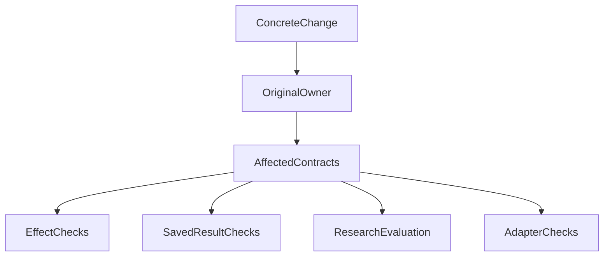

# What Should Stay Stable—and What Should Change—in an Agent Architecture?

*Rethinking module evolution after a real agent-runtime refactor*

> The companion retrospective, [Why Did One Subagent Change Hold Up Our Work for an Entire Day?](agent-runtime-refactor-one-day-blocked.md), records the concrete cost. Rather than repeat its timeline, this article asks what follows: who should maintain each kind of complexity, and how should it change?

## 1. Many modules, but difficult upgrades

While developing ETF Agent's subtask capabilities, we found that changing a handoff rule often required simultaneous edits to recovery encoding/decoding, the in-memory store, and the database store. Changes to user Memory could pull in the Runtime Factory and shared execution state as well.

The October 25, 2026 review counted **130 TypeScript files and 57,786 physical lines** in Research Runtime, including a **5,247-line** recovery codec. Those figures include comments and blank lines. They were navigation signals; the real issue was several places independently interpreting the same rule.

We began returning Child domain rules to their responsible module, encapsulating mutable state within the capability that owned it, and restoring the Factory's assembly role. Here, an Owner is the module responsible for a fact or effect—not an additional manager above the modules.

That addresses the first question: **who should maintain the complexity?**

Even with clear responsibilities, an evolution strategy does not appear automatically. Should permissions, reports, research methods, and model providers all carry the same stability requirements?

That question prompted the next architecture discussion.

## 2. Core business value does not mean code that should rarely change

We initially considered dividing capabilities into core, peripheral, and financial groups, then assigning maintenance requirements to each.

Contradictions appeared quickly.

Financial research is the product's core value, yet expert prompts, research routes, and report structures need frequent improvement. A model gateway is generic infrastructure, but physical request identity, usage accounting, and execution receipts must remain trustworthy.

Memory makes the distinction especially clear: its retrieval algorithm can change, but an already committed forget request must not stop taking effect after an upgrade. The stability requirements differ inside one module.

“Change core modules cautiously; change peripheral modules freely” is therefore too coarse to guide a particular edit.

**Business value explains why a capability exists. Stability requirements identify which outward commitments must continue to hold.**

We later organized the then-current 43 capability Owners into seven maintenance areas. Those areas help people find code; they are not seven stability levels. Financial calculations do not become less important because of their area, and frequently changing orchestration does not earn an authorization exception.

The useful unit of classification is a specific interface or effect, not an entire directory.

## 3. Four evolution contracts—not four grades of quality

An interface includes more than parameter and return types. It also includes the identities, ordering requirements, failure semantics, and storage rules callers rely on. We grouped those commitments into four categories:

| Contract | What must remain trustworthy | What may evolve |
| --- | --- | --- |
| **Protected effect** | Permissions, execution identity, idempotency, confirmation, and actual receipts | The implementation can be rewritten while preserving effective protections and effect meaning |
| **Durable outcome** | The identity and historical meaning of reports, citations, and calculated results | Presentation and read implementations may change under existing retention, deletion, and forgetting rules |
| **Evolving behavior** | Accountability for research quality, rather than frozen prompt bytes | Research routes, prompts, retrieval ranking, and summarization can be tested and versioned |
| **Replaceable Adapter** | Internal contracts, source representation, and failure semantics | Providers, parsers, and external integrations can be replaced |

These categories are not ranked from highest to lowest reliability. Rapidly evolving research methods do not make research quality optional. Replaceable adapters do not get weaker rules for private data.

One edit can affect several categories. Changing a summarization strategy primarily changes behavior. If it also drops source identity or reintroduces forgotten material, it touches a protected effect too.

Classification clarifies impact; it does not excuse the change from scrutiny.

## 4. Subagents: change the research method without redesigning execution

Subtasks were the most direct source of this discussion.

Suppose a fund-research child is reading sources when the user adds a requirement. A partial result from the previous request returns afterward. The system must establish whether the reply was accepted, which task owns the result, whether cancellation occurred, and whether the handoff is duplicate or stale.

Those are execution contracts. The first refactor slice separated accepted human-response facts, Child handoff decisions, and transactional Store commits under their existing owners. Both storage implementations consume the same rule. The database still reads facts, plans, and commits under its original locks and transaction.

That path had a bounded first implementation and targeted verification, while complete recovery and historical-reader disposition remained unfinished at the time.

Now consider a different request: add an expert focused on overlapping fund holdings, or improve how bullish and bearish views challenge each other.

What the expert asks, what it reads first, and how it compares evidence are evolving research methods. **Provided the handoff data contract is unchanged and no durable fact is added, improving the method should not require both stores to reinterpret expert behavior.**

A new structured handoff field or recovery meaning may legitimately require coordinated foundation changes. We want fewer unrelated edits, not a promise that every upgrade touches one file.

That is the link between the two efforts: the ownership refactor concentrates change within the original owner; the evolution contract says what that change must preserve.

## 5. Memory: separate algorithm changes from forgetting protection

ETF Agent's Memory covers retrieval, summarization, user scope, record revisions, temporary mode, and forgetting. They belong near the same capability, but are not all the same kind of responsibility.

On October 25, the project independently addressed a gap through which forgotten content could be disclosed through a later request's context. That repair was kept separate from Memory's structural extraction; it was not treated as an assertion to relax for refactoring convenience.

The reason is practical. After a delete or forget effect commits, old indexes, caches, and history projections can still provide paths back into model input. The protected property is the material's eligibility, not a particular cache implementation.

At the same time, keyword, vector, or hybrid ranking can improve, as can the choice of useful summary length.

Structurally, Memory should manage per-research reads, caches, references, and usage deduplication. The Factory should assemble its necessary dependencies. Changing the ranker then need not expose new cache fields to callers.

Contractually, the original Run authorization lifetime, account isolation, and committed forgetting effects remain in force. **Changing an algorithm does not authorize broader disclosure, and does not require inventing a separate mid-Run revocation mechanism.**

That is how one module can combine fast-changing behavior with strict protection.

## 6. Financial research: innovate in methods, not silently in denominators

Finance makes “core code should rarely change” sound appealing. Yet core research capabilities need continuing improvement. What must remain explicit is the meaning of particular calculations and results.

Consider a synthetic example, unrelated to any real portfolio. The portfolio's net gain is **CNY 100,000**. Asset A contributes **CNY 150,000**, and asset B contributes **CNY −50,000**.

Using net gain as the denominator, A contributes **150%** and B **−50%**. Together they still total **100%**.

If a report generator decides that anything above 100% must be wrong and silently changes the denominator to total positive gains, the numbers may look more intuitive—but they answer a different question.

Our financial-research contract explicitly preserves the denominator, units, method version, input dependencies, and coverage. The original domain method owns the calculation convention. The model explains it; generating another formula does not make the model a second calculation authority.

Improved explanations and new risk methods can therefore continue. A formula or denominator change needs an explicit new method/result binding. Reopening an old report should not silently recompute it into a new conclusion.

Preserving historical meaning also does not imply retaining all data forever. Retention periods, deletion, and forgetting continue to follow their own contracts.

## 7. Replace the technology without resetting execution facts

Model providers, web retrieval, and PDF parsing involve real external differences. An adapter can hide those differences behind a stable internal interface.

Replacing an implementation still requires more than changing one function call.

In provider failover design, we found that differently named models could share the same service endpoint. Switching between them during an endpoint failure might provide no independent availability.

Moving to an independent provider also requires establishing whether it may receive private material in the current request. Settlement of already dispatched requests, budget held for unknown costs, and which attempt owns each receipt cannot reset when the route changes.

A replaceable implementation and protected execution facts coexist here. The Adapter translates external differences; it does not take ownership of authorization and accounting.

We therefore prefer assembly at startup or binding a new method version to new research and new subtasks. Hot replacement during active work requires additional evidence about versioning and in-flight work. Calling something a plugin does not establish those properties.

Without a second real implementation or a concrete replacement need, an elaborate plugin lifecycle for every internal function is unnecessary.

## 8. Turn classification into edits using the existing review

If classification remains a diagram, development will fall back to either “test everything whenever anything changes” or “peripheral code is safe to change freely.”

We instead want the existing design review to state what the actual change affects:

| Concrete request | Main change | Commitments preserved | Useful verification |
| --- | --- | --- | --- |
| Update a fund expert's research method | Evolving behavior | Existing authorization and handoff contract | Real consumer path; representative research and review when claiming quality gains |
| Change partial-result handoff rules | Protected effect | Original task identity and transactional atomicity | Valid commits, duplicates, stale input, cancellation, and affected races |
| Replace memory retrieval ranking | Evolving behavior / Adapter | User isolation and post-forget disclosure eligibility | Ranking behavior plus data protection in the actual input path |
| Change a return-calculation convention | Calculation rule and durable outcome | Units, denominator, version, and historical results | Independent expected values, new result identity, and old-report readback |

These are examples of different edits, not a mandatory approval form. Cross-category changes cover the effects they actually touch. A local implementation adjustment does not need a new test suite for every category.

The diagram describes review reasoning, not a new execution pipeline. Several verification branches may apply, or only one. Scope follows actual impact rather than the module's directory.

## 9. Recovery is an application, not the entire principle

Differentiated contracts also changed how we discussed recovery. Reliable preservation of committed outcomes does not automatically require every ordinary research task to reconstruct its complete execution state across versions.

The later light-recovery design proposed honest interruption for an ordinary old task under existing safeguards, followed by explicit continuation in a new task using bounded, still-permitted saved work. State still consumed by human-interaction or Child wakes, unknown external effects, and actual receipts remains protected.

That is a scenario-specific choice to narrow executable promises—not a general reduction in reliability. The design discussed here was still being implemented in stages and does not establish completed delivery.

If in-place continuation is essential to a product, it should bear the corresponding versioning and recovery cost. The four categories make the choice explicit; they do not prescribe light recovery for every system.

## 10. Clear responsibilities and clear ways to change

The two efforts address consecutive questions.

**First: who owns the rules and state?** Consolidated responsibility, private state, and narrower interfaces make change more local.

**Second: what do those interfaces promise?** Protect effects and historical outcomes while allowing research methods and technical implementations appropriate freedom to evolve.

Doing only the first can produce an orderly but inflexible system. Doing only the second, without encapsulation and real-consumer constraints, can leave classification as a paper exercise.

The goal is neither identical change rates for every module nor a ranking of modules by importance.

**Specific commitments should remain stable; implementations and methods should remain open to change. Good architecture allows both.**

---

*Engineering scope: this article draws on ETF Agent's October 2026 ownership refactor, domain specifications, and differentiated-evolution RFC. It distinguishes recorded problems, first-batch implementation, and design direction. The four contracts are not four new modules and do not claim complete refactoring or live-model quality acceptance. Quantified maintenance-cost improvements have not been collected.*

## Further reading

[Why Did One Subagent Change Hold Up Our Work for an Entire Day?](agent-runtime-refactor-one-day-blocked.md) provides the full incident context. [Code Is Cheaper; Why Are Systems Harder to Evolve?](code-cheaper-systems-harder-to-evolve.md) examines the long-term costs of adding, replacing, and retiring capabilities.

This article is part of [ETF Agent Engineering Notes](https://hpoenixf.com/eff-agent-article/en/articles/agent-differentiated-evolution-contracts). If these architectural tradeoffs are useful, consider starring the [public article repository](https://github.com/hpoenixf/eff-agent-article).

These four categories belong to [On-Demand Method 7: differentiate interface stability and evolution](/en/principles#method-7), not a new tenth core principle.
