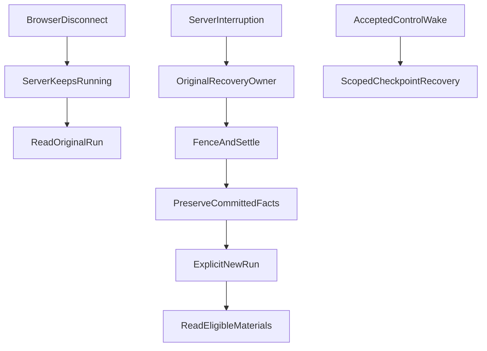

# A Disconnected Browser Is Not a Crashed Agent: Why Recovery Need Not Rebuild the Execution Graph

**The essential promise of long-running research is not that every failure resumes at the same model step. It is that closing a browser does not mistakenly stop an active task, effects that already happened are not repeated, and saved facts remain safely reusable.** When a product permits some uncommitted progress to be lost, permanently reconstructing the original execution graph may be a much stronger—and more expensive—promise than users need.

This distinction emerged as ETF Agent narrowed its recovery contract. We already had background research, durable state, browser reconnection, Subagents, and human interaction. Yet “recovery” had come to cover three different activities: reopening a page, rebuilding an interrupted Root Run after a process stops, and explicitly continuing unfinished research. They may use the same saved material, but they do not have the same execution authority.

## 1. Which Connection Actually Disconnected?

Imagine a user asks: “Compare the underlying holdings of these two funds, verify the disclosure date, and identify any gaps in coverage.” Main has read some evidence; a Child is still processing a PDF when the user closes their phone browser.

**A closed browser is not a terminated server-side Run.** If the server is still running and the original grant and resource constraints remain valid, the original Run can continue in the background. Reconnecting only reads previously committed answer text, events, and progress; it should not call the model again merely to reconstruct the display.

A stopped server process is different. The database may retain ModelTurn, Tool, Child, and wait receipts without retaining the entire live set of executing objects. Being able to read those facts does not prove the original concurrent graph can be safely recreated.

| Situation | Expected behavior | What must not happen |
| --- | --- | --- |
| Only the browser disconnects; server execution continues | Original Run continues; reconnection replays stored records | Generate a fresh model answer merely to restore the UI |
| The server stops and ordinary Root re-entry has no accepted control wake | Original Recovery safely settles and preserves committed material | Replay the old Root/Child graph without authority |
| An authorized Human/Child control wake exists | Continue through the original limited checkpoint and fence | Treat the existence of a saved Run as a wake grant |
| User explicitly asks to resume research | Admit a new Run that can read still-eligible saved material | Transfer the old Run's execution grant or remaining budget |

A *Run* is one attempt to answer a user message. Its *execution graph* consists of internal model requests, tool actions, Children, and waiting relationships. The history of the Run can persist even when its entire execution graph is no longer reconstructable.

## 2. Why the Older Recovery Design Was Reasonable—and Why We Reduced the Promise

Our earlier approach tried to retain internal cursors and checkpoints so that a restarted process could reconstruct pending execution and continue the original model turn. This was reasonable: avoid discarding expensive research, make users repeat fewer questions, and reconnect legitimate human replies to the correct task.

But Child collaboration, Peer interactions, human safe points, tool-schema versions, and concurrent requests expanded the scope of that promise. Reconstructing a cursor might also require the original tool catalog, expert-method version, authorization, unresolved external effects, waiting partners, and historical executable format. Recreating an object graph is not sufficient if no one can determine whether a previously dispatched request already took effect.

The decision was not that checkpoints are useless. It was a product trade-off: **after a server crash, some uncommitted progress may be lost; committed evidence and outcomes remain; the user may start a new Run to continue.** Same-process background execution and legitimately parked Human/Child work remain supported.

This is deliberately a narrower promise than a general durable-workflow engine. For comparison, [Temporal's workflow execution documentation](https://docs.temporal.io/workflow-execution) describes recovery based on persistent event history and replay semantics. ETF Agent is not claiming Temporal-equivalent replay. It instead reduces reconstruction obligations to match the original recorded effects and the amount of progress loss the product accepts.

## 3. Stop Rebuilding the Graph, Not Preserving Its Effects

An interrupted Run contains at least three different kinds of facts.

First are **committed effects**: original tool receipts, source-bound research material, published answer passages, or artifacts. Second are **uncertain effects**: a provider request might have been dispatched before the transport was interrupted, so the result or charge is not known. Third is **execution position**: the next step the original model intended to take.

Under this contract, the third may be abandoned. The first two must not be silently rewritten.

When ordinary cold Root re-entry has no accepted control wake, the recovery entry no longer blindly reconstructs the old model loop. It uses the original Store and Recovery owners to check the lease and fencing identity, then leaves settlement to the original termination owner. Eligible published text may be preserved as partial work. A few tool log entries cannot by themselves justify a claim of completion. Showing an old answer does not authorize another external dispatch.

The diagram shows **three distinct entry paths**, not one automatic sequence. Reconnection is read-only; ordinary interruption needs settlement by the original owner; an authorized control wake uses its existing constrained recovery path.

Why insist on a *fence*? An executor missing from a local in-memory map might still be alive and capable of writing late results. Another executor cannot take over terminal authority, clear resource usage, or replace committed text merely because it cannot see that process. Durable execution identity, original leases, cancellation receipts, and transactional rules determine which writer still has authority.

Most importantly, a missing acknowledgment is not proof of non-execution. When an external request may have been dispatched, uncertain costs and effects remain unknown—not assumed to be zero, refunded, or automatically repeated. This design does not claim end-to-end exactly-once behavior across external providers and local storage.

## 4. Continue the Research by Reusing Evidence, Not Execution Authority

After a Run is honestly settled as interrupted, what can a new Run inherit when the user chooses Continue?

It may reuse data that an original owner retained and the current user is still permitted to read: previous report passages, source observations, qualified result references, explicit computation inputs and outputs, and unresolved research questions. The **new Run has its own admission**. It does not inherit the old model-request identity, lease, unspent execution budget, or pending tool proposals.

Consider this constructed example:

1. Run A reads a fund's disclosed holdings, including the disclosure date and coverage scope, and saves an authorized computation result. The process then stops. The saved conclusions remain, but coverage for a second fund is unresolved.
2. When the user reopens the conversation, the UI shows the original settlement and previously saved partial answer. It does not fetch the first fund again just to display History.
3. The user explicitly creates Run B to continue. The system passes along still-eligible evidence, computation identity, method, and the unresolved coverage question. Main can check the second fund's latest disclosure and decide whether any recomputation is needed.

**Reusing computation is not the same as certifying that an old conclusion remains current.** Disclosure dates, coverage denominators, calculation windows, source eligibility, and later corrections still matter. Revoked materials cannot become readable again merely because they appear in an old summary. A model's prior belief that the problem was solved remains a historical assessment, not investment truth.

A separate bounded engineering qualification crossed actual Tool, containerized Python, ResultRef, and PostgreSQL Human-safe-point seams. A second operating-system process read the original stored results without rerunning the completed source or calculation. That establishes one meaningful **cross-process consumption path**, not lossless recovery after every possible crash or sound live-model financial advice.

## 5. Keep Legitimate Wakes Instead of Deleting Every Checkpoint

An easy mistake is to conclude that abandoning ordinary Root graph reconstruction means all checkpoints and wake mechanisms should be removed.

But a Child may already have submitted partial results, or a real user may have answered a question while a task was parked at a legitimate safe point. Such work has a separate, limited continuation contract.

We therefore distinguish **ordinary cold Root re-entry**, which carries no implied authority to execute, from **a Human/Child wake accepted by the original control owner**, which may continue using a bounded current-format checkpoint, original sealed request identity, fence, and remaining resources. An old database record is not a wake permission; a genuine wake does not authorize arbitrary replay of every historical execution format.

Likewise, a record that a physical model request ended is not proof that its result was usable or that more work is permitted. The original owners decide what was committed and which transitions remain legal. Uncertainty stays uncertain; one unrecoverable stage must not erase valid earlier publications.

The result is a smaller but more demanding recovery contract: preserve the currently needed safe points and test their real consumers, instead of keeping an ever-growing historical execution graph indefinitely replayable.

## 6. Verify Preserved Facts, Not the Appearance of a Reconstructed Graph

The strongest engineering checks now ask whether ordinary cold re-entry avoided a second external dispatch; whether a stale executor was prevented from rewriting settlement; whether original answer passages, result references, and unknown usage survived; whether explicit continuation could read eligible material; and whether lawful Human/Child wakes were still supported.

Those behavior paths have scoped tests and independent observations through original production seams. **As of October 27, 2026**, parts of this narrower contract were already reflected in main implementation and accepted requirements, but the separate interrupted-continuation change did not thereby have a verified full formal close. Nor do these controlled observations prove lossless real-model recovery in production.

Not every application should choose this contract. If a business operation must execute precisely once, must survive any restart, or must be resumed without permitted loss, it needs correspondingly durable orchestration and external-effect protocols. For exploratory research that tolerates bounded lost progress, preserving original results and explicitly starting a new Run can be the more useful promise.

## Conclusion: Preserve Truth, Not the Illusion of Continuous Execution

Where to continue is not merely a cursor-design question. It is a product promise and an allocation of authority.

We preserve background work when only the browser disconnects, constrained legitimate Human/Child continuation, and already committed source, computation, and publication facts. What we give up is **pretending that reconstructing an old graph is safe when we do not know whether its earlier effects happened**.

When designing research recovery, write down three promises separately: what browser reconnection reads, what a server crash preserves, and what a new Run may lawfully reuse. Pay for full execution-graph replay only when the product actually needs that stronger guarantee.

---

## Further Reading

[Async research delivery](agent-asynchronous-research-time-bound-delivery.md) concerns time-based user notifications; [Run termination authority](agent-veto-authority-and-run-termination.md) concerns local refusal and settlement; [externalized tool results](tool-results-outside-model-context.md) concerns result projection and later model consumption. They are related problems, not reasons to create a universal Recovery Manager.

[ETF Agent engineering notes on GitHub](https://github.com/hpoenixf/eff-agent-article) (Stars and discussion welcome).
