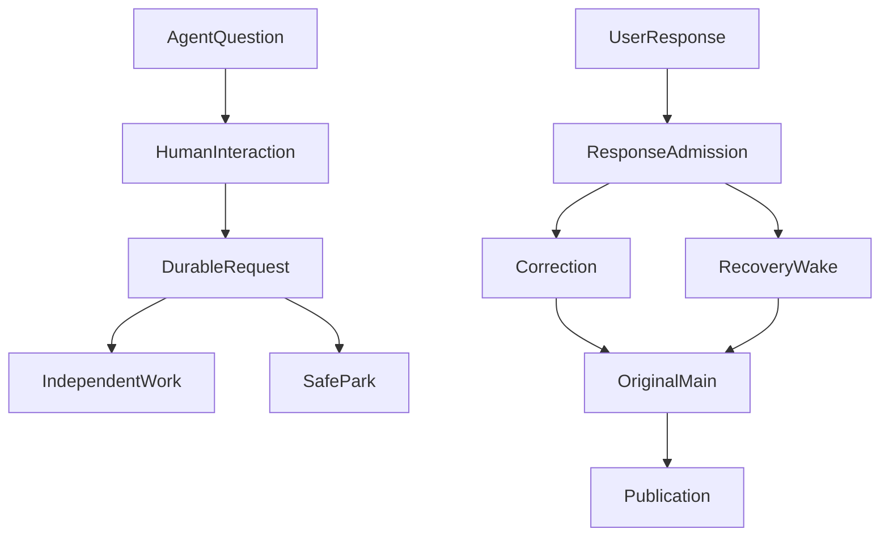

# After an Agent Asks the User: Returning a Durable Human Response to the Original Research

A research agent is writing a fund-risk report. It has already read a portfolio summary and relevant fund disclosures, but one analytical choice is missing: “Which benchmark should I use?” The agent can continue preparing the material it already has while asking the user. The user may be in a meeting and respond hours later. By then, the browser may have closed and the service may have restarted.

The difficult part is not rendering a confirmation dialog. It is proving that **after the system receives a reply, the original research that needed it actually consumes that reply**. Worse, “I agree” could answer an ordinary question or approve a protected operation. Reducing both to one Boolean would destroy the system’s ability to account for what happened.

Using a long-running research agent as an example, this article explains how durable human-in-the-loop (HIL) interaction supports non-blocking questions, precisely bound replies, same-run recovery, and scoped approvals. Every sample input below is synthetic; none represents a real account or portfolio.

## 1. Four Moments That Must Not Collapse into One

A conventional chat interface often combines “the question was sent,” “the user saw it,” “the user answered,” and “the research adopted the answer” into one completed status. Each is a separate fact with its own failure modes.

| Fact | What establishes it | What it does not establish |
| --- | --- | --- |
| Request accepted | The server commits an interaction request with identity and revision | The user has seen the question |
| Response received | The authenticated user's original response is durably accepted | A model has used the response |
| Response adopted | The original Correction, Child, or Effect consumer commits its adoption receipt | A business effect was executed |
| Effect committed | The original business Owner records the actual authorized effect | The model's next answer is necessarily correct |

We therefore did not give a mutable `resolved=true` field the job of representing every phase. The Human Interaction Owner (HIO) admits and routes interactions. Conversation owns the original user text; Recovery owns the checkpoint for the original run; Authorization owns the grant; Effect owns the protected operation; and Publication continues to own the answer body.

This split adds a small number of identity fields, but avoids another model loop, authorization ledger, or publication state machine. When the interface says “Response received,” it promises only that the response was saved—not that research has already resumed.

## 2. Asking a Question Does Not Necessarily Stop Research

The easiest implementation makes `ask_user` terminate the model turn. That may work for a short question-and-answer exchange, but a long research job often has independent work left to do. Our interaction contract therefore distinguishes two modes.

**Non-blocking** is the default. Once the request is accepted, the system returns a stable interactionRef, and Main may continue other authorized reading, computation, and partial publication. The reply later reaches Main through the original Correction seam at a safe point. Asking a question does not, by itself, stop the run.

**Blocking** expresses the model’s judgment that no independent work can currently progress. It is only a proposal. Original Recovery must still check settled answer blocks, outstanding Child/Hook/tool effects, cancellation, and lease/fence before parking the same nonterminal Run safely. Parking does not trigger a normal completion hook or create a second Run.



These are alternative paths, not actions that always happen together. Research proceeds while independent work exists; SafePark is used only when a genuine human wait is necessary. One Root has at most one actual human parking point. Expiry, Stop, and existing resource constraints remain effective. Waiting does not reset model request usage, costs, or the user’s hard deadline. Automatically executing Scheduled Tasks do not enter human waits.

## 3. Identity Determines Which Question Was Answered

Suppose an original research request has two missing conditions. The user opens one question in a global inbox while viewing another conversation. If the backend matches the reply against “the latest message,” or guesses from similar wording, the reply can land in another Run—or accidentally approve another operation.

An interaction request binds at least its producer/action, Root Run, conversation, recipient account, request revision, expiry, and response contract. A reply adds the exact request revision, authenticated actor, stable clientResponseId, and **unaltered original content**. The user cannot rewrite the interaction kind, scope, or owning business consumer.

This is a conceptual handoff format, **not a public HTTP API**:

```json
{
  "interactionRef": "human-question-example",
  "requestRevision": 2,
  "runRef": "research-run-example",
  "mode": "non_blocking",
  "question": "Which benchmark should this risk report use?",
  "response": {
    "clientResponseId": "reply-example-01",
    "text": "Use the CSI 300 Index as the benchmark"
  },
  "receipt": "response_received",
  "adoption": "pending"
}
```

Retrying the same reply ID with the same content returns the existing receipt. Reusing the ID with different content is a conflict. A different account, expired request, or older revision cannot acquire admission merely because a card was visible in the browser. If model capacity is unavailable after the reply is saved, the system preserves the truth: “Received, waiting to continue.” It does not discard the reply or redispatch research prematurely.

**A terminal Run requires a different path.** A late reply is saved first. If the original continuation contract permits it, the user explicitly confirms “Continue analysis,” and Continue creates a linked new Run. The server must not silently turn a terminal Run back into a running one. Stop and invalidated effects do not revive automatically when someone replies.

## 4. The Last Handoff Is Harder Than Admission

Engineering acceptance uncovered two subtler errors.

**First, equivalent parsed objects are not necessarily identical original bytes.** PostgreSQL JSONB preserves object values, not the original ordering of stdin bytes. A recovered command that requires exact sealed input cannot reserialize a stored object and claim to possess the old byte identity. It needs proof against the original sealed preview, not a newly constructed equivalent object.

**Second, a safe point can commit without the continuation cursor advancing.** If the reply is adopted at a safe point but the cursor still points to an older Main request, recovery can reuse obsolete input. Correct recovery identifies the precise latest Main request/seal. A later Child receipt cannot hide that identity. Authorized publication must also settle along the original Publication path before the recovery barrier is crossed.

Child consultation has an especially easy-to-miss distinction: a summary of the user's answer inside Main is not proof that the original Child received the user's words. If Child is the actual consumer, its own user message must contain the reply bound to the original request, and its original Child Control resumes it. An already cancelled or terminal Child cannot be awakened by an old reply.

Tests therefore need to inspect **the next real model input and the actual consumer**, and verify that old operations were not dispatched twice. A test that checks only “HTTP reply accepted,” “one model call,” or “Run completed” misses the causal handoff.

### The Public Slice: Return One Ordinary Reply to Its Original Call

The [fixed public v0.13.0 implementation of Open ETF Agent](https://github.com/hpoenixf/open-etf-agent/tree/300f78f7066ab76fcc4e9efb54137ff021ecc278) keeps the smallest useful handoff: `ask_response` asks one question, Session persists its identity and releases the execution lease, another process receives a reply, and an explicit `resume` lets the original Run adopt it. This does not reproduce the full non-blocking HIO, Human Park, approvals or cross-account inbox described above. Receiving a reply does not automatically start research.

The synthetic example asks which label the report should preserve verbatim. Use Node 26.8.1–26.x (the recorded example ran on 26.11.1). After installing dependencies as described in [that fixed version’s README](https://github.com/hpoenixf/open-etf-agent/blob/300f78f7066ab76fcc4e9efb54137ff021ecc278/README.md), use a new local directory:

```bash
npm run session -- start --session runs/article-reply --case durable-response
# Replace the placeholders with the original runId and questionId printed above
npm run session -- question --session runs/article-reply --run RUN_ID --question QUESTION_ID
npm run session -- respond --session runs/article-reply --run RUN_ID --question QUESTION_ID --response reply-1 --text 'Synthetic label: blue'
npm run session -- resume --session runs/article-reply --run RUN_ID
npm run session -- response-status --session runs/article-reply --run RUN_ID
```

The first command returns `awaiting-response`: the question is saved and the execution process can exit. `respond` records only the original reply, yielding `received-not-adopted`. The reply becomes the original `ask_response` tool result only when the original Run's `resume` claims the lease, validates the original checkpoint and commits adoption. The example's next actual Gateway input and final report preserve `Synthetic label: blue`. The report uses the existing file-delivery path; the completed result's `directory` and report receipt locate the original file.

A counterexample makes the boundary useful: if the process exits after adoption and after reserving the next model request, recovery may return `MODEL_OUTCOME_UNKNOWN` rather than dispatching that request again. Saving the answer does not guarantee that research finishes; an unknown outcome does not authorize automatic retry.

This slice supports one ordinary question and one accepted reply per Run. Complete the interaction within the original 300-second deadline; waiting resets neither budgets nor the deadline. The same reply ID and original content return the existing receipt, while conflicting content cannot overwrite it. A reply is untrusted input, not a permission grant or Memory write intent. The Gateway is scripted; SQLite handoff, separate processes and original-file reads really execute, without establishing whether a real model asks appropriate questions.

The explicit response profile uses Session v3, while default profiles remain v2; there is no in-place migration. Finish active old Runs in their original fixed version. Local Session write access is the trust boundary here, not internet authentication.

Compare the [reply contract](https://github.com/hpoenixf/open-etf-agent/blob/300f78f7066ab76fcc4e9efb54137ff021ecc278/src/human-response.mjs), [CLI](https://github.com/hpoenixf/open-etf-agent/blob/300f78f7066ab76fcc4e9efb54137ff021ecc278/src/session-cli.mjs) and [original-call adoption tests](https://github.com/hpoenixf/open-etf-agent/blob/300f78f7066ab76fcc4e9efb54137ff021ecc278/test/ordinary-response.test.mjs). The [current main README](https://github.com/hpoenixf/open-etf-agent/blob/main/README.md) remains the ongoing entry point.

## 5. Questions, Approvals, and Permission Requests Are Different

“Use the CSI 300 as the benchmark” is research input. “Allow this private document to be read” is a permission request. “Approve sharing this particular artifact with this recipient” is an operation approval. They can use the same durable inbox, but their effects belong to different original Owners.

For a Permission Request, Authorization first establishes whether a scope is legally and technically requestable. HIO receives typed consent, and original Authorization checks the grant ceiling and current prerequisites before any permission is appended. A free-form “yes” in conversation is not a grant. Previously recorded Run grants persist across the same Run/recover; new permissions still require their own legitimate receipts.

For Effect Approval, consent must bind the original operation, final parameters, and preview revision. The user approves the operation they actually reviewed. New parameters require a new proposal. An effect whose dispatch is uncertain cannot be safely replayed by clicking Approve again. Arbitrary script closures with no recoverable identity cannot become cross-process approvals by changing their UI.

A Child may raise an input gap, while Main decides whether it can answer independently, consolidate ordinary questions, or ask the user. Precise approval for a protected Effect cannot be merged semantically into a generic “approve everything.” HIO centralizes **interaction identity and handoff**, not business effects.

## 6. Three Failure Paths Worth Keeping Visible

| Scenario | Correct behavior | Failure to avoid |
| --- | --- | --- |
| Browser closes; user returns later | Read the original question and reply entry from the authenticated durable inbox | Depending on the original SSE stream or an in-memory Promise |
| Reply is saved after the original Run terminates | Preserve it and request explicit Continue confirmation | Reviving the old Run or silently inheriting obsolete authorization |
| Effect was dispatched but its outcome is unknown | Retain unknown until the original Effect Owner reconciles it | Treating renewed approval as a safe retry |

Human participation is therefore not a single synchronous blocking call. It is a durable, bounded, two-way handoff inserted into the original task. When the existing Owners keep control of their effects, new interaction types need not generate another central state machine.

## Results and Current Limits

As of **October 24, 2026**, ETF Agent’s HIO Stages A–D completed their stated local provider-free formal close and archive. The covered mechanisms include blocking and non-blocking Main questions, cross-conversation inboxes, duplicate-response handling, Effect Approval, Permission Request, Child original-text handoff, and scoped recovery tests with PostgreSQL, separate OS processes, and authenticated browsers. Production Human Park remains **disabled by default**.

Those engineering results do **not** prove that a real model asks the right question at the right time, that users prefer its questions, or that the system meets long-term production reliability targets.

The main lesson is simple: **receiving a reply begins a handoff; adoption by the precise original consumer completes it**. A new interaction module should own only the facts necessary for that handoff, while the original business Owner keeps authority over the actual effect.

### October 26, 2026: HIO and Runtime Ownership

A scoped Runtime refactor now consolidates **how an admitted human reply affects a Child's phase** under the original Child/HIO Owner. Memory and PostgreSQL adapters must consume the same transition plan inside their original transaction safeguards. This grants HIO no new Publication, Authorization or whole-Run termination power. The first slice has bounded evidence; broader duplicate, cancel, stale-fence and cross-process recovery coverage and removal of repeated decisions remain open.

A37's earlier local close does not enable production Human Park or certify live-model questioning quality. An accepted reply must still reach the original consumer; a merely received answer cannot be labeled adopted without that fact.

## Further Reading

[Concurrent front-end chat and background research](https://hpoenixf.com/eff-agent-article/en/articles/agent-background-research-collaborative-experience) explains why chat need not block on a long task. [Time-bound asynchronous delivery](https://hpoenixf.com/eff-agent-article/en/articles/agent-asynchronous-research-time-bound-delivery) examines delivery promises and saved results. They can cooperate with human replies, but have different Owners.

More case studies are published in [ETF Agent Engineering Notes](https://github.com/hpoenixf/eff-agent-article). A Star is welcome if the material helps.
