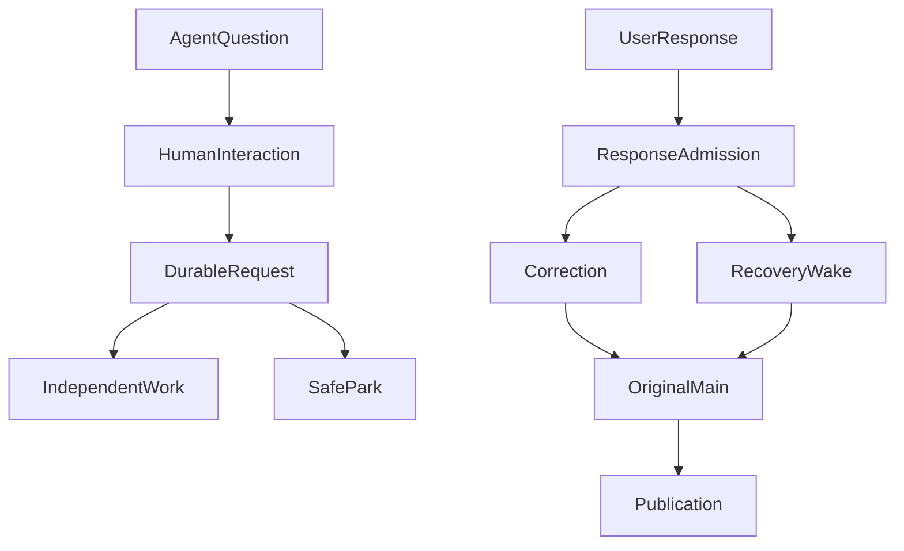

# After an Agent Asks the User: Returning a Durable Human Response to the Original Research

A fund-risk report has collected the relevant disclosures but still lacks a comparison benchmark. After asking the user, should the agent stop or keep working?

It depends on the next operation. Checking fund fees and disclosure dates does not require the benchmark. Computing relative returns and assessing relative risk does. Stopping everything wastes work that could proceed in parallel. Asking the question while silently calculating against an assumed benchmark creates rework and may turn a guess into a conclusion.

**Human interaction starts with dependencies, then messaging: continue work that does not depend on the answer, wait where it does, and return the reply to the original execution point.** This article follows that research task through mode selection, execution handoff, response adoption and recovery. The first part discusses ETF Agent's full HIO mechanism. The later section shows the ordinary-response path currently available in public Open ETF Agent. Their scopes differ.

<span id="_2-asking-a-question-does-not-necessarily-stop-research"></span>

## 1. Separate Work Dependencies Before Choosing Blocking

Here, blocking and non-blocking describe **how the original research waits for an answer**. They do not describe whether an HTTP request is asynchronous or whether the browser's input box remains usable. Both modes can persist a question and let the user return after closing the page.

| Decision | Non-blocking: ask and continue | Blocking: request a wait |
| --- | --- | --- |
| Useful work remaining | Authorized work independent of the answer | All useful next work depends on the answer |
| Original research | Continue reading, computing or delivering established parts | Park the original Run when enabled and safety checks pass |
| Incoming reply | Reach a later Main request through a correction safe point | Wake through recovery, then enter the original task |
| No reply arrives | May finish with the gap stated explicitly | Remain subject to wait expiry, Stop and the original budget |

For the fund report, the agent can check fees, size and disclosure dates while leaving the relative comparison open. That fits non-blocking. If the only requested output is excess return against a specified benchmark, and neither the benchmark nor the period is known, further model calls do not create the missing input. Blocking is more useful.

The important distinction is that **one operation needing to wait does not necessarily require the entire Run to stop**. If reading portfolio details requires additional permission, that analysis must wait, but public-disclosure research can continue. Marking a question non-blocking allows independent work to progress; it does not authorize dependent reads or external operations.

The model chooses a mode from task semantics. Runtime does not add another scoring system to decide whether a question is important enough. This leaves room for model planning while separating responsibilities: the model identifies missing information and useful work; deterministic code governs identity, permission, budgets and safe parking. This HIO path does not prove semantic dependencies between pieces of work, so the plan and final report must still be consistent about which work truly did not depend on the answer.

Non-blocking is a useful default for long research, but it has a cost. Some work may finish before a reply arrives. Later work can supplement or revise it, but cannot pretend the earlier work already used the answer. Blocking reduces that rework at the cost of waiting latency. Choose based on the cost of a wrong assumption and the amount of independent work, not a preference for asynchronous systems in the abstract.

## 2. How One Question Leads to Two Execution Paths

Both modes start at the same point. Main proposes a question. The Human Interaction Owner (HIO) validates its original request, persists a stable identity and returns an admission receipt. That receipt establishes that the question entered the system, not that the user saw or answered it.



Independent work and safe parking are alternative choices. A response also enters correction or recovery according to the original Run's actual state; it does not launch two Main executions.

### Non-blocking: persist the question and continue the original loop

After `ask_user` returns a stable interaction reference, Main continues its existing model-and-tool loop. An unanswered optional question does not automatically become a completion condition or force extra model calls to wait for an answer. The report can deliver established findings and identify the comparison that remains open.

When a reply arrives, admission first preserves its original text and association, then routes the handoff through the original Correction safe point. A non-blocking answer does not preempt and cancel independent reads already in progress. This gives an input change a verifiable execution boundary. An already dispatched request cannot be edited retroactively. Old proposals not yet dispatched can be superseded under the existing correction rules. The next eligible Main request includes the answer. A changed user condition therefore has a defined point of effect rather than silently replacing parameters in flight.

A controlled acceptance run exposed a concrete counterexample. With a real browser, authentication and PostgreSQL, but a scripted gateway, a reply to a non-blocking question caused general correction logic to cancel an active document read. The read left an unsettled invocation, the original task ended partial, and the answer was not adopted. The repair did not disable correction. It used the exact original question/response binding to defer only the preemption of independent reads, letting the read settle before Main adopted the answer at its safe point. Ordinary immediate corrections can still interrupt a read. **Supplying a missing answer and asking to change course immediately cannot share one ambiguous Continue signal.**

### Blocking: prove that parking is safe before releasing execution resources

The model's `blocking` choice is a request to wait. Before actual parking, Recovery must establish several facts:

- Is the latest Main request settled, and does the continuation cursor identify the same sealed input?
- Is delivered content durable, and are there unsettled tool or Hook effects?
- Have Children finished, or become quiescent at recoverable partial checkpoints?
- Do cancellation state, deadlines, lease and fence still permit this handoff?

Only then can the original Run enter nonterminal Human Park and release the execution resources that may be released. Its task identity, committed results, checkpoint and budget remain intact. Parking neither triggers the normal completion Hook nor creates another Run. A Child request still in flight or an effect with an unknown outcome cannot become safe merely because the model says it wants to wait for a person.

One Root supports at most one actual Human Park and multiple bounded non-blocking interactions. The wait deadline is the earliest of question expiry, the remaining cumulative human-wait allowance and the user hard deadline. Restarts and repeated questions do not refill the allowance. Once an answer arrives, time waiting for execution capacity cannot keep being credited as human waiting. Automatically executing Scheduled Tasks do not enter human waits. When required input is missing, they preserve independent research or reject the operation that depends on it.

Safe parking in full HIO has an implementation and controlled recovery evidence, but production Human Park is disabled by default. Product integration must check question admission separately from whether that deployment enables actual parking. A blocking receipt alone does not establish the latter.

<span id="_1-four-moments-that-must-not-collapse-into-one"></span>
<span id="_3-identity-determines-which-question-was-answered"></span>

## 3. Persist the Causal Link Between the Answer and Its Task

A chat history can preserve words without preserving which request they answered or who must consume them next. A user may have two research tasks open or answer an older question from a global inbox. Matching the latest message or guessing from similar wording cannot carry that handoff.

The request binds its producer/action, Root Run, conversation, recipient, type, revision and expiry. The response carries the exact request identity, authenticated actor, stable response ID and original content. The interface selects the original question; the server validates that association. The model does not need to guess again which question the reply probably answers.

Durable state must distinguish at least four facts:

| Fact | What the system can establish |
| --- | --- |
| Request accepted | The original question is saved and can be queried or shown again |
| Response received | The original answer is saved; a duplicate submission can return its existing receipt |
| Response adopted | The original consumer has incorporated the answer into its execution handoff |
| Effect committed | The approved operation has an execution result |

Evidence of adoption must come from the consumer. A running question in full HIO must connect to correction input in an actual Main request. The public ordinary-response path first commits the reply as the original `ask_response` tool-result checkpoint. Neither can label research as resumed merely because HTTP admission succeeded. Nor does showing the answer to the model establish that it understood the answer correctly.

This separation directly addresses retries. If a reply was saved but its network acknowledgement was lost, the same response ID and identical text should return the original receipt. Reusing the ID with changed text is a conflict. There is no need to ask again, and no permission to adopt twice. Original text remains in Conversation or Session. HIO stores associations and handoff evidence rather than duplicating model context and the execution ledger.

The frontend must also preserve the outcome of this particular submission, not merely poll task status. In the same controlled browser lane, two different answers were submitted concurrently. The backend correctly returned one 202 and one 409 and stored just one response. Yet polling erased the losing client’s conflict warning. Failed detail reconciliation could also allow another submission with a new response ID. The repair retained the frozen submission identity and conflict before reconciling the saved answer. Refreshing could no longer turn a conflict back into permission to resend. Admitting one answer and showing the user which answer was admitted are two separate acceptance goals.

Original bytes matter at a particular boundary. When recovering a protected command, JSON reserialized from a database may have equivalent values without being the exact input the user reviewed. Approval must match the original sealed preview's identity, not a newly reconstructed equivalent object. Keep that constraint at the command-and-effect boundary that needs it; an ordinary question need not inherit the entire approval protocol.

<span id="_4-the-last-handoff-is-harder-than-admission"></span>
<span id="_6-three-failure-paths-worth-keeping-visible"></span>

## 4. Route the Reply According to the Original Run's State

Response admission and resumed execution should be separate. A user can submit an answer without a model execution slot being available at that moment. After saving it, scheduling chooses a path from the original Run's actual state.

### Still running: enter the next safe point

Use the original Correction path instead of starting a concurrent Main. The next actual model input must include the original answer and connect to its adoption receipt. The most useful inspection is not the card's wording but whether the new input reached the intended request.

### Parked: acquire execution authority, then restore the checkpoint

Wake must reacquire the original class of execution capacity and a unique lease. If another task has occupied the released slot, preserve the answer as received and waiting to continue. Do not preempt that task or exceed capacity silently.

Once execution authority is acquired, recovery restores the latest eligible Main checkpoint, not the old process's memory stack. A syntactically valid cursor can still point to the request before the answer arrived. A later Child receipt must not hide the latest Main identity either. Recovery therefore checks the request, seal, cursor and committed publication together, avoiding redispatch under obsolete conditions.

<span id="october-26-2026-hio-and-runtime-ownership"></span>

When a question belongs to a Child, there is another handoff. Main can process the answer first, but the original text enters the Child's own input only when Main explicitly chooses to resume that Child with the bound response. Main's paraphrase cannot substitute for the user's words. When a response arrives alongside an original Child partial handoff without evidence or artifact references, Child/HIO checks the original request, response and phase together. Memory and PostgreSQL stores consume the same plan within their respective protected commit boundaries and recheck execution authority, avoiding different admission decisions.

Separately, Human Park safety checks allow a settled, recoverable Child partial to remain dormant while its Root parks. It does not wake the Child automatically. Main may decide that the Child is no longer needed, and an old reply cannot reactivate a cancelled or terminal Child.

### Terminal: save the answer and obtain explicit continuation intent

A terminal state is not a longer pause. For an ordinary question eligible under the original continuation rules, full HIO asks the user to choose Continue analysis. Continue then creates a linked new Run, while the existing report remains a result of the original execution. An already adopted reply cannot trigger continuation again, and expired permission or approval cannot revive through that route. Public v0.21 ordinary responses do not yet support terminal-run continuation.

All three paths rely on the same distinction: **continue from a known stopping point; preserve uncertainty when a request or effect may already have executed**. For example, the answer may have been adopted before the next model request was dispatched and its result lost. Having the answer on disk does not authorize another dispatch. Recovery must reconcile the original request instead of masking uncertainty with a replacement Run.

<span id="_5-questions-approvals-and-permission-requests-are-different"></span>

## 5. Waiting Mode and Authorization Type Are Separate Dimensions

Blocking versus non-blocking determines scheduling during ordinary questions. Ordinary questions, permission requests and operation approvals determine what a user's answer can change. Permission and approval follow their own contracts to block the relevant effects; they do not consequently support every combination of waiting mode. Confusing the two can turn “this question does not block research” into “this operation needs no approval.”

| Interaction | What the user decides | Where it takes effect |
| --- | --- | --- |
| Ordinary question | A research condition, such as the benchmark | The original Main or Child input |
| Permission Request | An additional permitted access scope | The original Authorization Run grant |
| Effect Approval | One operation with its final parameters | The original Effect confirmation and execution path |

In portfolio research, “Use the CSI 300” changes an analytical condition. “Allow this research to read portfolio details” changes available access. “Confirm the external operation in this preview” approves a defined action. Permission to read does not approve associated external operations, and approval of one action does not confer arbitrary future access or execution rights.

The current full-HIO permission entry point is `request_research_scopes`. Its requestable portfolio projections are limited to `anonymized_holdings_summary` and `portfolio_details`. Authorization first supplies the legitimate requestable scope. After the user confirms, it rechecks current policy, routing and ceilings before appending the original Run grant. This is not a general file or system-permission requester. A free-form conversational “yes” is not that typed confirmation.

Effect Approval instead binds the original Action, final-argument digest, preview and version. Materially changed parameters, recipients or previews require a new proposal for the changed operation. After approval, the original Effect module still records the execution result. If an external request was sent but its outcome is unknown, clicking Approve again does not make replay safe.

The useful shared HIO machinery is therefore request identity, inbox presentation, response admission and handoff. Authorization and effect decisions stay with their responsible modules. That lets the rest of research progress while the unapproved step actually remains stopped.

<span id="the-public-slice-return-one-ordinary-reply-to-its-original-call"></span>

## 6. Adopting the Public Implementation: Start with Sequential Questions

Open ETF Agent does not expose the entire full-HIO system. The [fixed v0.13 implementation](https://github.com/hpoenixf/open-etf-agent/tree/300f78f7066ab76fcc4e9efb54137ff021ecc278) established durable receipt and original-call adoption for one question. The [fixed public v0.21 source](https://github.com/hpoenixf/open-etf-agent/tree/427315b5554b1c9af8fa50b8ab622747045e691a) connects it to local research projects with a bounded sequence of questions.

Here, “fixed public source” means an inspectable candidate implementation with bounded qualification. The final package's original CI and formal tag/Release still require separate verification; a source commit is not proof of a completed release.

This follows the blocking side: `ask_response` persists a question and yields the Worker; after answering, the user explicitly runs the same task again. It is a practical starting point for making questions discoverable, answers precisely associated, and resumed execution actually consume them. Without independent background work to run concurrently, non-blocking correction and a cross-conversation inbox need not come first.

Follow the [fixed project guide](https://github.com/hpoenixf/open-etf-agent/blob/427315b5554b1c9af8fa50b8ab622747045e691a/docs/research-project.md) to create the project, import selected material and approve the provider, data and cost. Keep `report`, enable `response`, and explicitly add this project configuration:

```json
"interaction": {"schemaVersion":"human-interaction@1","maxQuestions":3}
```

The limit can be 1–8. Old projects without interaction configuration retain their single-question contract. Updating configuration affects future tasks only. When a task reaches a question, use the [ordinary-response commands](https://github.com/hpoenixf/open-etf-agent/blob/427315b5554b1c9af8fa50b8ab622747045e691a/docs/human-interaction.md):

```bash
node dist/src/research-cli.mjs interaction list --project PROJECT
node dist/src/research-cli.mjs interaction inspect --project PROJECT --run TASK --question-id QUESTION
node dist/src/research-cli.mjs run respond --project PROJECT --run TASK --question-id QUESTION --response-id RESPONSE --text ANSWER_FILE
node dist/src/research-cli.mjs run work --project PROJECT --run TASK
node dist/src/research-cli.mjs run report --project PROJECT --run TASK
```

Use the original `TASK` and `QUESTION` returned by list/inspect. `ANSWER_FILE` is a text file containing the response. Queries and response admission do not call a model. After `respond` returns `received-not-adopted`, `work` on the original Run commits the tool-result checkpoint. Another question is possible only after the previous answer has been adopted and the question allowance and original model/tool budgets still permit it. Retrieve the report through the existing file-delivery path.

The [interaction contract](https://github.com/hpoenixf/open-etf-agent/blob/427315b5554b1c9af8fa50b8ab622747045e691a/src/human-interaction.mjs) checks that receive, adopt and ask-again ordering. Waiting still counts against the original task deadline. Preserve the complete project directory for recovery, and continue the original task instead of submitting a replacement. For ongoing use, start at the [current main README](https://github.com/hpoenixf/open-etf-agent/blob/main/README.md); finish old tasks with their compatible version.

This public path has execution evidence with real models and synthetic material. In the fixed v0.21 qualification, ten natural tasks produced twelve question receipt/adoption records and ten reports that could be read back in a fresh process. Sequential questioning was therefore tested beyond a scripted gateway. But this establishes the observed handoff and report readback, not dependable interpretation or preference recall: one task failed to retrieve an existing English-format preference. In one case, the model inferred a document version's applicability dates; it ultimately used the version explicitly selected by the user while retaining uncertainty about the dates. The observation illustrates why correct handoff and correct interpretation are separate. Runtime can return the original answer to the original call; the research still needs to check what that answer means. The [fixed execution evidence](https://github.com/hpoenixf/open-etf-agent/blob/427315b5554b1c9af8fa50b8ab622747045e691a/docs/verification/v021-release.md) preserves that observation.

Its adoption scope is local, single-user, ordinary sequential questions. It does not provide non-blocking interruption, Child-directed consultation, additional permission or external-effect approval. The earlier identity, consumer and recovery responsibilities can guide those extensions; enabling `response` does not create the full platform.


<details>
<summary>Trace the minimal protocol: receive and adopt one reply in fixed v0.13</summary>

To observe receipt before adoption in isolation, install the fixed release using the [v0.13 README](https://github.com/hpoenixf/open-etf-agent/blob/300f78f7066ab76fcc4e9efb54137ff021ecc278/README.md), with Node 26.8.1–26.x and a new local directory. These commands use [that version’s original CLI](https://github.com/hpoenixf/open-etf-agent/blob/300f78f7066ab76fcc4e9efb54137ff021ecc278/src/session-cli.mjs), not the project commands above:

```bash
npm run session -- start --session runs/article-reply --case durable-response
# Replace the placeholders with the original runId and questionId returned by start
npm run session -- question --session runs/article-reply --run RUN_ID --question QUESTION_ID
npm run session -- respond --session runs/article-reply --run RUN_ID --question QUESTION_ID --response reply-1 --text 'Synthetic label: blue'
npm run session -- resume --session runs/article-reply --run RUN_ID
npm run session -- response-status --session runs/article-reply --run RUN_ID
```

This is a single-question path with a scripted gateway. `respond` preserves the original text and yields `received-not-adopted`; `resume` commits it as the original call’s tool result. Complete the interaction within the original 300-second deadline. Waiting does not extend it, and a reply grants no permission. This isolates the durable handoff; current projects should use the v0.21 entry above.

</details>

<span id="results-and-current-limits"></span>

## Conclusion: Stop Dependent Work and Preserve the Basis for Continuing

Return to the fund report. Public information can be organized before the benchmark is known, while relative comparison waits. The comparison starts under the new condition only when the original task's later input adopts the answer. If no independent work remains, park the original Run safely rather than keeping the model loop busy waiting.

Before designing the next human interaction, answer four questions. Which authorized work can proceed without the answer? Who decides whether actual parking is safe? Which consumer ultimately adopts the reply? After a process restart, which durable facts determine where execution continues? With those answers, dialogs, inboxes and status cards have something reliable to show.

## Further Reading

[Concurrent front-end chat and background research](https://hpoenixf.com/eff-agent-article/en/articles/agent-background-research-collaborative-experience) covers continued conversation during long research. [Time-bound asynchronous delivery](https://hpoenixf.com/eff-agent-article/en/articles/agent-asynchronous-research-time-bound-delivery) covers delivery promises and saved results. Both can cooperate with the handoff described here, but neither replaces exact response association and adoption.

More case studies are published in [ETF Agent Engineering Notes](https://github.com/hpoenixf/eff-agent-article). A Star is welcome if the material helps.
