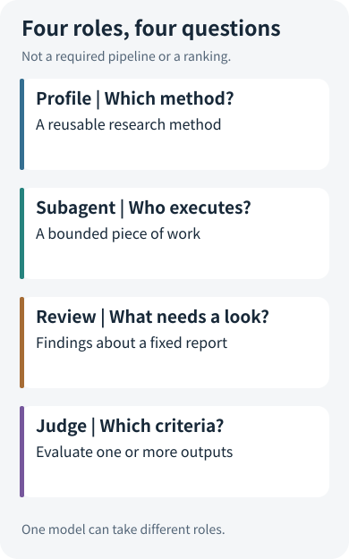
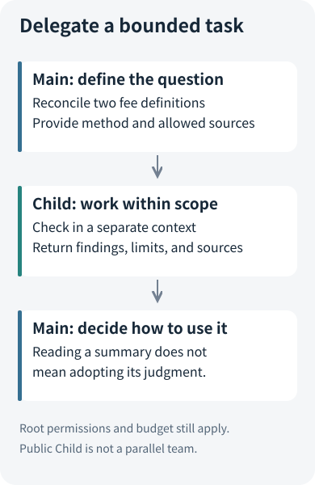
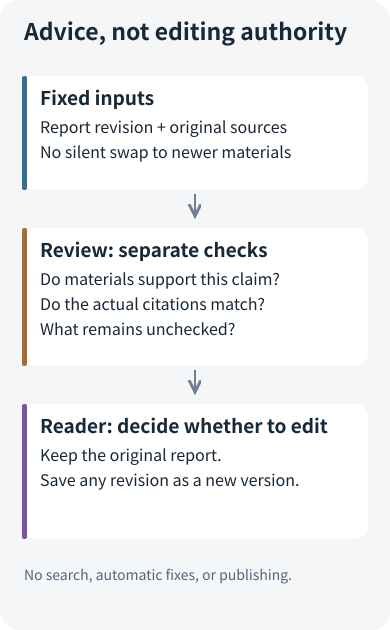

# Expert, Subagent, Review, Judge: If They All Use Another Model, Why Are They Different?

After writing a fund research report, we want “another model” to look it over. Should we call it an expert, a subagent, a reviewer, or a judge?

All four names can sound like one more request. But designing around model count quickly leaves practical questions unanswered: What information should this call receive? May it edit the report? Is its opinion a score? If it fails, should the original report remain visible?

**A model is an execution mechanism. A role is defined by its task, inputs, outputs, and decision-making authority.** One model can perform different roles, while different models can repeat the same work. Clarifying the role is how we decide whether another call is worthwhile.

## 1. Four Terms Answer Four Different Questions

Consider a teaching example: the main agent compares the fees of two funds and produces a sourced explanation. Its materials contain both annual expense ratios and example costs based on an assumed investment amount. The numbers are related, but they are not interchangeable.

Each role addresses a different question:

- **Expert profile: What method should we use?** Check the share class, effective date, and fee scope before explaining differences.
- **Subagent: Which bounded piece of work should we delegate?** Ask a separate execution unit to inspect two authorized documents and reconcile the fee definitions.
- **Review: What in the completed report needs another look?** Does the report mistake an example cost for an annual expense ratio, and does the citation support that statement?
- **Judge: What criteria should we use to evaluate results?** Across a fixed question set, which configuration makes fewer scope errors, and at what cost?

A judge can score individual answers. “Across samples” describes how we use judging to compare versions, not a universal definition of the term. Real frameworks often package configuration, execution, and role into one object. We separate them here to clarify responsibility, not to impose one naming scheme on every project.

## 2. An Expert Is First a Method, Then a Choice of Executor

“You are a senior fund expert” can be a prompt, but it does not explain how the research should proceed. A more useful profile specifies what to identify first, which figures cannot be compared directly, how to handle missing evidence, and what supporting material to return.

For example, this teaching method card focuses only on fee definitions:

> List the share class and effective date first. Distinguish ongoing expenses, transaction charges, and example costs. Compare only compatible measures; do not turn monetary amounts based on different assumptions directly into annual expense ratios.

The main agent or a subagent could use this method. **A reusable method does not require a new execution unit.** For a simple question, adding these instructions to the existing prompt is often more direct than introducing scheduling.

Open ETF Agent makes method management explicit through project specialist profiles: an operator maintains the profile, a task selects a particular revision at submission, and that revision is frozen into the task. Editing the profile later should not silently change the method of an ongoing investigation. This answers “Which method revision did this research use?” It does not grant the model a new identity or new permissions.

The project extended its earlier bounded Child execution with a specialist catalog rather than creating another budget and permission system. Profiles select existing constrained methods. Main may select a method from the frozen set, or select none; a preset list is not a mandatory pipeline that runs every expert. The [public profile contract](https://github.com/hpoenixf/open-etf-agent/blob/d53abf0acc0944664ca2df6a0eb60d0529449f01/docs/v027-specialist-profiles.zh-CN.md) preserves this distinction.

When investigating why an expert had no effect, therefore, do not start by adding more experts. Check separately whether the profile entered the task, whether its method was selected, and whether execution actually occurred.

## 3. A Subagent Creates a Boundary Around a Piece of Work

Suppose the fee documents are lengthy and Main also needs to synthesize other research. We can delegate “reconcile the fee definitions in these two documents” to a subagent.

Its input should be a small question, the necessary materials, and a clear method, not a vague “research this for me.” Its output is a local finding and original sources. Main then decides how to use those findings in the final report. Execution and synthesis become separate responsibilities.

Open's bounded Child has its own context and execution identity, but remains constrained by the root task's source permissions, call limits, and time limits. A method cannot grant itself extra tools through a prompt. A Child summary is also a derived result: another model repeating something does not turn it into primary evidence.

This also explains a common misconception: **an independent context does not guarantee an independent judgment.** If Main passes along “fees must explain the difference,” Child may merely find reasons to support that hypothesis. The public implementation's independent-evidence method excludes Main's local interpretation from Child's task text. Yet Child still uses specified materials and methods and may share Main's model biases.

Claude Code's [custom subagent documentation](https://code.claude.com/docs/en/sub-agents) also emphasizes separate contexts, dedicated prompts, and tool access. Open's current public Child is narrower: it performs local checks sequentially through admitted methods, rather than acting as a general-purpose parallel background team. These scopes serve different goals. Drawing both as “several models researching at once” would obscure the actual mechanism.

When materials are short and there is little separable work, delegation adds handoff, waiting, and synthesis costs. Keeping one main agent is not a regression; it avoids an unnecessary transfer.

## 4. A Review Inspects Existing Work Without Acquiring Publication Authority

Suppose a report says: “Fund A has lower fees, so its return was higher during this period.” This deserves review. A fee difference and a return difference occurring together do not automatically establish causation.

What we need is not another report on the same topic. We need a fixed revision of the original report, its sources, and a targeted question: **What material supports this statement, and do its actual citations point to that material?**

Open 0.28's report Review follows this design. It receives a fixed Markdown report and source texts, then produces separate review findings. It has no search or editing tools, does not automatically alter the report, and does not publish it. Its output retains original-text locations, quoted excerpts, reasoning, and unchecked scopes. If the report changes, we must know which revision was reviewed rather than transferring old findings unconditionally to new text.

Two judgments must remain separate:

1. **Material support:** Can the available material support the statement?
2. **Citation correspondence:** Does the source actually cited for that statement support it?

Even if another document proves the fact, the incorrect citation still needs attention. Conversely, an excerpt really existing in a source does not mean it establishes the report's conclusion.

The tradeoff is limited coverage. Review can inspect only the materials it receives; it cannot fill gaps by searching the entire web or inspect binary attachments that were not provided. Software can verify that text locations and excerpts exist, but this does not guarantee that the model's semantic judgment is correct. The default offline demonstration exercises the lifecycle, not real semantic review. Actual use requires a model entry point configured according to the [review contract](https://github.com/hpoenixf/open-etf-agent/blob/d53abf0acc0944664ca2df6a0eb60d0529449f01/docs/report-review.md).

Anthropic's [Building effective agents](https://www.anthropic.com/research/building-effective-agents) distinguishes orchestrator-workers from evaluator-optimizer: the former divides work, while the latter uses evaluation feedback to improve output. Open's approach here is a more restrained post-hoc review, not an automatic revision loop. For reports where the reader retains judgment, that separation makes the process easier to understand. Automatic rewriting would additionally require a defined edit scope, stopping conditions, and version preservation; “please fix it” is not enough.

## 5. A Judge Answers an Evaluation Question, Not a Source Question

A review finding two problems in one report does not establish whether a new version is better. The old version might contain three problems, simply be shorter, or use different source material.

For a comparison, the judge needs explicit evaluation targets and criteria. We can first check sources, dates, and definitions claim by claim, then assess whether necessary information is present and the explanation is usable. Numeric relationships that software can calculate should be calculated directly. Model or human judgment can handle the parts requiring semantic interpretation.

The same model may perform Review and judging. The contract differs: Review helps someone handle a particular report; a judge produces an evaluation against specified criteria. A score may support one selection or an aggregate across samples, but it cannot replace original sources.

Judges make mistakes too. The [original MT-Bench and Chatbot Arena paper](https://arxiv.org/abs/2306.05685) discusses position bias, verbosity bias, and self-enhancement bias. In engineering evaluations, longer answers, more calls, or a higher mean score therefore cannot automatically count as improvement. Fix questions, sources, model conditions, and resource accounting; examine order effects and sample the reasoning behind judgments. For a fuller evaluation workflow, see [the evaluation overview](https://hpoenixf.com/eff-agent-article/en/articles/honest-agent-evaluation). This article does not present a private evaluation system as a built-in feature of the public edition.

## 6. Find the Gap Before Assembling the Cast

For an unreliable report, four questions help identify the next step:

- **Is the research method inconsistent?** Improve the expert profile first; another execution unit may be unnecessary.
- **Is there too much separable work or context interference?** Consider bounded subagent delegation.
- **Does a particular completed report need checking?** Review its fixed revision.
- **Do you want to decide which of two approaches is worth adopting?** Use a comparable experiment and judge-based evaluation.

This is not an upgrade ladder. Simple tasks do not need all four roles. A complex system may use a subagent to perform a review, giving it both an execution identity and a review responsibility. Combining roles is fine; confusing their authority is the problem.

The important boundaries are these: **expert profiles cannot grant permissions; subagent summaries cannot replace sources; review opinions cannot silently rewrite the original report; and judge scores cannot replace success on the user's task.** Once those boundaries are clear, another model can add a capability rather than just another name.

To turn this map into a hands-on exercise, continue with [the follow-up workshop](open-etf-agent-report-review-workshop.md). To understand execution across time, read [Task, Session, Run, Worker, and Schedule](agent-task-session-run-worker-schedule.md).
