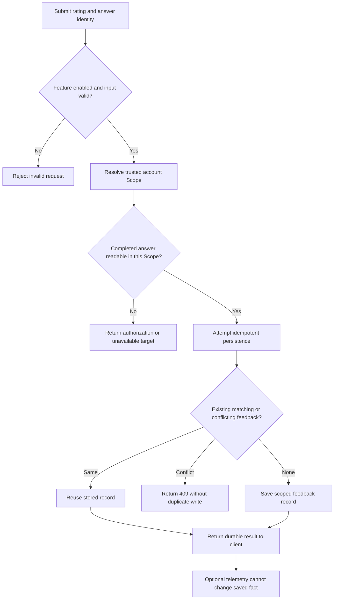

# A User Dislikes an Agent Answer. Should the Agent Automatically Learn? Feedback Identity, Idempotency, and Reliable Improvement Signals

A research agent delivers a fund comparison. The user chooses “not grounded,” and the interface says their feedback has been recorded. But on reopening the conversation, the button appears unselected. Switch to a different answer, and an old asynchronous response might even restore the state belonging to the previous one.

There is a subtler failure mode: the feedback **was** stored, but the system treats one negative rating as a proven assessment of answer quality—or uses it to alter long-term Memory, trading restrictions, or the next research judgment automatically.

**User feedback is first a scoped, durable, rereadable record of an evaluation made by a user. It is not an authoritative model-quality judgment and certainly not an automatic training event.** Getting that distinction right is a prerequisite for later evaluation and improvement.

## 1. Which Exact Answer Did the User Dislike?

A field such as `rating = down` is insufficient. A Conversation may contain several Runs, and a Run can involve previews, revisions, and a final answer. The actual target of feedback is a **completed assistant message**, not “the overall conversation today.”

The current feedback contract expresses a submission using five core inputs:

| Field | Meaning | Source of the fact |
| --- | --- | --- |
| `clientFeedbackId` | Logical idempotency identifier created for a client submission | Client submission |
| `runId` | Run that produced the specific answer | Original conversation execution/store |
| `assistantMessageId` | Completed assistant message being rated | Original conversation store |
| `rating` | `up` or `down` | User's evaluation action |
| `reason` | Allowlisted code such as `not-grounded`, `incorrect`, or `incomplete` | User selection, server validation |

The browser does **not** get to choose `scopeId`. The server derives that scope from verified identity and scope resolution, then checks that the `runId + assistantMessageId` pair is readable within it before accepting feedback.

Here is a simplified request with synthetic identifiers:

```json
{
  "clientFeedbackId": "fb-demo-001",
  "runId": "run-demo-017",
  "assistantMessageId": "answer-demo-017",
  "rating": "down",
  "reason": "not-grounded"
}
```

Persistence stores these bounded fields plus server-assigned identity and timestamp; it does not duplicate the full user question or assistant answer inside feedback metadata. **“Not grounded” is the reason the user selected—not a system finding that the answer has definitively failed its evidence requirements.**

## 2. Verify the Answer and Its Owner Before Writing

Feedback is not just a natural-language instruction sent to the model. The write path has a sequence of deterministic decisions:



The response distinctions matter. Invalid request fields produce **400**; unavailable scope admission is **403**; an unreadable target answer is **404**; and incompatible existing feedback for the same answer is **409**. A cross-account read must not be silently treated as “this answer has no feedback,” and an optional telemetry failure must not undo a successfully persisted record.

The current PostgreSQL implementation combines uniqueness constraints with `INSERT ... ON CONFLICT DO NOTHING` to settle competing writes. On a conflict, it rereads the existing record and compares the result. Preventing a duplicate does not depend solely on a disabled button in the browser.

“Equivalent” feedback has the same target assistant message, Run, rating, and reason. Retrying the same submission can reuse its durable result. Two requests attempting incompatible opinions about the same answer do not silently apply a last-writer-wins policy.

## 3. “Submitted Successfully” and “Still Visible After Reload” Are Different Guarantees

After a click, the frontend can update local state: the server responded successfully, so set `submitted = up/down` and disable the buttons. This explains the immediate user interface; it says nothing about what appears after a refresh, remount, or reopening the Conversation.

An engineering record from **October 27, 2026** contains a concrete component-level RED test: **a feedback record existed, but the remounted control failed to display its saved “recorded” state**. The issue was not a missing model call. Transient component state is not an authoritative read of durable feedback.

The focused repair made the control query by exact `runId + assistantMessageId` and distinguish three outcomes:

| Readback result | Correct interface behavior |
| --- | --- |
| Valid response, `records: []` | No saved rating for this exact answer; submission may be enabled |
| Valid response with a matching record | Display the persisted rating and prevent an incompatible repeat |
| Network, authorization, or response-structure failure | Show temporarily unavailable; **do not** interpret it as “no record” |

Target switching needs another precaution. Imagine the user opens answer A, its read is still pending, and then switches to answer B. A's late `up` response must not update B's control. Request cancellation and exact target identity checks are required, rather than merely adding a spinner.

There is an important implementation boundary here. The inspected `FeedbackPanel` selects the **most recent completed Run and assistant message in the currently opened Conversation**. It is not yet proof of a product feature allowing users to pick any historical answer for rating. Exact feedback readback and arbitrary history-message targeting are two different capabilities.

## 4. Three Failure Cases Determine Whether Feedback Is Trustworthy

**Case A: a submission times out, and the user retries.** Reusing the same logical `clientFeedbackId`, answer identity, and content must not create a second record. A successful database commit whose HTTP acknowledgment was lost is not a second user evaluation. The current UI creates an ID for a new click; an automatic transport retry must preserve its original logical intent ID.

**Case B: one answer is rated “helpful,” then a different request says “not grounded.”** Under the current one-record-per-answer rule, the later value cannot quietly overwrite the earlier one. Incompatible submissions are conflicts. This is not yet a full product for editing or retracting a rating. Supporting revision later would need an explicit, auditable revision policy—not a weakened uniqueness constraint.

**Case C: one Scope reads feedback for another user's answer.** The October 27 focused RED/GREEN evidence records a case in which an exact read returned HTTP 200 where an inaccessible target should have been rejected. The selected HTTP test passed after the focused repair. This is not merely a reporting-statistics bug: feedback readback can reveal the association between a user and a message. Identity and scope admission must precede feedback retrieval.

A common fourth misclassification is “read failed, therefore nobody voted.” That misleads the UI and may encourage a second attempt that conflicts with an existing record. Distinguishing **unavailable** from **absent** is part of the feedback contract.

## 5. Why Even Genuine User Feedback Must Not Become Automatic Learning

An `up/down` value is a useful product signal. It identifies cases worth reviewing and the direction of user dissatisfaction. It does not come with a ground-truth label.

Suppose a fund comparison receives `incorrect`. The user might disagree with the conclusion, have noticed a stale NAV timestamp, or be reacting to an ambiguous question. That single event cannot distinguish a model reasoning failure from a source-data or time-semantics problem.

A defensible later process treats feedback as a **candidate observation**. A separately authorized investigation can connect the original answer to verifiable evidence, classify the failure, create an evaluation case, and compare outcomes after a change. That downstream review is not a power automatically held by the A40 feedback-record Owner.

Current feedback persistence **does not** modify the published answer, automatically save a long-term Memory, or authorize an investment action. Observability can record bounded telemetry, but failed telemetry delivery must not change the underlying record. The causal chain “user clicked dislike → the next model consumed it → answer quality improved” is not established by merely recording the first step.

## 6. What the Engineering Evidence Actually Supports

As of **October 27, 2026**, the system has feedback storage and idempotency logic, completed-answer checks within a Scope, an exact-read endpoint, and the corresponding Web control. The in-progress feedback change documents a component-level RED case and later **focused GREEN** observations for reopen behavior, stale responses, target switching, and selected HTTP identity reads.

That evidence has explicit limits. Some results come from an unclosed development worktree. A broader affected test selection also reported a separate Publication History failure unrelated to feedback. Isolated PostgreSQL new-connection readback, a real-browser full submit-and-reopen journey, temporary and deletion lifecycles, and formal closure are **not** established by those records.

This article therefore explains an **existing base contract and a targeted readback improvement still being qualified**. It does not claim a production-ready feedback learning loop, improved user satisfaction, or automatic model training. In particular, a passing focused Web test does not establish end-to-end improvement in real user outcomes.

## Conclusion

A dislike button is easy to paint. The difficult part is making that button consistently answer three questions: **Who rated which completed answer? Was that exact rating saved at most once? Does rereading it still respect the original user and answer identity?**

Only after those facts are stable can feedback become a reliable starting point for investigation. First separate “the read is unavailable” from “this answer has no rating,” then consider aggregation or automated optimization. A supposed learning system without durable identity, idempotency, and readback evidence can become just another source of confident misdiagnosis.

## Further Reading and Discussion

[Failure diagnostics and attribution](../../en/articles/agent-failure-is-a-boundary-problem.md) examines how to identify the last confirmed blocker; [honest evaluation](../../en/articles/honest-agent-evaluation.md) distinguishes test strength and user outcomes. This article addresses the narrower, independently owned A40 problem: accurately persisting and rereading a user's evaluation of a particular answer.

The [ETF Agent Engineering Notes](https://github.com/hpoenixf/eff-agent-article) repository collects further implementation stories and architectural trade-offs. Stars are welcome if this work is useful.
