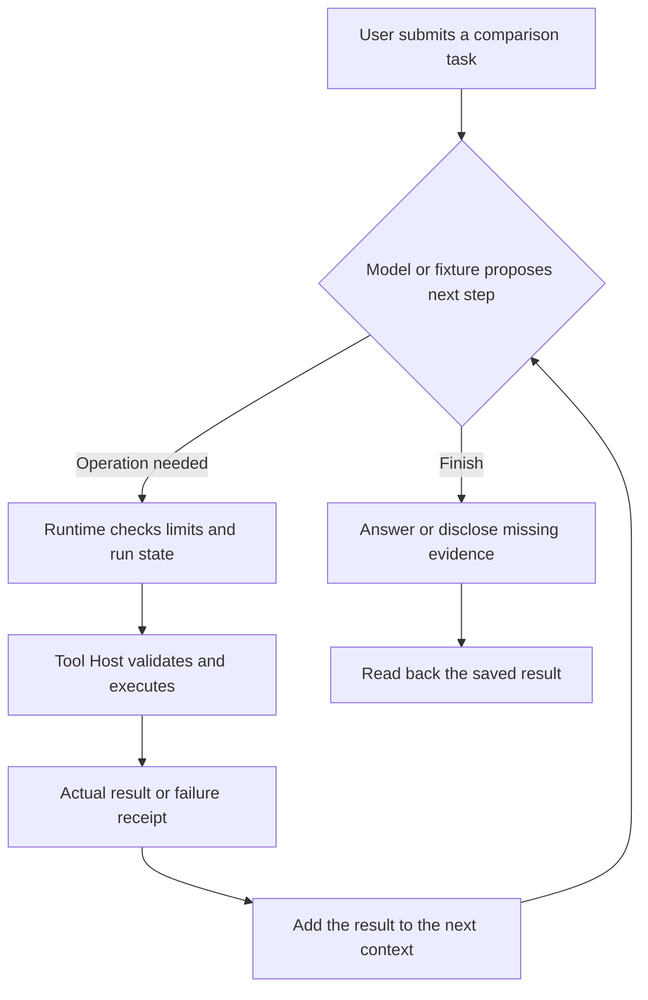
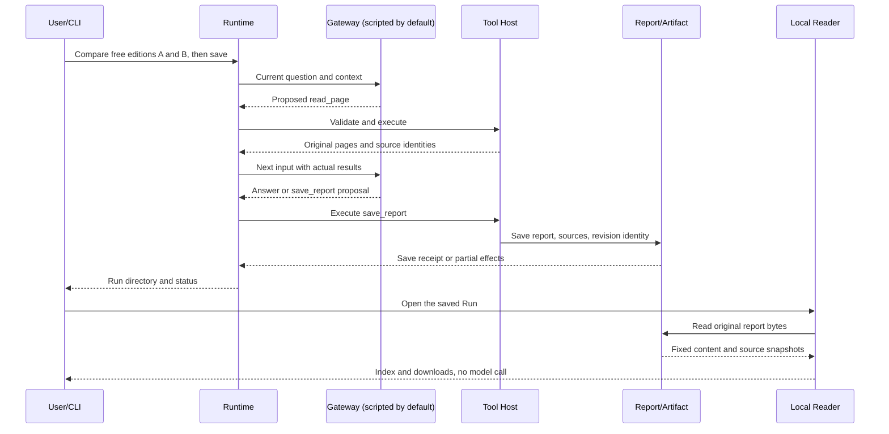
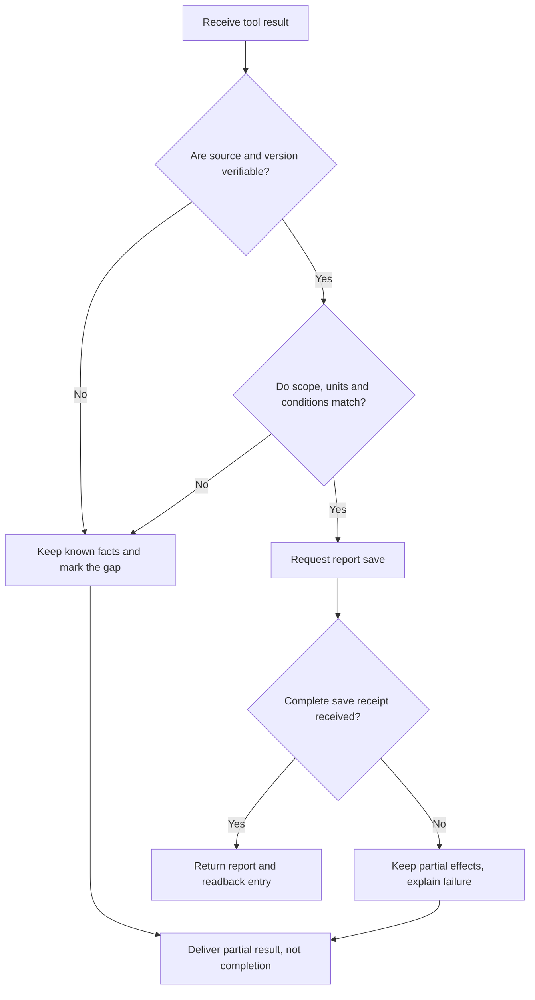

# Agents in 15 Minutes

> **Who this is for:** Developers comfortable with a little JavaScript, an API or a backend service, but new to agents. The reading path takes about fifteen minutes. No prior MCP, LLM framework or multi-agent experience is required.

Agent diagrams can feel overwhelming: Model, Runtime, Tool Host, Context, Publication, Subagent. Begin with one simpler question: **How does a program take a user's task, gather information, choose its next step, perform operations and deliver something that actually exists?**

We will use a runnable example first, then map it onto the larger system.

## 1. The task: compare two documents and save a report

Imagine receiving this request:

> Compare the **free editions** in Atlas Notes guides A and B. Which export formats are supported, which restrictions remain unchanged, and where does each claim come from? Save the report.

This is **synthetic teaching data**, not an actual vendor's API or investment advice. It is the existing example in [Open ETF Agent](https://github.com/hpoenixf/open-etf-agent). You can inspect the [document fixtures](https://github.com/hpoenixf/open-etf-agent/blob/7480b656b18192e6d6b44aab65255b970d58e6f8/fixtures/documents.json), [four questions](https://github.com/hpoenixf/open-etf-agent/blob/7480b656b18192e6d6b44aab65255b970d58e6f8/fixtures/cases.json), and pinned implementation instead of trusting an invented success story.

Here are the relevant facts:

| Item | Version A (A-2026-01) | Version B (B-2026-02) |
| --- | --- | --- |
| Free-edition export formats | CSV | CSV, Markdown |
| Free-edition cap per export | 120 rows | 300 rows |
| Online connection required for export | Yes | Yes |
| Enterprise-only PDF export | Available | Available |

The final row is the trap: **an Enterprise capability is not automatically a Free capability**. A comparison must retain product edition, source version and conditions, not just keywords.

For T1, a qualified response should say that B adds Markdown, both support CSV and both require an online connection, citing the original `atlas-a:1` and `atlas-b:1` pages. T3 separately asks for numeric changes: **180 more rows per export**, **2.5 times** the previous cap and a **150%** relative increase. Those are separate cases; completing T1 does not mean T3 was executed.

## 2. The model is not the tool, and an agent is not a fixed pipeline

Three responsibilities are enough to begin:

| Role | Familiar engineering analogy | Here |
| --- | --- | --- |
| **Model / Gateway** | Propose what should happen next | Suggest reading both guides or returning an answer |
| **Runtime** | Manage the loop, context, budgets and stopping | Decide whether another round is allowed and consume settled results |
| **Tool Host** | Execute permitted functions | `read_page`, `calculate_change` and `save_report` |

**Figure 1 · Minimal mental model of a tool-using agent**



The interesting part is not the number of tool calls. It is that **new observations can change the next decision**. If an original page is missing, the system should find a legitimate source or report the gap, not manufacture a comparison.

One crucial caveat: **the default v0.6 demo uses a scripted fixture Gateway, not a live language model deciding independently.** File reads, computation, saving and readback are real operations. This qualifies Runtime behavior, not live model comprehension.

## 3. Open up the execution: proposals, receipts and readable bytes

The pinned [v0.6 implementation](https://github.com/hpoenixf/open-etf-agent/tree/7480b656b18192e6d6b44aab65255b970d58e6f8) runs four synthetic cases, T1–T4, in `document-compare`. A representative sequence is: the Gateway proposes a document read, the Host returns the original material, the Runtime continues, and `save_report` creates the report.

**Figure 2 · From comparison to download: two different success criteria**



Two distinctions matter. **Proposing a save is not the same as successfully saving**: a real Host receipt is needed. And **a report on disk is not automatically accessible to the user**.

v0.6 adds immutable Artifacts and Revisions and a **loopback-only, read-only HTTP Reader** on top of local report creation. Refreshing or downloading a saved report does not invoke the model. It is not a publicly hosted chat product.

### Context is what the model actually received this round

Context is the task material visible to a model call: user instructions, permitted tool descriptions, earlier proposals and actual tool output or errors.

**A file being uploaded is not equivalent to the model having read its contents.** If the agent seems unaware of the document, first check whether `read_page` ran, then whether its returned content entered the next input. A fabricated source ID from a model response cannot substitute for a source read by the Host.

The following is only conceptual pseudocode, **not executable v0.6 source code or a vendor SDK example**:

```js
while (canContinue(run)) {
  const proposal = await gateway.next(context);
  if (proposal.type === "final") break;
  const receipt = await host.executeAllowed(proposal);
  context.add(proposal, receipt);
}
return readActualRunStatusAndArtifacts(run);
```

The main handoff is **proposal → permitted execution → actual result → next decision**.

## 4. Failure handling is part of the design, not an afterthought

Three cases make the distinction concrete:

- **Scope confusion (T2):** Enterprise allows offline editing, but Free does not. Free can view previously downloaded notes offline, while the first download still requires an online connection.
- **Missing evidence:** Without B's original page, do not claim the comparison is complete. Deliver what was established and identify what is missing.
- **Partial save:** `report.md` may have been written even if a later manifest write fails. That is neither a complete success nor permission to pretend nothing happened and retry blindly.

**Figure 3 · Failure and fallback: establish facts before choosing an answer**



**A finished Run does not prove semantic correctness.** In the pinned v0.6 [historical verification receipts](https://github.com/hpoenixf/open-etf-agent/blob/7480b656b18192e6d6b44aab65255b970d58e6f8/docs/verification/v06-delivery-receipts.safe.json), the four cases passed local HTTP checks of report bytes and source windows. Their `semanticStatus` is still `unreviewed`. Engineering readback and validated model conclusions are different claims.

## 5. Run the pinned version

Use the fixed **v0.6.0-dev.0 / commit `7480b656`**, not a moving `main`. The historical snapshot requires Node.js **26.11.1–26.x**. Installing dependencies might require network access; the default example needs no model API key.

```bash
git clone https://github.com/hpoenixf/open-etf-agent.git
cd open-etf-agent
git checkout 7480b656b18192e6d6b44aab65255b970d58e6f8
npm ci --ignore-scripts --no-audit --no-fund
npm run build
npm test
mkdir -p runs
node src/cli.mjs --case document-compare --output runs > runs/comparison.json
npm run evaluate -- --input runs/comparison.json
```

Results appear in separate `runs/run-...` directories identified in `comparison.json`. Choose an actual directory and launch the local, read-only server:

```bash
npm run serve -- --run runs/run-YOUR_ID
```

The CLI prints an `http://127.0.0.1:PORT` origin. Open it in your local browser to see existing revisions and report downloads. Refreshing it **does not rerun a model**. Replace `run-YOUR_ID` with the actual reported directory name.

Start with T1's formats and online rule, then T2's edition constraints, T3's numeric definitions and T4's original-byte readback. You may run just one question with `--case T1`. This article does not fabricate new execution output; the verification facts cited above are saved historical evidence from the fixed version.

## 6. Now map the example onto the six-layer architecture

This local CLI illustrates only part of a complete application. A system with real accounts, conversations, background research, publication and a browser needs more handoffs:

| Six-layer reading map | Your new mental model |
| --- | --- |
| L1 Task input and trigger | What the CLI or UI submitted |
| L2 Identity, session and context | Which sources are allowed and what was projected this round |
| L3 Agent decisions and execution | How Runtime handles the Gateway's proposed next step |
| L4 Tools and domain functions | Reading, computation, saving and real receipts |
| L5 Publication and delivery | Which report exists and can be retrieved |
| L6 User interface | Which result the user opened and can read again |

**The six layers are a reading map, not six mandatory processes.** This v0.6 demo does not implement full multi-account authorization, hosted conversation or background research. Do not mistake the table for complete six-layer implementation coverage.

Remember three questions when building your first agent: **What did the model actually receive? What did the program really execute? What can the user finally retrieve?**

For a deeper architecture discussion, read **[From a Question to a Visible Answer: ETF Agent's Six-Layer Lifecycle](/en/articles/017-prompt-to-answer-six-layer-panorama-v3)**. Or open the [pinned v0.6 source](https://github.com/hpoenixf/open-etf-agent/tree/7480b656b18192e6d6b44aab65255b970d58e6f8) and follow `src/cli.mjs` → `src/runtime.mjs` → `src/tools.mjs` → `src/reader.mjs`.

[中文版](/articles/agent-in-15-minutes) · [Engineering notes on GitHub](https://github.com/hpoenixf/eff-agent-article) · [Runnable open-source project (stars welcome)](https://github.com/hpoenixf/open-etf-agent)
