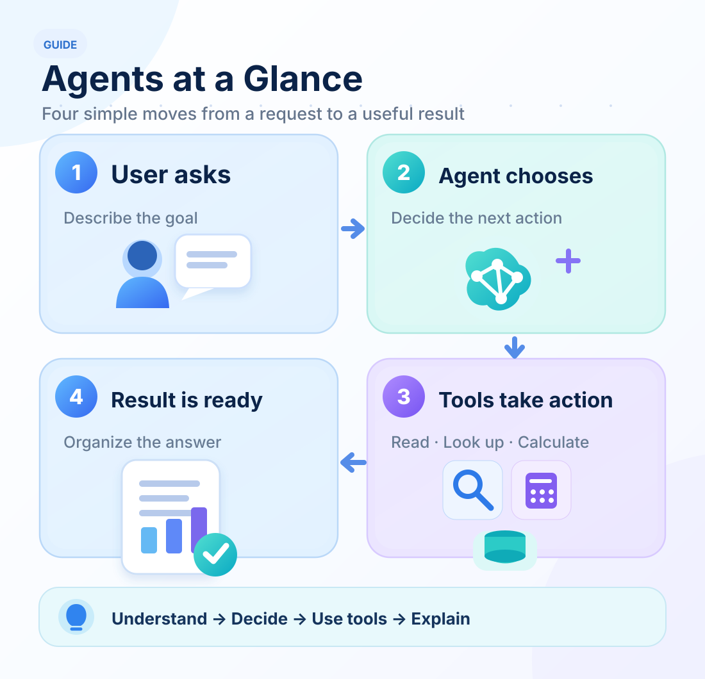
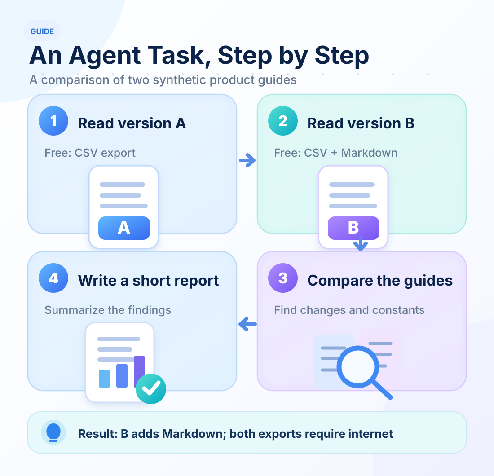
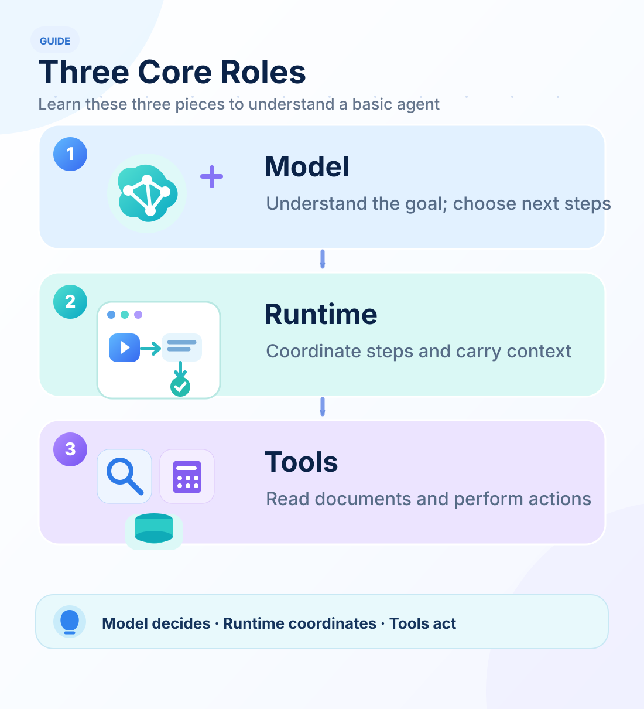

# Agents in 15 Minutes

<LearningPathNav />

If you have built an API, called a backend service, or written a short JavaScript automation script, you already have a useful starting point for understanding agents.

**Think of an agent as an assistant that keeps a task moving: it understands the goal, chooses a next step, uses tools, and continues with the information it receives.**

Follow one example, three diagrams, and a walkthrough of the Agent Loop to see how that works.



## Six-layer capability map: the smallest runnable path

This map uses the panorama's six horizontal stages and vertical capability groups, but **shows only modules used by the beginner example**. Select a colored solid chip to inspect the pinned v0.15 source. L5 means writing `report.md` and L6 means reopening it through the CLI; **neither implies** a complete online Publication system, a Web interface, or all panorama capabilities.

<PanoramaViewer src="/eff-agent-article/visuals/learning-stage-maps/intro-en.svg" label="Beginner six-layer map: minimal agent loop, tools, and CLI report" :source-links="true" :canvas-width="1720" :canvas-height="1110">
<div class="v3-owner-map-scroll">
  <object class="v3-owner-map" type="image/svg+xml" data="/eff-agent-article/visuals/learning-stage-maps/intro-en.svg" role="img" aria-label="Beginner six-layer map: minimal agent loop, tools, and CLI report">
    <a href="https://hpoenixf.com/eff-agent-article/visuals/learning-stage-maps/intro-en.svg">Open the six-layer SVG map</a>
  </object>
</div>
</PanoramaViewer>

**Follow the path:** start T1 → project Context → Gateway/Runtime loop → Tool Host reads A/B → save and reopen the report. The default model actions are scripted.

## A familiar task: compare two documents

Imagine receiving this request:

> **"Compare product guides A and B. Which export formats are available in the free edition, and what restrictions do they share?"**

This is a synthetic teaching example from [Open ETF Agent](https://github.com/hpoenixf/open-etf-agent). The fictional product is called *Atlas Notes*. The documents contain three facts:

- **Version A:** the free edition exports CSV.
- **Version B:** the free edition exports CSV and Markdown.
- **Both versions:** exporting requires an internet connection.

You would probably read guide A, then guide B, and summarize what changed and what stayed the same. The example agent follows the same outline.



**A useful result looks like this:**

> Version B adds Markdown export alongside CSV. Both free editions require an internet connection to export.

Even this small example includes the essential steps: understand the request, read information, organize it, and produce a result.

## Who does what inside an agent?

Start with just three roles.



The **model** understands the request and chooses what to do next. It might read a document first and organize an answer once it has the relevant material.

The **runtime** connects the steps. It gathers the question, available information, and tool results into the **context** for the next model turn, allowing the agent to continue its work.

The **tools** perform concrete operations. File reading, database queries, API calls, and calculations can all be exposed as functions with inputs and outputs.

## Walk through the loop: AI chooses each next step

**After a tool runs, its result goes back to the AI. The AI uses that result to choose another tool action or answer the user.** Repeating this process gives us the **Agent Loop**.

Here is one possible teaching walkthrough of the same comparison with a model choosing the actions:

| Turn | What the AI chooses | Outcome of this turn |
| --- | --- | --- |
| 1 | Read guide A first | Tool result: A exports CSV and requires an internet connection |
| 2 | Read B now that A is known, so the guides can be compared | Tool result: B exports CSV and Markdown and requires an internet connection |
| 3 | Both guides are available; summarize the comparison and answer | AI answer: B adds Markdown; both versions require an internet connection |

The first tool result enters the second turn's context, and the second result enters the third. **Each model call can make a fresh decision using what has already been learned.** These turns belong to one user request; the user does not need to prompt each step.

Remember one cycle as **AI chooses an action → tool executes → result goes back to AI**. The AI then chooses what to do next or finishes with an answer. The runtime drives the loop and manages tool permissions and execution limits.

A few lines of JavaScript-style teaching pseudocode show the division of work:

```javascript
while (withinLimits()) {
  const step = await model.decide(context, tools);
  if (step.type === "answer") return step.text;
  const result = await runAllowedTool(step);
  context.push(step, result);
}
```

`model.decide` stands for asking the AI to choose its next step. `context.push` supplies the action and result to the next turn. Helper functions and message formats are simplified here.

## How does this differ from a traditional program?

For a traditional comparison script, you might arrange the steps as `read A → read B → compare → output`. Developers encode its loops, branches, and stopping rules. Even when the comparison step calls an AI model, the overall route can still be predefined.

An agent delegates some task-level choices to the AI: **which document to read, which tool to call, whether to continue, and when to answer can depend on the latest result.** Developers supply the goal, available tools, and operating constraints. This is also the key distinction between workflows and agents in Anthropic's [Building effective agents](https://www.anthropic.com/engineering/building-effective-agents).

Imagine a small change: guide B says, "See the appendix for export formats." The AI can choose to read the appendix next, then return to the comparison. A traditional script can do this too, with a corresponding rule written by its developer.

Ordinary code is straightforward when steps are clear and rules are stable. Agents are especially useful when reading new material helps determine what to do next.

## Try the example in five minutes

The document comparison can be run locally using [Open ETF Agent v0.15](https://github.com/hpoenixf/open-etf-agent/tree/74bd5aa455ccaeb2994eb22aa744affde660bfa2). With Node.js 26.8.1–26.x installed, run:

```bash
git clone https://github.com/hpoenixf/open-etf-agent.git
cd open-etf-agent
git checkout v0.15.0
npm ci --ignore-scripts --no-audit --no-fund
npm run build
npm run demo -- --case T1
```

The command reports the directory for the run. Open `report.md` inside that directory to see the comparison and its sources.

The default example uses a **scripted model-action sequence**, so no model API key is needed. You can explore the tool execution process locally. When you later connect a live model, the same idea of choosing steps, using tools, and consuming results remains central.

## Next: Intermediate, with ten modules in the code

You now have a useful mental model: **the user sets a goal, AI chooses the next step from each result, the runtime drives the loop, and tools perform the actions.**

Continue with [**Agent Intermediate: Ten Core Modules in Open ETF Agent**](./agent-ten-modules.md). In the same v0.15 checkout, meet Skills, MCP, context, memory, sessions, and subagents. Then the [Deep Dive](./open-etf-agent-v010-system-design.md) follows an implemented specialist collaboration to show how those parts cooperate.

**Reading path: Introduction → Intermediate → Deep dive → Panorama.** Each stop keeps the familiar task and adds another layer of understanding.

You have already met three movements of the six-layer architecture: **L1 accepts the task, L3 decides the next action, and L4 uses tools**. Intermediate adds ownership and context (L2); Deep Dive follows how results are saved and actually delivered (L5/L6). You do not need to memorize the numbers yet—just keep following the task.

[Open ETF Agent source and examples](https://github.com/hpoenixf/open-etf-agent) · [中文版](/articles/agent-in-15-minutes) · [Engineering notes on GitHub (stars welcome)](https://github.com/hpoenixf/eff-agent-article)
