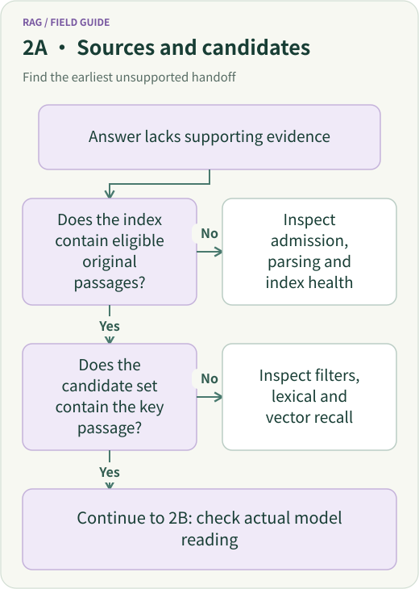
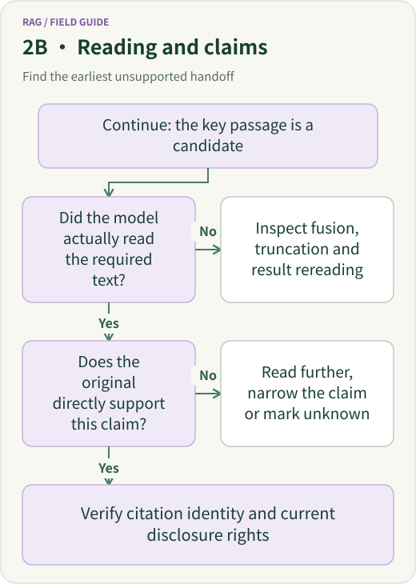
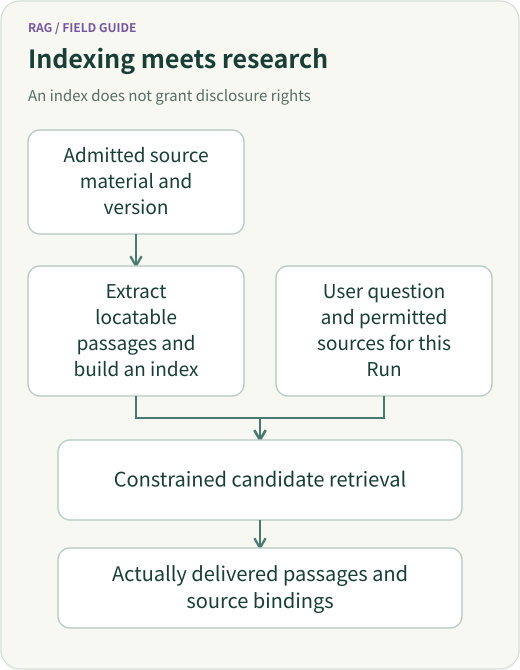
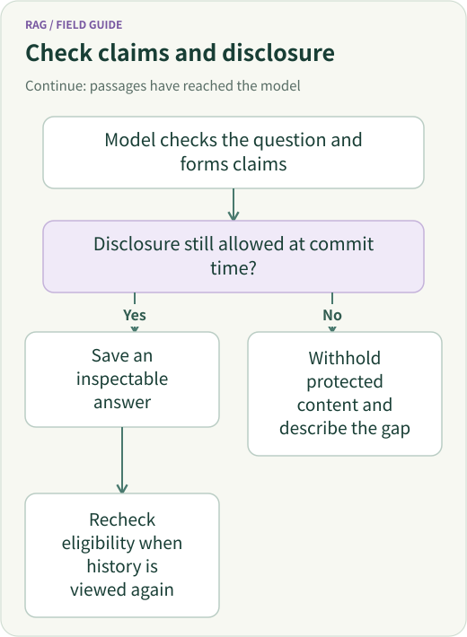

<script setup>
import { withBase } from 'vitepress'
</script>

<span id="knowledge-retrieval-how-does-a-document-become-citable-revocable-research-evidence"></span>

<span id="the-full-rag-lifecycle-from-knowledge-ingestion-to-a-trustworthy-agent-answer"></span>

# The RAG Lifecycle: From Document Ingestion to Cited Answers

A user asks: “What changed in the 2023 notice for 510500, and what can the later prospectus add?” The corpus contains three sources: a 2021 prospectus, the 2023 notice and a 2025 prospectus.

A RAG system, short for Retrieval-Augmented Generation, has a concrete job: **turn those files into locatable material, find the passages needed for the question, give the model those passages with their sources, and produce an answer the reader can check.**

This article follows that notice all the way through. We begin with the components available in common frameworks, then trace ingestion, retrieval and cited generation, and finish with ETF Agent's implementation and a public example readers can inspect. The notice research and historical observations come from previously checked material. The passage card, query breakdown and context package below are teaching illustrations, not logs from a new model run.

<span id="_1-the-big-picture-one-user-question-four-kinds-of-work"></span>

## 1. The normal path: build the corpus offline, answer questions online

RAG usually has two main paths.

**Offline ingestion** happens before a question arrives, or when sources change: acquire files → parse their content → split it into passages → build indexes. The output is a set of searchable records that can lead back to their original locations.

<picture>
  <source media="(max-width: 640px)" :srcset="withBase('/diagrams/rag-lifecycle/en/ingest-flow-mobile.svg')" />
  
</picture>

<a :href="withBase('/diagrams/rag-lifecycle/en/ingest-flow.svg')">Open the full ingestion diagram</a>

**Online answering** starts with the question: define the query and scope → retrieve and merge candidates → rerank when useful → assemble context → generate an answer with citations. The question, relevant passages, answer and cost can then become evaluation material.

<picture>
  <source media="(max-width: 640px)" :srcset="withBase('/diagrams/rag-lifecycle/en/query-flow-mobile.svg')" />
  
</picture>

<a :href="withBase('/diagrams/rag-lifecycle/en/query-flow.svg')">Open the full answering diagram</a>

*Figures 1 and 2 | A teaching view of normal RAG. Vector retrieval and reranking are optional. An Agent can repeat retrieval during a research task.*

### What do common frameworks provide?

All three frameworks below can organize this flow, with different component boundaries. This is a responsibility map, not a claim that the project uses all three frameworks.

| Framework | Common ingestion components | Common retrieval and answering components | A useful way to read the design |
| --- | --- | --- | --- |
| **LlamaIndex** | Readers load Documents; IngestionPipeline connects splitting, metadata and embeddings to produce Nodes | A Retriever fetches Nodes, postprocessors filter or rerank them, and a Response Synthesizer builds the answer | Follow Document → Node → retrieved result → answer |
| **LangChain ecosystem** | Document loaders, text splitters, embedding models and vector stores | Retrievers and models form a retrieval-answering flow; retrieval can also be an Agent tool | Distinguish a fixed retrieve-then-generate flow from on-demand tool use |
| **Haystack** | Converters handle files, preprocessing components split/clean content, and DocumentWriter writes to a Document Store | Retriever → optional Ranker → PromptBuilder → Generator | Pipelines explicitly connect component inputs and outputs |

The mappings follow the official documentation for LlamaIndex [ingestion](https://developers.llamaindex.ai/python/framework/module_guides/loading/ingestion_pipeline/), [querying](https://developers.llamaindex.ai/python/framework/understanding/rag/querying/) and [response synthesis](https://developers.llamaindex.ai/python/framework/module_guides/querying/response_synthesizers/); [retrieval in the LangChain ecosystem](https://docs.langchain.com/oss/python/deepagents/retrieval); and Haystack [preprocessing](https://docs.haystack.deepset.ai/docs/documentpreprocessor), [writing](https://docs.haystack.deepset.ai/docs/documentwriter), [reranking](https://docs.haystack.deepset.ai/docs/sentencetransformerssimilarityranker) and [prompt assembly](https://docs.haystack.deepset.ai/docs/promptbuilder). Check concrete class names and APIs against the version you use.

**The private ETF Agent implementation maps onto the flow as follows**, as already described in the public [earlier knowledge-retrieval article](https://github.com/hpoenixf/eff-agent-article/blob/a629e450e9e3a505089b54d68a14eaecf3b9a2fb/en/articles/agent-knowledge-retrieval-end-to-end.md): knowledge ingestion prepares sources; PostgreSQL stores documents and passages; pgvector supplies vector retrieval; lexical and vector candidates are merged with RRF; optional local TEI reranks them. A Native Knowledge tool returns material to the existing Agent research flow, while the Host binds results and citations. The sections below unpack that previously disclosed private-system path. The public teaching repository, Open ETF Agent, provides a separate, smaller lexical-retrieval example. This article distinguishes those scopes; the public code and runnable entry point appear near the end.

<span id="_2-before-knowledge-enters-the-system-what-do-we-actually-possess"></span>

<span id="_2-offline-why-review-the-material-before-indexing-it"></span>

## 2. Steps 1–3: turn files into passages that lead back to originals

<span id="source-admission-precedes-extraction"></span>

### 1. Acquire sources and register their versions

The inputs are three files actually acquired and authorized for processing. Record each title, source URL, publication date, logical source, content version and original location. The 2021 prospectus, 2023 notice and 2025 prospectus remain separate records with their historical relationship intact.

<span id="a-report-has-three-distinct-identities"></span>

<span id="_1-four-entities-that-must-not-be-collapsed"></span>

This creates three layers: the **original file** contains acquired bytes, the **research asset** records provenance, version and reading coverage, and the **knowledge index** stores a searchable representation. An indexed passage can therefore lead back through its version and location to the original file. URLs and filenames may be reused or replaced; content hashes and version identities fix what a citation refers to.

Admission also records the available representation: original text, a curated summary or metadata only. If only a reviewed description and source link may be retained, retrieval returns that representation and a route to the source. A task requiring the body must acquire it. Historical notices serve as explanatory material; current NAV, holdings and trading state remain with their respective authoritative data sources.

**Output: three document records with provenance, versions and an explicit usable scope.**

<span id="parsing-and-chunking-must-retain-qualifying-clauses"></span>

### 2. Parse content while retaining headings, pages and table relationships

A PDF needs usable text extraction; HTML needs its article content extracted; Markdown already provides headings and paragraphs. Scanned files generally require OCR or another document-understanding capability, whose availability must be checked for the selected parser and deployment.

For the 2023 notice, the relevant field changes appear on the first page. Parsing should retain the physical page number, field names, change descriptions and nearby conditions. In tables, column headings, units, footnotes and cross-page relationships all affect meaning.

<span id="extraction-coverage-matters-more-than-the-number-of-chunks"></span>

Think of a parsed page as “document version + physical page 1 + extracted text + coverage status.” If extraction captures “fee: 0.5%” but omits the applicable share class, reread the heading or original page before using that statement. Parsing checks should establish both what was read and which structures remain incomplete.

The private ETF Agent ingestion path described in earlier public articles retains physical PDF page numbers and distinguishes extraction coverage. Reading only an initial subset of pages does not qualify the whole file as indexed. Complex tables may require the document-reading capability to inspect the original; subsequent retrieval depends on the text quality produced here.

**Output: usable content with structure and source locations.**

### 3. Split content into passages that are readable and expandable

Chunking chooses a unit that is easy to find and sufficiently complete to read. A common approach starts with headings, paragraphs or pages, then bounds longer sections with limited overlap. One page of a short notice may be a suitable passage; a long prospectus needs multiple sections and passages.

For the notice, keep the field-change sentence, relevant conditions and necessary footnotes together when possible. The following **illustrative passage card** paraphrases the previously checked fact; it is not a quotation from the PDF.

| Field | Example content |
| --- | --- |
| Document | The 2023 notice for 510500 |
| Version and location | The acquired document version; physical page 1; the relevant passage range |
| Passage description | Cash-substitution field names changed, with corresponding discount fields added |
| Readback information | Original location, content hash, page number and passage identifier |
| Representation and purpose | Text extracted from the original, used to check the contemporaneous field changes |

The chunking approach in the earlier public article can group Markdown by heading and bound long sections with limited overlap; PDF passages retain their page numbers. When a qualification crosses a passage boundary, adjacent text can be read from the same source version. Choose chunk size using real tasks: languages, tables and document structures have different needs. [Azure's official chunking guide](https://learn.microsoft.com/en-us/azure/search/vector-search-how-to-chunk-documents) likewise presents fixed-size, structural and semantic approaches as alternatives.

**Output: passages carrying source, version, location and representation metadata.**

## 3. Step 4: make the same passages searchable in different ways

Lexical and vector retrieval work over the same passages, using different search representations.

- **The lexical route** associates terms with text. Queries for “510500,” “PCF” or an exact field name can locate passages containing those terms. Full-text retrieval and BM25 are common capabilities on this route.
- **The vector route** uses an embedding model to turn passage text into numeric vectors stored in a vector index. At query time, a compatible embedding model processes the question, and vector similarity supplies candidates that may use different wording.
- **Metadata** records source, version, purpose, status and readable scope so that search operates over the correct material.

In the private ETF Agent implementation described in earlier public articles, documents, passages and associated metadata live in PostgreSQL, with pgvector supplying vector search. The lexical route checks the `pg_search` extension, BM25 index and configuration: when those conditions are met it can use BM25; otherwise PostgreSQL full-text search (FTS) remains available. **These are inspected implementation branches. Establishing which branch a particular run used requires that run's configuration and retrieval records.**

After ingestion, perform a small smoke check: can a fund-code query find the notice? Can a fixed version and page lead back to the right text? Do document and passage counts match the admitted corpus? Then examine semantic retrieval.

This order reflects a concrete historical lesson. A September 2026 local diagnostic found model and database dependencies available but no indexed documents or chunks. That task first needed corpus ingestion. The observation describes that historical state, not the current index.

**Output: an index that supports lexical/vector lookup, scope filtering and original-text readback.**

<span id="_3-an-online-query-is-not-search-the-user-s-text-across-everything"></span>

<span id="_3-online-who-chooses-what-between-a-question-and-its-candidates"></span>

## 4. Steps 5–7: turn a question into ordered candidates

### 5. Form queries and establish the allowed source scope

“What changed in 2023?” can become one primary query and two comparison queries:

| Query purpose | What to find | Role in the answer |
| --- | --- | --- |
| The contemporaneous change | 510500, 2023, notice, cash-substitution fields | Directly explain the fields changed that year |
| Earlier background | Corresponding clauses in the 2021 prospectus | Explain the earlier wording when necessary |
| Later background | Related fields in the 2025 prospectus | Describe subsequent material while preserving chronology |

This is an illustrative research breakdown. A simple question may need one query; version comparisons can add targeted searches. In a fixed question-answering pipeline, the application initiates retrieval. An Agent can choose to call the tool, reformulate a question or reread a source during research.

<span id="why-hard-filters-must-precede-top-k"></span>

<span id="hard-restrictions-belong-before-top-k"></span>

ETF Agent's Host establishes the authorized scope first. Retrieval selects Top-K within hard constraints such as account scope, the `reference` / `personal` collection, source purpose, eligible version and document status. Public notices and private notes can then coexist while ranking operates on material usable for this run. Taking a small global Top-K and removing unauthorized items afterward can already have crowded out valid sources.

A domain preference can narrow the first attempt further. The existing contract permits one bounded widening within the original authorized set when candidates are insufficient; an explicit `only` request keeps its restriction. A low result count does not silently rewrite the research scope.

The input can be broken down as follows when connecting a question to the tool. This table explains the previously published contract; concrete IDs must come from identities actually returned by the system.

| Input | Purpose and boundary |
| --- | --- |
| Query text | State the fact being sought; an Agent can submit it through `search_financial_knowledge` |
| `collection` | Select an allowed `reference` or `personal` collection; default queries do not silently expand into personal notes |
| Domain and mode | `prefer` permits one bounded widening under the original hard restrictions; `only` preserves the explicit limit |
| `sourceIds` | Refer to actual logical document identities and narrow the source set; guessing an ID grants no permission |
| Scope, purpose and version | Constrained by the Host and source state; model arguments cannot relax those conditions |

<span id="why-lexical-retrieval-vectors-and-rrf-belong-together"></span>

### 6. Retrieve through both routes, merge ranks with RRF and deduplicate

<span id="lexical-search-vectors-fusion-and-reranking-solve-different-problems"></span>

Lexical retrieval uses codes, dates and field names. Vector retrieval finds passages related to the question's wording. “Cash-substitution field changes” and “creation/redemption basket revisions,” for example, can use different expressions, giving the two routes complementary opportunities.

The output is two ranked lists. Reciprocal Rank Fusion (RRF) combines a passage's **positions** in those lists, then source/version/passage identity supports deduplication. This avoids directly adding lexical scores and vector similarities with incompatible scales. [Azure's RRF documentation](https://learn.microsoft.com/en-us/azure/search/hybrid-search-ranking) explains the underlying rank-based combination.

Each route has its own candidate limit. If lexical retrieval fails while vector retrieval still returns eligible candidates, the system can retain them and report a partial result; the converse follows the same principle. Observations should identify the surviving route so that one channel failure is not interpreted as an empty corpus.

For the notice question, candidates may include all three years. The next step should prioritize text directly describing the 2023 change while retaining distinct background roles for earlier and later documents. This illustration assumes no actual rank or score; those belong to the corresponding run or fixed evaluation.

### 7. Rerank when useful and select material for the context

A reranker compares the question with candidate text and produces a new relevance order. It can help when the contemporaneous notice was retrieved but similar prospectus passages crowd it out of the final context.

The private ETF Agent implementation described in earlier public articles supports optional local TEI reranking over the same authorized candidates. If it is not configured, fails or cannot meet its usage conditions, the original RRF order remains. Reranking reads more closely and adds latency and computation, so compare it on a fixed task set before deciding to enable it.

Reranking changes the order of existing candidates. If the notice never entered the candidate pool, return to acquisition, query formation or recall. Mainstream retrieval services also distinguish these stages: [Azure semantic ranker](https://learn.microsoft.com/en-us/azure/search/semantic-search-overview) performs a second ranking over initial search results.

**Output of these three steps: scoped, deduplicated and ordered candidates, with source locations and retrieval status.**

<span id="_4-what-often-disappears-is-proof-that-the-model-actually-saw-the-chunk"></span>

<span id="_4-when-does-a-candidate-actually-become-evidence-for-the-model"></span>

## 5. Steps 8–9: assemble context and generate a cited answer

### 8. Give the model an ordered, source-linked package

Once candidates are selected, the application organizes what this model request will actually contain: retain the question, include directly relevant passages, remove duplication, add necessary headings, adjacent text or table footnotes within the context budget, and attach source markers.

The notice example can become the following **teaching context package**. Labels here illustrate the structure; the real Host creates result and citation identities.

| Part of the package | What it contains | How the model uses it |
| --- | --- | --- |
| User question | Which fields changed in the 2023 notice, and what later material adds | Keep the answer on task |
| Material A: direct evidence | Actually read text from page 1 of the 2023 notice, with version and page | Describe the contemporaneous field changes |
| Material B: earlier background | Relevant 2021 clauses read when needed, with locations | Compare the earlier wording |
| Material C: later background | Actually read 2025 passages, with their locations | Explain the later version |
| Answer instructions | Distinguish years, cite material supporting each claim, and identify remaining gaps | Produce an answer that can be checked |

<span id="authorization-to-use-a-tool-is-not-evidence-that-it-was-invoked"></span>

In an Agent, this involves real tool exchanges: the Host permits Knowledge → the tool definition appears in the model request → the model calls it and receives a result → subsequent model input contains passage text and provenance. Native Knowledge joins the original research loop, and the model can follow up or reread an original afterward.

<span id="externalized-results-make-the-model-read-it-especially-easy-to-overclaim"></span>

If a large result is externalized, a locator can be returned first, followed by an actual read that brings the necessary text into the input. Adjacent content keeps the same source version and authorization scope; citations bind the passages actually delivered in this run. Finding a matching location completes location search. Reading the body is a further step when the task needs it.

<span id="reading-neighboring-chunks-does-not-expand-an-existing-citation"></span>

In the previously described Native Knowledge path, the Host binds the anchor passage actually delivered. Expanding neighboring reading to understand a footnote does not automatically expand that existing citation. Citing additional text requires retaining the source range actually acquired and delivered.

A historical review found one run where the Host had prepared knowledge authorization but the actual model request omitted the tool definition. A later, separate run confirmed Knowledge calls and material consumption. The four handoffs above give concrete places to investigate such failures, starting with tool exposure and body delivery.

### 9. Generate the answer and link each claim to its material

<span id="which-parts-of-an-answer-are-genuinely-supported"></span>

After reading the material, the model can organize its response as “contemporaneous changes → later background → open questions.” A citation accompanies the specific claim and identifies the appropriate document version and location. Opening it should show the content that supports the statement.

In the existing notice research, human inspection of page 1 of the 2023 notice directly supported changes to cash-substitution field names and the addition of corresponding discount fields. The 2025 prospectus supplied later-version background. Reviewing those observations claim by claim gives an inspectable answer outline:

| Proposed claim | Material and review result | Appropriate output |
| --- | --- | --- |
| The 2023 notice changed cash-substitution field names and added corresponding discount fields | The specified page of the contemporary notice directly supports the change | Cite that version and limit the statement to this basket-field change |
| The later prospectus still contains related fields | The later version provides background and consistency clues | Identify its year and describe the later version |
| All causes, market effects and current holdings associated with the change | The inspected passages do not support these stronger inferences | State which questions require additional evidence |

This teaching claim-review table preserves the human-checked facts. It adds no automated semantic grading or new real-model result. A useful answer lets the reader see what changed, check the original through a citation, and understand what material would be needed for the remaining questions.

**Output of these two steps: material actually read by the model and an answer whose claims link to sources.**

<span id="_7-evaluate-where-evidence-was-first-lost"></span>

<span id="_5-no-answer-find-the-earliest-point-where-usable-evidence-disappeared"></span>

## 6. Step 10: evaluate fixed questions and update changing sources

Start with representative questions and identify the relevant documents, required pages/passages and supported facts for each. Preserve source versions, query conditions and run configuration, then compare lexical retrieval, hybrid retrieval or reranking. This establishes where a change made a difference.

| Stage | What to check in the notice example | Observable results |
| --- | --- | --- |
| Sources and parsing | Are the notice and required passages readable, with fields and qualifications intact? | Source coverage, extraction coverage and location accuracy |
| Recall and ranking | Does the relevant notice passage enter candidates and final Top-K? | Recall@K, Hit@K and MRR@K over a defined judgment set |
| Context delivery | Does the relevant body enter actual model input, including required externalized reads? | Tool exposure/call records and consumed text ranges |
| Answer and citations | Does contemporary text support the change claim, and is later background correctly identified? | Claim support, version and citation consistency |
| Overall task | Was the question answered and the result delivered? | Latency, calls and token cost for matched questions and source snapshots |

The existing RQ-08 review fixed three source versions, compared the ranking of **306 actual indexed chunks**, and observed real Knowledge calls. Those passages lacked complete human relevance judgments, and some readback established only matching locations. The available evidence therefore described candidates and calls; it did not establish improved real-world Recall or financial-answer accuracy. Further evaluation should add the corresponding judgments and claim review.

Diagnosis also distinguishes two sets of status values so that the next action addresses the right layer.

| Layer | Published statuses | How to use them |
| --- | --- | --- |
| Index health | `ready`, `partial`, `empty`, `not-indexed`, `unavailable` | Establish whether sources were indexed, coverage is complete and dependencies are available |
| Current retrieval | `grounded`, `partial`, `no-evidence`, `unavailable` | Establish what this query obtained and which channels or reads have gaps |

At retrieval level, `grounded` means material met that layer's contract; claim support still requires the preceding section's review. Address ingestion when the index is absent, recall when candidates are missing, and tool delivery/readback when text never reached the model. The diagnostic diagrams below help locate the earliest failing stage.



[Open the full vector diagram](../../visuals/en/panorama-rag/diagnose-1.svg)



[Open the full vector diagram](../../visuals/en/panorama-rag/diagnose-2.svg)

*Figures 3 and 4 | Diagnostic entry points alongside the normal flow: inspect sources, candidates, actual reading and the answer separately.*

<span id="updating-a-source-is-a-conditional-state-change"></span>

<span id="updating-a-source-is-not-overwriting-an-old-row"></span>

### How do source updates enter the same flow?

When a new version appears, check the source change and retention rights, then parse, split and index that version. Activate its current eligibility when it is usable. The 2025 prospectus enters as material with its own identity; a question about the 2023 event can still locate the contemporary notice.

ETF Agent's knowledge lifecycle separates read-only change checks from reviewed synchronization writes. Checks discover changes; synchronization updates indexes. A failure at one source leaves unrelated valid material intact. Older versions follow their lawful retention and readback rules, while version identity continues through search, context and citations.

<span id="_6-divide-responsibilities-rather-than-invent-a-rag-manager-for-everything"></span>

<span id="_7-the-architectural-trap-inventing-a-rag-manager-that-owns-everything"></span>

## 7. Who connects these steps in the project?

With the normal flow established, the engineering responsibilities are easier to see. The private ETF Agent path described in earlier public articles connects existing responsibilities, with retrieval as one callable capability inside research.

| Responsibility | Inputs and outputs it owns | Role in the notice question |
| --- | --- | --- |
| Research assets and Web/PDF reading | Originals, source versions, pages and extraction coverage | Acquire and locate the three sources |
| Source rights and Run authorization | Allowed source sets and capabilities for the run | Establish what may be searched and read |
| Knowledge ingestion and retrieval | Passages, indexes, ordered candidates and retrieval status | Find the notice and comparison material |
| Host results and citation management | Delivered text, provenance relationships, citation identities and readback | Give passages to the model and retain their citation sources |
| Main research and synthesis | Query decomposition, further reading and individual claims | Separate contemporaneous changes from later background |
| Body publication and conversation history | Current commit and later viewing | Deliver the answer and redisplay it under applicable eligibility |

These responsibilities can share a process; each row need not become a service. MCP can connect a tool, and a Native tool can enter the existing runtime directly. Both connect the same acquisition, authorization, reading and delivery actions.



[Open the full vector diagram](../../visuals/en/panorama-rag/system.svg)

*Figure 5 | Place the normal flow back in the system: corpus preparation and online research meet at retrieval, with the answer following the original delivery path.*

<span id="_5-a-document-can-lose-disclosure-eligibility-after-the-model-has-read-it"></span>

### How are changing or revocable sources delivered?

Account-scoped or revocable material requires eligibility checks when it is read, when an answer is committed and when history is displayed again. A user may revoke access during generation or reopen a conversation hours later. Body publication and historical delivery apply their own checks, using the source identities preserved by retrieval.

In a controlled September 2026 revocation reproduction, historical replay already hid revoked material while the initial stream could still emit protected passages. The relevant correction belongs at actual disclosure commit: recheck eligibility and establish an explicit ordering between concurrent revocation and commit. Already delivered bytes cannot be recalled.

Temporary access failure and explicit withdrawal of retention rights also need distinct handling. The former does not automatically trigger permanent deletion; the latter requires retained copies and derived content to follow retention rules. Public static material can use a simpler delivery design; revisable or account-scoped material needs these explicit constraints.



[Open the full vector diagram](../../visuals/en/panorama-rag/disclosure.svg)

*Figure 6 | Alongside content support, sources must remain eligible at actual delivery.*

<span id="_8-when-is-full-rag-worth-it—and-when-should-we-keep-things-simple"></span>

<span id="_6-from-this-architecture-to-one-runnable-minimum"></span>

## 8. Start with a runnable small loop, then add components

An engineering starting point can be small: connect finding material, reading the original and producing a source-linked result.

| Task at hand | Start with | Evidence for the next step |
| --- | --- | --- |
| A few short documents with known sources and versions | Direct original reading or bounded keyword location | Whether length and repeated queries begin to impede reading |
| More files, mostly queried by codes, titles and exact fields | A catalog, scope filters and lexical retrieval | Repeated misses caused by alternative wording in the task set |
| Many equivalent expressions within a controlled corpus | Vector candidates and reproducible fusion | Relevant material recovered for the same questions |
| Relevant passages are retrieved but fall outside the final context | Reranking over the same candidate set | Quality gains that justify latency, cost and failure handling |
| Account-scoped, revocable or historically reread material | Source eligibility and version checks at each stage | These constraints follow the source and delivery setting |

Matched task comparisons establish the value of optional components. Unstable reranking gains may justify returning to RRF; a vector route that fills no observed gap may be omitted in favor of lexical search; a user-specified two-page notice can simply be read. Source rights, account separation, versions and actual read coverage remain in place.

The public teaching repository [Open ETF Agent](https://github.com/hpoenixf/open-etf-agent) provides an approachable slice. In the [fixed v0.15.0 lexical implementation](https://github.com/hpoenixf/open-etf-agent/blob/v0.15.0/src/retrieval.mjs), `searchPages` accepts a query, documents and an allowed-document list. It counts query-term matches on allowed pages and returns document IDs, page numbers and scores. Candidates drive subsequent original-page reads and a source-linked report.

After following that version's installation and build instructions, use the example in its [module guide](https://github.com/hpoenixf/open-etf-agent/blob/v0.15.0/docs/module-guide.md):

```sh
npm run demo -- --case retrieve-reread --query "offline editing"
```

Then change the query to `Markdown` and inspect how candidate pages, actually reread originals and report sources change. This fixed-version example uses synthetic documents and a scripted Gateway, with no real model call required. It demonstrates scoped lexical retrieval and rereading, rather than reproducing the private PostgreSQL/pgvector, hybrid-retrieval and TEI stack described above. This article supplies the runnable entry point; the example was not rerun for this revision.

The public implementation has since advanced beyond that single retrieval example. The [fixed Open ETF Agent v0.23 Knowledge implementation](https://github.com/hpoenixf/open-etf-agent/blob/4e893ead9ebe8cdd13146ddc96fe1d56a1e56365/src/knowledge.mjs) starts from explicitly imported, admitted source snapshots frozen to a Run. The model calls `knowledge_query` through its permitted tool surface; Host registers matching **whole original pages** in the existing Result store, preserving exact `sourceId` and `resultRef` identities. Reports and Reader reread those original sources rather than treating a ranking score as a certificate of claim correctness. This public path is still bounded lexical retrieval, not the private system's vector search, fusion or reranking stack.

Several implementation choices now become observable. A query is limited to 512 UTF-8 bytes, with admitted result-count and original-text caps. `complete` means every lexical match within this admitted collection was returned; `partial` records pages omitted by count or capacity, while `no-evidence` does not prove the answer is absent outside the collection. When a page does not fit, the system omits the whole page instead of silently clipping its original text under an unchanged content hash. Context capacity must also count actual encoded tool definitions and the additional JSON escaping of Chat tool content, not merely the retriever's text bytes.

Use the [fixed-source Knowledge guide](https://github.com/hpoenixf/open-etf-agent/blob/4e893ead9ebe8cdd13146ddc96fe1d56a1e56365/docs/knowledge.md) to configure an explicitly authorized project, import synthetic text and submit a task. The read-only inspection command does not invoke a model:

```sh
node src/research-cli.mjs knowledge inspect --project DIR --run RUN_ID
```

The result identifies the original manifest, index identity and limits. Actual invocation, fidelity to an explicitly requested query, and report readback must be checked against the executed Run. [v0.23's layered real-task evidence](https://github.com/hpoenixf/open-etf-agent/blob/2fa6f29d322a3ee72ec5500ddaae21cea9dac14f/docs/verification/v023-release.md) includes cases where the retrieval contract worked but the model changed the user's specified query. This newer public example extends the source-to-answer path; it does not imply that the private RAG stack described earlier has been fully open-sourced.

The [v0.23.1 maintenance release](https://github.com/hpoenixf/open-etf-agent/releases/tag/v0.23.1) subsequently corrects lifecycle handling during finalization and response waiting: the original Session heartbeat continues through asynchronous cleanup, and durably cancelled questions no longer return as still waiting. The [fixed-version maintenance record](https://github.com/hpoenixf/open-etf-agent/blob/05c61e9c55ef55aab487834fff0397fe20caa367/docs/verification/v0231-maintenance.md) is a direct verification entry. This changes neither Knowledge retrieval nor source-identity contracts and is not a newly completed real-task cohort. Original content-quality gaps and later rate-limited observations remain separate; lifecycle repairs do not establish better queries or answers.

<span id="_9-walk-the-2023-notice-question-through-the-system-again"></span>

## 9. Walk through the notice question again

The three files first receive their own provenance and versions. Parsing extracts content and keeps page locations. Chunking produces readable passages. Lexical and optional vector indexes make those passages searchable.

When the question arrives, the system searches the allowed corpus for the 2023 notice and adds earlier or later material when needed. Fusion, optional reranking and context assembly turn candidates into actual text and source information delivered to the model. The answer first describes field changes directly supported by the notice, then identifies later background, leaving unsupported causes or effects as open questions. Specific citations lead back to the corresponding versions and passages.

Updates and evaluation follow the same chain. At each step we can ask: **was the file acquired, was the needed content parsed, was the relevant passage found, did the model read it, and which sentence does it support?** That is the working picture of normal RAG, and a shared map for choosing frameworks, adding components and diagnosing failures.

---

Further reading: [PDF: From Text to Evidence](/en/articles/024-agent-pdf-from-text-to-evidence) · [RAG Recall, BM25 and Financial-Evidence Evaluation](/en/articles/rag-retrieval-evaluation-evidence) · [Document Revocation and Historical Replay](/en/articles/027-rag-revocation-publish-replay) · [Research Assets](/en/articles/agent-research-assets-identity-version-lifecycle) · [Agent Citation Design](/en/articles/ai-citations-do-not-prove-reliability). Each explores retrieval, evaluation, revocation, asset identity or citations in depth; this article explains how they complete one question-answering task together.
