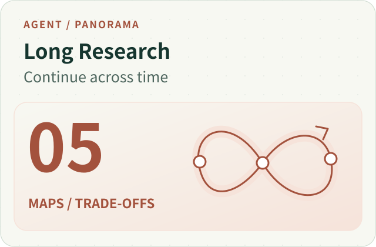
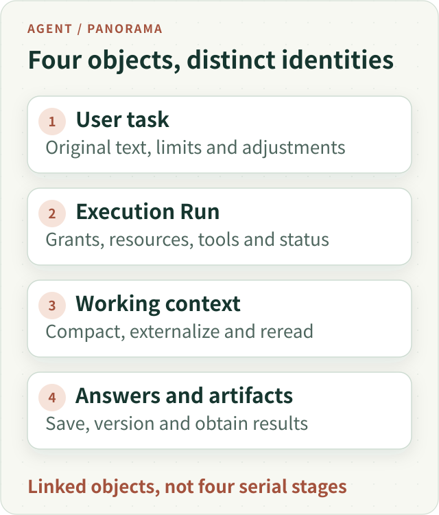
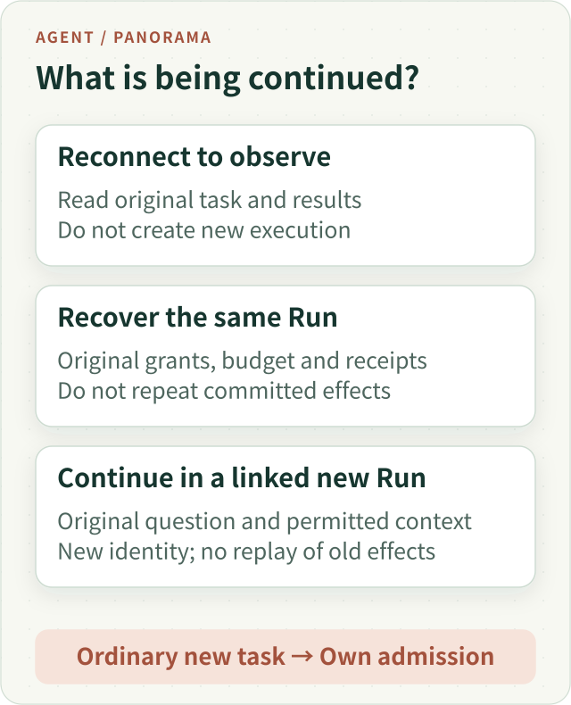
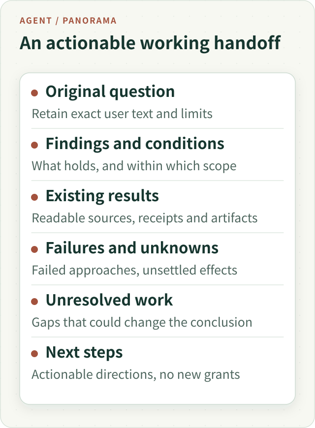

# Long-Horizon Research Panorama: Continuing Across Context, Interruptions and Time

A user asks: “Compare two thematic funds with my portfolio. Give me a grounded first draft, then investigate the important uncertainties.” The model reads documents, runs calculations and starts several specialists. Half an hour later, the activity list is long, but the user still cannot tell how the funds differ or which conclusions are usable.

The model may not be failing for lack of effort. It might not have read the essential disclosure. It might already have the data but keep searching. A calculation may have succeeded without its result reaching the next consumer. An answer may even exist without having been saved as something the user can reopen. All these situations look like “research is continuing,” yet they call for different repairs.

“Long-horizon” has no universal duration or token threshold here. It means **the research task outlives what one request, one context window or one uninterrupted process can carry**. Larger windows and longer timeouts postpone some constraints. They do not tell us whether research is advancing, whether it is time to deliver, or what justifies continuing after an interruption.

We follow one teaching task throughout. The fund example, its numbers and the walkthrough explain mechanisms; actual engineering observations are identified separately. They are not assembled into a claim that one end-to-end investment study has been completed. The relationship we want to establish is simple: **new evidence changes research judgments, original records retain what happened, and supported work products reach the user as they become useful.**

## 1. Separate Four Objects Often Called a Session

Long research starts with identity. A user thinking “this is still the same task” does not mean every piece of system state should share a lifecycle.

| Object | What it retains | Why the objects are not interchangeable |
| --- | --- | --- |
| User task | Original question, restrictions, explicit changes and requested deliverables | It can span executions; “continue” must not replace the original question |
| Execution Run | Admitted permissions, resources, model turns, tool effects and terminal state | Process recovery can continue the same Run; a new execution still has its own identity |
| Working context | Original passages, summaries, result references and open questions needed now | It changes and is compacted; it cannot be the only copy of history |
| Answer and artifacts | Accepted report versions, files and delivery records | Research can continue while established findings are saved and read |

*Figure 1. The four objects remain related without losing their identities. A shorter working context must not erase recorded requirements, tool effects or reports. Open the image for the full vector view.*

This distinction determines how the product treats time. Closing a page ends an observation connection, not necessarily research already admitted for background execution. A replacement process need not recompute finished work. A request for more investigation need not overwrite the previous report. Conversely, a new question does not inherit a previous Run's source permissions merely because it appears in the same conversation.

This separation may be unnecessary for a one-shot answer. A normal request and conversation history can be enough to read a passage and respond. The mixed identities become costly when work actually spans contexts, processes or delivery stages, causing duplicate execution, crossed conversations or lost work products.

## 2. Progress Means Letting Evidence Change the Next Step

### Progress changes a judgment, not an activity list

Return to the fund comparison. The lead model plans to calculate exact holdings overlap, then discovers that one fund discloses only its top ten holdings while the other discloses a full portfolio. Ten more searches for the same summary, or another specialist restating it, may add no value. Useful next steps could be finding comparable disclosures, calculating the known contribution of disclosed holdings, or withdrawing the currently unsupported goal of exact overlap.

Ask: **which part of the original question changed because of this information?** Progress may fill a factual gap, reject a hypothesis, expose a contradiction or establish that only a narrower answer is supported. Narrowing a conclusion can be progress. Quietly turning unknowns into zero is not.

Current model guidance distinguishes three temporary ways to think about a gap:

- **Missing evidence:** the share class, reporting period or holdings are unknown; original material is needed.
- **Missing transformation:** the data is available but dates, units, aggregation or calculations have not been reconciled. More search is not a substitute.
- **Missing judgment:** the facts and calculations are sufficient, but their relevance to the user's question and the limits of the conclusion still need explanation.

These are not three fixed routes or new database fields. They prompt the model to reconsider its next action after material results, failures, conflicts or a change of research phase. Translating every uncertainty into “search again” can trap a long study in collection mode.

### A working question can change; the original request cannot be checked away

ETF Agent uses research needs to help the model retain material gaps. New evidence can resolve a question or reopen one previously considered settled. When nothing material has changed, updating the list merely to leave activity behind is unnecessary.

The list is a **model-authored working assessment**. Setting an item to `resolved` does not establish source reliability, correct comparison or user agreement. Removing an item does not cancel an original requirement. Conversely, retaining `unresolved` and explaining the limitation can be an honest ending, rather than an error that must block delivery.

The runtime can establish that the list was saved, what a tool returned and whether those contents entered a subsequent request. It should not infer research sufficiency from keywords, an empty list or call counts. Turning these proxies into an automatic completion gate rewards satisfying the form instead of answering the question.

### After tool success, check whether the result can be consumed

A recent **controlled engineering check** illustrates this distinction. Native analysis completed, and the transformed content could be read by the fund research method on its own. Wrapped in the real tool response, however, it was rejected. The calculation was not at fault. The consumer recognized the legacy script condition `exitCode=0`, while the current native analysis completion contract has no such field.

The repair neither invented an exit code nor asked the model to transcribe the data. The original input parser learned the current completed-analysis shape and requires complete, untruncated UTF-8 output coverage before passing the result to the existing method. Failed, cancelled, unknown or incomplete output still cannot become usable input. Source permission and the meaning of the calculation remain with their original owners.

This changes the troubleshooting order. When a tool succeeds but research does not advance, first check whether its real output reached the consumer, then judge how the model used it. Prompt changes cannot fix an incompatible protocol. Fixing the protocol cannot prove that the model will make the right research choice next time.

## 3. Deliver Something Useful, Then Continue Around Its Gaps

### Feedback and deliverables answer different questions

“I found two reports and am checking their measurement basis” helps the user understand the wait. “The fee comparison is verified, but the holdings comparison covers only disclosed positions” begins to answer the research question. Both may be useful, but they are not the same completion measure.

A worthwhile progress update usually follows a changed research path, an important limitation, a needed user decision or a wait that has exceeded reasonable expectations. It need not pretend to be a report. **A staged deliverable should arrive when it has independent value, rather than waiting for every branch to finish.** If the fee basis is verified while holdings data is pending, deliver the fee section. If the missing fact is the fee's effective date itself, do not publish a definite number merely to produce an early answer.

Current native guidance asks the model to send independently readable, supported parts during research through the original answer publication path. It does not introduce an `answerReady` flag, periodic forced writing calls or a separate first-draft generator. Readiness remains a model judgment against the question and actual evidence; the runtime applies its existing source, numeric, permission, revision and resource controls.

### Complete retrieval is not complete coverage

Consider an explicit synthetic example. A fund accounts for 20% of a portfolio. Its two disclosed stocks account for 25% and 15% of the fund. Known portfolio exposures are therefore 5% and 3%. The remaining 92% is unknown: 80% comes from the unobserved remainder of the portfolio, and 12% from this fund's undisclosed holdings.

That result supports “known exposure and uncovered scope,” not “complete portfolio look-through.” It is not pairwise weighted overlap either. Reading the entire webpage establishes complete transport; it cannot turn a partial financial disclosure into a complete dataset. The corresponding native-consumption check carried this interpretation into saved and downloaded HTML. It used synthetic inputs and controlled requests, so it does not establish autonomous real-model completion of the financial study.

A staged answer needs scope attached to the conclusion, not an overconfident claim followed by general disclaimers at the end. Independently allowed text should also survive a broken citation attachment or an unrelated slow query. Actual permission denials still restrict the affected content.

### Fast does not mean ending early; deep does not mean spending every allowance

Once evidence supports the requested scope, synthesize it. Finding several more sources that do not change the judgment, or summarizing an already delivered answer again, may add no depth. Conversely, a material unresolved contradiction cannot be declared finished simply because some text has already been sent.

Timing agreements need equal care. “Within ten minutes” permits early delivery. “Notify me in ten minutes” constrains the notification time; it does not require the model to run idle for ten minutes or hide independently allowed answer parts. If the target arrives before completion, report real findings and gaps. Further work depends on the original permission, explicit deadline and remaining resources. A late partial result cannot be counted as an on-time complete answer.

Also define what the next result will be. Chat may show only the increment. If the user requested a report, the update should integrate still-valid findings, new evidence and corrections. A short note covering only the last angle cannot replace the report and be called a complete update.

## 4. Reduce Context Without Losing the Basis for Judgment

The context of a long study is a working desk, not an archive. Remove burdens that no longer help the next decision, rather than removing the original task or its factual basis.

**Retain original requirements independently.** “Use only the specified reporting period” and “do not access personal holdings” keep their original wording and origin. An assistant note saying “the user probably wants a comprehensive analysis” cannot override them. Current Main compaction keeps the original task, applicable corrections and authoritative state outside semantic rewriting.

**Externalize large results and read them through references.** Long tables, webpages and extracted PDFs can be stored with a summary and locator. The summary helps selection; exact calculations and disputed claims return to the actual retrieved result. Reading a passage does not mean the whole document was checked. A continuation cursor does not automatically invalidate the current range when that range was retrieved completely.

**Compact working process, not execution facts.** Completed steps, failed approaches, conditional conclusions and unresolved questions can become a working summary. Whether a call completed, what was authorized, where a number came from and whether a report was saved still come from original receipts. An unknown effect does not become successful because a summary says “handled.”

[Anthropic's context engineering article](https://www.anthropic.com/research/effective-context-engineering-for-ai-agents) presents compaction, external notes and subagents as different tools for long work, while recognizing the retrieval latency and tool-design costs of just-in-time loading. The local choice here is to separate working summaries from authoritative facts: reduce the model's burden while retaining a route back to unrewritten evidence.

This is not simply a matter of making summaries progressively shorter. Current Main compaction creates separate summaries of complete settled intervals. It does not split calls from results or repeatedly summarize old summaries. That reduces an opportunity for recursive distortion, but summaries themselves eventually consume capacity. Original text, tool definitions, summaries, output reserves and transport overhead all belong in the complete request. If it still cannot fit, the system must use its existing bounded ending or continuation path, not promise unlimited context.

[Anthropic's long-running harness work](https://www.anthropic.com/research/effective-harnesses-for-long-running-agents) uses progress files, Git history and verifiable feature lists to help coding agents take over. This fits observable engineering features well. Open-ended research can borrow the idea of leaving usable handoff artifacts, but not equate a fully checked question list with correct research. Later evidence may overturn an earlier conclusion, and research requirements may not be exhaustively enumerable in advance.

## 5. A Process Can Die Without Erasing What Happened

A disconnected browser, a failed model request and a crashed worker process are different faults. No frontend connection does not mean work has stopped. A missing old process does not authorize a fresh copy of the entire study.

Same-Run recovery first locates the original execution identity, durable checkpoint and tool receipts. A process with valid execution ownership can then continue. Leases and fencing answer “who may write”; working summaries answer “how should the task be understood?” A natural-language handoff cannot replace both.

| Recorded situation | Appropriate recovery action |
| --- | --- |
| The effect is conclusively complete and its result readable | Read the original receipt and result; do not repeat it |
| It conclusively failed and the original action permits safe repair | Decide on retry under the original budget, cancellation and idempotency constraints |
| It may have executed but lacks reliable settlement | Retain unknown status; let the original effect owner reconcile or apply its existing policy |

A durable cursor can lag a real effect. A result may have been saved just before the process crashed while advancing the checkpoint. The save receipt must outrank the old cursor. “Waiting to save” in the cursor cannot justify another save, and changing request identity cannot erase earlier unknown charges.

This is not unique to agents. [LangGraph's fault-tolerance documentation](https://docs.langchain.com/oss/python/langgraph/fault-tolerance) likewise distinguishes node retries from external effects and places idempotency and unknown acknowledgements in the application contract. A framework can provide durable state and recovery mechanisms while the application still decides what is safe to replay. There is no basis for promising exactly-once execution across arbitrary external tools.

ETF Agent has its existing native loop directly sequence model turns, action execution and completion handling, with one durable cursor owned by recovery. The old graph workflow layer was retired because it duplicated progress already represented by recovery, not because graph frameworks cannot support long research. A new project without mature execution and persistence may save substantial engineering effort by using a framework. A project already owning those boundaries incurs reconciliation work by adding a second cursor.

In this system, same-Run recovery uses the original recorded grant rather than reinterpreting a changing permissions table during recovery. Account and scope identity, explicit cancellation, execution ownership and resource limits still apply. Historical display and reads in a new Run follow their own entry contracts. Missing source bytes are an availability problem, not grounds to invalidate the entire Run's grant.

Recovery also does not promise to resurrect Python variables, open readers or temporary files. Deliverable tables and reports need the formal artifact path. An old result reference does not authorize a different Run to read the entire old workspace.

## 6. Recovery, Explicit Continuation and New Questions Take Different Routes

*Figure 2. Reconnection creates no new work. Same-Run recovery retains execution facts. Explicit continuation creates a linked new Run. An ordinary new question is admitted independently.*

| Situation | Execution relationship | What must remain intact |
| --- | --- | --- |
| Reopening a page | Observe the original task | Progress and saved work products, without replaying tools |
| Recovering a failed worker process | Continue the same logical Run | Original grant, budget, receipts, cancellation and execution ownership |
| Explicitly continuing a selected study | New Run linked to the parent study | Original question, applicable constraints, permitted background and a new execution identity |
| Asking an ordinary new question | New task through its normal entry | Current question and permission, without automatic binding to the previous study |

Why emphasize the original question? One actual Continue correctly linked the parent Run. Its new answer was visible and matched historical readback, yet it drifted away from the original multi-index task. Investigation found empty original-user context in the follow-on requests. Successful persistence could not qualify that continuation, and the new answer's topic alone could not identify which boundary had lost the information.

The subsequent repair placed explicit continuation preparation with the existing application owner. Original user text was retained separately from the assistant summary, source records, needs and fixed grant. The generic entry classifier no longer reclassified the task as “the user wants to continue.” Actual follow-on requests demonstrated that these materials reached the lead model; whether the model fully integrated previous findings remained a separate assessment.

Explicit continuation of an identified parent study also differs from an ordinary new question in a research workspace. The former inherits applicable source and tool permissions through the existing Continue contract and binds them to a new Run; other effects, such as a new provider's data-recipient approval, retain their corresponding admission rules. The latter obtains an independent grant through normal admission. Older reports, files and corrections are selectable material, not automatic authority. Being listed in a catalog does not mean a material was read or that its eligibility checks can be bypassed.

Progress retained across studies also needs attribution and versions. A model's “this question is resolved” is a working record, not a user-confirmed goal or trading instruction. New evidence can reopen a question, and an omitted old item does not cease to exist. Continuation can then carry history forward without turning old judgments into present facts.

## 7. Users Can Adjust the Task; Receipt and Adoption Remain Separate

While research runs in the background, the user asks a short question in the main conversation and adds “include tracking error” in the original research panel. The former can be answered independently; the latter must reach the intended study. A global busy state cannot represent this relationship.

An adjustment has three outcomes: **the original message was saved, subsequent model input actually included it, and the final answer genuinely addressed it**. “Received” establishes only the first. Even the second cannot certify the third: the model may misunderstand, omit or reason incorrectly.

An actual fault showed that research can lose its ability to investigate even when the correction reaches model input. The original request was preempted as intended, but an adapter collapsed “this request yielded to a new requirement” into ordinary cancellation. The runtime pushed the entire study into finalization-only mode, removing the tools needed for further investigation. The repair belonged in the preservation and handoff of the real interruption cause, not in more retries or asking the user to repeat the instruction.

The repaired follow-on resumed searching and reading, and later interaction checks observed separation between background research and short questions. Yet the same body of research still contained a semantic error: the model inferred “twice as strict a tracking constraint” from differently worded documents. An independent follow-on reread the primary sources and withdrew that inference. The original report and correction were retained separately.

These faults belong to different owners. Losing an interruption cause is an engineering boundary defect. The “twice as strict” claim needs source interpretation and financial semantic review. Repairing the latter with a runtime keyword ban could reject legitimate comparisons without teaching the model to use evidence. Strengthening model instructions alone cannot fix a misreported cancellation cause either.

[OpenAI's deep research introduction](https://openai.com/index/introducing-deep-research/) describes adapting research to new information; its 2026 update adds real-time progress and mid-research refinement. That establishes a real product interaction need, not proof of our message isolation, recovery or answer quality. The local lesson is to follow the original message, actual model input and delivered answer to determine how far an adjustment really traveled.

## 8. Let the Model and Runtime See the Same Resource Reality

Long research needs room to continue and an honest boundary for stopping. Model requests, tool computation, concurrent waiting, answer preparation and persistence consume different resources. One “turns remaining” number cannot represent all constraints.

The current implementation distinguishes lead execution, child execution and actual provider-request accounting. Children have their own execution allowances rather than consuming the lead model's room to synthesize without bound. A lead turn dedicated to sending findings can also be counted differently from exploration under the original policy. **These logical allowances do not refund real model calls: dispatched requests, time and unknown usage remain in their original records.** Older Runs retain their recorded policies rather than gaining an unannounced quota upgrade on recovery.

The model should see resource facts consistent with execution. If the product says work may continue but an outer script secretly imposes a lower limit, the model plans against false conditions and failures become hard to attribute. Stress tests may tighten limits, but should state them as experimental conditions instead of hiding another counter.

Resource reminders prompt reconsideration of effort; they do not let the runtime decide that research is sufficient. Near a boundary, the model may stop low-value exploration, deliver supported analysis or explain a gap. At a true hard limit, the runtime restricts the relevant new effects. Independently allowed text should not disappear because the last polishing request had no remaining allowance.

Multiple agents are not free extra time. [Anthropic's multi-agent research account](https://www.anthropic.com/engineering/built-multi-agent-research-system) emphasizes clear delegation, adaptive search and synthesis while recognizing added consumption and the limits of tasks that depend heavily on shared context. Independently checking two disclosures may justify parallel work. Asking several specialists to explain the same small table repeatedly may not.

Before delegating, identify the uncertainty the branch should reduce, how the lead model will receive the result and what happens if it arrives late. Child completion, submission, inclusion in a lead request and actual adoption are distinct facts. The main Run does not wait indefinitely past a hard boundary because a child is busy. A good submission that was never consumed cannot count as a benefit to the final study.

Parking and spinning also differ. A supported wake mechanism may continue original work when eligible conditions hold. Ordinary reminders belong in the next already-admitted model request, not an extra call merely to check the clock. Without a configured wake path, the system should not promise automatic continuation later.

## 9. Evaluate Continuation Against the Original Task

The final report alone rarely reveals where time was wasted. The call trace alone can make busyness look like rigor. Evaluation needs the task, evidence and user-visible work product together.

Work backward from an actual delivery:

1. **Did the original question arrive?** Inspect the original task, corrections and restrictions in actual follow-on input, not just the parent-child Run link.
2. **Which important unknowns changed?** Identify what new sources established, what calculations corrected and why an earlier claim was withdrawn. Repeated reads may reconcile different measurement bases; counts alone cannot label them waste.
3. **What was the earliest useful content?** It must address a material requested part with proportionate support. Plans, heartbeats, nonempty previews and incorrect early numbers do not qualify.
4. **Can the user obtain it again?** Check actual visibility, durable persistence, file download and the complete updated report separately, so success in one does not hide failure in another.

Time to first useful answer is therefore closer to the waiting experience than time to first character, but harder to measure. The reviewed content revision must be bound to actual client visibility. Missing same-clock timing or rendering evidence stays unknown. Correcting an early error later cannot retroactively make the early timestamp a supported delivery.

Comparisons must also retain no-answer attempts. If only successful answers enter an average, faster failures, abandoned hard questions or reduced scope can make the metric look better. At minimum, consider useful-answer achievement, semantic and source errors, the full requested scope and real resource costs together. This describes the current evaluation contract; it does not claim a demonstrated latency improvement in this system.

Model and human review assess whether evidence supports a conclusion and whether the answer addresses the question. Execution records establish what was read, sent and saved. Review findings may guide the next model or engineering improvement; they should not silently become a new semantic publication gate in production.

## 10. Walk the Whole Chain Through One Teaching Exercise

Let the original synthetic task experience several changes, and ask whether each mechanism serves the research.

**Establish one usable result first.** The lead model reads fees and disclosure dates and checks comparability. The fee section is supported, so it is delivered. Inconsistent holdings coverage appears next to the relevant conclusion, not buried at the end. The user receives a bounded draft, not “the plan is complete.”

**Work on gaps that could change the conclusion.** One branch seeks comparable disclosures; another calculates known holdings contributions. The lead model distinguishes missing data, transformation and interpretation instead of searching aimlessly after the necessary input has arrived. Children return locatable results, assumptions and unresolved questions, rather than just “done.”

**Accept the user's adjustment.** “Include tracking error” enters the intended study as original user text. The current request yields at a supported safe point, and subsequent input incorporates the new requirement. An unrelated short question remains separate. The lead model reopens the relevant question instead of treating an earlier checked item as an immutable plan.

**Reach context and process boundaries.** Settled working process is compacted while original requirements and results remain with their owners. After a service interruption, recovery reads the receipts: completed calculations are reread, uncertain effects stay uncertain. The draft remains accessible without requiring the model to rewrite it as proof that it exists.

**End the current work window honestly.** If comparable disclosures remain unavailable, save established findings and explicit gaps, retaining real resource consumption. An explicit user continuation starts a linked new Run with the original task and permitted background. It does not replay old effects or treat an unread historical catalog as knowledge already acquired.

**Deliver a complete updated report.** New evidence may fill a gap or withdraw a draft inference. Chat explains the material change; the report integrates still-valid findings, sources and corrections. Historical versions retain their dates. A normal ending does not imply that every unknown disappeared.

*Figure 3. A handoff preserves what the next researcher needs. Original records remain inspectable and summaries help action, jointly reducing repeated work and lost facts.*

This is a design exercise, not an acceptance record claiming every combination was executed. Its purpose is to expose what each handoff retains, what it changes and who is responsible.

## 11. What Existing Practice Establishes—and Where to Start

The current private implementation has mechanisms for native research loops, result readback, Main context compaction, staged answers, same-Run recovery and explicit continuation. Actual interaction observations also cover overlapping background research and short questions, targeted corrections entering subsequent input, and report/history readback. Concurrent conversation remains disabled by default; these observations do not establish production enablement.

The recent native-output consumer repair connected a synthetic portfolio input, disclosure read, calculation and artifact-readback path. It resolved a real implementation gap, but the personal financial research enhancement remains unfinished overall. Autonomous model choices, complete business judgment and recovery combinations cannot be qualified by this bounded check. The “twice as strict” error also shows why research quality needs separate verification even after execution becomes coherent. Public teaching-project capabilities must be checked against their published releases, not inferred from this private-system panorama.

To add long research to an existing agent, choose one task that genuinely needs several rounds of material handling and proceed through three questions:

- **Why is there no usable result yet?** Is evidence missing, transformation unfinished, a result absent from its consumer, or synthesis delayed? Locate the failure before choosing the repair.
- **What is already worth delivering?** Send one independently supported finding through real display and persistence paths. Keep a missing core premise unknown instead of manufacturing a placeholder answer.
- **What makes continuation legitimate after interruption?** Check that the original task, result receipts, resource usage and report versions reach the next actual work step. Then add compaction, children or cross-Run continuation according to the bottleneck.

Long research is not meant to run forever. Every continuation should have a reason, every stopping point should leave understandable state, and every ready work product should be obtainable. The model can start a fresh context and a new process can take over. Only when the original question, actual effects and evolving judgments remain connected can more running time become deeper research.

---

[Panorama series](/en/panorama) · [中文原文](/articles/agent-long-horizon-research-panorama)

Further reading: [Background research and foreground interaction](agent-background-research-collaborative-experience.md) gives actual interaction cases; [Same-Run context compaction](agent-main-run-context-compaction.md) develops working-set reduction; [Disconnection and recovery](agent-disconnect-is-not-crash-recovery-contract.md) examines execution lifecycles; [Time-bounded asynchronous research](agent-asynchronous-research-time-bound-delivery.md) explains deadlines and staged delivery.

More engineering practice is available in [ETF Agent Engineering Notes](https://github.com/hpoenixf/eff-agent-article). Star the repository to keep it handy.
