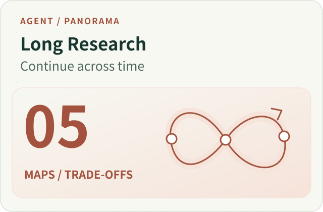
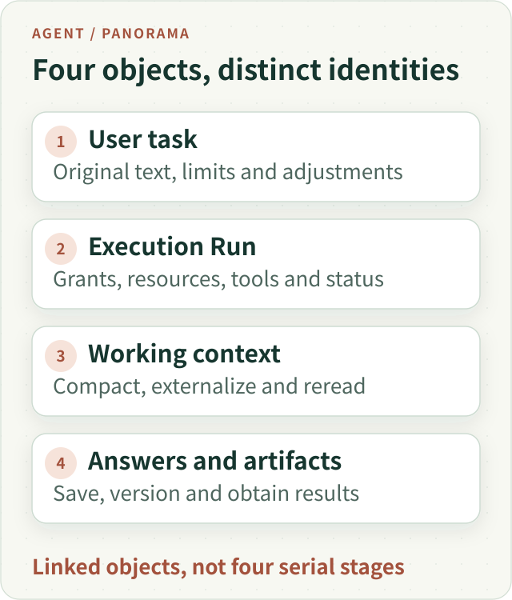
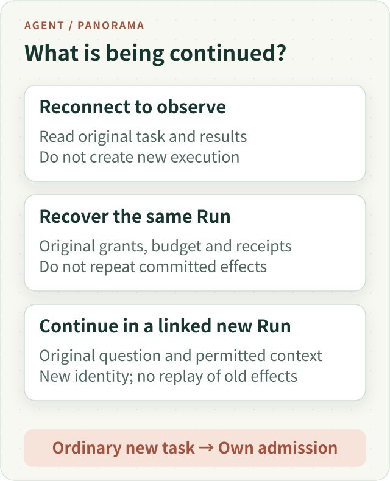
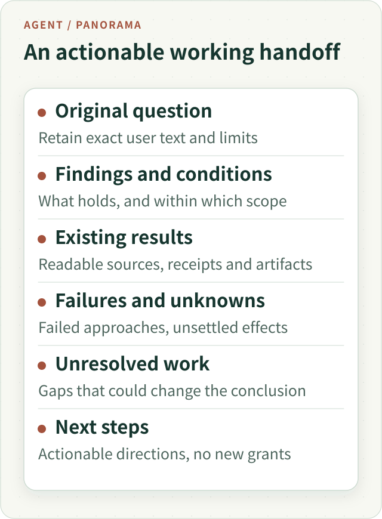

# Long-Horizon Research Panorama: Continuing Across Context, Interruptions and Time

A user asks: “Compare two thematic funds with my portfolio. Give me a grounded first draft, then investigate the important uncertainties.” The task may involve multiple documents, calculations and research methods. The user leaves the page or adds requirements. A service can restart. Eventually the accumulated material no longer fits one model request.

“Long-horizon” has no universal duration or token threshold here. It means **the research task outlives what one request, one context window or one uninterrupted process can carry**.

A larger context and longer timeout can postpone some limits. Alone, they do not solve task identity, original evidence, duplicate execution, saved results or how work should continue later.

**A system for long research lets judgments evolve, execution facts remain stable and users obtain valuable intermediate deliverables.** We follow the teaching task above. It is not a completed live investment evaluation and does not imply trading authority.

## 1. Separate Four Objects Often Called a Session

At first, long research looks like giving the model more thinking time. Implementation eventually forces four distinct objects into view:

| Object | What it retains | Why it cannot substitute for the others |
| --- | --- | --- |
| User task | Original question, restrictions, explicit adjustments and desired deliverables | The task can span executions; “continue” must not replace the original question |
| Execution Run | Its grants, resources, model turns, tool effects and terminal status | A process restart can recover the same Run; a new execution still needs its own identity |
| Working context | Raw text, summaries, result references and open questions needed now | It changes and has finite capacity; it cannot be the sole copy of historical facts |
| Answers and artifacts | Accepted report versions, files and delivery records | Research can continue while earlier work remains saved and readable |

One task may have a draft, targeted follow-up and a fully updated report. One Run may span many model calls and context compactions. The browser presents progress and interaction. A global loading state cannot decide every object’s lifecycle.

*Figure 1. The objects remain linked through their own identities. A shorter context must not erase recorded user requirements, tool effects or reports. Open for the full vector figure.*

## 2. Progress Means Letting Evidence Change the Next Step

A static workflow can prescribe reading, calculation and report generation. Open-ended research often discovers that its premise is wrong.

Suppose Main intends to calculate exact overlap between two funds. One document discloses only the top ten holdings; the other gives complete holdings. Adding the two columns does not make the answer precise. A better next step may be reporting the known overlapping contribution, explaining disclosure coverage or finding comparable material.

The model interprets that evidence and revises strategy and conclusions. Runtime executes permitted actions, records results and limits resources and effects. Keyword rules or a “sources complete” flag cannot decide semantic research sufficiency without turning the task into a hidden fixed workflow.

Progress happens at three timescales:

- **Within a request cycle:** read a document, notice an object or date mismatch, then continue reading or change sources.
- **Within one Run:** revise questions over several turns, externalize large results, reread selectively and preserve partial findings.
- **Across executions and time:** after interruption or explicit continuation, hand the original task and usable progress to later execution.

These timescales reuse existing model loops, context handling, recovery and continuation. They do not require a new controller that declares research truth. The essential design is that each observation can change the next decision. More tool calls alone are not progress.

## 3. Deliver Something Useful, Then Continue Around Its Gaps

Value should not appear only after the last tool call. A user may need verified fee differences now while a complex holdings check continues. One unresolved risk question need not prevent delivery of independently established facts.

A useful draft contains supported findings, relevant conventions and gaps that could change the conclusion. Do not make an overconfident claim and bury every limitation at the end. Do not rename a progress message and call it a deliverable.

Answers acquire versions as work proceeds. Generated prose that is independently authorized for display should be saved through the existing publication mechanism. A broken source attachment can be omitted locally or accompanied by a limitation; it should not swallow the whole answer. Preview, durable save, file export and actual user access retain distinct states.

**Staged delivery also needs a product decision: is the next result incremental, or a complete update?** Showing only new findings in chat reduces repetition. If the original request was for a report, the final artifact should integrate still-valid findings, additions and corrections. Replacing a draft with a short discussion of the last angle is not a complete updated report.

Staging does not authorize indefinite background activity. Continued execution still depends on the task, explicit instructions, budget and supported scheduling. The fact that more sources could be investigated does not grant a new action.

## 4. Reduce Context Without Losing the Basis for Judgment

Repeatedly transporting all tool bodies grows expensive. Deleting history indiscriminately loses calculation inputs, qualifications and restrictions. Handle different information differently.

**Keep user text identifiable.** “Do not use personal holdings” and “compare only the selected dates” must not become an approximate assistant paraphrase. Original instructions remain distinct from working notes; a summary is not a new user instruction.

**Store large results and reference them.** Tables, pages and PDF extraction can live outside the active request. The model keeps a short description and readable references, retrieving exact portions when needed. Externalization does not mean the material was fully read; a partial read does not establish a complete check.

**Compact assistant process.** Working notes should retain qualified conclusions, completed work, failed approaches, open questions and next actions. Long exposition, repeated source catalogs and intermediate debugging can leave subsequent requests.

**Keep execution facts in original receipts.** “Calculation finished” and “file published” must remain independently checkable. A summary asserting them is insufficient. If a reference disappears from the summary, inspect the original result and permitted readback path instead of immediately repeating an operation with an unknown effect.

[Anthropic’s context engineering article](https://www.anthropic.com/research/effective-context-engineering-for-ai-agents) discusses compaction, structured notes and subagents for extended work. Here their identities matter: notes help the model resume reasoning; original sources and receipts continue to carry their respective facts.

Measure the whole request, not just summary length. Retained user text, tool definitions, identity framing and serialization take space too. A summary’s target length may be advisory, while actual transport capacity remains with its owner. If compaction fails, expose the missing context and retain independent usable work rather than invent a lossless summary.

## 5. A Process Can Die Without Erasing What Happened

A browser disconnect and server-process crash need different handling. The former may only interrupt viewing; the latter raises execution ownership. No foreground connection does not mean the task stopped. A missing old PID does not automatically authorize starting another copy.

Same-Run recovery uses durable records to identify execution, checkpoints, completed or unknown calls and the writer allowed to proceed. Ownership and fencing protect concurrent takeover. Model summaries preserve working understanding. They solve different problems.

Three tool outcomes matter particularly in a long task:

| Recorded situation | Reasonable recovery behavior |
| --- | --- |
| Effect completed and result is readable | Reread the original receipt and result instead of repeating the effect |
| Known failure with a safely repairable action | Decide on retry under original budget, cancellation and idempotency conditions |
| Request may have executed without reliable settlement | Preserve unknown; let the original effect owner query, reconcile or apply its existing policy |

“Try again” can be correct. Forgetting an old request to make a new one appear free is not. Nor should the system claim universal exactly-once behavior across external tools.

Our same-Run recovery retains the recorded Run grant without reinterpreting changing permission tables. Account, scope, source and content identities, explicit cancellation and resource limits remain effective. Missing source bytes are an availability failure, not disappearance of the entire Run’s authorization.

Temporary analysis has another boundary. Recovery does not promise to resurrect Python variables, open readers or temporary files unchanged. Tables and reports that must survive need an actual artifact-delivery path. An original result reference also does not grant a later Run access to the whole old workspace.

## 6. Recovery, Explicit Continuation and New Questions Take Different Routes

Many resume bugs start by using one word for different actions.

*Figure 2. Reconnection creates no new work. Same-Run recovery preserves execution facts. Explicit continuation creates a linked new Run. Ordinary new questions undergo their own admission.*

| Situation | Execution relationship | Boundary to preserve |
| --- | --- | --- |
| Reopen the page | Observe the original task and reread progress/results | Do not rerun tools or redispatch committed effects on reconnect |
| Recover after a worker failure | Continue the same logical Run | Original grant, budget, receipts, cancellation and writer ownership |
| Explicitly continue a selected research task | A new Run linked to the parent task | Inherit applicable restrictions and recorded source/tool grants, bound to the new identity; do not relabel old effects as new results |
| Ask an ordinary new question | Handle a new task through the existing entry | Background history does not grant access or force the new question into old research |

ETF Agent’s explicit continuation already identifies its parent research. An existing preparation owner can carry the original question and permitted working background straight to Main. Calling generic entry classification again can instead reduce the task to “the user wants to continue.”

The linked Run inherits applicable source and tool grants and binds them to its new identity. That does not transfer every other effect. Permission to disclose data to a particular provider still follows the new Run’s original admission contract. Spent budget, unknown charges and old receipts cannot be cleared or reissued as new execution.

The word “continue” is not itself a runtime authorization protocol. The model interprets ordinary language. A validated explicit control carrying the real parent identity selects the continuation route. This preserves a research task while still letting the user change topics naturally.

## 7. Users Can Adjust the Task; Receipt and Adoption Remain Separate

While the opening research runs in the background, the user asks an unrelated short question in chat, then adds “include tracking error” in the original research panel.

The first is independent; the second names its target research. A busy background task must not absorb all new conversation. An explicit adjustment should not become an unrelated new task either.

Three facts remain separate: the raw user message was saved; a later research request actually included it; the report satisfied it. “Received” supports the first. “Passed to the research model” requires handoff evidence. The third still depends on research quality.

An in-flight model request may yield at a safe point so its successor can adopt the adjustment. **Yielding one request and stopping the whole research need different reasons.** A real case exposed this: the adjustment was saved and the current request interrupted correctly, but an adapter collapsed the local yield into overall cancellation, prematurely forcing finalization. Preserving the original reason fixed the handoff. More retries would not fix the authority mistake.

The UI also needs Run-based correspondence. A later short answer can finish first, a temporary message can be replaced by a durable one, and an end notification can precede history readback. None should cause crossed conversations, lost text or duplicate work. An independent research lifecycle is what makes a continuously usable input box possible.

## 8. Let the Model and Runtime See the Same Resource Reality

Long work consumes model requests, input/output, tools and computation, concurrency waits and finalization capacity. Children, Reviewers and retries all count. Naming another role does not create a free budget.

Represent limits through existing shared admission and runtime resource records. If Runtime believes dozens of requests remain while an outer script secretly permits only a few, the model plans under false conditions and the final state becomes hard to attribute. A low-budget stress test is legitimate when its condition is explicit and conveyed to execution.

Unknown cost is a fact too. A dispatched request without known usage is not zero-cost. Switching routes does not erase earlier consumption. On a real budget or user deadline, stop the affected new effects while retaining independently authorized prose, artifacts and gap statements. A final editing call lacking capacity must not clear all existing work.

Parking also differs from keeping a model spinning. A task waiting for a human reply or a supported external condition can retain state and wait through existing mechanisms. Wakeup preserves identity and resource facts. Without a configured wake mechanism, do not promise automatic future continuation.

## 9. Evaluate Continuation Against the Original Task

New paragraphs do not necessarily advance the question. Repeated reads, rephrasing or another specialist restating an answer add activity without reducing uncertainty.

For the teaching task, substantive progress could mean finding comparable holdings, correcting a fee’s effective date, withdrawing a comparison after calculation, or establishing that disclosure cannot support a precise answer. Each changes what the user can reasonably conclude.

Check separately:

- Whether the actual later request includes the original question, restrictions and conditions.
- Which gap new research resolved or narrowed, and which prior conclusion needs correction.
- Whether visible new content was saved and can be obtained again from history.
- Whether a requested complete update retains valid earlier findings and necessary source qualifications.

Execution and delivery can be checked through their original records. Semantic progress and completeness still need model and appropriate human judgment. Promoting an “all open questions checked” field into a publication certificate would create another shadow decision maker.

## 10. Walk the Whole Chain Through One Teaching Exercise

Let the same synthetic task experience several changes.

**First, produce a useful finding.** Main verifies fees and document dates and saves a draft. Holdings coverage differs, so overlap remains limited to disclosed material. The user already has a qualified result.

**Second, delegate complex local work.** Child handles documents and computation, returning result identity, conventions and gaps. Main rereads decisive passages. Working notes retain “complete overlap not established” without importing every debugging turn.

**Third, adopt a user adjustment.** The original “include tracking error” message goes to the selected research. The current request yields at a supported safe point; its successor receives the condition. Independent chat remains in its own execution.

**Fourth, survive a service interruption.** A new worker recovers the same Run from a checkpoint. Completed calculation is reread. A request without settlement stays unknown rather than being repeated on the strength of a summary. The draft remains readable.

**Fifth, reach the current execution boundary.** Save progress, expose unresolved work and retain consumption. A later explicit continuation creates a linked Run. Main receives the original task and permitted background. Old requests are not replayed as fresh effects.

**Sixth, deliver a complete update.** New evidence fills or revises gaps. Chat highlights additions; the report integrates valid prior material, new results and corrections. If key evidence remains unavailable, explain the answer’s scope rather than equating orderly termination with every question being solved.

*Figure 3. Original records remain checkable while notes help the next researcher act. Together they reduce avoidable repetition and factual loss.*

This synthetic path helps examine a design. It does not claim one live run covered every failure, nor does a bounded engineering check establish long-term reliability.

## 11. What Existing Practice Establishes—and Where to Start

Existing live interaction observations on this site cover background research overlapping short questions, targeted adjustments reaching later research requests, and report/history readback. A normally finished study still contained a financial inference that required correction from independent sources. Interaction continuity, durable delivery and research quality remain separate outcomes.

Compaction, source readback, same-Run recovery and explicit continuation each have their own implementation and bounded verification. Putting them in one panorama explains their connections. It does not jointly qualify every combination, provider or long-running behavior, and it does not imply the public sample project contains the private system’s full capabilities.

To extend an existing Agent, start with one task that genuinely requires multiple research turns. Connect the original request, original results and a readable report; verify that they survive one interruption. Then add externalization, compaction, Child or staged delivery where an actual bottleneck calls for it. Deliver one valuable result before expanding the scope of continuing work.

Long research changes the system’s relationship with time. The model can move to another context, the process can hand execution to another worker, and the user can leave temporarily. The original question, what already happened and the obtainable results still need a clear home. Only with that continuity does running longer have a chance to become researching more deeply.

---

[Panorama Series](/en/panorama) · [Chinese edition](/articles/agent-long-horizon-research-panorama)

Further reading: [Background research and foreground conversation](agent-background-research-collaborative-experience.md) provides live interaction cases; [Main context compaction](agent-main-run-context-compaction.md) covers working-set reduction; [Disconnection and recovery](agent-disconnect-is-not-crash-recovery-contract.md) examines execution lifecycle; [Time-bound async research](agent-asynchronous-research-time-bound-delivery.md) discusses deadlines and staged results.

More engineering practice is collected in [ETF Agent Engineering Notes](https://github.com/hpoenixf/eff-agent-article). Star the repository to keep it within reach.
