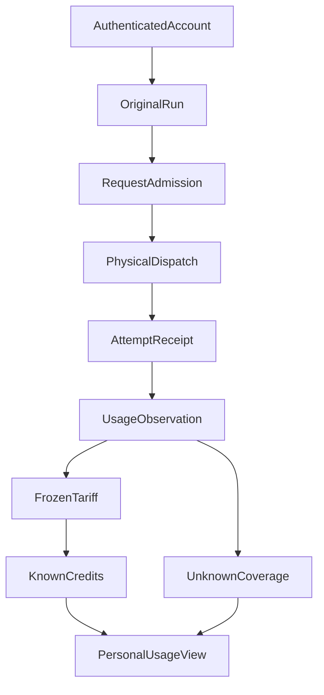

# How Much Did an Agent Really Consume? Requests, Tokens, and Credits Are Different Facts

The user sees a completed research report. Behind it, the agent may have made several model calls, dispatched tools, retried a request, and encountered a stream that ended without complete usage data. After the page says “Success,” can the system reliably answer how much the report consumed?

A real system has at least three ledgers that are often mistaken for one: **Run budget** constrains how much work remains, **physical model attempts** record actual dispatches and observable tokens, and **personal Credits** represent known usage under an internal allocation rule. They are related, but one cannot fill the missing facts in another.

ETF Agent currently uses a **Shadow Credits** usage view: it observes usage without denying existing research. The first task is to make identities, unknowns and calculation rules reviewable before deciding whether payments, billing or enforced quotas are needed.

## 1. Three Numbers Answer Three Questions

| Concept | What it actually means | Common mistaken inference |
| --- | --- | --- |
| Run request budget | Admissions and stage usage allowed for one Run | Treating admitted requests as token counts |
| Physical model attempt | A real model dispatch and its observable SDK usage | Treating a logical request or Langfuse span as one physical send |
| Personal Credits | Known internal usage under the tariff revision frozen on each attempt, attributed to the user’s UTC month | Treating internal points as a provider invoice or currency |

One logical model request may produce multiple physical attempts after SDK retries. A final aggregated SDK usage response cannot necessarily be split reliably among them. Counting only the final successful result can omit failed sends or assign fabricated precise costs to retries.

Original Run budget therefore remains with Resource/Recovery. Personal Credits passively consumes proven identities of admitted requests and physical attempts. A number appearing on the usage page does not authorize additional research; Shadow does not reject a call merely because observed usage exceeds a planned allowance.

## 2. Prove Whose Attempt It Was Before Pricing It

Accounting needs a path back to a trusted account, original Run, original request debit, and actual physical dispatch receipt. The key distinction is that **reservation for a logical request and evidence of a real send have different identities**.



Only a callback at the physical gateway dispatch seam can mint the corresponding receipt. Reading an old call during recovery, expanding a diagnostic record, or fetching a history view does not create a new physical attempt. Proven retries get separate identities. Where the SDK cannot establish how its cumulative observation maps to individual attempts, the correct result is incomplete coverage—not a made-up sequence number.

Account identity is similarly non-negotiable. A browser-provided `userId` cannot select whose Credits to view. The self-view derives owner scope from a verified session and does not accept an arbitrary owner filter. Logout, account disablement, session changes, and cross-account requests must not expose the previous user's totals.

## 3. Known Usage and Unknown Are Both Results

The Shadow ledger applies an internally versioned tariff to normalized input and output tokens actually reported by the SDK. Supplier-specific prices, cache discounts, and hidden usage that was never reported cannot be invented by the UI.

The current internal rule, `flat-reported-tokens@1`, applies uniformly to configured chat models: 0.001 Credits per input token and 0.004 per output token. For example, a **synthetic** 1,000 input + 100 output tokens produces 1.4 Credits, provided that attempt has attributable, completely reported usage. Cache input is already included in normalized input; it is neither added twice nor given a supplier cache discount. Each attempt receipt freezes model, route, and tariff revision. Its period follows the UTC month of physical dispatch. This is an internal allocation scale, not a way to compare suppliers’ actual prices.

The following **synthetic usage summary** omits API nesting; it is not an actual bill or API response. Assume a monthly allowance of 10 Credits, a known subtotal of 4, and one uncovered retry:

```json
{
  "period": "2026-10",
  "accountScope": "current-authenticated-user",
  "mode": "shadow",
  "knownCredits": "4.000",
  "observedAttempts": 1,
  "coverage": "partial",
  "unknownReasons": ["unreported-retry"],
  "wouldDeny": null
}
```

`knownCredits` describes only the observed, attributed portion; `coverage=partial` indicates uncovered work. Here `wouldDeny` must be `null`, not `false`: **a known subtotal above the allowance proves an overage, but a subtotal below it does not prove sufficient remaining credit.** Uncovered usage could change that conclusion. The current projection therefore returns only `true` or `null`, rather than inventing a complete negative finding. Credits use decimal strings to avoid browser rounding errors. Unavailable storage is shown as unavailable, not a zero bill.

Three branches are especially easy to miscount: a network send lacks complete usage; one cumulative SDK record spans retries and cannot be safely divided; or the process crashes after sending but before observation persists. The last gap is a direct cost of noninterference: observations use bounded asynchronous writes that model dispatch does not await. A usage-store failure therefore cannot block research, but a crash can leave an unpersisted window. None proves a free call, and recovery cannot turn a persisted unknown attempt into zero consumption.

## 4. Shadow and Enforced Quotas Are Intentionally Separate Phases

At this stage, an authorized local operator can set a monthly allowance revision for an existing verified account. Repeating the exact same operation identity returns the original revision; conflicting parameters are rejected. The user can see their own period, known Credits, tokens, and coverage gaps in the original account settings. There is no public top-up API, subscription, payment flow, or general admin console.

If known usage exceeds the configured allowance, the system may compute a **wouldDeny** simulation. It does not change Run resource budgets, Provider capacity admission, model sending, scheduled-Task budgets, or Publication. A broken observation store likewise cannot become a new research gate. Noninterference is the entire point of the Shadow stage: inspect the actual production seam before assuming a hard quota is complete enough to enforce.

Three starting points were considered:

| Starting point | When it fits better | Why this project did not simply adopt it |
| --- | --- | --- |
| Existing observability token/cost views | Comparing usage trends across models, users, and tasks | Local sampling, export failures, and uncovered attempts cannot establish a complete durable balance |
| SaaS billing and account services | A new product needs ready-made tariffs, administration, and payments | Replacing existing trusted accounts and Gateway would duplicate identity and execution authority |
| Existing accounts + original physical attempts + scoped PostgreSQL receipts | Stable user/month readback of attempts actually observed | Reuses existing integration points, but adds storage, unknown-state handling, and operations; current delivery remains Shadow |

This does not mean observability tools cannot calculate costs. [Langfuse’s official documentation](https://langfuse.com/docs/observability/features/token-and-cost-tracking) supports ingesting reported usage and costs or deriving cost from model prices. For trend analysis, that may already suffice. The decision here follows the local telemetry path’s incomplete coverage, not a claim that external products cannot be extended. A mature billing service can be a reasonable choice elsewhere; ownership of identity, allowance, and real dispatch records still needs to be explicit.

Any future enforced Credit admission requires independently designed atomic reservation, unknown-attempt holds, recovery reconciliation, and supported-route coverage. Merely turning `wouldDeny` into an actual denial would not establish reliable billing.

## 5. Deliverables can now be associated with original requests; full attribution remains separate

Users may ask what one weekly report cost, not merely how much their account used this month. As of October 31, 2026, the cost reader can associate a currently settled publication revision with its original Main request and observed physical attempts after confirmation by the original publication module. Files use original artifact identity and export receipts rather than temporary display names or nearby timestamps.

This advances association, not exclusive allocation. A request may serve multiple outputs, views remain non-additive, and shared costs remain unallocated. Complete report cost and the provider invoice remain unknown. Nor does this establish actual adoption of Child findings in the final report.

A controlled readback also confirmed that saved delivery remained independently readable when cost observation failed. These are delivery-cost changes, not an expansion of personal Shadow Credits qualification, payment, or hard quotas. [What Does an Agent-Generated Report Actually Cost?](agent-report-cost-attribution.md) separates association, allocation, and reconciliation.

## Implementation and Verification Limits

The current implementation includes monthly allowance revisions, Shadow physical-attempt observations, a self-scoped API and the original account settings view. Controlled verification on October 24, 2026 covered authenticated browser isolation between two users and real PostgreSQL paths where Shadow accounting leaves original Task/Scheduler behavior unchanged; engineering qualification without real model calls was also completed. This supports the design that observation failures should not block the original task. It does not establish production enablement, complete billable coverage or invoice reconciliation.

This phase has no payments, automatic charging, authentic provider invoices, or comprehensive coverage of every model, embedding route, and semantic Memory call. We do not claim token savings, lower costs, or a reconciled production bill.

We chose to preserve unknown because **an honest, recoverable partial usage record is more useful than a complete-looking zero invoice**. Long-running agents can gradually gain a trustworthy resource view only when “how much work is allowed,” “what was actually dispatched,” and “what can be reliably accounted for” remain distinct.

## Further Reading

[Run budget and constraint governance](https://hpoenixf.com/eff-agent-article/en/articles/agent-runtime-constraint-governance-v2) explains research admissions and finalization protection. [Langfuse and trustworthy observability](https://hpoenixf.com/eff-agent-article/en/articles/025-agent-langfuse-from-trace-to-trustworthy-observability) distinguishes physical attempts from visible traces. This essay focuses on the personal Shadow ledger rather than repeating those subjects.

More engineering notes are collected at [ETF Agent Engineering Notes](https://github.com/hpoenixf/eff-agent-article). Star the public collection if it helps.
