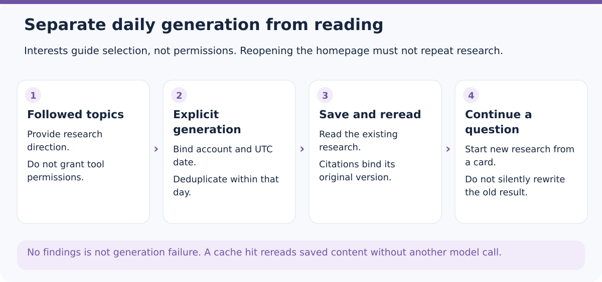
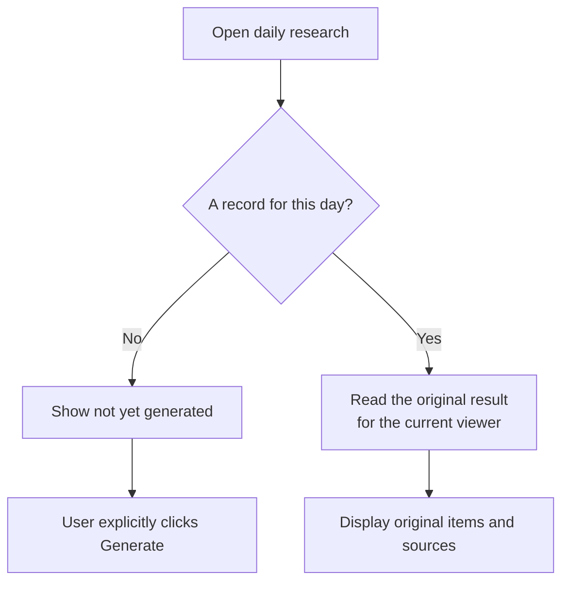
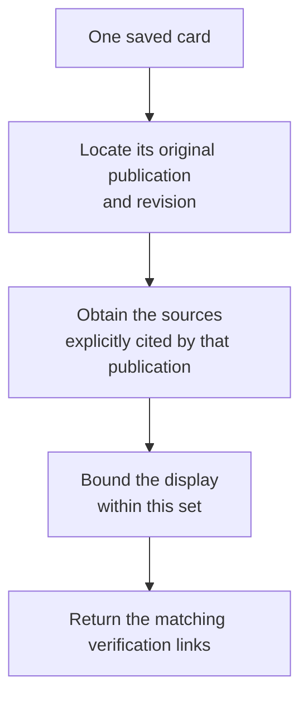

# Daily Personalized Research Is Not Just Repeating a Prompt

A user opens the homepage in the morning and sees research related to their interests. After lunch, the same content is still there. In the evening, they open an item to ask a follow-up question.

From the interface, this looks like a few cards. The obvious implementation is tempting: read preferences, append “generate something worth following today,” and put the output on the page.

But does refreshing the page authorize another round of model spending? Will two devices opening it create two results? Why might one card show another card's citations? When followed topics change during the same day, should the previous result remain or be regenerated?

**Daily research turns one clearly owned research execution into a result that can be read repeatedly. It should not turn every read into another inference run.** We will follow one day on the homepage, then examine two specific problems observed during engineering verification.

<picture>
  <source media="(max-width: 640px)" srcset="../../visuals/en/agent-personalized-daily-research-cache/overview-mobile.svg" />
  
</picture>

*Figure: Daily research generation, deduplication and rereading. This overview organizes responsibilities; it is not the execution trace of a particular task.*

[Enlarge the full diagram](../../visuals/en/agent-personalized-daily-research-cache/overview.svg)

## 1. Interests and permissions are different inputs

Start with a teaching example. A user enters “dividend-fund fee changes” and “fund holdings disclosures” under their interests, or selects a suggested topic.

These are initially just followed-topic strings. The implementation trims whitespace, limits length, deduplicates exact text, and saves the strings under the user's scope. A fund name does not automatically create a financial entity. The text is not written into long-term memory or interpreted as additional data permission.

That restraint is deliberate. Interests express what the user would like to learn. Source authorization expresses what the system may read. Research determines which questions are worth exploring from the available materials. Combining all three into a single topic system would make a simple product entry own responsibilities it should not have.

Daily research therefore enters the existing research engine. It uses the sources and tools admitted for that execution; the model selects questions, reads evidence, and organizes an answer, which is saved through the original publication pipeline. The homepage wrapper does not create another researcher or bypass source, budget, and publication rules.

In the current version, the model can select zero to three questions. The ceiling bounds presentation and work; it is not a requirement to manufacture three “opportunities” every day. A structurally valid output is displayable. That alone does not establish novelty, usefulness, or suitability for investment action.

## 2. Opening the homepage reads results; clicking Generate starts work

Putting “generate on cache miss” into page-loading logic can make an ordinary refresh initiate expensive, stateful research. Prefetching, failure retries, and multiple tabs can become repeated execution the user never clearly requested.

The entries are explicitly separate: `GET .../today` reads the saved daily result; `POST .../today` requests generation or a retry. Page mount uses the read-only endpoint. When nothing exists, the page says it has not been generated rather than silently making a model call.

This fits [HTTP safe-method semantics](https://www.rfc-editor.org/rfc/rfc9110.html#section-9.2.1): a client read should not be interpreted as a request to create another research task. The point is not that GET performs no server computation, but that reading an existing result and initiating business work are distinct user intentions.

Only the final step enters generation. Retrying a failed attempt also requires an explicit action, not a side effect of displaying the page.

Inside generation, the system first checks for an already successful result that day. A success is reused. Otherwise the request attempts to obtain generation eligibility. Clicking again must not imply permission to create a second research result merely because a button is visible.

This has a concrete product consequence. When the morning's generation succeeds and the user changes their interests in the afternoon, that day's result is not automatically rewritten. The current entry has no separate “force-refresh a success” operation. Immediate work on a new topic can become ordinary new research; the next day's explicit generation uses the interests present then.

## 3. Define “today” before using it as a deduplication key

A daily cache appears to need only a date. Where that date comes from determines which requests belong to the same result.

**The current daily entry uses the server's UTC date together with user scope as its storage key.** It neither infers the day from device location nor refreshes automatically at each user's local midnight.

For example, early morning in UTC+8 can still fall on the previous UTC date. The frontend must not label a new local day while the backend returns the same UTC-day research without explaining that convention.

The existence of a user timezone setting does not prove every product feature consumes it. Moving to local calendar days requires connecting trusted timezone, day boundaries, and duplicate-generation identity, including how later timezone changes affect old results. Changing only the displayed date would separate the interface from the real deduplication key.

Date alone is also insufficient. Users following the same topic may have different private context and source permissions. The stored object is this user's research for this day, not a shared answer available to anyone who asked something similar.

## 4. Not generated, no findings, and failure need different meanings

A homepage without cards can mean several things: generation has not started, it is still running, it succeeded with no selected items, it failed, or a saved result cannot currently be read.

Collapsing them all into `items: []` makes the correct next action difficult to express.

| Meaning of the state | What the user should understand | What must not happen |
| --- | --- | --- |
| Not generated | Today's work has not been started | Suggest that research finished with no findings |
| Generating | Another request is already processing it | Start duplicate parallel research |
| Successful with zero items | This execution selected no items within its scope | Automatically retry until content appears |
| Failed or no usable result | The original attempt has a gap requiring explicit handling | Present a failed cache as a successful empty recommendation |
| Saved result temporarily unreadable | There is a real access or projection problem | Regenerate and pass the new result off as the original |

Successful generation with zero items does not prove there is nothing worth following in the market today. It establishes only that this execution selected no items within its given scope, sources, and model judgments.

Likewise, a card with all required fields does not become a valuable recommendation automatically. Format parsing, execution completion, and content value are observed separately so filling the homepage does not encourage invented novelty.

## 5. Engineering example: correct text, wrong citations

In a synthetic-run verification, the research body and tool-issued citation relationships were correct, yet the final card was associated with the wrong sources.

The problem was the read model's selection order. It first selected a bounded set of recent sources across the entire research and only then looked for the citations required by a particular publication. Records belonging to an earlier publication had already fallen outside the candidate window. An overly broad fallback then admitted neighboring content that the card had never cited.

A simplified example makes this concrete. The research first publishes a conclusion about fee changes, then reads many holdings-disclosure materials. To bound display size, the page takes the latest source records across the entire research. The fee card's sources disappear, and adjacent sources fill their place. The text is unchanged, but the reader receives the wrong verification links.

This is not a model-intelligence problem, and regenerating the summary is not the right repair.

First locate **the original research's specific publication and revision**. Then form a bounded display from its established source relationships. A display limit is still useful, but it must operate on the correct set.

Private background that influenced generation also does not necessarily belong on a public-facing source card. The system can retain that dependency without presenting a user profile or uncited sibling excerpt as a public basis merely to fill citation slots.

Once the source projection is corrected, saved results can be displayed through the proper bindings without changing their body or calling the model again. A cache is not only a hit or a miss: **the research result can stay unchanged while the faulty logic used to read it is repaired.**

Current access rules must also be distinguished from historical versions. Each response still checks the current account and resource ownership, and reads publications under the original Run's recorded grant. Later source-configuration changes cannot arbitrarily rewrite the historical authorization of the same admitted research. New research needs its own admission.

## 6. Engineering example: deduplication consumes the query pool

Same-day deduplication must handle concurrency. When two devices initiate generation nearly together, an in-process `generating` variable cannot block the same request in another process.

The persistence layer uses a unique user-and-date key and coordinates generation with a PostgreSQL session-level advisory lock. Its meaning is application-defined: mutually exclude generation of the same daily research. The database is not deciding which research card is better.

The [PostgreSQL documentation](https://www.postgresql.org/docs/17/explicit-locking.html#ADVISORY-LOCKS) explains that a session-level advisory lock remains held until explicitly released or the session ends. Its lifetime is therefore closely tied to the connection holding it.

The engineering counterexample appeared at this boundary. Long-running research held locks using ordinary query-pool connections. With multiple users generating concurrently, those lock holders occupied the pool. The research then requested connections from the same pool to read conversations, retrieve material, or save publications—but none remained available.

The jobs were waiting for the very pool they had filled. It could look like the model was not returning, while the cause was application resource starvation, not necessarily a transaction deadlock detectable by the database lock manager.

Making the ordinary pool larger merely delays the trigger. The repair places long-lived lock ownership in a separate, capacity-bounded pool and limits queueing and acquisition time. Ordinary queries retain the original operational pool.

Database load does not disappear. The cost is another finite resource with its own shutdown, lock-loss, and cancellation behavior. The benefit is that concurrency control no longer consumes every connection required by the work it controls.

More importantly, a worker that loses eligibility cannot commit merely because its model response eventually arrives. Locks, cancellation, and late results must settle through the original generation path. A database deduplication design is not a universal exactly-once guarantee for external model calls.

## 7. Scheduling and follow-up should not create another research engine

A daily homepage naturally invites more features: generate at nine, notify at the agreed time, or continue from a card. Copying research and publication logic for each entry would give the same content multiple identities and inconsistent failure semantics.

The current design connects these concerns separately.

The basic daily entry owns explicit generation and daily rereads, not another scheduler. When presenting a confirmed scheduled research result in the daily interface, the association layer checks the original schedule's identity, active revision, and content digest, then reads through original task history. Selecting a schedule ID neither reconfirms it nor authorizes a new model execution.

Continuing research also does not silently append another execution to the old result. The current card entry creates an ordinary new conversation and places the topic in a visible input box. It neither copies the old Run ID or grant nor submits on the user's behalf. Actual sending admits a new question into new research.

This behavior is deliberately simple. The user knows what they will discuss and can add conditions. The old card supplies a lead, not a permanent cross-task access pass.

Calendar semantics, cancellation, and execution binding are covered in the [scheduled-research article](https://hpoenixf.com/eff-agent-article/en/articles/agent-autonomous-scheduled-research). The daily homepage consumes those established facts without taking ownership of them.

## 8. Evaluate personalization without counting cards

This capability has at least two distinct evaluation tracks.

On the engineering side, check that same-day duplicate requests do not initiate another successful research result, reads dispatch no model work, users' results remain isolated, sources map to the right publication, and retries preserve the original attempt's facts. Requests, persistence, and actual publication seams make those behaviors inspectable.

On the content side, reread the user's interests and final items. Are the topics relevant? Are the claimed changes actually supported? Does the output explain why they matter? Is it only old information rephrased? Does following up give the user a new understanding?

Neither track may borrow the other's results. A displayed card does not prove a useful recommendation. Correct source identity does not prove novelty. One successful research run does not qualify every later UTC-day output as reliable investment-opportunity screening.

The basic capability should not be described as already providing real-time novelty comparison, unread state, or automatic push. Allowing zero items is useful restraint, but deciding when the system should proactively interrupt a user still requires additional product evidence and evaluation.

## 9. Adjacent public mechanisms are not the complete daily product

Public [Open ETF Agent v0.15.2](https://github.com/hpoenixf/open-etf-agent/tree/34124cefc6df289e08518173789210b45a716451) does not implement the account-level daily topic selection, database generation lock, or scheduled-result association described here. Scheduling a few CLI commands in Cron does not make them equivalent.

A useful foundation to compare is generating a synthetic report through the [fixed-version demo entry](https://github.com/hpoenixf/open-etf-agent/blob/34124cefc6df289e08518173789210b45a716451/README.md), then reopening it through the [read-only reader](https://github.com/hpoenixf/open-etf-agent/blob/34124cefc6df289e08518173789210b45a716451/src/reader-cli.mjs). The latter invokes no model and makes the distinction between generation and later consumption observable.

That comparison covers the read boundary only. It does not establish personalized topic quality or multi-user access qualification. Later public scope is defined by [current main's actual documentation](https://github.com/hpoenixf/open-etf-agent/blob/main/README.md).

## Conclusion: a dependable daily service starts by not repeating work

After generating research in the morning, a user returning at noon should find the same content and correct sources. Two devices should not create unrelated duplicate results. An evening follow-up should clearly enter new research rather than silently inherit old permissions.

Those continuous, explicit behaviors create the daily product experience. The model selects questions worth exploring from authorized material; the system keeps interests, generation, persistence, and rereads correctly identified.

**“Research for you every day” is not resending the same prompt daily. It is a service with a cadence, durable rereads, and explicit boundaries.** Its real personalization value must still be demonstrated through the topics chosen and the understanding users gain.
