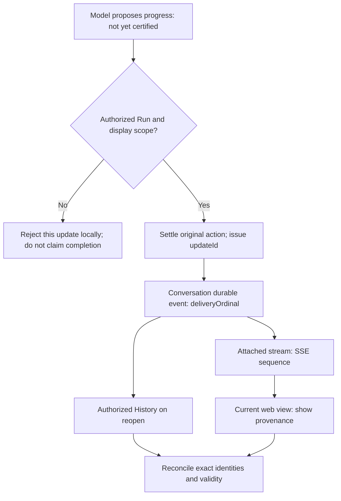

# Agent Research Progress Is Not a Log: Making In-Flight Work Truthfully Visible

A user asks an agent to compare two funds. The page says “Organizing disclosures,” then “Checking fees.” The next source read is slow. The user waits, refreshes, and finds one of those progress messages missing. Or perhaps the page keeps saying “Researching” even though the only thing known is that the browser connection is alive; no current observation establishes whether the server is still working.

Both problems seem solvable with a progress bar. But the difficult question is not animation: **on what grounds may a system describe work that is not yet finished? Which observations are worth retaining, which are local to one connection, and which should not be asserted at all?**

The fund example is a teaching scenario. The engineering history comes from ETF Agent's October–November 2026 changes to time awareness, research progress, Conversation/Recovery, SSE, and web reading. The validation cited below includes actual browser paths and isolated PostgreSQL with scripted model behavior and synthetic data. It does not certify production latency or the financial accuracy of real model research.

## 1. Why This Took So Long: The Problem Kept Moving Beyond “No Updates”

The original request was straightforward. Research can last minutes; the model needs to know time is passing, and the user needs feedback. On October 10, the first design separated three things: Host elapsed-time reminders enter the next authorized model request; the model may propose short updates through `send_research_update`; scheduled delivery commitments use the original task and notification path.

That answered **whether progress could be expressed**. It did not cause an extra model call just to report that time had passed. It did not insert model progress into the formal answer. And reaching a time threshold did not automatically mean the task had completed.

A second problem emerged as the real path was inspected. On October 25, progress updates of the same `kind` could replace one another in the Native pending map, the public event collector, Memory/PostgreSQL event identity, and the web projection. An earlier update could also be held until unrelated slow work later in the same model turn finished. The HTTP SSE comment sent every ten seconds kept the transport alive, but was not user-visible and said nothing about which stage of research had actually happened.

The next design therefore asked a narrower and more useful question: **if the model has produced three distinct authorized updates, can all three become visible in their actual order before a later slow action finishes?**

Implementation and browser verification on November 2–3 revealed a third problem. Seeing all three rows did not prevent a late History snapshot from erasing one. Nor did a row having appeared once prove that it would remain readable after reconnecting. Races, current authorization, and the original source of prior conversation context made “seen live” and “durably justified” separate concerns again.

| Stage | Reasonable earlier choice | Constraint revealed later | Retained design judgment |
| --- | --- | --- | --- |
| Time hints and model progress | Reuse the existing tool, Host guidance, and SSE | Same-kind updates could be overwritten or delayed | Give each authorized update its own identity and deliver it promptly |
| Ordered timeline | Append in event arrival order | SSE, storage, and browser reads operate on different timelines | Separate live sequence from durable ordinal |
| Reopen and racing reads | Replace the view with the latest returned History response | The snapshot might be older than a live row—or that row might no longer be readable | Verify only the exact existing receipt, within a bounded current view |

The earlier designs were not foolish. A per-kind replacement is sensible when the product needs only the **latest stage**. It stops being sufficient when the product promises an event-by-event account. **A state summary and an event timeline are different commitments; changing a Map into an array does not complete that transition.**

## 2. Who Said This Was Progress? Three Origins, Three Kinds of Evidence

The most misleading user interface is one that paints every signal of “not yet finished” in the same reassuring color.

| Signal | Producer and meaning | What it can show | What it cannot prove |
| --- | --- | --- | --- |
| Model progress `research-progress` | Model-authored text accepted through the original tool, authorization, and durable-effect path | “AI progress (not independently verified)”: what the model believes it is doing or attending to | That a source was fully read, a calculation was right, or research is some percentage complete |
| Transient Host status `research-pulse` | A current/last-known Run observation, or an explicit unknown | “System status”: the last observed state, a wait, or inability to confirm one | That the model is thinking right now or will eventually finish |
| Browser connection status | Client-local observation of a delay, disconnect, or recovery | “Connection status”: reconnecting or temporarily unable to obtain updates | That the server has stopped, cancellation completed, or the task finished |

The first transferable lesson is simple: **“Still researching” has no stable meaning unless its source is clear.**

A model can summarize its intended work, but a sentence from the model cannot certify a financial source. The Host can observe some execution facts, but it does not own investment conclusions. A browser can observe its connection, but connection health does not identify a live worker. These signals can help a reader together; none may silently borrow authority from another.

The actual research result still goes through the original Publication contract, with its body identity, revisions, numeric restrictions, and source rules. A progress message is neither a second answer nor a substitute for an actual question that needs a human response. A collapsible “Research process” panel can present the different observations without creating a fake assistant message for each one.

## 3. Between the Model and the Screen Are Four Separate Facts

One model update is not simply “send some SSE text.” The model proposes bounded `progress` or `attention` text through a controlled tool. The original Runtime checks the Run, current permissions, displayable content, and termination fences, then settles the action with a stable `updateId`. The existing Conversation durable event/outbox path assigns a `deliveryOrdinal`. The attached SSE connection sends an event in its own sequence, and the web client projects a visible row.

*Figure 1. Every visible update crosses distinct factual seams. Ordering, identity, and readability remain owned by the existing execution and delivery path; there is no new Progress Manager.*

There are at least four noninterchangeable facts: the model **proposed** text; the system **accepted and settled** an action; Conversation **committed** a durable event; and the browser **displayed** a row. A nice-looking UI cannot be used to infer that an earlier fact succeeded.

Deduplication also depends on the promise being made. Two `kind=progress` events with different `updateId` values are two statements. An identical sealed retry under the same action identity is one effect. If `runId + kind` remains the storage slot, the sequence “what we checked first, what we discovered next” collapses to the final sentence. Historical updates already overwritten by the old contract cannot be retroactively reconstructed.

## 4. Two Orders: Live Delivery and Durable History

One tempting shortcut is to use the SSE `sequence` as the History cursor: larger means newer. It appears to work on one connection. It fails across reconnects because a new stream may restart its sequence, while History may contain a different subset of events.

The revised design therefore maintains two independent orders:

- **Live order** belongs to the original Run event queue and applies only within that attached stream. Transient Host pulses enter the same queue rather than receiving sequence numbers from a separate heartbeat path.
- **Durable order** belongs to the original Conversation and uses `deliveryOrdinal` for committed progress actions. A transient Host pulse has no durable ordinal and is not copied into the outbox.

On reconnect, a complete, correctly scoped original snapshot establishes a durable catch-up cut. The consumer can then distinguish existing retained updates from later commits. The cut must not be guessed from the last UI sequence, and the private payloads used in internal ordering must not leak into the view. If the snapshot is partial or has the wrong identity, that classification remains unknown.

This does not try to create an abstract total order of everything in an agent. It makes a smaller, enforceable promise: **the current stream is ordered, distinct durable actions stay distinct, and reconnecting does not manufacture events that never happened.**

## 5. The Hardest Race: History Arrives Later but Describes an Earlier World

Consider an actual test target. A browser starts a History read. Before that read returns, SSE delivers a newly accepted progress row, and the page displays it. History finally returns without that row. Its absence might mean the database read began before the commit. It might also mean that the original stored identity or current permission no longer permits that text. **Absence alone is insufficient evidence in either direction.**

Replacing the entire view with the newly arrived History response loses legitimate live progress. Trusting every previously seen SSE message indefinitely can keep revoked material visible.

The implemented approach is deliberately narrower. After the original SSE send authorization succeeds, the transport may attach a short-lived, opaque, process-local receipt bound to the exact conversation, scope, Run, ordinal, and payload. If a late History snapshot omits that already-visible row, the client performs a bounded check of **that precise receipt** with the existing authority. It cannot use arbitrary text or guessed IDs as an authorization query, and it does not create a second permission owner.

| Check outcome | Current-view behavior |
| --- | --- |
| `current`: original identity and payload still match | Keep the row |
| `not_current` or invalid receipt | Remove only that row; do not erase independent answers or other Runs |
| `unknown`, timeout, or network failure | Retain only the exact already-visible row in the current Run/view generation, pending later genuine History; do not treat it as permanent permission |

A receipt from a process that has exited may fail local validation after restart. That means its temporary proof is no longer available—not necessarily that the underlying content was revoked. A later authorized durable History read can independently display the canonical row. A delayed verification response cannot resurrect a row across cancellation, a different account, a later view generation, or another Run.

Most importantly, optional progress verification must not hold an independent answer hostage. A legitimate publication continues even if one progress row still has uncertain status. That is what keeps Progress subordinate to the actual research task rather than turning it into another termination authority.

## 6. An Invisible Gap: Why Does a Second Research Turn Lose Progress?

The two-turn HTTP/PostgreSQL investigation on November 3 found another, less visible problem. The first answer had been committed, and the second model request really did include earlier conversation text. Yet second-turn progress could still be rejected because the origin of that fitted text had not been proven with enough precision.

A source ID by itself is not adequate. Source versions, which history was actually fitted into the new request, what had been truncated, and which text came from other sources all matter. An unsafe fix could perform another awaited History read on every dispatch or treat incomplete lineage as fully established.

The repair stayed with the original History → actual fitted request → new Run origin handoff. Only content whose original identity, version, and presence in the fitted request were established by the existing owner could support the corresponding visible progress. Other sources remained unknown. Bounded authenticated HTTP/PostgreSQL and browser two-turn observations then showed correctly delivered new progress while preserving the earlier answer.

The lesson goes beyond frontend event reconciliation: **a claim about the research process can itself depend on source provenance. Something being present in old History does not prove it was fully and legitimately included in this request.**

## 7. Thirty Seconds of Silence: Should the Screen Say “Still Working”?

For a long quiet model request, a cheaper and more truthful addition is available. When an attached, healthy viewing stream has not produced meaningful visible status, the Host emits a transient observation about every thirty seconds. When it cannot establish the current phase, it explicitly says that execution status is unknown. A bounded real-browser wait displayed two such unknown-state entries approximately thirty seconds apart.

This does not ask the model to reason again every thirty seconds, consume extra model attempts, or permanently write dozens of “I'm alive” messages into History. Leaving the page and reconnecting recovers only the original authorized durable events and readable Run facts; missed transient pulses are not backfilled as fictional history.

The system thus keeps two different heartbeats: HTTP `: heartbeat` is transport maintenance; `research-pulse` is limited, human-readable Host observation. Stop, park, cancellation, terminal events, and attached-stream shutdown must fence later pulses. The browser's own offline indicator explains the connection, not whether execution has stopped.

## 8. Frontend Acceptance Is About Reading Continuity, Not a Moving Spinner

Browser acceptance was not limited to “three rows appear.” With an isolated database, synthetic account, and scripted gateway, two model updates became visible before later held work; a third update and independent answer appeared when the gate was released. Refresh, cold reads, and service switching exercised retained authorized state. Other tests deliberately raced History, receipt verification, and the terminal event, checking that waiting to verify progress did not hide the answer.

There are also important reader-facing details. New progress must not force-scroll a user away from an older answer. Replacing a transient assistant message ID with its persisted identity must not collapse the same Run's open “Research process” panel. Concurrent Runs must not mix just because one emits its last event first.

These are bounded protocol and browser observations. They do not establish a production maximum silence interval, every physical disconnection, screen-reader behavior, or whether users feel more confident. If long timelines begin to cost too much to display, or the product needs claims about progress latency, measure those costs and gaps before introducing pagination, virtualization, or another instrumentation layer.

## 9. If We Started Again, We Would Begin with Less

The most reusable outcome of this history is not a particular event name. It is a way to **grow complexity only when the user-facing commitment requires it**:

1. **For a short task, deliver the answer.** Do not generate ceremonial progress events for every ordinary question.
2. **When long waits appear, reuse the existing Run and stream.** Start with stable task identity and conservative current status; a transport heartbeat alone is not feedback.
3. **Only when a recoverable sequence is needed, assign separate effect identities and durable order.** Do not mistake a latest-stage slot for a complete history.
4. **When actual reconnect races appear, verify only the narrow original receipt.** Keep authority with existing owners instead of adding a universal Progress Manager, a second event ledger, or another veto.
5. **Make optional status disposable.** Uncertainty about one progress row should not prevent delivery of an independently legitimate publication.

My condensed design judgment is:

**Good Progress is not a screen that always has something to say. It is a system that knows when it has grounds to speak, which facts its message represents, when that justification has expired, and when “unknown” is the right answer.**

That distinction matters especially for agents: the model may dynamically choose its research strategy, but the system's account of ongoing work still needs identity, provenance, time, and permission. A convincing impression of busyness is not a trustworthy record of progress.

## Further Reading

[Agent client interaction and reading](agent-client-interaction-and-reading.md) covers Run attribution, answer revisions, and control receipts. [Time-bound asynchronous delivery](agent-asynchronous-research-time-bound-delivery.md) explains promises made when the user leaves the page. [Observability panorama](025-agent-langfuse-from-trace-to-trustworthy-observability.md) examines why diagnostics cannot replace the original execution facts. This article focuses on the narrower question of truthful feedback while research is still underway.

For transport background, see [MDN: Using server-sent events](https://developer.mozilla.org/en-US/docs/Web/API/Server-sent_events/Using_server-sent_events). SSE delivers events; application identity, permission, revisions, and business semantics are separate contracts.

More essays are available in [ETF Agent Engineering Notes](https://github.com/hpoenixf/eff-agent-article).