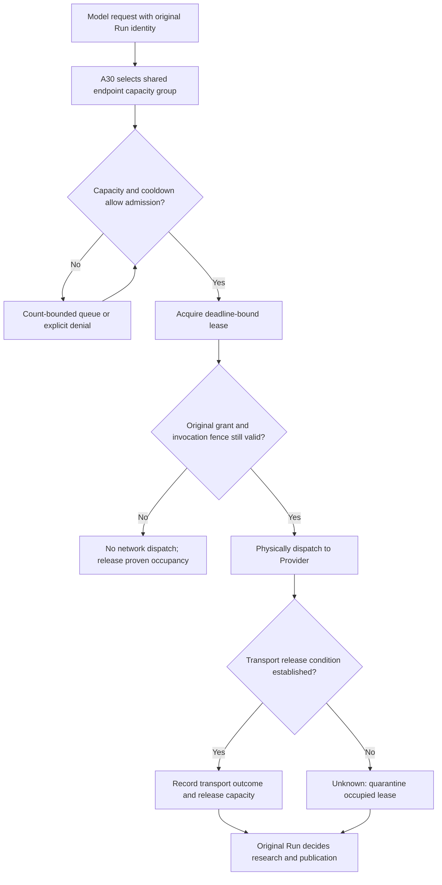

<div><a id="why-the-next-model-request-still-queues-after-http-200-a30-provider-admission-leases-and-unknown-occupancy"></a></div>

# Why the Next Model Request Still Queues After HTTP 200: Provider Admission, Leases and Unknown Occupancy

The main research loop is invoking a model while two Child agents analyze evidence and a separate process is about to review a report. Each process believes it is "below its concurrency limit." Yet all of them may use the same external endpoint and compete for the same capacity.

The less obvious problem appears at completion: the server has received HTTP 200 and several streaming fragments, and the UI may already show words, while the next request remains queued. Did the limiter forget to release its permit, or **is there insufficient proof that the previous remote invocation has actually ended**?

ETF Agent's Provider Admission owns a narrow answer: **within one managed coordination domain, may a particular physical provider call occupy capacity now, and when is there adequate evidence to release or quarantine that occupancy?** Provider Admission does not select the model, own the Run budget, evaluate the research or retry the task.

## 1. Separate model selection from the capacity group

Suppose two model IDs are served by the same configured proxy endpoint. Using the model names as concurrency keys would create two artificial pools for one external resource. A profile alias or a second worker must not make existing occupancy vanish.

The responsibilities are divided as follows.

| Owner | Fact it owns | What it does not own |
| --- | --- | --- |
| Model Catalog and Route Configuration | Model ID, provider profile, protocol and stable route identity | Registration does not issue invocation permission |
| Model Invocation and Request Configuration | Bound request, final protocol representation, dispatch and response | It does not create an independent cross-process capacity counter for each model |
| **Provider Admission** | Queue, lease, cooldown, release and quarantine for the shared group | It does not debit total Run budget or mark research complete |
| Run Resource Ownership | The original Run's request/action allowance, consumption and unknown outcomes | Its admission does not certify a provider connection has been released |

Provider Admission groups capacity by the **normalized endpoint from server-controlled configuration**. This is a shared upper bound inside the selected coordination domain, not a discovery mechanism for the provider's worldwide account quota. Independent deployments using the same provider account may still compete for vendor-side capacity; an application-side K is not a provider SLA.

## 2. Why coordination state must survive processes

A process-local semaphore is easy to implement: decrement the available permit count when work starts, increment it when work finishes. But once an API server, background runner, quality judge and evaluation worker share an endpoint across processes, their separate counters no longer represent total occupancy.

The current managed path requires callers within the same environment to share one PostgreSQL Provider Control store. Separate from the application/conversation database, it owns the capacity group, queued tickets, leases, generation and cooldown state. Losing that control database cannot trigger an automatic fallback to process memory: doing so would make previously invisible occupancy look like zero at exactly the wrong time.

Why not use an existing semaphore or distributed lock? If all calls truly pass through one process, a local semaphore is simpler and may be sufficient. A system already using Redis can use shared leases with unique owners and validity windows. [Redis's distributed-lock documentation](https://redis.io/docs/latest/develop/clients/patterns/distributed-locks/) emphasizes identity-checked release and a bounded validity assumption. That supplies coordination primitives; whether an external model keeps running after local expiry remains a caller concern.

We keep the queue, original tickets, occupancy and cooldown generation in one control state, changed atomically through PostgreSQL short transactions. This preserves unknown outcomes across processes and permits original-identity readback. It is not a claim that PostgreSQL is inherently faster. The costs are another shared-store dependency, connection and lock contention, and refusal of new dispatch when control is unavailable. If an existing unified Gateway already owns the complete cross-process boundary, reuse it rather than stacking another unaware counter.

Database transactions only serialize **short admission state transitions**. The HTTP stream happens after the transaction commits. A model response that takes tens of seconds must not hold an open database transaction for the entire invocation. That distinction preserves cross-process atomicity without turning slow inference into a lock held against other admission decisions.

## 3. Queue time and model execution follow different clocks

A request joins the queue before acquiring a lease. It remains associated with trusted original `scopeId`, `runId`, `requestDebitId` and relevant Owner fence. Provider Admission uses that binding to prevent one original debit from simultaneously acquiring a duplicate slot, but does not create a fresh Run allowance.

Waiting can reflect a full group or an active failure cooldown. It consumes real wall-clock time, but **is not counted as time in which the model has already been executing**. After admission and before actual dispatch, the Host still checks current authorization, original execution lifetime, cancellation and deadline. Permission before waiting does not imply permission at send time.



“Bounded” here first means queue length, not a fixed maximum waiting duration. Current managed calls use dispatch-relative execution allowances. They maintain original queued-owner liveness and establish the execution deadline after gaining a permit; there is no separate rule that spends model execution time merely by waiting. A full queue, cancellation, lost owner or control-store failure still stops admission. Calls supplying an explicit absolute deadline retain that deadline, but this branch must not be generalized into a timeout for all managed queueing.

Polling, renewal and expiration have defined policies. Pilot defaults such as concurrency 3, queue capacity 32 and lease length 60 seconds are Host settings, **not independently measured vendor promises**. Real waiting should remain visible to the user; excluding it from active execution does not make elapsed time disappear.

## 4. HTTP 200 leaves a crucial gap before stream completion

HTTP 200 establishes that an HTTP response began normally. It does not certify that the protocol completed, much less that the consumer processed a full answer.

At least four facts must be kept separate for a streaming model call.

| Observation | How Provider Admission can interpret it | What it cannot prove |
| --- | --- | --- |
| HTTP 200 and some output fragments | Dispatch and partial transport occurred | Remote execution is complete |
| A valid protocol terminal | The lease may be released under the original completion contract | User satisfaction or published content |
| User cancels or client stops reading without proof of remote termination | Local wait can end; unknown occupancy remains protected | Provider stopped work or charged nothing |
| Provider Control transaction acknowledgment is ambiguous | Reconcile the same original ticket/lease | Apply for another permit as "compensation" |

Protocol completion is not the only release condition in current code. No dispatch, a recognized protocol terminal, reaching the HTTP body EOF, and certain originally classified transport failures may be marked releasable by the transport owner. In particular, **EOF can release capacity while the missing required protocol terminal still produces protocol-incomplete**. Releasing a slot and accepting model output answer different questions; the former is not a successful answer.

Local cancellation without confirmed termination instead retains quarantine until the original dispatched execution deadline plus the bounded reclamation window. A lost heartbeat does not immediately free the slot. This is the local coordination contract's reclamation policy, not proof of provider cost settlement. The browser's spinner, Run terminal state and transport occupancy are separate facts.

## 5. What leases, renewal and generations protect

A lease identifies its owner and a bounded interval during which renewal and dispatch eligibility can be checked. If a scheduler pause makes a heartbeat late, resuming execution does not magically restore the old permit. The original hard execution deadline remains stronger than any renewal policy.

Cooldown is a shared next-dispatch policy, not a permanent judgment that a provider is broken. Qualified transient failures may trigger it, followed by limited half-open probes. Two identities have different jobs: **the original ticket and owner prevent releasing somebody else's lease; generation prevents an old result from incorrectly changing the new generation's cooldown and health state.** A valid old-generation completion can still release its own occupancy, but cannot reset the newer state to healthy. Rate limiting has a separate rule: an old generation's Retry-After remains a group-wide waiting floor.

Renewal also distinguishes a missing local ACK from expired durable ownership. Classified transient storage failures get bounded retries only for the same still-valid ticket and owner; the last confirmed expiry bounds starting retries and waiting between them. An original atomic renewal already in progress may acknowledge late with a new expiry still in the future. Accepting that result does not resurrect an owner the store judged expired. This tolerates short interruptions without another model call or a second debit.

One motivating engineering observation involved HTTP 200, streaming fragments and a scheduling gap lasting a little over thirty seconds, followed by lease interruption and research expiration. This supported investigating shared scheduling or storage jitter and later extending the normal Provider lease TTL to 60 seconds. The observation **does not prove the original failure's precise cause, nor that subsequent real research runs are fully reliable**.

## 6. Why cancellation, retry and release cannot be one Boolean

Suppose the original request lifecycle emits cancellation while the model stream has no recognized terminal. The system must respond, but must not automatically lend potentially occupied external capacity to the next call. Whether closing a tab cancels a task belongs to the original conversation lifecycle, not the capacity layer. A call with valid protocol completion can be settled according to the original contract; a detached consumer without such proof ordinarily retains unknown/quarantined occupancy.

A Provider Admission `release` decision distinguishes transport completion, transient failures and execution whose final state is not established. If the release transaction ACK is lost, bounded compensation retries use **the same ticket and the same first outcome**. They do not allocate a second ticket in an attempt to manufacture a successful release.

This also preserves the upstream Run ledger. The original `requestDebitId` does not get charged a second time merely because a request queued, its lease renewed or History was read again. Any legitimate new physical retry still requires the original request/Recovery Owner to admit it. Provider Admission can refuse capacity for a new invocation; it cannot declare the research failed and grant itself permission to rerun it indefinitely.

## Start with Two Processes and One Slot

Start with two outcomes for one slot. The [Open ETF Agent v0.17 fixed source snapshot](https://github.com/hpoenixf/open-etf-agent/tree/8137e592b0a07bcb0dfdd8756409c5bbc7d909ce) uses local SQLite, one capacity group and an original Runtime request. Runtime still reserves budget; admission receives its Run, ordinal, fence and input identity, then invokes the original Gateway only after gaining capacity. Database failure does not select an uncoordinated entrance.

After installing dependencies according to the fixed commit's README, run the two provider-free examples in the [same-version guide](https://github.com/hpoenixf/open-etf-agent/blob/8137e592b0a07bcb0dfdd8756409c5bbc7d909ce/docs/shared-admission.md):

```sh
node src/admission-demo.mjs normal output/admission-demo
node src/admission-demo.mjs unknown output/admission-demo
```

normal keeps the second process waiting for the original slot's release; unknown retains uncertain occupancy and cancels the queued caller. Each creates an isolated synthetic directory without a paid model. Do not delete unknown tickets to manufacture capacity. Observe **which fact makes the next dispatch lawful**.

Then use the original [two-process scenario](https://github.com/hpoenixf/open-etf-agent/blob/8137e592b0a07bcb0dfdd8756409c5bbc7d909ce/test/admission.test.mjs) to inspect original-ticket readback after a lost completion ACK:

```sh
node --test --test-concurrency=1 --test-name-pattern='^two original Gateway workers share one slot; settled original ticket survives acknowledgement loss$' test/admission.test.mjs
```

Compare the [admission module](https://github.com/hpoenixf/open-etf-agent/blob/8137e592b0a07bcb0dfdd8756409c5bbc7d909ce/src/admission.mjs) with its [scope proposal](https://github.com/hpoenixf/open-etf-agent/blob/8137e592b0a07bcb0dfdd8756409c5bbc7d909ce/openspec/changes/v017-shared-admission/proposal.md). This version has no PostgreSQL, multi-group fairness, cooldown or failover; unknown occupancy is not automatically released by TTL. Budget and capacity stores do not form one cross-database transaction. A debit may persist without a ticket, and refunds or automatic retries must not erase that uncertainty.

The records answer distinct questions. The [independent provider-free receipt](https://github.com/hpoenixf/open-etf-agent/blob/187c942b2c43c6da77011bcb2cbab1bfde1bdead/docs/verification/v017-admission-offline.safe.json) covers local contention and ticket readback. The [fixed real-task record](https://github.com/hpoenixf/open-etf-agent/blob/187c942b2c43c6da77011bcb2cbab1bfde1bdead/docs/verification/v017-real-ten.safe.json) covers the normal chain through admission, tools, Publication and original-byte cold Reader checks. The [earlier real-request record](https://github.com/hpoenixf/open-etf-agent/blob/8137e592b0a07bcb0dfdd8756409c5bbc7d909ce/docs/verification/v017-release.safe.json) remains a separate historical cohort, not part of a combined new pass rate.

An environment-interrupted task retains its unknown outcome and occupied capacity. Later completion in an isolated new group does not prove the old group recovered, cross-group global coordination, or real concurrent contention. These experiments also establish no financial-research quality. **Later success is not evidence for releasing earlier unknown occupancy.**

## 7. Current implementation and remaining evidence

The currently inspected full ETF Agent implementation, rather than the `open-etf-agent` public repository, contains shared PostgreSQL Provider Admission, endpoint-based groups, bounded queues and leases, cooldown/half-open recovery, a final original-authorization guard before dispatch, streaming protocol-terminal observation and unknown-occupancy quarantine. Managed API, research, self-test and review callers configured into **the same coordination domain** share this boundary. A synthetic memory coordinator used in narrowly scoped tests is not the production fallback.

Controlled engineering work has verified selected transaction semantics, control-database connection failures and recovery behavior. It has not transformed a test environment's policy parameters into a vendor guarantee, nor established a production-long-term throughput or latency SLA. Model-catalog eligibility, account usage limits and actual investment-research quality require separate evidence as well.

The goal is not a system where no model call ever waits. It is to make the waiting explainable: **which request lacks dispatch permission, which earlier attempt may still occupy a slot, when capacity can be safely released, and when the remote outcome must remain unknown.**

---

## Further reading

[Provider configuration and route identity](https://hpoenixf.com/eff-agent-article/en/articles/agent-provider-architecture-and-admission) explains the broader model-catalog and invocation layer. [Run budget and constraint governance](https://hpoenixf.com/eff-agent-article/en/articles/agent-runtime-constraint-governance-v2) covers the separate per-task resource allowance. [Failover and original Run identity](https://hpoenixf.com/eff-agent-article/en/articles/agent-provider-failover-without-resetting-the-run) shows why retry still belongs to the original Run.

Find more case studies at [ETF Agent Engineering Notes](https://github.com/hpoenixf/eff-agent-article); Star the repository to follow the series.
