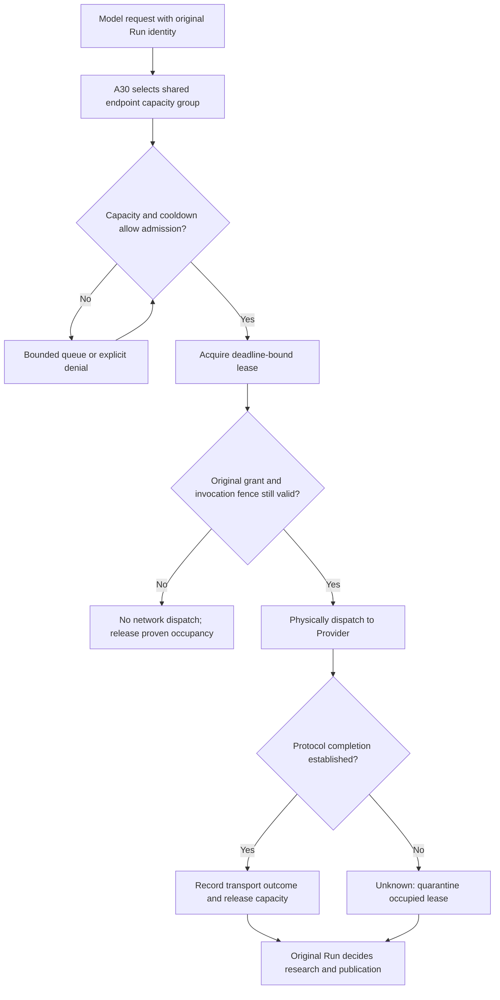

# Why the Next Model Request Still Queues After HTTP 200: A30 Provider Admission, Leases and Unknown Occupancy

The main research loop is invoking a model while two Child agents analyze evidence and a separate process is about to review a report. Each process believes it is "below its concurrency limit." Yet all of them may use the same external endpoint and compete for the same capacity.

The less obvious problem appears at completion: the server has received HTTP 200 and several streaming fragments, and the UI may already show words, while the next request remains queued. Did the limiter forget to release its permit, or **is there insufficient proof that the previous remote invocation has actually ended**?

ETF Agent's A30 Provider Admission owns a narrow answer: **within one managed coordination domain, may a particular physical provider call occupy capacity now, and when is there adequate evidence to release or quarantine that occupancy?** A30 does not select the model, own the Run budget, evaluate the research or retry the task.

## 1. Separate model selection from the capacity group

Suppose two model IDs are served by the same configured proxy endpoint. Using the model names as concurrency keys would create two artificial pools for one external resource. A profile alias or a second worker must not make existing occupancy vanish.

The responsibilities are divided as follows.

| Owner | Fact it owns | What it does not own |
| --- | --- | --- |
| A32 Model Catalog and Route Configuration | Model ID, provider profile, protocol and stable route identity | Registration does not issue invocation permission |
| A10 Model Invocation and Request Configuration | Bound request, final protocol representation, dispatch and response | It does not create an independent cross-process capacity counter for each model |
| **A30 Provider Admission** | Queue, lease, cooldown, release and quarantine for the shared group | It does not debit total Run budget or mark research complete |
| A05 Run Resource Ownership | The original Run's request/action allowance, consumption and unknown outcomes | Its admission does not certify a provider connection has been released |

A30 groups capacity by the **normalized endpoint from server-controlled configuration**. This is a shared upper bound inside the selected coordination domain, not a discovery mechanism for the provider's worldwide account quota. Independent deployments using the same provider account may still compete for vendor-side capacity; an application-side K is not a provider SLA.

## 2. Why coordination state must survive processes

A process-local semaphore is easy to implement: decrement the active count when work starts, increment it when work finishes. But once an API server, background runner, quality judge and evaluation worker share an endpoint across processes, their separate counters no longer represent total occupancy.

The current managed path requires callers within the same environment to share one PostgreSQL Provider Control store. Separate from the application/conversation database, it owns the capacity group, queued tickets, leases, generation and cooldown state. Losing that control database cannot trigger an automatic fallback to process memory: doing so would make previously invisible occupancy look like zero at exactly the wrong time.

Database transactions only serialize **short admission state transitions**. The HTTP stream happens after the transaction commits. A model response that takes tens of seconds must not hold an open database transaction for the entire invocation. That distinction preserves cross-process atomicity without turning slow inference into a lock held against other admission decisions.

## 3. Queue time and model execution follow different clocks

A request joins the queue before acquiring a lease. It remains associated with trusted original `scopeId`, `runId`, `requestDebitId` and relevant Owner fence. A30 uses that binding to prevent one original debit from simultaneously acquiring a duplicate slot, but does not create a fresh Run allowance.

Waiting can reflect a full group or an active failure cooldown. It consumes real wall-clock time, but **is not counted as time in which the model has already been executing**. After admission and before actual dispatch, the Host still checks current authorization, original execution lifetime, cancellation and deadline. Permission before waiting does not imply permission at send time.

When a queue is full or waiting exceeds its deadline, the request is explicitly denied rather than looping indefinitely through `C`. The diagram is a state sketch, not an unbounded polling algorithm. The implementation has bounded queues, polling, lease renewal and expiration checks. Pilot defaults such as concurrency 3, queue capacity 32 and lease length 60 seconds are Host-controlled operating policies, **not independently measured promises about the vendor**.

## 4. HTTP 200 leaves a crucial gap before stream completion

HTTP 200 establishes that an HTTP response began normally. It does not certify that the protocol completed, much less that the consumer processed a full answer.

At least four facts must be kept separate for a streaming model call.

| Observation | How A30 can interpret it | What it cannot prove |
| --- | --- | --- |
| HTTP 200 and some output fragments | Dispatch and partial transport occurred | Remote execution is complete |
| A valid protocol terminal | The lease may be released under the original completion contract | User satisfaction or published content |
| User cancels or client stops reading without proof of remote termination | Local wait can end; unknown occupancy remains protected | Provider stopped work or charged nothing |
| Provider Control transaction acknowledgment is ambiguous | Reconcile the same original ticket/lease | Apply for another permit as "compensation" |

This is why a model call that visibly returned something can still affect later queueing. The capacity slot represents potentially ongoing external work, not the state of the browser's spinner. Occupancy can be released after a qualified terminal or a safe bounded reclamation point. Under the current contract, an invocation without a confirmed remote end is protected until its original dispatch-relative execution deadline plus the configured quarantine interval, rather than released immediately when a heartbeat is lost.

## 5. What leases, renewal and generations protect

A lease identifies its owner and a bounded interval during which renewal and dispatch eligibility can be checked. If a scheduler pause makes a heartbeat late, resuming execution does not magically restore the old permit. The original hard execution deadline remains stronger than any renewal policy.

Cooldown is a shared next-dispatch policy, not a permanent judgment that a provider is broken. After a bounded threshold of qualified transient failures, the group may enter cooldown; later, limited half-open probes can establish whether dispatch may resume. A **generation** separates newly issued leases from uncertain occupancy under an earlier mode, protecting new capacity from a late release acknowledgment belonging to the old generation.

One motivating engineering observation involved HTTP 200, streaming fragments and a scheduling gap lasting a little over thirty seconds, followed by lease interruption and research expiration. This supported investigating shared scheduling or storage jitter and later extending the normal Provider lease TTL to 60 seconds. The observation **does not prove the original failure's precise cause, nor that subsequent real research runs are fully reliable**.

## 6. Why cancellation, retry and release cannot be one Boolean

Suppose a user closes a tab while the model stream has no recognized terminal. The system must respond to cancellation, but must not automatically lend potentially occupied external capacity to the next call. A call with valid protocol completion can be settled according to the original contract; a detached consumer without such proof ordinarily retains unknown/quarantined occupancy.

A Provider Admission `release` decision distinguishes transport completion, transient failures and execution whose final state is not established. If the release transaction ACK is lost, bounded compensation retries use **the same ticket and the same first outcome**. They do not allocate a second ticket in an attempt to manufacture a successful release.

This also preserves the upstream Run ledger. The original `requestDebitId` does not get charged a second time merely because a request queued, its lease renewed or History was read again. Any legitimate new physical retry still requires the original request/Recovery Owner to admit it. A30 can refuse capacity for a new invocation; it cannot declare the research failed and grant itself permission to rerun it indefinitely.

## 7. Current implementation and remaining evidence

As of October 24, 2026, main contains shared PostgreSQL Provider Admission, endpoint-based groups, bounded queues and leases, cooldown/half-open recovery, a final original-authorization guard before dispatch, streaming protocol-terminal observation and unknown-occupancy quarantine. Managed API, research, self-test and review callers configured into **the same coordination domain** share this boundary. A synthetic memory coordinator used in narrowly scoped tests is not the production fallback.

Controlled engineering work has verified selected transaction semantics, control-database connection failures and recovery behavior. It has not transformed a test environment's policy parameters into a vendor guarantee, nor established a production-long-term throughput or latency SLA. Model-catalog eligibility, account usage limits and actual investment-research quality require separate evidence as well.

The goal is not a system where no model call ever waits. It is to make the waiting explainable: **which request lacks dispatch permission, which earlier attempt may still occupy a slot, when capacity can be safely released, and when the remote outcome must remain unknown.**

---

## Further reading

[Provider configuration and route identity](https://hpoenixf.github.io/eff-agent-article/en/articles/agent-provider-architecture-and-admission) explains the broader A32/A10 layer. [Run budget and constraint governance](https://hpoenixf.github.io/eff-agent-article/en/articles/agent-runtime-constraint-governance-v2) covers A05's separate per-task allowance. [Failover and original Run identity](https://hpoenixf.github.io/eff-agent-article/en/articles/agent-provider-failover-without-resetting-the-run) shows why retry still belongs to the original Run.

Find more case studies at [ETF Agent Engineering Notes](https://github.com/hpoenixf/eff-agent-article); Star the repository to follow the series.
