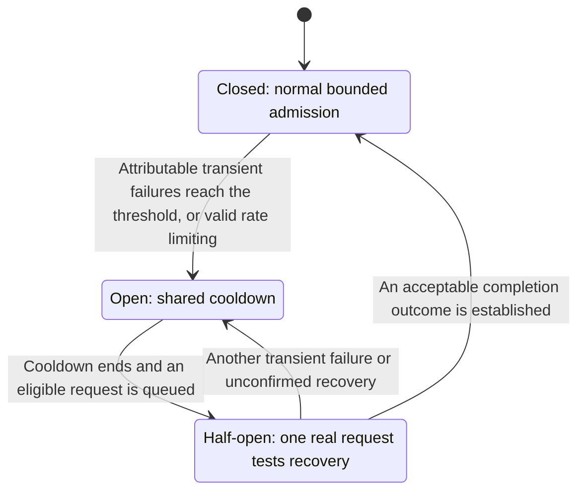
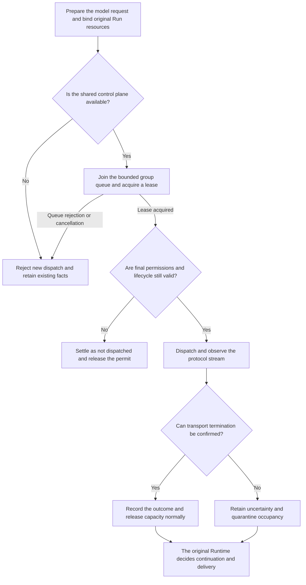

# Inside an Agent’s Provider Layer: Why a Unified API Still Needs Shared Admission

> October 23, 2026
>
> This article concerns language-model providers, not market-data, search, or fund-data providers.

Connecting a second model to an agent often takes little more than another endpoint and API key. But once the main research loop, child tasks, reviewers, and test processes all invoke models, connectivity is no longer enough. Their requests may consume the same external capacity. Waiting does not necessarily mean the model is slow, and a broken connection does not necessarily mean the remote execution has stopped.

We eventually reframed the provider layer’s purpose: **not merely to unify invocation APIs, but to give every external request a clear identity, a controlled entry point, and a trustworthy way to end.**

Using ETF Agent’s implementation, this article explains the reasons for that separation and which kinds of complexity belong in this layer.

## 1. Separate four identities before unifying the API

The user selects a model. The system actually uses a complete route. Those are not the same string.

| Concept | Question it answers | Why it needs a separate identity |
| --- | --- | --- |
| Model | Which model does the task intend to use? | Preserves the user’s selection and the task’s starting point |
| Provider Profile | Which server-owned configuration provides access? | Binds the provider, endpoint, credentials, and protocol |
| Route Identity | Which exact route did this request actually use? | Associates the model, protocol, and adapter settings with execution records |
| Capacity Group | Which requests compete for the same capacity? | Prevents model names, profile aliases, or processes from multiplying the allowance |

A model name cannot answer the other three questions. A name that exists in one platform’s catalog may not be accepted by another platform. Conversely, two very different models may pass through the same shared gateway.

The project encountered the first problem: an exact model ID was assigned to an official route that did not own it, and the invocation failed. Checking the actual catalogs established that it belonged to a different provider route. The durable lesson was not the particular error code: **a name is a selection identifier, provider ownership is a configuration fact, and actual execution identity requires its own record.**

That is also why a browser request does not accept “model name + arbitrary URL + API key.” The browser may submit an allowlisted model ID; the server resolves the endpoint and credentials. Otherwise, every invocation could invent a new route, leaving capability qualification, capacity grouping, and auditing without a stable basis.

The current implementation rejects duplicate model mappings rather than letting the last registration silently win. A modest configuration restriction buys runtime determinism.

### Why static profiles instead of a provider-management platform?

Our immediate problem was whether a small set of explicit routes could be invoked reliably and their behavior explained—not whether users could register arbitrary providers at any time.

Provider configuration is therefore parsed at process startup. Duplicate mappings and incomplete configuration fail early. Profiles explicitly represent differences such as protocol selection, omitted parameters, and route-specific reasoning modes.

This keeps a running task from silently changing its model identity because an administration panel hot-reloaded a setting. The tradeoff is equally explicit: adding or changing a route requires controlled configuration and a process update. It is not an off-the-shelf design for an open model marketplace.

Dynamic configuration is not inherently wrong. **Flexibility that the product does not yet need is not worth trading away the explainability it needs now.**

### A32 model catalog: registration, routing and eligibility are different actions

The architecture assigns these facts to **A32, the Model Catalog and Route Configuration Owner**. The catalog holds server-allowed model IDs and defaults, the deterministic mapping from profiles to providers/protocols, declared capabilities and route eligibility. It does not own the runtime's provider-capacity ledger. A25's UI submits an authorized model selection; A10 binds its route and protocol for the particular invocation; A30 subsequently decides when that capacity group may admit a physical request.

When a model ID exists but the mapping is duplicate, incomplete or bound to the wrong provider, catalog validation must refuse the configuration or unsupported selection. The Gateway must not guess another vendor after a failed call. Likewise, inclusion in a model list is not evidence that real tool invocation, long research or semantic output quality has passed acceptance. The current implementation uses server-side configuration, startup assembly and qualification records; **it is not a live editable model-administration platform that silently migrates old Runs**.

This article retains the "catalog identity to protocol request" storyline. The dedicated [A30 capacity-lease article](agent-provider-admission-capacity-lease.md) explains cross-Run queueing, leases, unknown occupancy and safe release. A32's registration facts, A10's dispatch facts and A30's shared capacity admission are three distinct effects.

## 2. A gateway unifies invocation, not model capabilities

A gateway is a protocol adapter. It gives the application a relatively stable request and event interface while handling provider-specific protocol differences. Current registered configurations include actual Chat Completions and Responses routes; the browser does not choose the protocol.

A tempting design is to compress every provider into one universal configuration: identical parameters, identical tool support, and identical structured-output promises. Any difference can then be handled when a request fails.

We did not take that approach. Profiles explicitly record parameters that must be omitted or special modes that must be used. Route identity includes configuration that affects invocation behavior. A changed protocol or significant adapter setting cannot inherit the old route’s qualification merely because the displayed model name is unchanged.

A unified interface therefore has two distinct meanings:

**It standardizes how callers invoke the model, receive events, and identify failures. It does not standardize capabilities that the provider does not actually have.**

Returning some text does not establish that a route can correctly terminate a tool call. Appearing in the registered model catalog does not establish eligibility for a research role. The Host—the application that runs the agent—must qualify the exact route for that role.

Keeping qualification in the Host and protocol differences in the gateway avoids two extremes: provider-name conditionals scattered across application code, or a gateway that independently decides which research responsibilities a model may assume.

<!-- open-etf-case:provider@e0a6a29b7474a19c18b169c0e4a7eb0eb614504d -->
### Start with Gateway encoding and call-result pairing

The [Gateway case at this fixed public snapshot](https://github.com/hpoenixf/open-etf-agent/blob/e0a6a29b7474a19c18b169c0e4a7eb0eb614504d/test/gateway.test.mjs) isolates the adapter's smallest responsibility without bringing the shared-admission system into the experiment.

After installing dependencies according to the README at the linked fixed snapshot, run:

```bash
node --test --test-concurrency=1 --test-name-pattern='^1\.4 injected offline transport verifies request encoding and matched tool results$' test/gateway.test.mjs
```

An injected offline transport captures the constructed request. Assertions check the original question, the tool-call ID and its matching result ID, and rejection of redirects. The terminal reports this exact test; no real API credential is needed.

No external HTTP request is sent. This does not qualify a real provider or implement the article's cross-process queue, capacity leases, or PostgreSQL admission store.
<!-- /open-etf-case -->

## 3. Why not put rate limiting inside each gateway instance?

Suppose the API service, research child tasks, and an independent reviewer process all use the same model endpoint. If each process maintains a local “at most K concurrent calls” counter, each limits only its own view, not the external resource they collectively consume.

The overall system can exceed its intended capacity even when every local counter is perfectly implemented.

We therefore moved concurrency admission into a shared coordinator: Provider Admission. It answers a deliberately narrow question:

> Within this coordination domain, may this request occupy one execution slot in this provider group now?

The current capacity group is derived from the normalized, server-configured endpoint—not the model name, SDK instance, or profile alias. Different models behind the same endpoint enter the same group.

The scope matters: **the limit covers managed requests that belong to the configured coordination domain and pass through this admission path.** Independent environments sharing a provider account can still compete for its external account-wide quota. Endpoint grouping does not reveal every limit inside the provider.

Consequently, a local concurrency setting is not presented as proven provider throughput. Nor do different endpoints prove complete independence of their underlying infrastructure.

### Shared capacity does not require shared conversations

Runtime services, live-model tests, and reviewers in one environment share a control database, but they need not share a conversation database.

The control store contains group state, queue tickets, attempt identities, leases, deadlines, and bounded resource bindings—not prompts, answers, portfolio holdings, or provider credentials.

This separation addresses different lifecycles. A test may clean up its own conversation data, but it must not erase cooldown or occupancy state still used by other processes.

**Agreeing on who occupies a resource does not require reading what everyone is researching.**

## 4. Why short PostgreSQL transactions instead of locking an entire model call?

What requires atomic coordination is a short decision: read the group state, determine whether this request is eligible, update the queue or lease, and commit.

The PostgreSQL backend uses a row lock for the capacity-group record and completes the mutation in a short transaction. Competing processes therefore serialize their decisions against the same state. Time-dependent decisions use the database clock rather than independently invented group clocks in each process.

The following is a mechanism sketch, not runnable production code:

```text
BEGIN
Read and lock the capacity-group row
Reconcile state against current time; inspect queue and leases
Write the admission decision
COMMIT
Only then proceed toward network dispatch
```

The network call is outside the transaction. A model can stream for a substantial period without holding the group lock or an open database transaction for that duration.

That separates two lifecycles: the database atomically commits who receives a slot now, while a lease expresses who continues to hold it.

The rationale for the PostgreSQL implementation is that the existing system needs short, persistent, cross-process coordination—not a general-purpose distributed scheduling platform first. There is no evidence here for a claim that PostgreSQL is faster than Redis. Changing the storage engine would not remove the lease and uncertain-execution semantics anyway.

The costs are real: the shared control store becomes a dependency for new dispatches, same-group mutations are serialized, and polling and heartbeats add overhead. Material changes in concurrency, isolation needs, or hot-group pressure would justify revisiting the implementation. It is not an unlimited scaling claim.

### Why not fall back to in-memory limiting when the control database fails?

Because the processes would lose their shared view. Each might believe capacity is available while persistent records still represent outstanding requests elsewhere.

The production path therefore rejects new managed dispatches rather than treating an in-memory coordinator as an availability fallback. The memory backend is reserved for explicit offline tests.

This is a deliberate tradeoff: **pause new requests whose eligibility cannot be established rather than interpret control-plane loss as zero shared occupancy.** Existing results remain the responsibility of recovery and delivery; rejecting another model call does not require discarding them.

## 5. Why separate queues, budgets, and clocks?

A provider queue answers “is a slot available now?” A Run budget answers “may this task continue consuming resources?” They are related, but they are not interchangeable.

A Run is one execution instance of a user task. It may already hold a durable reservation for its next model request while that request is still waiting in the provider queue. “Reserved” and “not dispatched” can both be true.

Admission receives a resource binding issued by the original Host, associating the Run, request debit identity, and execution identity. The same original debit cannot be queued or leased twice. Constructing another model object does not grant the task another budget.

Here is an illustrative input and decision summary. Its fields are simplified for explanation:

```json
{
  "request": { "runId": "example-run", "debitId": "example-debit", "group": "shared-gateway" },
  "decision": "queued",
  "reason": "capacity",
  "dispatched": false,
  "budget": "original-reservation-preserved"
}
```

The queue is bounded, with ordinary admission following queue order. A full queue produces an admission rejection, not an unlimited backlog or a fabricated provider outage.

Timing must also follow the actual phase. Managed calls distinguish queueing and shared cooldown from post-dispatch execution time, while those waits remain part of the wall-clock time the user experiences. Cancellation, owner-liveness checks, and applicable deadlines remain in force.

A single total-duration number cannot distinguish slow model execution, unavailable capacity, and compliance with a provider cooldown. Those conditions call for different engineering responses.

## 6. A lease proves local ownership, not remote termination

A capacity slot uses leases, heartbeats and execution deadlines, but two questions remain distinct: **may the local holder still act, and has the remote model request actually ended?** Cancellation, disconnect, process loss or lease expiry may establish only local facts. They do not prove that the remote request stopped or incurred no cost.

Confirmed termination can release capacity; uncertain remote activity receives bounded conservative quarantine, even if that temporarily underuses capacity. A missing acknowledgement after a control transaction likewise cannot fabricate successful admission. The detailed Claim, Lease, generation and renewal rules belong in the [A30 shared-capacity article](agent-provider-admission-capacity-lease.md); here they explain why a unified Gateway does not eliminate a separate Provider Admission Owner.

## 7. A circuit breaker coordinates the next attempt; it does not permanently label a provider

The group uses three states: ordinary admission, suspension of new calls, and a limited recovery attempt. These are conventionally called Closed, Open, and Half-open.



This is not an independent monitoring robot. After cooldown, one eligible request already waiting in the queue tests recovery. The system does not generate a new paid probe.

We chose this demand-driven approach because the goal is to restore business requests, not continuously buy information about whether a provider is healthy at this instant. It avoids extra calls and another scheduling responsibility. The tradeoff is that idle systems do not proactively discover the recovery time, and the next business request may bear the half-open attempt.

Failure attribution must remain restrained. Temporary transport failures and provider rate limiting can affect group state. Invalid model output, poor answer quality, user cancellation, and a full local queue must not all count as provider transport failures.

Otherwise, a model failing to produce valid JSON could unnecessarily cool down unrelated tasks.

### Why does group state need a generation?

Suppose request A is in flight when request B observes rate limiting and opens a new cooldown. A then returns successfully. Should that older request’s late success cancel the newly established cooldown?

No. It does not belong to the new recovery decision.

The state therefore includes a generation. Results from an older generation cannot arbitrarily clear a newer cooldown, while a valid Retry-After can still establish a later shared waiting floor. This is not complexity for its own sake. It makes concurrent outcomes affect state in the correct temporal context.

## 8. HTTP 200, stream termination, and task completion are different facts

A provider layer that records success on HTTP 200 cannot explain a subsequent broken stream. A layer that accepts a tool proposal merely because it sees EOF may accept arguments that never completed.

The transport layer observes bounded stream frames under the selected protocol and recognizes protocol terminals. For example, the Chat Completions observer combines a finish reason with the terminal marker. The Responses observer checks the completion event and matching status rather than searching arbitrary text for the word “completed.”

This observation establishes only whether the protocol confirms termination. A length-limited termination may still leave content incomplete. A valid tool proposal must still pass Host validation before execution.

Transport completion, tool execution, and answer submission therefore have separate sources of truth. They should not collapse into one `success: true`.

The overall path is illustrated below. Each approval applies only to the step that owns it:



There is a reason for checking final permissions after acquiring capacity: while queued, the user may cancel, source permissions may change, or the original executor may lose its authority. Eligibility before queueing does not establish eligibility at the moment of dispatch.

## 9. Three scenarios that clarify the separation

**Different models behind the same gateway.** The main research task occupies the group’s available slots. A reviewer requests another model through the same endpoint. It should still queue rather than receive an additional allowance because the model name differs. Eligible requests to an independent capacity group need not stop as well.

**The model returns invalid JSON.** If transport terminates correctly, capacity can be released under the existing rules. The content failure belongs to the protocol handler or task-recovery logic. Fixing answer format should not begin by labeling the entire provider group unhealthy.

**The user cancels a streaming research task.** The local caller responds to cancellation immediately. If remote termination remains uncertain, the corresponding isolated occupancy and unknown facts remain. The user no longer waiting is not the same as proving that the request never happened.

These scenarios concern identity, attribution, and lifecycle respectively. The provider layer’s value is not swallowing every exception. It is translating external uncertainty into facts the application can handle correctly.

## 10. Why not absorb retries, model selection, and research state as well?

Admission knows group occupancy and local transport outcomes. It does not know whether a research task may continue, what has already been delivered to the user, or which tools have produced effects.

If it retries on its own, a capacity permit turns into a new task authorization. If the gateway switches models on its own, it may skip source permissions or the existing budget.

We retain the following separation: configuration and gateways own routes and protocols; Admission owns immediate capacity eligibility; the Run owns permission for another attempt; recovery and publication own what happened and which results were committed.

That also creates a clear extension point for failover. It can use existing capacity facts to help the original Run select another eligible route without owning those facts again.

The companion article, “How Does an Agent Continue After a Model Failure?”, explores that problem. The provider lifecycle described here does not depend on automatic failover to be useful.

## Conclusion: a good abstraction unifies responsibility instead of hiding differences

For a single-process demonstration, a thin SDK wrapper may be enough. Once multiple tasks and processes share expensive, imperfectly controllable external resources, a unified API is only the beginning.

Our choice was not an all-encompassing Provider Manager. It was to give configuration, protocol adaptation, capacity, and lifecycle explicit responsibilities, connected through the original request identity.

That adds a control database, leases, and explicit failure handling. In return, it provides something more important: **knowing who actually received a request, why dispatch was allowed, why the request is still waiting, and when the system can honestly say it has ended.**

---

### Implementation scope and sources

This article was checked against the main-branch snapshot retrieved on October 23, 2026, including configuration, admission backends, protocol-terminal observation, and relevant history. It describes implemented mechanisms and their tradeoffs—not a provider SLA, cross-environment global-capacity guarantee, or measured long-term availability. The separate verification scope of automatic cross-provider failover is described in the companion article.

---

**Further reading:** [How Does an Agent Continue After a Model Failure?](agent-provider-failover-without-resetting-the-run.md).

Part of [ETF Agent Engineering Notes](https://github.com/hpoenixf/eff-agent-article). Star the repository to follow future articles on agent architecture and engineering.
