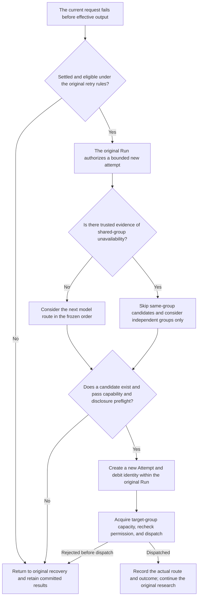

# How Does an Agent Continue After a Model Failure? Designing Failure-Domain-Aware Failover

> October 23, 2026
>
> This is an architectural account of failover, not an announcement of completed, seamless production high availability.

A model request fails halfway through a research task. Other models are already configured. Why not immediately switch to one of them and continue?

For a simple text exchange, that can look like a small `try/catch`. For an agent that has read sources, executed tools, and stored intermediate results, switching models can also change the data recipient, invocation cost, and recovery path.

Our choice was not “run it again whenever something fails.” It was: **select another eligible route for the next model request within the original task’s authorization and budget. Continue the task without resetting its responsibilities.**

## 1. First decide which layer needs recovery

Before discussing backup models, “research failure” needs to be decomposed.

A provider may have rejected a request. A model may have produced invalid output after receiving its inputs. A tool may have failed. An answer may already have been committed while the client has not yet received its latest state.

All can appear to the user as a stalled task, but only some are appropriate for model failover.

This design focuses on a narrow case: **the current model request has not produced effective output, trustworthy facts establish an eligible and bounded retryable failure, and the original Run still has authority to attempt continuation.**

It does not repair answer quality, automatically turn a tool error into a model switch, or erase completed research in the name of retrying.

A Run is one execution instance of a user task. An Attempt is a concrete model-request attempt within it. Separating them allows a task to continue through different routes while preserving the facts of each physical invocation.

An earlier project decision already separated failure classification from retry scheduling: the observed transport facts should determine a failure’s category. Whether a particular runtime path allows a retry must not change the name assigned to that same failure. Failover preserves this separation.

## 2. Why are three routes not simply a fixed three-step retry chain?

The candidate plan combines two kinds of redundancy: model diversity and endpoint diversity.

| Candidate route | What changes | What remains correlated |
| --- | --- | --- |
| Go DeepSeek | The original primary route | Depends on Go’s shared endpoint and the current model route |
| Go GLM | A different model behind the same entry point | Still shares the Go endpoint and capacity group |
| Official DeepSeek | A separately configured provider endpoint | Does not prove complete independence of the underlying model or infrastructure |

These are not three equivalent backups. Go DeepSeek and Go GLM primarily differ by model. The official route primarily differs by access endpoint and provider configuration.

Consequently, the policy cannot be reduced to:

```text
Primary fails → backup one fails → backup two
```

Whether the next route is worth considering depends on the scope of the failure: one request, one model route, or a shared entry point used by several models. That scope is the failure domain.

A single 503 does not establish that the entire shared entry point is unavailable. If group state does not establish a shared failure, Go GLM can remain a reasonable candidate.

But if trustworthy Go-group rate-limiting or cooldown facts already exist, switching to GLM behind the same endpoint does not leave the affected resource group. The independent official route can then be considered. A policy containing only same-group routes has no cross-group escape and should preserve the real failure.



“Consider” does not mean “guarantee an invocation.” Ordering supplies a direction; capability, budget, disclosure, and actual capacity checks still follow.

### Why start with a static order rather than intelligent routing?

The immediate goal was an available continuation path after a specific failure—not dynamically comparing model capability, cost, and latency for every question.

Static candidates let the Run freeze its allowed routes and order at admission. Successful ordinary requests need no additional probes. When something fails, the choice can be explained without reconstructing a continuously changing model-scoring system.

The tradeoff is that the policy does not automatically find the cheapest or smartest model, or exploit every temporarily idle service. At this stage, that restriction allows recovery to become well-defined without simultaneously building quality evaluation, cost optimization, and dynamic model selection.

## 3. Which failure facts justify changing routes?

Provider error messages often use natural language. Routing based on words such as “busy,” “unavailable,” or “retry” would turn changes in provider wording into changes in runtime policy.

We use structured failure categories, actual HTTP status, existing admission-group state, and the original request receipt. The error body does not determine the failure domain.

| Observed condition | Current direction | Architectural reason |
| --- | --- | --- |
| Retryable 500/502/503/504 before effective output, without established group unavailability | Consider the next candidate model route | One rejected request does not prove an endpoint-wide outage |
| A trusted provider 429 has established group cooldown, or the group is already unavailable | Skip candidates in that group | Changing model names cannot bypass the same group’s rate limit |
| A supported pre-response DNS failure bound to the original request and group | Consider an independent group | Specific shared-endpoint failure evidence exists |
| A local request-budget 429, 401/403, or parameter/protocol incompatibility | Do not treat it as a transient provider failure for switching | Quota and eligibility restrictions cannot be bypassed through another endpoint |
| Effective output already exists for the current attempt, or execution remains unknown | Do not resubmit the attempt from the beginning | Avoid overwriting output or replaying uncertain behavior |

The table deliberately does not say that every network error can trigger failover. The current endpoint-evidence implementation is bounded: it recognizes specific pre-response DNS failure codes with original request-identity binding. It is not a general-purpose network-outage diagnosis system. TLS security failures, for example, do not belong in this automatic-switch path.

### Group observations eliminate candidates; they do not grant capacity

The selector reads a projection from the existing Admission owner containing group mode, the waiting floor, and sample time. The projection must be sufficiently fresh and belong to the current route’s capacity group.

It is a conservative hint, not another health database or a dispatch permit.

Other processes can act between observation and dispatch. A group that appeared to have capacity earlier may no longer have it when the request is ready. The request must therefore still enter the target group’s real admission path.

An independent group need not inherit the old group’s Retry-After. It still obeys its own admission state, the original Run’s limits, and applicable deadlines. Crossing groups changes resource ownership; it does not abolish rate limiting.

## 4. Why not implement fallback inside the gateway?

A gateway knows how to invoke a provider, but it lacks enough task-level facts to own the decision.

It generally cannot independently establish whether the failed attempt has been durably settled, whether retry authority remains, whether a previous tool completed, or whether the current context may be disclosed to another provider.

A hidden backup invocation inside the gateway can still appear upstream as a single request even though the actual provider, cost, and data recipient have changed. The original Run’s records may no longer explain what occurred.

We therefore leave authority with the original Retry Owner: the runtime logic that authorizes retries for that Run. The failover selector answers only which route can be considered under already established authority. The gateway does not create a separate retry allowance, and implicit SDK retries do not invent physical attempts on the Host’s behalf.

The sequence is:

```text
Confirm that the failure matches the original durable receipt
→ Reserve a bounded retry permission in the original Run
→ Select the next eligible route
→ Prepare and validate the request for that target route
→ Reserve request resources and record a new Attempt
→ Pass target-provider admission and final dispatch checks
→ Persist what this invocation actually did
```

Three candidates do not mean two free additional requests. Retry permission and model-call allowance remain governed by the original task. A backup route does not come with a new budget.

One concrete implementation detail is that Entry failover checks whether the latest request is settled, whether its HTTP rejection or endpoint failure matches the durable receipt, and whether the execution identity remains valid before requesting a retry from the original Run. An exception object alone is not enough to call the backup SDK.

## 5. Why must the entire request be checked before changing providers?

“The backup model can answer” and “this particular request may be sent to it” are different claims.

The first check is capability compatibility. A target route has its own protocol, context capacity, tool support, and parameter constraints. A request accepted by the source route is not automatically suitable for the target. If required parameters cannot be satisfied, the candidate should be rejected rather than tested through a speculative 400 response.

The second check is role qualification. Registration in a model catalog does not establish permission to perform Native Research. Qualification must bind to the exact route; observations from an old model, old protocol, or another profile do not transfer automatically.

The final check is especially important for a financial-research agent: **who may receive which data.**

A model request can include the current user input, but also holdings, private documents, memories, tool results, and earlier model-generated intermediate content. Switching providers can change the recipient of that information.

Two providers supporting the same API is therefore not a disclosure authorization.

### Recipient consent does not establish coverage of this payload

The implementation separates three conditions: the identity of the target route, the data classes approved by the original Run, and proof that the complete prepared request is covered. All must hold.

The complete request is more than the user’s sentence. It includes tool descriptions, context, and derived content assembled later. Coverage proof follows the original producer and an unchanged request envelope. Arbitrarily cloning an object or adding an “authorized” flag does not inherit that provenance.

That is why the initial supported scope remains conservative. Current input and bounded, provenance-backed model-derived content can enter supported paths under the corresponding confirmation. Nonempty memory, private material, and dynamic sources without complete coverage proof do not become transferable merely because a model can process them.

This is not a promise that one consent click allows all future data to be switched. Support is restricted to request compositions that the current implementation can establish as covered.

### A key example: earlier model output is still data that needs authorization

Suppose a Child has produced an intermediate analysis and its next request would send that content to the independent official route.

The content is not automatically nonsensitive because a model wrote it. It may carry information from earlier inputs or sources.

If the original Run approved only current user input, that approval does not cover the derived content. The allowed path requires approval for the corresponding data class and matching provenance and integrity evidence for the bounded transcript.

This restriction limits recovery options, but it gives “safe continuation” a concrete meaning: recovery cannot expand disclosure authority that did not exist before.

## 6. Why must request identity change when task identity stays the same?

Imagine a research task originally selected for Go DeepSeek whose next model invocation is completed by Go GLM after a failure.

The system must not rewrite the original choice as GLM, as though the user selected it initially. Nor may it continue recording the actual request as DeepSeek, as though no switch occurred.

We preserve the original selection and record the actual route for each attempt. The following synthetic summary illustrates the concepts; it is not a production wire schema:

```json
{
  "runId": "example-run",
  "selectedModel": "Go DeepSeek",
  "attempts": [
    { "id": "a1", "route": "Go DeepSeek", "debit": "d1", "outcome": "http-rejected-503" },
    { "id": "a2", "route": "Go GLM", "debit": "d2", "outcome": "completed" }
  ],
  "authorization": "original-run-grant",
  "budget": "original-run-budget"
}
```

Task identity, the original user selection, granted capabilities, and established business facts stay unchanged. The new request receives a different Attempt, actual route, and debit identity within the original task’s ledger.

One logical model turn can involve multiple physical requests. A shared logical turn ID must not collapse those requests into a single overwriteable record.

### Why can’t recovery simply use the latest configuration?

After a restart, the system needs to know which candidates the original Run was allowed to use, which route it actually reached, and which requests remain unsettled.

Applying the latest candidate list could let an operational configuration change add providers to an old task, change its recipients, or reinterpret historical receipts.

The original candidate plan and authorization therefore remain fixed with the Run. Historical requests are read under their original routes. A new attempt must additionally pass current availability, qualification, and safety-switch checks.

**Configuration changes cannot rewrite historical facts, and historical permission cannot override a current denial for a new request.**

Similarly, an executor that has lost its fence—the token that prevents stale executors from continuing to commit—cannot overwrite current state using an old request. Duplicate acknowledgments or changed content cannot rewrite the first accepted submission identity either.

The original recovery and submission path enforces these conditions. Failover does not create a second ledger.

## 7. How should existing results and partial output be preserved?

“No output can exist before switching” is too coarse. Two situations must be separated.

**Earlier turns may already have completed and stored results.** Those results belong to the original Run. Failure of a later model request should not retract or re-execute them. Continuing through another route still depends on the new request’s admission and disclosure proof.

**The current failing attempt may already have produced effective text or a valid tool proposal.** In that case, the system must not pretend the attempt produced nothing and hand the entire attempt to a backup model for a fresh execution.

The second case belongs to the existing partial-result, repair, or limited-delivery path. Failover does not decide which committed answer blocks may be erased, nor whether a tool with an unknown effect should be executed again.

Missing receipts are particularly important: not observing local success is not proof of no remote execution. Absence of effective output alone is insufficient; trustworthy failure and settlement facts are also required.

That is why this design does not promise seamless switching at every stage. When the required facts are missing, retaining uncertainty or delivering existing results is more reliable than rerunning the task to create apparent success.

## 8. What may a Child inherit, and which roles should not inherit automatically?

A Child is a subexecution derived from the parent research task, not an unconstrained new task. It can inherit the parent Run’s approved candidates and corresponding authorization—not unlimited backup invocations.

The implementation uses the Child’s own request, retry, result, and recovery path to record its actual route and independent Attempts. A switch in one Child does not rerun completed siblings.

Later turns must also preserve the route that was actually used. A Child should not switch to a backup for one turn and silently jump back to the primary on the next because a default configuration was consulted again.

This does not give every role the same policy. Independent reviewers, fixed-model evaluations, diagnostic invocations, scheduled tasks, and context compaction are outside the scope of automatically broadening this failover strategy.

Evaluation makes the reason especially clear: if the question is how model A performs, silently replacing it with model B after a failure invalidates the original evaluation question, even if the resulting answer is good.

The same principle applies throughout: **technical ability to dispatch does not establish that this task permits that continuation.**

## 9. Three contrasting scenarios reveal the value of these choices

### Scenario one: a 503 without established shared-endpoint unavailability

The current request produced no effective output, its rejection was settled under the original identity, and the Run retains retry authority. The system reads fresh group state and considers Go GLM when shared-group failure has not been established.

The next invocation has a new Attempt and debit identity but belongs to the same Run. The system does not rebuild the conversation or hide the switch inside the gateway.

This adds a model-route option. It does not diagnose the 503 as necessarily originating in the model itself.

### Scenario two: the Go capacity group is in a trusted cooldown

Trying GLM in the same group does not escape the group’s wait. The full policy can consider the independent official route, but its qualification, disclosure, and capacity checks still apply.

An explicit Go-only policy has no independent group and cannot invent permission to use the official provider. Missing candidate configuration or qualification must not silently become a different, looser policy.

A new Run may acquire a narrower disclosure-eligible candidate scope through the original confirmation mechanism. That is different from adding new authority to an old Run during recovery.

### Scenario three: the backup is available, but the context is not proven transferable

The user approved current input only, while the actual request contains uncovered history or derived material.

The system rejects that candidate dispatch. It does not declare the original task’s existing results invalid. Preservable answer content remains, and the new cross-provider request does not occur.

This should not be described as a failed failover feature that needs weaker checks. It means the intersection of recovery routes and data authorization is currently empty.

## 10. Why didn’t we build another universal router?

The system already has configuration, capacity admission, Run budgets, source authorization, recovery, and publication. Most facts required for failover already belong to those mechanisms.

A router that owns everything might make the flow look centralized initially, but it can also duplicate health state, retry counters, and authorization decisions. Once the copies disagree, the system must again decide which one is authoritative.

The new core logic is therefore intentionally narrow: consume existing facts, eliminate unsuitable candidates, and return a selected route to the original request lifecycle.

That does not mean there is no orchestration. Entry, Main, and Child still need to connect these checks in the correct order. We avoid a second independently authoritative governance system, not the necessary steps.

The composition has defined ownership: Admission retains capacity facts; the Run retains retry authority; confirmation and source mechanisms retain recipient eligibility; the gateway dispatches the physical request; recovery records retain what happened.

## Conclusion: reliable failover is more than keeping spare models

A backup becomes a genuine recovery route only when it matches the failure domain, the task may continue, capabilities are compatible, disclosure is permitted, and historical state is trustworthy.

I therefore see this change as adding a controlled continuation option to an existing Run, rather than attaching a fallback to every exception.

**Change the route, not the task. Add an attempt, not permission. Recover execution without rewriting the past.**

These constraints are not accessories to failover. They distinguish reliable recovery from silently starting the problem over.

---

### Current implementation and verification scope

At this review, the code includes Root and Native Child failover integration, fixed authorization, and request-receipt support. Historical records include real backup-model invocations after controlled primary-route failures, plus separately executed persistence and permission checks.

These observations cover separate routes, not one complete natural-entry end-to-end run. The strategy remains default-off and the change is retained as non-release history; normal-application acceptance, route qualification, and deployment enablement are still separate tasks.

---

**Further reading:** [Inside an Agent’s Provider Layer: Why a Unified API Still Needs Shared Admission](agent-provider-architecture-and-admission.md).

Part of [ETF Agent Engineering Notes](https://github.com/hpoenixf/eff-agent-article). Star the repository to follow future articles on agent architecture and engineering.
