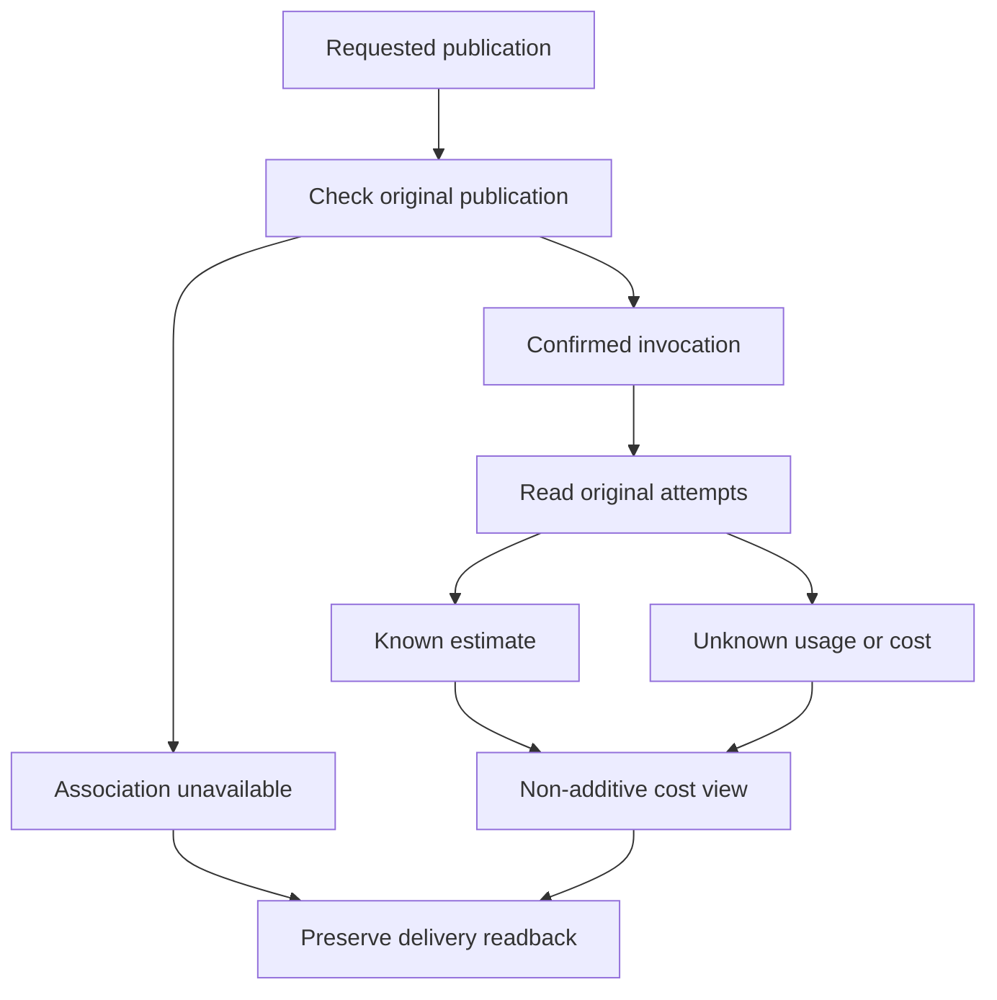

---
evidence:
  implementation: "Original-request and publication-version association implemented"
  scoped: "Controlled persisted-delivery readback and observer-failure checks"
  live: "Shared allocation, complete causal costs and invoice reconciliation remain open"
---

# What Does an Agent-Generated Report Actually Cost?

A research report has been saved, and the system recorded its tokens. Can we add up the Run’s costs, display the number next to the report, and call cost accounting finished?

Only under strong assumptions: the Run served that report alone, every call was recorded, pricing bases are consistent, no work was shared, and no costs are unknown.

Real agents frequently violate those assumptions. One request may produce text and a chart. Several outputs may reuse a Child’s research. A retry may occur before complete usage is returned. **Finding requests associated with a report is not the same as knowing its exclusive cost.**

## 1. Which ledger are we discussing?

Agent-cost discussions often conflate four questions.

| View | What it answers | What it cannot replace |
| --- | --- | --- |
| Run budget | How much work is this task still allowed to perform? | Observed tokens or provider charges |
| Physical attempts | Which request was actually dispatched, and what usage was observed? | The complete cost of a report |
| Account usage or Credits | How is known usage accumulated under internal rules? | The provider’s final invoice |
| Deliverable attribution | Which work relates to this answer or file, and how is it allocated? | A simple sum of request charges |

Physical attempts are particularly important. One logical request can cause multiple real dispatches. The same dispatch can also appear in a gateway receipt, a trace, and a Run summary.

The former must not lose failed attempts; the latter must not charge the same attempt repeatedly. Accounting starts with original physical-attempt identity, not with the number of report rows.

## 2. One investigation, two artifacts, and double counting

The following example is entirely synthetic. It does not describe real provider prices or a user invoice.

A research run has three confirmed physical attempts. Attempt A has a known estimated cost of USD 0.01, B has USD 0.04, and C lacks enough usage information to estimate its cost. A and B serve one logical request that both publishes report text and creates a chart file.

Displaying USD 0.05 under “report cost” and another USD 0.05 under “chart cost,” then adding the views, produces USD 0.10. Yet the observed known request estimate remains USD 0.05, and C’s gap has not disappeared.

The arithmetic is not the problem. The sets overlap: both deliverable views refer to the same attempts rather than two disjoint groups of charges.

The system therefore needs to say: **this is a non-additive association view; this is a known estimated subtotal, not a complete total; shared cost remains unallocated.**

Even splitting the cost equally is not inherently correct. Assigning half to each output can be a declared management-accounting policy. It is not an objective fact discovered in a dispatch receipt. Until a policy is selected, “unallocated” is more honest than a precise-looking decimal that conceals a missing decision.

## 3. We implemented association before allocation

In this implementation, published text and files are read through their existing durable identities. Text uses its publication block and revision. Files use original artifact identity and content hashes rather than a temporary display name.

For text, the reader asks the original publication module to confirm the current settled revision and its bound Main invocation. Only then does it associate observed physical attempts for that request. Older revisions, missing versions, and insufficient bindings are not repaired by matching nearby timestamps.

For files, it checks original artifact identity and export receipts. Saving a file, registering it in history, and establishing its semantic membership in a weekly report are different facts. The cost reader does not certify them all incidentally.



Attempt association occurs only after the publication owner confirms the requested revision and original invocation. An unavailable association limits the cost view; it does not invalidate independently saved text. Known estimates and unknown usage may coexist.

This chain answers, “Which observed attempts belong to the request that published this block?” It does not answer, “What was all the work required to produce this block?” Earlier source reading, Child work, and shared research may contribute. The publication request alone is not the whole causal chain.

Accordingly, the current view retains `requestMayServeOtherOutputs`, `viewsAreAdditive=false`, and `sharedCostAllocation=unallocated`. Complete report-attributed amounts remain unknown. This is not a forgotten sum; it is a deliberate refusal to promote request association into full attribution.

## 4. Unknown is not zero, and reported zero is not zero total cost

Missing usage may result from interruption before a receipt or from a recording gap. Neither permits an empty amount to be rewritten as zero.

The reverse distinction also matters. A provider reporting zero balance charge may describe one billing dimension of that response. Subscription price, allowance consumption, list price, and other external services are different quantities.

We retain provider-reported balance charge, BYOK cost, list cost, and allowance observations separately rather than collapsing them into an unexplained `cost` field. These are response-time observations, not reconciled final invoices.

The following is a presentation suggestion for the synthetic example, not a copy of the production API:

```json
{
  "knownRequestEstimateUsd": "0.05",
  "completeRequestCostUsd": null,
  "reportExclusiveCostUsd": null,
  "unknownAttempts": 1,
  "sharedCostAllocation": "unallocated",
  "viewsAreAdditive": false
}
```

Amounts retain a decimal representation, and unknown totals remain `null`. A useful interface might say, “Observed request estimate: USD 0.05; one attempt has unknown cost, and shared work is unallocated.” That is closer to the evidence than “This report cost USD 0.05.”

Likewise, index-page subtotals must not simply be added into a Run bill. Pagination coverage, repeated identities, and overlapping views must be checked first.

## 5. A broken cost observer must not break an already saved report

Cost observation is often optional, but composition can turn it into a global failure point. Text is saved; a report read also requests cost information; the cost query throws; the entire endpoint fails.

What the user has lost is not necessarily the report. It is the combined “report plus optional cost view” response. An auxiliary feature has expanded its failure scope.

A controlled check deliberately failed the cost-observation reader, then accessed saved artifacts from a fresh reader process. The behavior to preserve is straightforward: cost information becomes unavailable, while the original text, artifact identity, and independently authorized read remain intact. Do not resend model requests or regenerate the report merely to repair accounting.

Authorization failure is different. An unauthorized reader must not learn about a report through its cost view. Optional-observer availability and access to the original data are separate boundaries; graceful degradation cannot bypass the latter.

## 6. When can we claim that a report became cheaper?

First name the comparison: request-level estimates, account-level spending, or deliverable cost under a particular allocation rule? Each can be useful, but they are not interchangeable.

Then check three things: whether physical-attempt and pricing coverage are comparable, whether shared-cost rules were fixed in advance, and whether the delivered content and quality are comparable. Reading fewer essential sources, omitting failed calls, or moving Child costs elsewhere can lower the displayed number without improving efficiency.

Incomplete coverage still allows useful reporting of known amounts and gaps. It does not justify a claim about total savings per report. Complete causal attribution and provider reconciliation remain further work along this chain.

## 7. Why an E04 Evidence Copy Still Cannot Establish a Report's Total Cost

In October 2026, the independent E04 Research Evidence Store was given responsibility for retaining logical input, observable output and source-dependency copies. That establishes **attempt identity, retention and readback**, not a reconciled model-provider bill.

| Additional observable material | What it can establish | What is still missing |
| --- | --- | --- |
| Physical attempt under an exchange | Distinguish separate attempts | Coverage of all dispatched and unknown attempts |
| Observed usage or balance-charge fields | What a particular provider response reported | Complete prices, subscription billing or final invoice |
| Attempt-to-answer revision association | A relation between some work and a publication | Allocation of shared Child and retrieval effort |
| Queued or missing E04 snapshot | Capture attempt and known gap | Durable readback and full HTTP wire |

**Missing E04 content does not mean the request did not occur.** A vendor-reported zero balance charge also does not mean the full report was free. Original execution, passive evidence, physical usage, internal Credits and eventual billing have different Owners.

This essay therefore retains the distinct questions of measurement, association, allocation and reconciliation. The [E04 evidence lifecycle deep dive](/en/articles/agent-research-evidence-store-lifecycle) explains why an input or output copy can be stored, missing, revoked or expired. Combining the readings clarifies what is known and unknown without manufacturing complete causal cost data.

## Conclusion: establish identity and basis before insisting on a total

A cost system need not answer everything immediately. It must separate known from unknown and avoid charging an attempt twice because it appears in two views.

For agent reports, a readable request-association view is more useful than an unexplained precise amount. It identifies observed calls, estimated prices, and shared work without allowing auxiliary accounting to damage delivery.

**Association asks where the work occurred. Allocation asks who should bear it. Reconciliation asks what was ultimately paid.** Keeping those questions separate gives cost optimization a trustworthy starting point.

Further reading: [Requests, Tokens, and Credits](agent-personal-credits-shadow-accounting.md) · [Evidence of Specialist Contribution](agent-subagent-contribution-evidence.md) · [Trace Completeness Gaps](agent-trace-complete-observation-gaps.md)

More cases are available in [ETF Agent Engineering Notes](https://github.com/hpoenixf/eff-agent-article). Star the collection to support this work.
