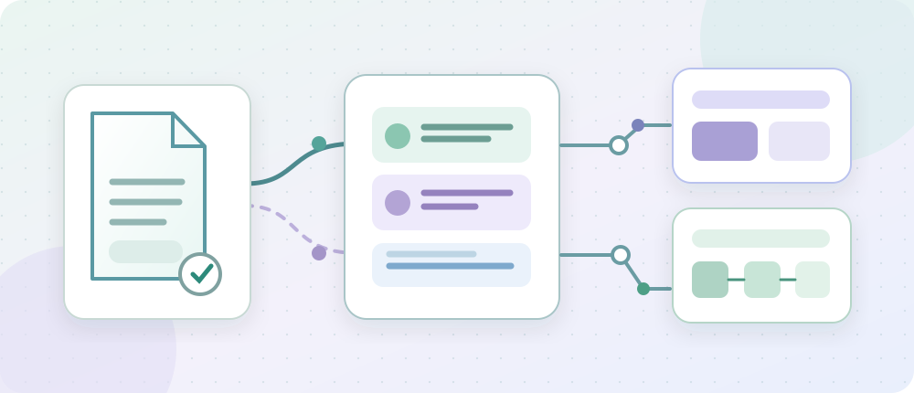

# Why a Research Report Must Become an Asset Before an Agent Can Reuse It

A financial-research agent receives a prospectus PDF, extracts some text, locates a fee clause, and produces a summary. That first exchange may look successful. Weeks later, the document has changed, and another research run wants to refer to the earlier report.

“Being able to read a PDF” is no longer enough. The system must also establish **which source and version it read, which passages were actually extracted and consumed, and whether the material remains eligible for use today**.

In ETF Agent, I assigned these concerns to **A17, Research Assets**. It owns the identities, versions, extraction states, and lifecycles of imported research files. It does not replace the PDF reader's page interpretation, the retriever's relevance judgments, or the financial reasoning needed to support an investment conclusion.

*Figure 1. One document may participate in several stages, but each read remains subject to the original source and Run authorization. This illustration is conceptual, not a runtime screenshot.*

## 1. A file, a research asset, and a piece of evidence are different things

Consider a teaching example used throughout this article: a fund report V1 was studied earlier; now V2 arrives and we want to compare fee terms. The documents and conclusions in this example are synthetic, not actual fund filings.

A **file** consists of the bytes acquired. A **ResearchAsset** registers the provenance, version, and processing status of those bytes. **DerivedResearchEvidence** is the bounded text or structure actually extracted from a page, section, or table.

| Layer | Question it answers | What it does not establish |
| --- | --- | --- |
| Original file | Which bytes came from which approved entry? | Authentic meaning or complete parsing |
| ResearchAsset | Which logical source, version, hash, and scope? | That the model has read the entire content |
| Derived evidence | Which excerpts exist, where and how were they extracted? | That unprocessed regions contain nothing |
| Run Evidence Workspace | What can this Run search, locate, and read? | Automatic permission for a future Run |
| Publication and history | Which committed research report was produced? | That its old assessment is current financial truth |

The asset identity distinguishes scope, admitted root, logical source ID, content hash, version, asset kind, extraction status, and active state. A filename can remain unchanged while its bytes change. Two accounts may obtain identical bytes without acquiring the same access rights.

A controlled development test in October 2026 exposed a concrete defect: equal source and content across two scopes produced the same asset key. The scope was subsequently incorporated into identity derivation. This was an engineering test finding, not a confirmed production data leak.

## 2. Why use one acquisition seam instead of many model file tools?

The first research-asset importer centered on approved local directories. That was a useful constraint against arbitrary paths, but it did not readily cover PDF, DOCX, XLSX, and HTML attachments returned by business MCP tools.

Two plausible alternatives were to let every MCP or Skill handle its own downloads and parsers, or to expose separate PDF, Word, and spreadsheet tools to the model. The former duplicates authorization, parsing, and citation logic; the latter makes file-format mechanics part of the model's operational vocabulary.

The chosen architecture uses a **Host-owned generic file-evidence ingestion seam**. Business tools retain their original identities and business results. The Host recognizes attachments from actually validated results, A17 registers the acquired assets, and the existing Evidence Workspace provides generic search and read operations.

**Figure 2. Acquisition authority originates in validated Host results, not text authored by a model.**

~~~mermaid
graph TD
A[Business MCP result or approved local file] --> B{Acquisition source authorized?}
B -- No --> X[Reject file acquisition]
B -- Yes --> C[Acquire bytes within limits]
C --> D{Bytes and format valid?}
D -- No --> Y[Record unavailable attachment]
D -- Yes --> E[Register ResearchAsset]
E --> F[Extract locatable derived evidence]
F --> G[Register in this Run Evidence Workspace]
~~~

An instruction embedded in a document to “open this URL” does not grant file access. Credentialed sources require explicitly configured acquisition adapters with reviewed destination, redirect, and credential policies; there is no arbitrary HTTP fallback.

Acquisition also has size, count, cancellation, and deadline bounds. One failed attachment must not erase independently valid attachments or unrelated business fields in the original MCP result.

## 3. Version changes: why a failed V2 must not destroy a usable V1

A dangerous update sequence is to invalidate V1 first and only then attempt to parse V2. If V2 is damaged or persistence fails, the system loses its last usable material.

A17 takes the more conservative route: register the new version, extract and persist evidence, and only then activate the replacement. Identical valid content under the same logical source can reuse its existing registration. A failed new version remains observable without deactivating the previously valid one.

**Figure 3. Switching versions depends on a usable, persisted extraction result.**

~~~mermaid
graph TD
A[Currently valid V1] --> B[Receive V2]
B --> C{Identical to existing valid content?}
C -- Yes --> D[Reuse existing asset]
C -- No --> E[Register and parse V2]
E --> F{Valid extract persisted?}
F -- Yes --> G[Activate V2 and deactivate V1]
F -- No --> H[Record failure; retain valid V1]
~~~

Partially readable material remains explicitly partial. Every current read must still check the asset identity, scope, source, version, hash, and active state. Historical existence alone is not a bypass.

Importantly, “V1 remains valid” here means **an import failure did not corrupt the asset lifecycle**. It does not imply that V1's fee data is appropriate for a present-day investment decision.

## 4. Acquiring bytes is not the same as examining an entire document

Obtaining PDF bytes does not mean an OCR engine inspected scanned pages. Extracting a spreadsheet formula does not mean it was evaluated. Extracting DOCX paragraphs does not prove that every complex structure was understood.

The bounded format-processing path retains physical PDF pages, native DOCX heading and paragraph positions, XLSX sheets and cell addresses, and sanitized static HTML text. OCR, chart interpretation, and cross-modal retrieval are not implied simply because those asset kinds are representable in the schema.

There is also a second distinction: **extraction coverage versus actual reading coverage**. A parser may know that later pages exist while the model receives only page 8. A stored preview is not the full source, and a search hit is not the same as delivered passage text.

The following is a conceptual result, not a production API response:

~~~json
{
  "source": "fund-report-A",
  "version": 2,
  "extraction": "partial",
  "actualRead": ["page:8"],
  "supported": "The fee clause delivered from page 8",
  "unverified": "Additional terms on unread pages"
}
~~~

An answer may explain what page 8 actually says, but not claim that no other conditions occur anywhere in the document. **Unexamined means unknown, not absent.**

## 5. Workspace number one: evidence available to a single Run

The terminology can be confusing. An **Evidence Workspace** is a controlled view of materials for one research Run; it is not the user's long-running project folder.

It can project active durable ResearchAssets eligible for the current scope and add temporary MCP-acquired attachments during that Run. The model receives bounded logical references, locators, and read results, never arbitrary host filesystem paths.

Temporary attachments live in run-local storage by default. Reuse still requires the proper current admission and source identity. A new Run does not inherit access merely because another Run cached identical bytes; temporary files are not automatically promoted to a permanent RAG corpus.

When a Run reads a passage, the original material-history mechanism can record the asset version, evidence identity, and actual read range. This helps explain what an earlier analysis used, but the historical record is not a future access grant.

## 6. Workspace number two: a long-term research goal across Runs

The newer **Research Workspace** addresses a different problem: a research goal can outlive any single Run.

It stores the user goal and its revisions, associations to original Conversations and committed Publications, supported Artifact links, and optional source-attributed advisory checkpoints. It **does not become a second document repository or take over A17's source identities and permissions**.

**Figure 4. A long-running research goal can reuse committed historical results without inheriting access to original files.**

~~~mermaid
graph TD
A[Prior Run reads ResearchAsset] --> B[Original committed Publication]
B --> C[Long-term Research Workspace link]
C --> D[User starts independent new Run]
D --> E{Exact historical version and dependencies eligible?}
E -- Yes --> F[Read qualified historical Publication]
E -- No --> G[Mark that material unavailable]
F --> H[New research and independent Publication]
G --> H
~~~

Imagine that week-one report A cited fund document V1, while week-two report B drew a different conclusion. In week four the user wants to reconsider both reports in the light of a new announcement.

Research Workspace can discover exact historical Publication versions. After original-owner checks, the model can choose and actually read those versions into a fresh model request. Controlled engineering tests have demonstrated a new Run consuming two distinct historical reports, including a non-latest version.

Yet **reading a historical Publication is not the same as regaining the raw PDF bytes used by the earlier Run**. Rechecking a page in V1 still requires valid original-source acquisition and read authority. A historical link and a content hash identify material; neither creates a new permission.

File retention is another separate concern. The current Workspace Artifact Pin uses the original Artifact retention capability, with a supported path for eligible HTML reports. It is not a permanent collection for arbitrary PDFs and spreadsheets. Archiving or removing a Workspace likewise does not authorize deletion of its original Conversations, Publications, or independently retained Artifacts.

The handoff between A17 and long-term Research Workspace is therefore **persistent research relationships plus freshly qualified original materials**, not a wholesale copy of every file into a project directory.

## 7. Why this still cannot certify an investment conclusion

ResearchAsset owns file identity. The PDF reader owns actual page interpretation and reading coverage. Retrieval selects candidate passages. Publication records committed research text, and the long-term Workspace organizes goals and relationships across Runs. None of those modules should acquire authority over current portfolio balances, trading confirmations, or deterministic financial arithmetic.

A quarterly fund report can have a correct hash and page number while still describing an old reporting period. A complete historical Publication can remain lawfully readable while its market assumptions are obsolete. Fee comparisons, risk judgments, and numerical calculations still need separately qualified source dates, units, and domain rules.

These decisions resemble provenance and derivation ideas in [W3C PROV-DM](https://www.w3.org/TR/prov-dm/) and the run–dataset relationships documented by [OpenLineage](https://openlineage.io/docs/spec/object-model/). They are local applications of related ideas, not claims of standards conformance. An agent adds its own distinctive constraints: model text is not authorization, run-local attachments are not general cross-run assets, and historical judgments are not current source authority.

## 8. What has actually been implemented?

The private ETF Agent code and controlled tests show approved-root acquisition, content-hash and version registration, idempotent reuse, retention of a valid previous version on failed ingestion, and authorized reads through the current Evidence Workspace. MCP file handling also has bounded DOCX, XLSX, and HTML locators and localized attachment-failure behavior.

The long-term Research Workspace P0 implementation has entered the main branch. Scripted-model and synthetic-source tests exercise exact historical Publication consumption across independent Runs. However, the feature remains disabled by default; the full application type-check and formal end-to-end closure still have outstanding gates. Those observations do not certify long-term real-model financial reasoning quality.

The separate public teaching repository, [Open ETF Agent](https://github.com/hpoenixf/open-etf-agent), does not expose the complete A17-plus-long-term-Workspace system described here. This is an implementation-informed architecture discussion, not a public installation tutorial.

A future ability to **explicitly retain and re-acquire source ResearchAsset versions from a long-term Workspace** would need its own retention, authorization, and version-selection design. It must not be inferred from the existing Publication association feature.

## Conclusion

A research report becomes a more reliable input only when it has an explainable **source, version, processing state, and actual coverage**. A failed import should not destroy previously valid material; partial extraction must not impersonate full review; and a historical reference must not expand a future Run's authority.

Three questions are worth asking before designing a document-based agent: **Who authorized the acquisition? Which exact version is this? What did the model actually read this time?**

Answering them does not make the investment judgment correct. Failing to answer them, however, makes even sophisticated retrieval, reasoning, and long-term memory difficult to audit.

---

Further reading: [PDF, from text to evidence](/en/articles/024-agent-pdf-from-text-to-evidence) · [Why Agents Need a Workspace](/en/articles/agent-research-workspace-goal-continuity) · [Why tool results do not all belong in model context](/en/articles/tool-results-outside-model-context). If you find these engineering examples useful, consider starring the independent teaching project [Open ETF Agent](https://github.com/hpoenixf/open-etf-agent).
