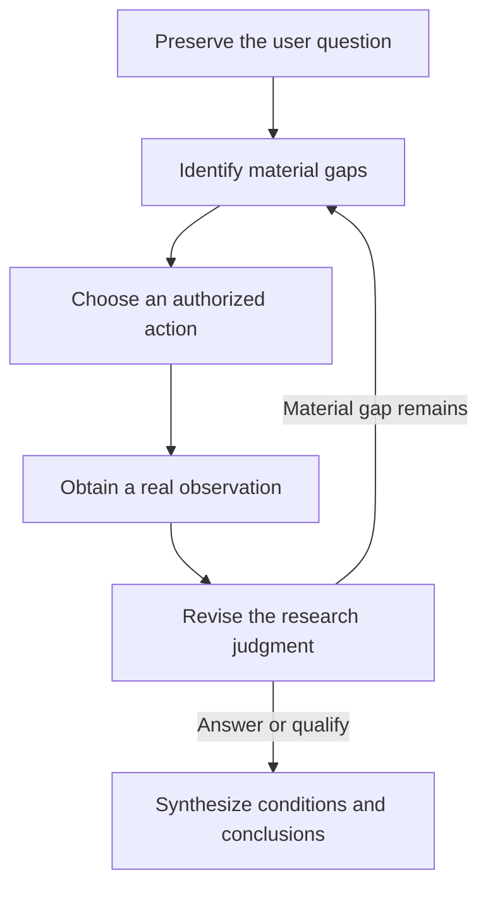
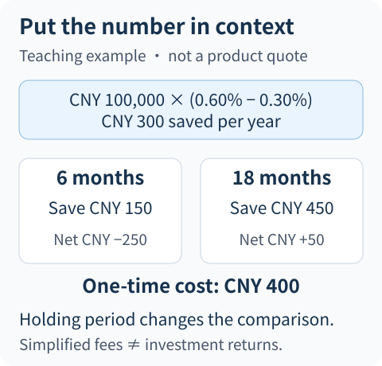

# When Should an Agent Keep Researching—and When Should It Answer?

A user asks: “This fund has two share classes. The newer one has a lower annual fee. Should I switch?”

An Agent that collects information well can quickly find fee tables, announcements, product descriptions, and commentary, then produce a well-sourced answer. Yet it may still miss the central question: **Will the lower ongoing charges offset the cost of switching within the user's intended holding period?**

The opposite failure is equally possible. The system requires a minimum number of sources, every risk to be listed, and several experts to be consulted. The fee facts are already clear, but the Agent keeps searching until it has no time left to form a conclusion.

This article examines the judgment between those extremes: deciding whether another action is necessary, answering usefully when conditions are incomplete, and actually incorporating new evidence into a conclusion. The fees, share-class labels, and research sequence below are teaching constructions. The engineering mechanisms come from ETF Agent's design and implementation.

## 1. Decide what needs answering before deciding how much to collect

“Which fee is lower?” and “Is switching worthwhile for me?” are different questions.

The first may require only two applicable fee schedules. The second also depends on share-class comparability, effective dates, channel and holding-period conditions, and how long the user intends to remain invested. Searching repeatedly for “low-fee funds” can generate more information while avoiding the real problem.

A useful starting point is to identify a few **judgments that require evidence**. This is not a transcription of every possible subquestion into a checklist. It is an attempt to identify unknowns that could change the conclusion.

| Judgment to establish | What must be known first | What cannot substitute for it |
| --- | --- | --- |
| The two classes can be compared directly | Product identity, currency, investment scope, and applicable rules | Similar names or the same provider |
| The newer class has lower ongoing charges | Comparable fee scope and effective period | One isolated headline rate |
| Savings can offset the switching cost | One-time cost, comparison amount, and holding period | Long-term return rankings |
| The conclusion applies to this user | User constraints and actually available channels | Investment preferences guessed by the model |

This table illustrates a research structure. It does not propose another approval gate requiring every box to be filled before anything may be published. Initial reading may establish that some questions are irrelevant; other judgments may remain conditional.

The original question and user constraints must remain available throughout. A simplified working note helps organize research but cannot replace what the user actually asked.

## 2. Working questions can change; execution facts cannot

ETF Agent supports optional working research questions for missing facts, evidence conflicts, or transformations still needed. A question has stable identity. The model may provisionally consider it unresolved, resolved, still unavailable, or no longer relevant.

The important distinction is not the names of those states. **They represent the model's current research judgment, not a correctness certificate issued by the system.**

For example, after reading a fee table, the model may mark ongoing charges as confirmed. An original announcement then reveals that the table describes a change taking effect next month. The model should reopen the question and compare present and future rules separately, rather than ignore the new fact to keep its checklist complete.

Which version was actually read, whether a tool succeeded, and which inputs a calculation used are different: they are execution facts. A changed opinion cannot turn “original not read” into “confirmed.” Nor can marking a working question resolved create a calculation result that does not exist.



“Can answer” in this diagram is a semantic judgment by the model, not a fixed source-count rule. Tool execution, authorization, and budgets remain system responsibilities based on their own facts.

Anthropic's [Building effective agents](https://www.anthropic.com/engineering/building-effective-agents) similarly emphasizes obtaining real observations from environmental feedback and adjusting actions. That describes a general loop. Our particular financial-research challenge is to make product identity, time, denominators, and user conditions affect the adjustment—not merely circulate between tools.

## 3. Before the next action, ask which conclusion it might change

Return to the fee comparison. Suppose two formal documents have been found, but three gaps remain: one announcement's effective date is unclear, the actual switching charge is unverified, and the user's intended holding period is unknown.

Those gaps should not all become “search again.”

The effective date is already in an acquired announcement, so read the relevant section. The switching fee depends on channel-specific conditions, so obtain the applicable rules. The holding period is a user condition; a document repository cannot supply it automatically. Meanwhile the Agent can explain the two fee structures without stopping every part of the answer because that final condition is unknown.

**Before an action, ask: which sentence, comparison, or applicability condition could its result change?**

This is a research-organizing principle, not an implemented, precisely measured information-gain score. Without reliable measurement, the Runtime should not invent a utility function with two decimal places to decide whether another page deserves attention.

The principle also separates three commonly confused states. “Not yet read” means a lead remains available. “This read was unavailable” means the tool or source did not return the needed content. “No relevant rule was found” describes the scope of this search. None automatically establishes that the rule does not exist.

When the original document is already in the workspace, reread it rather than search for it again. When sources conflict, check their scope rather than add reposts that agree with one side. When a user condition is missing, ask a materially useful clarification instead of deciding on the user's behalf.

## 4. Before resolving a conflict, check whether the sources answer different questions

Suppose the product description lists one ongoing charge and a recent announcement lists a lower one. Immediately choosing the newest document—or the value repeated by more websites—can be premature.

Check three dimensions first.

**Identity.** Do both sources concern the same share class, currency, and sales channel? Similarly named products can have different fee conditions.

**Time.** Do announcement date, effective date, and research comparison period align? A change announced today may take effect in the future. An older document read yesterday may still describe today's applicable rule.

**Definition.** Does one number include only a management charge while the other includes a distribution or service charge? Can one-time and ongoing costs be compared directly?

After those checks, the conflict may disappear: one document describes the period before a change and the other describes the period after it. A genuine conflict may remain between two formal descriptions of the same product and period. Then seek an amendment or acknowledge the unresolved inconsistency. Averaging the two figures would only manufacture a precise-looking “combined result.”

Multiple sources are valuable for discovering and explaining differences, not voting. Experts follow the same rule: a delegated specialist should bring back new evidence, a calculation, or a counterexample. Two experts repeating the same passage do not provide two independent supports.

## 5. A calculated number still needs the user's context

To distinguish calculation from synthesis, assume the following teaching conditions: a fixed comparison amount of CNY 100,000; comparable annual ongoing charges of 0.60% and 0.30%; total one-time switching costs of CNY 400; and no NAV changes, other differences, or actual daily-accrual details.

Under this deliberately simplified model:

```text
Theoretical annual saving = 100,000 × (0.60% − 0.30%) = CNY 300
Theoretical six-month saving = 300 × 0.5 = CNY 150
Theoretical eighteen-month saving = 300 × 1.5 = CNY 450
```

This is not an actual fund fee-accrual formula. It only demonstrates how research conditions affect a conclusion. The real charging base, holding period, and fee rules must come from the relevant materials and calculation method.



*Teaching assumptions only. Net fee differences subtract the CNY 400 one-time cost from the corresponding theoretical saving; they do not predict investment returns.*

A computation tool can establish these outputs from these inputs and assumptions. It has not automatically answered whether switching is worthwhile.

When the user needs the money in six months, the simplified ongoing savings do not cover the one-time cost. At eighteen months, the model shows only a small net fee difference. That still does not establish actual switching eligibility, justify ignoring other differences, or prove better investment returns.

A useful synthesis therefore goes beyond “the new class has half the fee”:

> Assuming comparable fee definitions, total switching costs of CNY 400, and an unchanged comparison amount, six months of ongoing savings would not recover the switching cost. The simplified eighteen-month difference is close to the break-even region, so actual fee rules and other differences still need checking. Your intended holding period changes this assessment.

Each qualification does work. It explains how the conclusion changes with conditions instead of attaching a generic disclaimer at the end.

## 6. Conclude claim by claim, not after collecting everything

Our fund-research methods encountered pressure in the other direction: a reference ceiling intended to bound work was interpreted as a quantity to fill. Optional review reports and simulated presentations became extra work expected on every request.

The original motivations were reasonable: provide comparison angles and make outputs easier to inspect. Once they became quotas, however, “which evidence is needed?” turned into “how many actions remain?” The later adjustment preserved bounded work while allowing a smaller sufficient set of useful references and on-demand additional presentation.

The point is not to encourage less research. It is to return stopping judgment to the user's question.

| Current research situation | Reasonable next action |
| --- | --- |
| Key facts support a limited conclusion, with no unexplained conflict found that would overturn it | Begin answering and preserve applicability conditions |
| A material gap remains and an authorized, feasible way to resolve it exists | Continue reading, calculating, or clarifying |
| A key condition cannot currently be obtained, but some facts independently hold | Deliver the supported parts and identify judgments that cannot yet be made |
| Execution deadline, resource limit, or cancellation is reached | Stop according to the actual execution state; do not call the evidence sufficient |

This is a way to reason, not another production approval state machine. The last row concerns execution conditions in particular. It must not be relabeled as successful research completion.

One answer can contain conclusions of different strengths. The fee difference may be verified while conversion conditions and the user's horizon remain unknown. The Agent can explain the fee structure and conditional comparison, then explain why a personal choice is not yet justified. It need not choose between a complete conclusion and saying nothing.

Quality review should also look beyond terminal execution state. Did the model withdraw a premise invalidated by new evidence? Does the final recommendation still depend on an unobtained condition? Did important source limitations travel with the conclusion?

## 7. Synthesis is not pasting tool results in execution order

A research task may produce ten tool responses, two specialist opinions, and a calculation. The user does not need to read a dozen summaries in that order.

A better organizing unit is **what the user needs to decide**. In a share-class comparison, begin with the differences currently supported, explain which conditions determine the cost comparison, and identify the next check that could genuinely change it.

The main researcher must bring comparable facts together, explain conflicting materials, and reconnect calculations to the original user conditions. Subtask summaries supply local material; they do not replace that work.

A reviewer may identify omissions and contradictions, but the review remains advice for the main researcher. Calling the evidence “sufficient” cannot create a missing source. Raising a local doubt cannot automatically erase an independently supported explanation either.

A useful final answer distinguishes verified facts, calculations under explicit assumptions, the researcher's judgments, and conditions that would invalidate those judgments. That is closer to research delivery than displaying the entire execution log.

## 8. Use the public implementation to distinguish working representations from original evidence

The public [Open ETF Agent v0.15.2](https://github.com/hpoenixf/open-etf-agent/tree/34124cefc6df289e08518173789210b45a716451) uses synthetic document examples to show how materials, derived working notes, and reports remain separate.

Its [working-note implementation](https://github.com/hpoenixf/open-etf-agent/blob/34124cefc6df289e08518173789210b45a716451/src/working-note.mjs) retains the note's identity as a derived summary whose semantics have not been reviewed, with bindings to source or memory references. A note cannot be repackaged as an original document. This matches the distinction here: organizing material can help the model continue working, but organization does not upgrade the evidence's authority.

Follow the [fixed-version README](https://github.com/hpoenixf/open-etf-agent/blob/34124cefc6df289e08518173789210b45a716451/README.md) to run `document-compare` and inspect `report.md`, sources, and run records. The default transport uses scripted responses. The example explains separation of facts and derived representations; it does not demonstrate that a live model has learned this article's stopping judgment, nor implement the teaching fee task against real investments. The later entry point is [current main](https://github.com/hpoenixf/open-etf-agent/blob/main/README.md).

## Conclusion: make the next action accountable to the conclusion

The user asked whether switching is worthwhile. The Agent should ultimately explain the evidence and conditions under which a choice holds—and where no conclusion is yet justified.

Source counts, expert counts, and research duration describe only parts of the process. More important is whether another action resolves a material gap, whether a new observation changes an old judgment, and whether the final conclusion retains its dependencies.

**When continuing, know which important evidence is still missing. When answering, know how far the evidence allows you to go.** That is the capability research decision-making and synthesis should provide.

For adjacent mechanisms, see [Model, Harness, and the research loop](https://hpoenixf.com/eff-agent-article/en/articles/etf-agent-model-harness-research-loop) and [time, definitions, and reproducible financial numbers](https://hpoenixf.com/eff-agent-article/en/articles/031-fintech-data-time-and-reproducible-numbers). The former covers execution organization, the latter numerical evidence. This article focuses on the research choices connecting them.
