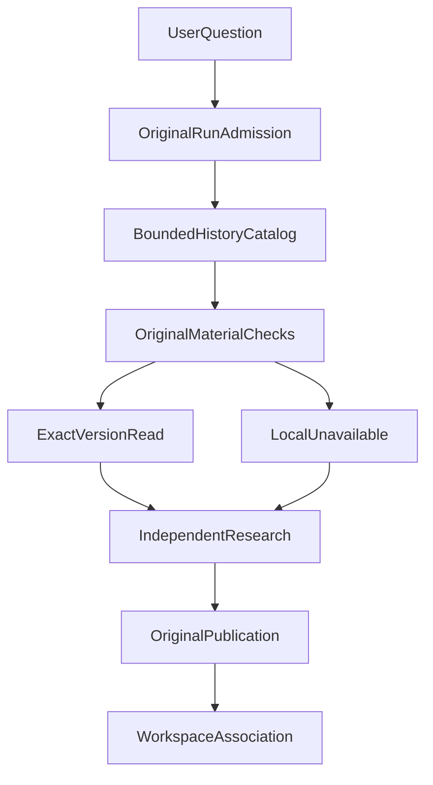

---
readingBrief:
  takeaways:
    - "Workspace organizes enduring goals, relationships and progress without taking over Run execution or duplicating report and permission authorities."
    - "A history catalog supplies candidates, not consumption proof; each new study validates exact historical versions and must actually receive their content in its model request."
    - "Goals and advisory progress have distinct revisions; archiving does not cancel admitted Runs, and removing organizational relationships does not cascade-delete original research results."
  appliesTo:
    - "Research goals spanning independent Runs, with exact historical report reuse, open questions and result lifecycle management."
  notFor:
    - "Simple follow-ups within one conversation, or seeking a publicly installable, default-enabled Workspace with completed formal qualification."
---
# Why Agents Need a Workspace: From One-Off Conversations to Long-Term Research

Many agents already support long conversations, memory, tool calls, task recovery, and saved reports. But when a user investigates the same goal over several weeks or months, combining those features can still leave a crucial gap.

**One research Run can end while the research goal remains unfinished.**

My ETF Agent could already execute independent research Runs, publish durable answers, read historical evidence, and retain preferences through Memory. None of those capabilities, by itself, created a long-lived research space.

When I designed Research Workspace, I was not trying to keep an agent running forever. I wanted to answer a different question: **How can several independent studies contribute to one enduring goal while preserving their original identities, evidence, revisions, and permissions?**

The approach was an independent Workspace Module that organizes research goals and results without creating a second research executor.

## 1. Why Aren't Conversation History and Memory Enough?

Consider an illustrative scenario.

A user wants to keep assessing the liquidity risk of a fund.

In week one, the agent examines public disclosures about fund size and trading activity, producing report A.

In week two, the user notices a change in holder structure and generates report B. Its assessment is not entirely consistent with report A.

In week four, a new fund announcement appears. The user asks the agent to reassess the risk and explain which earlier judgments still hold and which require revision.

This is research across time and evidence revisions.

The simplest implementation might send both earlier conversations to the model. But that creates three problems.

First, historical context is not historical evidence. A summary of report A may omit the exact original revision, its date, or whether a later revision superseded it.

Second, history keeps growing. The model should not read everything for every request. It may only need a particular older revision of report A, the conclusion from report B, and the latest announcement.

Third, a model's temporary assessment cannot overwrite the user's enduring research goal. A user-authored objective and the judgment formed in one Run are different kinds of state.

Existing capabilities address different needs:

| Capability | Primary responsibility |
| --- | --- |
| Conversation | Preserve a thread and its messages |
| Run | Execute one particular research request |
| Memory | Retain reusable preferences, episodes, and similar advisory information |
| Publication | Persist research answers with explicit identities and revisions |
| Workspace | Organize an enduring goal, original research objects, and progress across Runs |

This differs from the persistence mechanisms offered by common agent frameworks. The [OpenAI Agents SDK Session](https://openai.github.io/openai-agents-js/guides/sessions/) keeps conversation history across turns. In [LangGraph](https://github.com/langchain-ai/docs/blob/main/src/oss/langgraph/persistence.mdx), checkpointers persist a thread's execution state, while stores support data across threads. These are useful foundations, but they do not automatically define how one financial research goal relates to several reports or when an earlier report can be read by a new study.

Workspace answers a more specific product question: **What is the user researching, what materials were produced before, which were actually reused, and which questions remain unresolved?**

## 2. An Independent Module, Not a Second Agent

An intuitive design would be a continuously running Project Agent.

It could maintain the goal, schedule tasks, remember conclusions, retrieve sources, and control subsequent execution. That sounds like long-term continuity.

But when a system already has Run, Publication, Memory, and Artifact capabilities, this approach risks duplicating authority.

After an old Run ends, who may restart it? Can a historical report in Workspace bypass the original owner's permissions? If a research conclusion is revised, does Workspace or Publication own that revision?

If those questions remain ambiguous, a long-term research feature can gradually become a second runtime.

I limited Workspace's responsibilities to three things: **goals, relationships, and progress.**

The goal is the user's research objective and its versions. Relationships connect the Workspace to original Conversations, Runs, Publications, and Artifacts. Progress consists of optional, source-attributed research notes and open questions.

The original Run still executes each actual study.



The diagram shows responsibility, not an unconditional pipeline. An eligible material can be read at its exact historical revision. An ineligible material becomes locally unavailable. With enough other lawful evidence, the Run can continue; otherwise it must explain the gap. The existing research and publication mechanisms still decide whether an answer can be published.

The important architectural property is that Workspace does not own execution.

When a user asks a new question inside Workspace, the existing Entry, Host, and Run admission path creates an independent study. It has its own identity, resource limits, and authorization.

It may read eligible earlier materials, but it neither inherits all the earlier Run's privileges nor resurrects a completed task.

Workspace does not have to copy old report bodies, either. It stores relationships to original objects; the original modules retain authority over content reads, version checks, and publication.

This is a Module with a clear interface and implementation, not a second agent process or an additional model loop.

## 3. Finding an Earlier Report Is Not the Same as Using It

The most interesting technical problem is how Workspace consumes historical material.

In a normal conversation, a user may explicitly select the last report. In long-term research, the user may ask only a new question. The system needs to offer several potentially relevant earlier materials for the model to choose from.

There is a consequential distinction:

**A report appearing in a historical catalog does not mean the model read it. Even a successful read does not establish that the model correctly used its conclusions.**

Workspace therefore separates discovery, reading, and consumption.

First comes candidate discovery.

Using the current user scope, associated Conversations, and original research outputs, Workspace builds a bounded historical catalog. The catalog describes object identity, revision, and relevant provenance; it does not blindly inject every historical report body into the prompt.

Candidate counts are limited, and the catalog can indicate incomplete or unavailable coverage. A report absent from this page cannot be declared nonexistent.

Next comes selection and reading.

The model may choose materials relevant to the new question. Each read must pass the original owner's checks, including original identity, exact revision, content digest, source dependencies, and current-Run eligibility.

Only then can content be consumed by a model request.

The system can say that a historical report was consumed by the new study only when the content passed those checks, was actually read, and reached the appropriate model input.

That is more verifiable than putting “please refer to earlier reports” in a prompt.

### A Concrete Example

Continuing the fund research scenario, this JSON is an illustrative teaching example—not the production API or real financial data.

```json
{
  "goal": "Continuously assess a fund's liquidity risk",
  "goalVersion": 2,
  "question": "Does the new announcement change earlier judgments?",
  "selectedHistory": [
    {
      "material": "Week-one report A@v1",
      "status": "Exact historical revision read"
    },
    {
      "material": "Week-two report B@v1",
      "status": "Exact historical revision read"
    }
  ],
  "currentEvidence": "New announcement in week four",
  "outcome": "A separately published research report"
}
```

Two details matter.

Report A's `v1` is a specific historical revision. If a `v2` is later published, the system cannot silently substitute it for the old judgment that the user wanted to revisit.

And the new announcement has a different temporal meaning from the old reports. An old report records a judgment given evidence available at the time; a new disclosure may provide fresher information. They must not be treated as facts observed on one date.

In controlled ETF Agent integration checks, a new Run read two exact Publication versions from earlier studies, including a non-latest revision. Their contents entered the new model request, and the resulting answer was independently saved and reopened through the original Publication path.

This demonstrates a bounded engineering path for cross-Run material consumption. It does not show that a real model will choose the most useful materials or make correct financial judgments. Source-selection quality and research accuracy require separate evaluation.

## 4. Why Persist Research Progress?

A collection of historical reports is not itself a useful view of progress.

A user may have accumulated a dozen reports while still being unsure which questions remain open or where to continue.

That is the purpose of Workspace Checkpoint.

It is not the execution checkpoint used to recover a Run. It is an **optional, versioned record of research progress**.

For example, after a study, a model might propose:

“The previous liquidity assessment needs reevaluation. The new disclosure does not resolve holder-concentration risk. Next, inspect the latest published subscription and redemption figures.”

This can help the user decide what to study next. It does not become the fund's factual condition or override the original user goal.

A Checkpoint retains the originating Run, the accepted Publication, referenced earlier materials, and their source dependencies. It is explicitly marked as model-authored advice.

Several constraints matter in practice.

**Progress updates are optional.** If the model proposes no valid update, an otherwise lawful answer must not fail. The system must not invent a “research completed” note merely because nothing was proposed.

**Updates are versioned.** Research progress uses compare-and-swap (CAS) with an expected revision. A stale proposal cannot overwrite a newer record, and questions omitted in one proposal are not automatically erased.

**An unavailable source must not silently support a seemingly current note.** If an original source or historical Publication underlying the derived note is no longer eligible to read, the checkpoint read returns an unavailable state rather than presenting stale cached prose.

This is why Checkpoint is different from Memory.

Memory can preserve preferences and episodes under its own governance. Checkpoint represents an assessment and unresolved questions about one goal, grounded in particular source revisions. It cannot silently rewrite an Investment Thesis or become a user-confirmed investment decision.

Automatic Workspace-specific Memory is a later direction. The first useful Workspace does not require a second memory system.

## 5. Long-Lived State Requires a Clear Lifecycle

A Workspace that lasts across research sessions must handle goal changes, concurrency, archive, and removal.

Those scenarios reveal more about ownership than simply creating a folder.

### Changing a Goal Must Not Rewrite an In-Flight Run

Suppose a user submits a research request and then edits the Workspace goal.

The already-admitted Run keeps the goal revision and material selections frozen when it was submitted. Only the next Run uses the new goal.

That makes earlier results explainable: a report may legitimately still address the older objective.

A retry that changes the original Workspace or material selection must not silently count as an identical request.

### Archiving Is Not Stopping the Original Run

Archiving means that the Workspace temporarily stops admitting new Workspace-associated research.

It cannot acquire the right to cancel all original work. A previously admitted Run continues or settles according to its own execution, Stop, and Recovery rules; its original reports remain readable under their own access permissions.

Archive is a reversible organizational state, not a deletion.

### Removing a Workspace Is Not Deleting Research Results

When a user removes Workspace, the system removes its organizational relationships, user goal, and advisory progress, and disallows future associations. It does not cascade-delete the original Conversations, Runs, Publications, or files legitimately retained by the original Artifact owner.

Even if an already-admitted Run completes after Workspace removal, a late callback must not resurrect the removed Workspace.

Each kind of data retains the lifecycle of its original owner. A future “clear all associated data” action would need separately defined authorization, scope, and consequences rather than being hidden behind Remove Workspace.

### Artifact Retention Follows the Same Rule

Workspace can request retention and association for the currently supported HTML Artifact path. The original Artifact module still owns the bytes, eligibility, download permissions, and expiry.

A Workspace association is not a transfer of ownership. If original-file retention succeeds but the Workspace association cannot be confirmed, the system must report those two outcomes separately.

A file link in the interface is not evidence that every PDF, Markdown, or other historical file can be retained indefinitely.

## 6. What Has Actually Been Verified?

Workspace P0 has been merged into the main branch of the private ETF Agent implementation.

The implementation includes an independent application interface, durable records, goal revisions, original Conversation associations, a historical material catalog, cross-Run material consumption, optional Checkpoints, Artifact associations, and a Web entry point.

In addition to interface-level tests, controlled checks used synthetic research materials, scripted model responses, and the existing HTTP, Runtime, Publication, and PostgreSQL paths. They examined how an independent new Run consumes old revisions, saves its new answer, and rereads that answer after a service process replacement. Replays using the same request identity were also checked so that retrying does not accidentally create another independent study.

These observations support specific engineering mechanisms—not just a type definition or screenshot.

But a merge is not complete qualification. The integration retained a timeout gap in the full application type-check path, full formal acceptance had not finished, and the feature remained disabled by default. These results do not establish real-user usage or real-model financial research quality.

The public `open-etf-agent` repository also does not yet provide this Workspace module as a runnable capability. This article describes implemented engineering mechanisms; it is not an installation tutorial for the public project.

Phased delivery can be reasonable for a long-term research product, but a working engineering path does not, by itself, prove product value.

## 7. When Is a Workspace Worth Adding?

Not every agent needs one.

If a user is only asking follow-ups within one conversation, ordinary Session handling, conversation history, and careful context management may be sufficient.

A separate long-term research Module becomes more attractive when three conditions appear:

- The user's goal spans multiple independent studies and outlives any individual Run.
- Earlier conclusions must be reread by original identity, revision, and observation date rather than replaced with a latest-summary approximation.
- The user must manage progress, results, and lifecycle without letting the organizational layer seize execution or authorization authority.

Then Workspace is not merely helping the model remember more text. It makes the relationships among research objects manageable and verifiable.

This adds real complexity: durable relationships, conflicting revisions, cross-module read checks, and bounded catalogs that may omit relevant candidates. Where cross-Run goal continuity is unnecessary, that complexity is not justified.

## Conclusion

Before designing Workspace, I tended to understand agent continuity as preserving history, retaining memories, and supporting recovery.

This engineering work clarified a more useful distinction: **execution continuity, conversation continuity, and research-goal continuity are three different problems.**

A Run can end, a report can be revised, an old material can become unavailable, and even a Workspace can be removed. None of these changes should force the system to clone or rewrite another module's authoritative facts.

Long-term research needs a stable user goal, relationships back to original objects, and eligibility checks whenever a new study begins.

That is why I did not build an always-running Project Agent. I made Workspace a focused, independent Module.

**Long-term research does not require an agent to keep running. It requires each new study to begin knowing the goal, the historical materials, which of them remain eligible, and what evidence actually supports the next judgment.**

For a personal research agent evolving beyond chat, this is an engineering problem worth solving first.

---

Further reading: [Cross-Run Conversation Compaction](agent-conversation-history-compaction-source-boundaries.md) · [From Investment-Research Chat to Ongoing Research](deepseek-superagent-continuous-research.md). [Open ETF Agent](https://github.com/hpoenixf/open-etf-agent) is a separate runnable teaching project and does not yet include the Workspace module discussed here. If its examples are helpful, consider giving the repository a Star.
