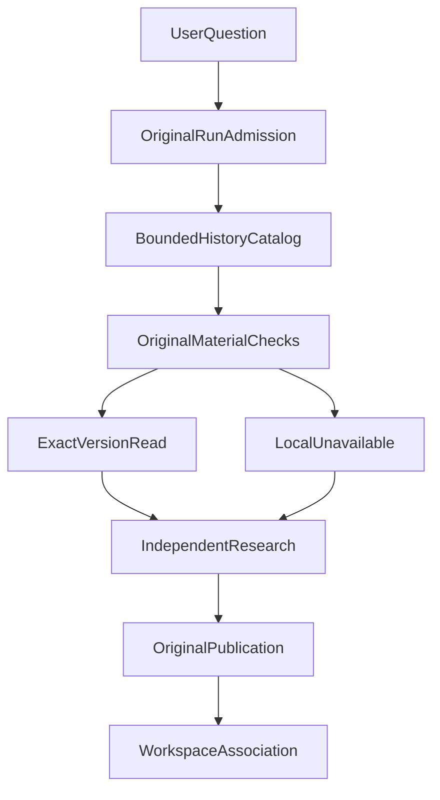

# Why Agents Need a Workspace: From One-Off Conversations to Long-Term Research

In week one, we study a fund's liquidity and save report A. In week two, new information about its holders leads to a different assessment in report B. In week four, a new announcement arrives. The user asks: “Does the earlier view still hold?”

In this teaching scenario, the difficult part may not be reading another announcement. It is finding **which judgment was made from which evidence at the time**. Dumping all conversations into context can lose revisions and dates; selecting only the newest report can hide how the assessment changed.

Our current design puts the enduring goal, relationships among original results and optional research progress in Workspace. Each study still gets an independent Run, and the original publication system stores its report. **The goal persists without requiring an execution process that runs forever.**

This article describes implemented engineering mechanisms that remain disabled by default, not a public installation tutorial.

<span id="_1-why-aren-t-conversation-history-and-memory-enough"></span>

## 1. When are conversation history and Memory insufficient?

For follow-up questions within one conversation, a Session and appropriate history management are usually enough. Workspace becomes useful when a goal spans independent tasks and users need to organize results, compare earlier judgments and choose where to resume research.

The objects preserve different information:

| Object | What it retains for long-term research |
| --- | --- |
| Conversation | What happened in a particular exchange |
| Run | One study's execution identity and outcomes |
| Memory | Preferences or experiences under its own governance |
| Publication | A particular revision of an answer |
| Workspace | An enduring user goal, related studies and open questions |

The existing system already had conversation groups, weekly history and exact historical-version reads. Groups provide organization; weekly reports provide periodic summaries; a selected historical answer provides one reuse path. Workspace adds a **goal-centered, non-periodic entry point linking multiple original results**.

That also explains why it does not copy every report body. Publication already owns report identity and revisions. Another “project copy” creates questions about where corrections propagate, which permissions prevail and how many copies deletion must reach. Relationships are smaller and easier to verify against original objects.

<span id="_2-an-independent-module-not-a-second-agent"></span>

## 2. Compare reasonable alternatives before adding a layer

[OpenAI Agents SDK Sessions](https://openai.github.io/openai-agents-python/sessions/) maintain conversation history across runs. [LangGraph persistence](https://docs.langchain.com/oss/python/langgraph/persistence) uses checkpointers for thread-scoped graph state and stores for application data across threads. Both can underpin a product; neither requires inventing another framework.

The application still needs to choose its data model:

| Approach | Good fit | What this scenario still needs |
| --- | --- | --- |
| One long Session | Work mainly continues in the same conversation | Relationships among independent reports, exact old revisions and separate goal revisioning |
| Cross-thread Store or business database | Information must survive across conversations | Object identity, permissions, revisions and lifecycle above the storage mechanism |
| Continuously running Project Agent | The product genuinely requires autonomous ongoing execution | Scheduling, stopping, resource costs and the lifetime of prior authorization |
| Workspace plus original Runs | The goal endures while studies restart on demand | Bounded relationships and progress, reusing execution and read contracts |

We chose the last option because Run, Publication, Artifact and Memory already existed. A Project Agent that also owns scheduling, history, permissions and results risks implementing each again. Workspace therefore retains three things: **goals, relationships and progress**.

The costs remain real: persistent relationships, cross-module reads, concurrent goal and progress revisions, and incomplete candidate discovery in bounded catalogs. Without goals spanning Runs, these costs are usually unnecessary.

<span id="_3-finding-an-earlier-report-is-not-the-same-as-using-it"></span>
<span id="a-concrete-example"></span>

## 3. How does a new study actually use two old reports?



The new question enters original Run admission, then selects from a bounded history catalog. Eligible materials are read at exact revisions; an ineligible material alone becomes unavailable. The new study saves its own outcome through Publication, and Workspace links objects that actually committed. Merely opening the page does not start research.

### Offer a catalog, rather than treating all history as context

The catalog comes from original Conversations and results associated with the current account. It supplies identity, revision and provenance cues instead of injecting every report body. Candidate and scan limits mean absence from this page does not prove absence from history.

After model selection, the original reader checks the object, revision, body digest and source dependencies. The new Run has its own grants and budgets; it neither inherits the old Run's privileges nor resurrects completed execution.

### Non-latest versions must remain selectable

Return to report A. It may now have revision v2, but the user wants to compare the judgment from week one. Substituting v2 silently would make history appear never to have been wrong.

Reads therefore bind exact revisions, not just report names:

```json
{
  "goal": "Keep assessing the fund's liquidity risk",
  "goalVersion": 2,
  "question": "Does the new announcement change our earlier assessment?",
  "selectedHistory": [
    { "material": "Week-one report A@v1", "status": "Exact revision read" },
    { "material": "Week-two report B@v1", "status": "Exact revision read" }
  ],
  "currentEvidence": "New announcement in week four",
  "outcome": "An independent new research report"
}
```

This is a teaching representation, not the production API. An old report explains a judgment under earlier information; the announcement supplies new evidence. They cannot become financial facts from one shared date.

### A link, a body read and a judgment are separate events

Catalog presence offers a choice. After a read, the body still needs to reach the new request before it counts as consumed. Whether the model resolves a conflict correctly or chooses the best source requires separate review of its research.

An existing controlled path exercised two distinct historical Publications, including a non-latest revision, actually included them in a new model input, and saved an independent result through the original publication mechanism. This supports the engineering path, not long-term investment judgment quality.

## 4. How did one bad candidate block an entire study?

During engineering closeout, the original provenance resolver correctly refused an ineligible candidate, but initial admission and catalog projection expanded that refusal into whole-request failure. The source protection was correct; the expanded effect was not.

Suppose report A is no longer readable while report B and the new announcement remain lawful. A should receive no grant and expose neither its body nor prohibited metadata. B and the announcement should remain usable. If A is essential to the requested comparison, the answer should explain that particular gap.

The repair stayed in the two consumers of the original resolver: handle unavailability per candidate, retain independent lawful materials and tools, and let original publication continue. It did not disable provenance checks, add model repair turns, or refresh or revoke the same Run's frozen grant.

**A relationship layer may report missing material without gaining authority to terminate the whole study.** Catalog products are particularly susceptible to this mistake: one invalid entry does not make every other entry worthless.

<span id="_4-why-persist-research-progress"></span>
<span id="changing-a-goal-must-not-rewrite-an-in-flight-run"></span>

## 5. Why does progress need separate revisions?

A list of reports does not tell users which questions remain open. Workspace therefore accepts an optional, source-attributed progress record, also called a Workspace Checkpoint. It might say that the announcement has not resolved holder concentration and suggest examining subscription and redemption disclosures. This is working research progress, not a checkpoint for resuming an execution graph.

No proposal means no update. A proposed record binds its original Run, accepted outcomes and historical materials. It cannot replace the user's goal or turn “resolved” into certified completion or an investment decision.

Updates check the expected revision. If two studies return concurrently, a late old proposal cannot overwrite newer progress. Omitting an earlier question does not erase it. When dependent material cannot lawfully be read, the associated progress retains an accurate unavailable state.

Separating goals from progress also preserves history. If the user changes direction, an admitted Run keeps its frozen goal revision; later Runs use the new goal. Otherwise a report reopened weeks later may no longer have an explainable purpose.

Automatic learning from Workspace into Memory remains a later direction. Saving open questions does not require another memory system today.

<span id="_5-long-lived-state-requires-a-clear-lifecycle"></span>
<span id="archiving-is-not-stopping-the-original-run"></span>
<span id="removing-a-workspace-is-not-deleting-research-results"></span>
<span id="artifact-retention-follows-the-same-rule"></span>

## 6. What do archive, removal and file retention each change?

A long-lived relationship layer needs a clear exit design.

**Archive** stops new Workspace-bound research and allows later restoration. It does not cancel admitted Runs, which retain their original stopping and settlement owners.

**Remove Workspace** removes its goal, organization and advisory progress, preventing future association. Original Conversations, Publications and legitimately retained Artifacts are not cascade-deleted. Late results cannot recreate the removed Workspace. Clearing all associated data would be a separate operation with an explicit scope and consequences.

**File retention** invokes the original Artifact capability. Supported HTML reports have a retention-and-association path; this is not permanent storage for arbitrary PDFs or spreadsheets. If retention succeeds but association fails, those outcomes must remain separate.

<span id="_6-what-has-actually-been-verified"></span>
<span id="_7-when-is-a-workspace-worth-adding"></span>

## 7. Which conclusions can be adopted now?

At the November 5, 2026 source review, goal revisions, associated catalogs, new-Run multi-material consumption, optional progress, supported Artifact association and Web entry points are implemented and have completed engineering qualification without real model calls. The feature remains disabled by default. Real-model relevance, sustained research quality and product value require their own evaluation.

[Open ETF Agent](https://github.com/hpoenixf/open-etf-agent) does not yet provide this complete Workspace as a publicly runnable module. The transferable result here is the data and responsibility design, not a claim that downloading the teaching repository installs the same product.

When designing a similar capability, start with three questions:

1. Does the goal genuinely span independent Runs, or is this simply a longer conversation?
2. Can earlier judgments be reread at their original revisions instead of disappearing behind the latest summary?
3. When the organizational layer is removed, do original results and tasks retain their original lifecycles?

## Conclusion

Research continuity does not require an agent that never stops or an ever-growing prompt history.

Keep the user's goal explicit, make earlier results readable by exact identity, independently admit each new study, and link its judgment back to the same goal. Workspace preserves those relationships while individual executions stay separate and explainable.

Further reading: [Research asset identity and revisions](agent-research-assets-identity-version-lifecycle.md) · [From research chat to continuous research](deepseek-superagent-continuous-research.md) · [Cross-Run conversation compaction](agent-conversation-history-compaction-source-boundaries.md). Explore the independent teaching implementation in [Open ETF Agent](https://github.com/hpoenixf/open-etf-agent).
