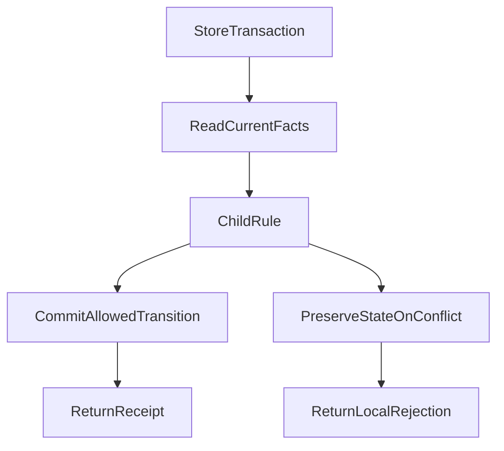

# Why Did One Subagent Change Hold Up Our Work for an Entire Day?

*The real cost of an agent-runtime refactor, and what it taught us about ownership and historical compatibility*

> This article follows how the day was spent and how we began to contain the problem. Its companion, [What Should Stay Stable—and What Should Change—in an Agent Architecture?](agent-differentiated-evolution-contracts.md), asks what evolution contracts different capabilities need once their responsibilities are clear. Both articles stand on their own.

## 1. We set out to improve subagents—and ended up repairing the runtime

On October 25, 2026, we intended to continue developing the subagent capabilities of ETF Agent, our investment-research assistant. A subagent is a task delegated by the main agent: one reads sources, another computes results, and another examines a conclusion from a different investment perspective.

Work was already under way on expert collaboration, human questions, durable recovery, and research delivery. The next step should have been making those capabilities cooperate so that complex fund research could be divided, synthesized, and delivered.

Instead, one maintenance problem kept returning: **why did changing a subtask also require changes to Memory, Recovery, and even PostgreSQL?**

Two recent commits made the pattern concrete. A fix at 08:07 changed recovery encoding/decoding, the in-memory store, and the PostgreSQL store together. A follow-up at 09:46 touched all three again, along with Main request handling and Child execution. All times in this article are Beijing time, UTC+8.

Touching several files is not inherently wrong. A genuinely new durable fact may require changes in execution and storage. The warning sign is narrower: **when no durable fact has been added, changing one business rule still requires several modules to update equivalent conditions independently.**

### Code size was an alarm, not a verdict

The static review recorded the following snapshot:

| Object inspected | Size at that time |
| --- | ---: |
| TypeScript files in Research Runtime | 130 |
| Physical runtime lines, including comments and blanks | 57,786 |
| One Recovery Codec file | 5,247 lines |
| Direct Recovery Store methods | 75, plus inherited interfaces |

A file of more than five thousand lines is not automatically a bad design. A narrow interface that hides necessary complexity can still form a useful deep module.

But this codec—nominally concerned with encoding and reading state—also participated in child admission, researcher snapshots, request planning, handoffs, and some terminal rules. The in-memory and database stores separately orchestrated conditions involving subtasks and human replies.

Elsewhere, a shared Run Context collected eight groups of mutable state. Modules received the entire object and could read or write one another's internals. The Factory, originally an assembly point, had accumulated user-memory caching, waiting, deduplication, and usage tracking.

**The files were separate. The knowledge and decision rights were not.**

## 2. The painful part was how the day disappeared

We chose to address the coupling before adding more related subagent features. Once implementation began, “move a few functions back to the right place” proved to be only a small part of the work.

A few checkpoints summarize the day:

| Time | What happened | What it meant for development |
| --- | --- | --- |
| 08:07 and 09:46 | Related commits repeatedly touched the codec and both stores | A subtask rule was already entangled with the shared foundation |
| 12:31–12:37 | We fixed a source baseline and inspected existing code and tests | Establish exactly which version was being changed before moving code |
| Afternoon | Runtime and shared-contract responsibilities were assigned | Other implementers moved to independent work; related changes required handoff |
| 17:34 | One of six targeted PostgreSQL scenarios failed | Reopen diagnosis: production regression or test setup? |
| 17:55 | All six original scenarios passed after a test-helper correction | The first delivery could proceed, but the complete refactor was not finished |
| 18:14 | The first child/human-interaction ownership slice reached main | Deliver the verified slice and keep remaining work separate |
| 23:38 | The overnight handoff was still defining the next day's development baseline | Continuing feature development still required explicit coordination |

This was not a production outage, nor a day with no repository output. Independent research, UI, and documentation work continued. What was held up was the shared Runtime/Subagent development stream that we had intended to advance.

### 2.1 Avoiding overwrites first meant restricting parallel changes

The refactor covered child handoffs, recovery storage, shared execution state, and user memory. Those were also the places other development tasks needed to modify.

The afternoon collaboration plan temporarily assigned the entire Research Runtime and its shared interfaces to one responsible implementer. Another coding agent moved to independent fund-research quality, account configuration, and UI work. A change requiring the shared foundation had to pause that portion and hand over a minimal reproduction and interface need.

There was a valid reason: several implementers cannot independently reshape the same state and expect the merge to be correct by default.

The cost was equally real. **Coupling reduced not only change locality, but also the amount of work people and agents could safely perform in parallel.**

By evening, the handoff explicitly narrowed that restriction. An unfinished whole refactor must not become a blanket ban on new features. Stable interfaces could still be used; genuinely overlapping edits should be coordinated at the relevant change fragments.

That is part of the lesson, too. Protecting shared code is necessary, but an overly broad exclusion zone can magnify the blockage.

### 2.2 Old test entry points blocked validation of the new structure

Some Child tests still created tasks with an old selector, such as `type: "web"`, while the fresh admission interface now used `agentId`.

The old field was not invalid everywhere: readers of stored historical tasks could still need it. But creating a new child and reading an old record had become different entry points.

As a result, some tests failed while setting up the child, before reaching the notification, recovery, or handoff behavior they were meant to exercise.

The disposition notes identified **33 shared fixture-precondition symptoms** in one selected group. A fixture prepares test inputs and dependencies. This does not mean “33 production bugs,” nor does it mean that all 33 scenarios had individually completed before-and-after validation.

The proper correction was to load the current managed expert definitions and task bindings while retaining the original authorization, idempotency, and concurrency assertions. Renaming a field—or inventing an identity that happened to pass validation—was insufficient.

That work did not directly improve research output, but it was unavoidable. Until tests were aligned with the real admission path, neither their red nor their green results were easy to interpret.

### 2.3 A 1.5-second guard sent us back into diagnosis

At 17:34, five of six PostgreSQL scenarios passed. The failing scenario accepted a human reply while a child request was still in flight.

Several explanations were plausible: lock contention, a lost reply, or a refactor that had changed task completion conditions.

The execution trace revealed an extra **1.5-second whole-run wait limit** in the test helper. It fired before the final assertions. The child had already been dispatched, the related requests did not record an execution failure, and later steps had not yet completed.

We changed only the helper: removed that extra short race and awaited the real execution promise. The original ordering barriers, business assertions, and **20-second** per-case PostgreSQL timeout stayed intact.

No production code, SQL, or database configuration was changed for this correction. Rerunning the original six scenarios passed all six. The affected human-interaction/Factory offline file also passed its nine scenarios.

The value of those results was not another impressive pass count. It was a precise diagnosis: **this failure called for a test-assembly repair, not another waiting or retry mechanism in the runtime.**

Had we reacted only to the red result, a constraint invented by the test could have become permanent production complexity.

### 2.4 Checks remained inconclusive while branches kept moving

Two full type-check attempts also failed to produce usable conclusions. One lacked a complete retained exit result. The other ended with code **137**, printed `Killed`, and emitted no compiler diagnostic.

That establishes an incomplete check. It does not establish an out-of-memory cause, a successful type check, or a diagnosed production bug.

We subsequently compared targeted source and dependency closures, keeping the incomplete full-check boundary explicit rather than repeatedly changing parameters until something turned green.

Parallel branches increased integration work as well. At fixed snapshots, the complete Runtime refactor shared **18 paths** with the first Child/human-interaction batch and **3 paths** with the light-recovery work.

Shared paths are not confirmed Git conflicts. The first number partly reflects that the larger branch already contained the smaller batch; the counts cannot be added into a rework total.

They did show why applying old branches wholesale was risky. We had to select remaining increments against the integrated baseline and preserve behavior already repaired by the earlier batch.

**Writing code had become only one part of the job. Establishing current facts, repairing validation preconditions, tracing consumers, and integrating safely consumed much of the effort.**

## 3. Three layers of problems—not one root cause

Blaming the entire day on “too much reliability” would be inaccurate. At least three layers required different responses.

The first was ownership coupling. Child rules were distributed across the codec and stores; Memory lifecycle knowledge had leaked into the Factory. Local changes kept spreading. The response was to consolidate responsibilities.

The second was historical compatibility. To keep old tasks executable, the runtime retained previous tool contracts and recovery matching logic. The fresh contract was already at `@45`, while we still had to decide which `@39`, `@44`, and other historical reading or execution paths remained necessary. That required a product decision and a consumer audit, not just moving functions.

The third was validation and collaboration. Stale fixtures, an extra wait guard, inconclusive checks, and overlapping branches made the first two problems harder to deliver safely. The response was better assembly, precise scope, and incremental integration.

The layers amplified one another, but “the system is too complex” is not a sufficient diagnosis. Nor are authorization, concurrency protection, and actual request reconciliation burdens that can simply be deleted.

## 4. The first slice: one place interprets each rule

For human replies and child partial handoffs, we separated four responsibilities. The interaction module determines whether a reply was accepted. The Child module interprets what the accepted facts permit for that handoff. The Store commits state within the right transaction. The Run lifecycle module decides how the overall research continues or ends.

Crucially, this does not mean making a decision outside the database and entering a transaction merely to write it. **Reading current facts, planning the transition, and committing must remain inside the original transaction and concurrency protection.**

The two outcome paths depend on current task state, reply identity, and concurrency facts. An allowed transition is committed and returns an actual receipt. A conflict preserves state and rejects that handoff. A local rejection does not automatically terminate unrelated lawful research.

The following is an explanatory example, not a new production interface:

| Input facts | Structured decision | Next behavior |
| --- | --- | --- |
| The original task can still hand off; reply identity and revision match | Allow transition | Commit once in the original transaction |
| The same result was already committed | Return original receipt | Do not execute or charge again |
| The task was cancelled, or the reply/writer identity is stale | Reject this effect | Preserve state; do not revive the old task |

The first batch integrated on October 25 touched **6 production files and 5 test/helper files**. The original codec lost **145 lines** of related logic, with responsibility moving to Child and human-interaction modules. New domain code was also added, so 145 lines must not be presented as the system's net reduction.

The batch established that particular ownership change and behavior in the selected scenarios. Broader recovery coverage, historical reader disposition, and the whole refactor remained open.

The useful future test is practical: when the same handoff rule changes again without adding a durable fact, will equivalent conditions still need to be edited separately in both stores and the codec?

## 5. A separate decision: which historical promises may end?

Clear ownership does not, by itself, decide whether old formats must remain supported.

The original refactor explicitly allowed retiring unreleased development formats with no current consumers. At the same time, it preserved the recovery guarantees still required for the current version, authorization isolation, actual receipts, and already committed text.

Only later did the separate light-recovery design ask a further question: could an ordinary research task honestly stop after a service failure, with an explicit continuation creating a new task that uses still-permitted saved work, instead of reconstructing the entire old execution state?

These are different decisions. One narrows compatibility with old development versions. The other changes ordinary research's recovery promise. The latter must not be described as an outcome already delivered by the first ownership refactor.

A reader with real consumers cannot be removed merely because its name contains “legacy.” Accepted human replies still need their wake-up state where current tasks rely on it. External requests without definite outcomes must retain their unknown status and original reconciliation identity.

The aim is to retire unnecessary executable promises—not to erase things that actually happened.

## 6. What remained after the day?

The day did produce work. The initial handoff-rule slice reached main, and some private-state changes became independent deliveries later that evening. Yet the overnight coordination still had to answer, “How do we resume subagent feature development tomorrow?”

That is what being blocked for a whole day meant for us. There was no dramatic production incident. Instead, time intended for new capability went into foundation maintenance, test repairs, and coordination.

Our execution approach also needed improvement. Shared code needs coordination, not a permanent lock on an entire directory. Existing tests need classification, but “obsolete” cannot explain every failure. A complex refactor can be delivered in slices; unrelated work need not wait for every phase to close.

After this experience, I start with three questions: **who actually interprets this rule, who still needs this compatibility promise, and which real behavior did this validation reach?**

They concern ownership, product commitments, and evidence respectively. Missing any one of them can keep the work circling.

Which parts of different capabilities should remain stable, and which should evolve quickly, is the next architectural question. We develop it in the [companion article](agent-differentiated-evolution-contracts.md), rather than turning one difficult refactor into a universal argument for less reliability.

**Good architecture gives necessary complexity a clear home—and lets unnecessary historical mechanisms leave.**

---

*Engineering scope: this article reconstructs development work on October 25, 2026. Size, commit, and validation figures come from contemporaneous records. “A day” describes disruption of the shared development stream, not a precise labor-hour measurement or an outage statistic. Targeted tests qualify particular versions, not the whole repository, live-model quality, or production acceptance. Later progress is not backdated into the event, and maintenance-efficiency gains remain unmeasured.*

## October 26, 2026: Progress without full closure

The incident and the numbers above remain a snapshot of **October 25**, rather than being retroactively labeled a completed refactor. Since then, main has received the initial run-scoped Access/Exposure slice, private Access Skill-session state, and a run-local Memory lifecycle with separate evidence. An eight-group mutable-field ownership/writer reconciliation was recorded on October 26. Original tasks **1.1, 2.1 and 3.1** each have their own bounded completion status.

Tasks **1.2, 1.3, 2.2, 3.2, 4.1 and E.1** remain open: wider Memory/PostgreSQL recovery coverage, retiring repeated codec/store conditions, remaining private-state migration, Factory cleanup and overall closure. Local checks are not complete live-model or production qualification, and maintenance savings have not been measured. See the [dated Owner status update](/en/gallery#daily-status-20261026).

## Further reading

[What Should Stay Stable—and What Should Change—in an Agent Architecture?](agent-differentiated-evolution-contracts.md) develops the differentiated evolution contracts prompted by this refactor. [Tests Expire Too](test-lifecycle-refactoring-retirement-and-spec.md) examines how to separate valid protections from assertions about retired implementations.

This article is part of [ETF Agent Engineering Notes](https://hpoenixf.github.io/eff-agent-article/en/articles/agent-runtime-refactor-one-day-blocked). If these engineering cases are useful, consider starring the [public article repository](https://github.com/hpoenixf/eff-agent-article).

The ownership lesson maps to [Core Principle 3: complexity belongs with its rightful owner](/en/principles#principle-3).
