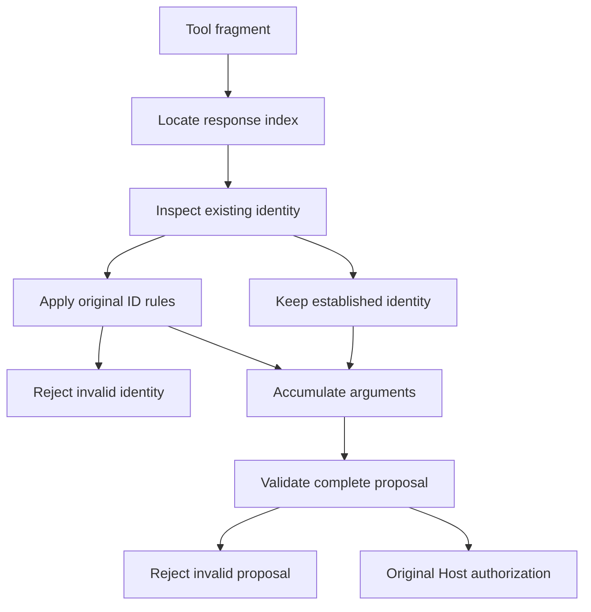

---
evidence:
  implementation: "Narrow established-ID compatibility in public v0.15.2"
  scoped: "Synthetic streaming regressions through the original runtime"
  live: "Independent live tasks check integration, not occurrence of a nullable continuation"
---

# How a null Broke an Agent Tool Call: A Streaming Compatibility Case

The model had begun generating tool arguments and the stream was still arriving, but the agent failed before executing the tool. The offending value was neither an invalid tool name nor malformed arguments. It was `id: null` in a later fragment.

Such a repair easily drifts toward either rejecting every null or broadly accepting them. We chose a third approach: **interpret a later null as “no identity update” only when the same index already has an established nonempty call ID.**

This was a narrowly scoped compatibility repair in open-etf-agent v0.15.2. It did not invent an ID, change authorization, or skip validation of the complete call proposal.

## 1. Tool calls arrive as updates, not complete objects in every frame

In streamed Chat Completions, a tool call can span multiple events. The application uses the response-local `index` to locate the call being assembled, concatenates function-name and argument fragments, and eventually submits the complete proposal to validation and execution.

These simplified synthetic fragments omit SSE framing, `choices`, and terminal events. They are not a raw provider payload:

```jsonl
{"index":0,"id":"call-a","function":{"name":"read_page","arguments":"{\"page\":"}}
{"index":0,"id":null,"function":{"arguments":"1}"}}
```

The second fragment still belongs to index 0. Its arguments extend `{"page":` into `{"page":1}`. The identity question is whether the later null should invalidate the already established `call-a`.

The old rule effectively said: whenever an ID field is supplied, it must be a non-conflicting string. That is intuitive for a complete object, but it treated an incremental “no identity update” representation as a new identity value.

The relevant input is not null alone. It is **null combined with the state already accumulated**.

## 2. Specify the permitted state transitions

The scope is the same tool index within the same response. A matching tool name or an ID from an earlier model request does not satisfy the precondition.

| Existing state and incoming fragment | Behavior |
| --- | --- |
| Nonempty ID exists; later fragment omits id | Preserve the existing ID |
| Nonempty ID exists; later id is null | Preserve the existing ID; this is the new compatibility case |
| Nonempty ID exists; later string is identical | Preserve the existing ID |
| Nonempty ID exists; later string differs or is empty | Reject the identity conflict |
| First fragment or new index lacks an established nonempty ID and supplies null | Reject; do not manufacture identity |
| id is a number, Boolean, array, or object | Continue rejecting it |

The original implementation allowed an early empty string to be replaced by a later valid string. This repair leaves that behavior unchanged. An empty string is not an established nonempty identity, however, and cannot authorize a null continuation. Final proposal validation still applies.

Isolating the new exception keeps the rule small:

```js
const hasEstablishedId = typeof call.id === 'string' && call.id.length > 0;
const keepsEstablishedId = part.id === null && hasEstablishedId;
if (part.id !== undefined && !keepsEstablishedId) {
  validateOriginalIdRules(call.id, part.id);
  call.id = part.id;
}
```

This is teaching pseudocode. `validateOriginalIdRules` represents the existing type and conflict checks. It is not a standalone replacement for the stream parser and does not perform argument, permission, or execution validation.

## 3. Compatibility belongs in assembly, without expanding trust

A generic cleanup rule that generates random IDs for missing values might stop the exception, but it would manufacture an identity the provider never supplied. Result association, deduplication, and diagnostics would then lose their original basis.

Copying the previous call’s ID is also dangerous. Parallel tool fragments may interleave, causing arguments from one index to be attached to another call.

The correct location is the assembly state for the current index in the current response. Preserve only the ID already established there. Do not borrow across indices, inherit across requests, or choose whichever conflicting value looks more plausible.



Only a later null with an established nonempty ID takes the preservation branch. Other inputs follow the original checks. Final validation still examines the assembled arguments and call identities; the original Host then decides whether execution is authorized. A compatible fragment is not execution permission.

Stream completion is another independent condition. The repair does not turn partial responses, abnormal termination, or unsupported protocol forms into executable calls.

## 4. Prove the repair without removing the protection

A minimal unit test feeds two fragments and asserts that the ID remains `call-a`. That is useful but insufficient: the user’s task depends on the call passing through the original gateway and runtime.

The regression therefore uses a complete synthetic path: read a source, save a report, and finish through the original runtime. The control omits the continuation ID; the target includes null. Both preserve the same call identity and produce the same report content.

Negative transitions matter just as much: initial null, null on a new index, a conflicting string, and unsupported types must remain rejected. Even with a valid ID continuation, malformed assembled argument JSON or duplicate final call IDs must still fail.

This is a good fit for state-transition testing. Test inputs are not merely possible field values; they include the state already present when each value arrives.

A later independent real-model batch exercised ordinary reading, publication, and recovery after integration. That does not prove a null continuation occurred in those streams. **Controlled null regressions establish the repaired boundary; live tasks check that integration still works.** Neither evidence source substitutes for the other.

## 5. Diagnostics do not require raw arguments

Previously, several identity failures could collapse into one compound error. `TOOL_FRAGMENT_ID` alone did not distinguish missing identity on an initial fragment, a later identity conflict, or an unsupported type.

Distinguishing those cases does not require logging real tool arguments, user material, or complete model output. A bounded diagnostic can retain the error category, incoming ID kind, whether a nonempty ID already existed, and whether an incoming string was empty.

For example, “incoming kind: null; previous identity present: true” helps identify this compatibility case. “Incoming kind: string; prior identity present; conflict” remains a reason to reject. They do not justify the same repair.

The better diagnostics describe state relationships, the less they need to expose original content to explain the failure.

## 6. One repair cannot explain every historical failure

The investigation obtained trusted bounded diagnostic evidence of null following an established ID in a real qualification run. That supported this specific repair and its targeted verification.

Earlier compound identity errors lacked equally specific evidence. We cannot retroactively assign them the same cause. Historical failures remain failures; passing tasks on a new revision do not rewrite them.

Likewise, observing this stream form from a provider does not establish that every provider protocol promises nullable continuations. The implementation supports one preconditioned representation while preserving identity. It is not general acceptance of arbitrary responses.

## Conclusion: compatibility adds a conditional interpretation

The source change was small. The substantive decision was which state transition preserved the invariants: established identity is not cleared, different calls are not merged, missing identity is not invented, and complete proposals are still validated.

For the next protocol difference, ask: Is this a complete-object field or an incremental update? Which existing state makes the representation safe? At what layer can it be interpreted without relaxing permission, execution, or recovery rules?

**Compatibility is not disabling validation. It is accepting a previously uncovered representation without changing the original facts.**

The public repository includes the [stream assembler](https://github.com/hpoenixf/open-etf-agent/blob/34124cefc6df289e08518173789210b45a716451/src/stream.mjs), [null-continuation regressions](https://github.com/hpoenixf/open-etf-agent/blob/34124cefc6df289e08518173789210b45a716451/test/stream-null-continuation.test.mjs), and [version verification note](https://github.com/hpoenixf/open-etf-agent/blob/34124cefc6df289e08518173789210b45a716451/docs/verification/v0152-stream-null-continuation.md).

Further reading: [From Tool Execution to Model Input](agent-tool-lifecycle-and-model-input.md) · [Trace Completeness Gaps](agent-trace-complete-observation-gaps.md)

Star [open-etf-agent](https://github.com/hpoenixf/open-etf-agent) to follow these boundaries in the implementation.
