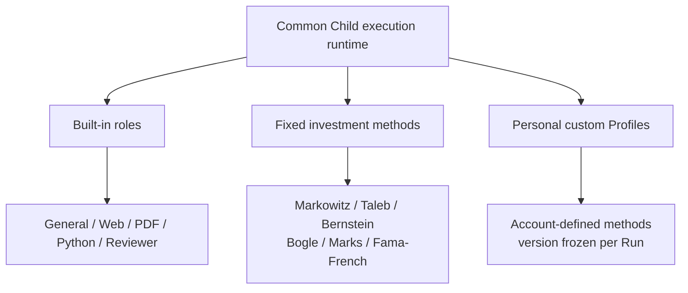
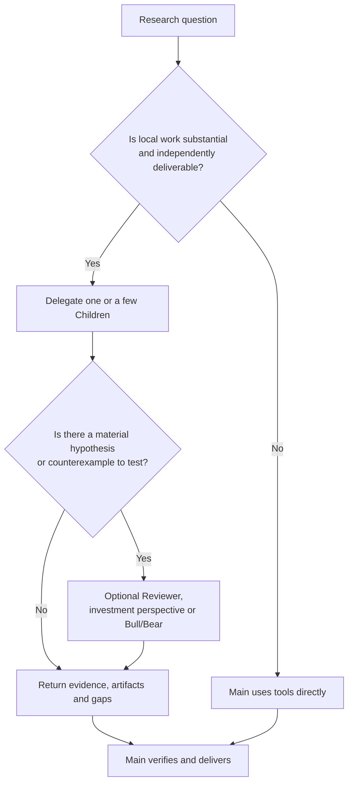

# Subagent Panorama: Independent Context, Specialist Work and Real Handoffs


ETF Agent now supports more than “Main calls a subagent.” We have **a general Child, built-in specialist roles, six investment research methods, and personal custom experts**. Two Children can also engage in bounded Bull/Bear challenges when useful. These are not separate Agent frameworks: **they share the same execution substrate, vary in method, and remain subject to the original authorization and delivery responsibilities.**

The design began with a simple problem: reading PDFs, following sources, and debugging calculations can consume a great deal of context. Main should not need to carry all that local history. In practice, the harder part turned out to be **returning real evidence, usable results, and explicit gaps**. This article explains what we support today, why we built it this way, and what engineering experience changed our decisions.

## 1. Which Subagents Do We Support Today?

First, separate **an execution, a specialist method, and a collaboration pattern**. Each Child is an independent execution. Web, PDF, or an investment perspective describes how it approaches a task. Bull/Bear describes how two Children may interact under specific conditions.

### Figure 1: three specialist sources on one execution substrate



This is a **capability map, not a pipeline that starts every role**. For each dispatch, Main chooses an appropriate method, and Child still needs the tools and sources actually authorized for that execution.

| Category | Supported capability | Distinguishing characteristic |
| --- | --- | --- |
| **General Child** | General local tasks without a domain-specific method | Independent context and autonomous multi-step work within granted tools |
| **Web / PDF / Python** | Retrieval and cross-checking, documentary evidence, computation and artifact export | Working specializations, **not single-tool restrictions** |
| **Research Reviewer** | Gaps, counterexamples, source checks, and fragile assumptions | Advises Main; never acts as final publication authority |
| **Six investment methods** | Markowitz, Taleb, Bernstein, Bogle, Marks, Fama–French | Apply different tests to shared evidence; not six advisers authorized to trade |
| **Personal custom experts** | Account-stored Profiles, precise selection, frozen revisions, historical attribution | User-defined methods without additional source, tool, or transaction permissions |

**Bull/Bear is a bounded two-Child exchange**: one makes a claim, the other challenges it with evidence, and the original claim receives a real response. It is neither a seventh investment method nor a voting system. **Remind is not a Subagent**: it brings known budget and timing facts into suitable existing model requests, instead of launching another research model call.

We describe Web, PDF and Python mechanics separately in [Web deep reading](021-agent-web-research-from-search-to-deep-reading.md), [PDF evidence](024-agent-pdf-from-text-to-evidence.md) and the [Python workbench](agent-python-compute-workbench-evolution.md). The central point here is that a Child can **use multiple authorized tools to finish a meaningful task**. A disclosure check that reaches a PDF footnote does not require a needless return to Main and a second dispatch.

For the six analytical perspectives, see [investment perspectives and falsification](investment-perspectives-and-thesis-falsification.md). For direct challenges, see [bounded Bull/Bear collaboration](bounded-bull-bear-peer-dialogue.md). Account configuration, selection, recovery, and contribution readback are covered in the [custom expert article](agent-custom-expert-from-prompt-to-recovery.md).

## 2. Shared Runtime, Independent Working History

We did not build a separate model loop, budget, workspace and Recovery stack for every role. **Each delegation gets its own Child identity and working context while reusing the common Runtime.** A specialty Profile informs the method; Host determines the tools and sources the Child may actually access; Main keeps the user goal and final answer.

### Figure 2: separate contexts with common governance


The design has four practical properties. **Context isolation** keeps local search and debugging away from subsequent Main turns. **Multi-step autonomy** allows a Child to read, calculate and repair within its permissions. **Method portability** avoids cloning an execution platform for each built-in or personal Profile. **Traceable outputs** keep original execution identity, frozen methods and source receipts available across supported Recovery paths.

“Which method helps?” and “what is this execution permitted to do?” must remain separate. A personal Profile saying “access every account” does not gain data privileges. Reviewer can raise significant objections but cannot approve Main's final answer. Managed PDF experts can use existing Skills and sandboxed helpers; this does not permit users to upload arbitrary executable expert packages.

## 3. How Would the Children Collaborate on an ETF Question?

Consider a **teaching example**, not an independently qualified production investment result. A user is considering adding an ETF and wants to know its holdings overlap with the portfolio, its fees, and its main risks.

Main can handle small lookups directly, and delegate long disclosure checks, document reading, or calculation debugging to independent Children. **Questions and true data dependencies determine the work—not a mandatory Web → PDF → Python role pipeline.**

### Figure 3: different questions contribute to one answer


For example, a fee check can start on the issuer's website and continue into PDF footnotes inside one Child. An overlap calculation depends on holdings with compatible dates, units, and coverage. When only top-ten positions are disclosed, a Child should preserve that limitation rather than invent a precise full-portfolio overlap figure.

If the research depends on “more funds means better diversification,” Main may use an investment perspective, Reviewer, or Bull/Bear to challenge it. Specialists should preferably use **the same authorized factual basis** rather than vote on numbers collected from incompatible dates.

A task may include `relationHint`, and Child can adjust its subsequent research description after reading new evidence. But such hints are not an automatic scheduler. A real dependency still requires original task receipts, lawful `inputRefs`, and evidence that the input was actually consumed. **“Please consider the other expert's result” does not mean that the expert has seen it.**

## 4. What Must a Child Hand Back?

A Child should not flood Main with full tool logs and failed scripts; “done” is not enough either. Our handoff retains **a findings summary, original evidence or measurement basis, genuine artifacts, and unresolved gaps**. Useful partial results can be handed back without pretending every part succeeded.

### Figure 4: preserve valid findings and explicit gaps after local failure


An error can be repaired only within existing authority and remaining budget. Unrecoverable gaps remain explicit. If the Child reports a downloadable file, it must actually exist and be readable by Main. If a PDF page image was produced, we need to check whether it entered the model request—and separately whether the model interpreted it correctly.

One practical distinction matters most: **a Child submitted results; Host accepted them; the next Main request received them; Main used them; the user received an answer** are not interchangeable claims. We observed a Child return valid citations while Main repeatedly polled and re-delegated until no answer was delivered. We also observed a Python Child repair code and export an HTML report from synthetic data, with Main consuming the actual artifact and publishing a download entry. A successful local step does not prove end-to-end delivery.

The detailed evidence and limitations of contribution-to-Main checks belong in [how to verify Subagent contributions](agent-subagent-contribution-evidence.md), rather than repeated test logs here.

## 5. Three Lessons That Actually Changed the Design

**First, isolation involves execution identity and files, not only messages.** When Main and Children interleave, the third global event may be Main's second turn. Using global progress to bind local inputs once caused a legitimate reference to be rejected. Python workspaces likewise belong to specific executors; sibling Children do not acquire access by guessing paths.

**Second, delivery of evidence and understanding of evidence are different checks.** In a real PDF study, page images reached model requests while some visual details were still misunderstood and cross-document coverage remained incomplete. In a historical-report handoff, Main had the complete report while Child had not actually selected the corresponding input. We therefore distinguish source authorization, actual model input, and interpretation. Tool success cannot stand in for research correctness.

**Third, adding a role should not create a new authority.** Investment and personal methods must be frozen to their Child identity so Recovery does not silently substitute a newer Profile. Reviewer advises; Remind should not spend another model call to rediscover known budget facts. Before dispatching a second Child, we ask whether another isolated context and the associated delegation, waiting, and readback costs are warranted.

These lessons rest on implementation, bounded tests, and limited real-model samples. We have observed concrete paths for local computation, method binding, and some evidence handoffs. That is not evidence that multiple specialists are consistently faster, more accurate, or a net benefit in live fund research.

## 6. When Does Delegation Earn Its Cost?

### Figure 5: decide whether to delegate before adding another viewpoint



A single fee lookup or stable calculation often does not justify a Child. Long reading across several documents, repeated debugging, or distinct subquestions with inspectable outputs are better candidates for isolation and limited parallel work. Extra parallelism does not remove real dependencies.

**Our current state is a shared Child execution mechanism with multiple expert methods and bounded collaboration.** The open question is whether a second viewpoint improves the actual research delivered to users under comparable costs and evidence. The reusable engineering rule is to define a verifiable local task and its handoff first, and only then decide if an extra Subagent is worthwhile.

<!-- open-etf-case:child@e1b8e4edde724548fab16d8ca4b205379bfa7f30 -->
For one small public handoff example, see the [Open ETF Agent read-only Child fixture](https://github.com/hpoenixf/open-etf-agent/blob/e1b8e4edde724548fab16d8ca4b205379bfa7f30/src/cli.mjs). This is an **offline scripted example**, not a public implementation of every expert described above. Follow that snapshot's own documentation for commands and limitations.
The fixed, read-only fixture can be launched with:

```bash
node src/cli.mjs --case fixture-child --output runs/article-child
```
<!-- /open-etf-case -->

---

<!-- agent-article-sync:guidance:start -->
## Further Reading and Discussion

[Panorama series](/en/panorama) · [Chinese original](/articles/agent-subagent-context-specialization) · [Public article source](https://github.com/hpoenixf/eff-agent-article) (Stars welcome).
<!-- agent-article-sync:guidance:end -->
