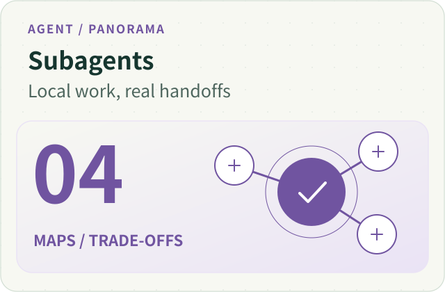
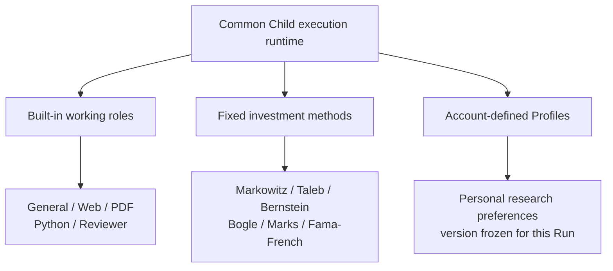
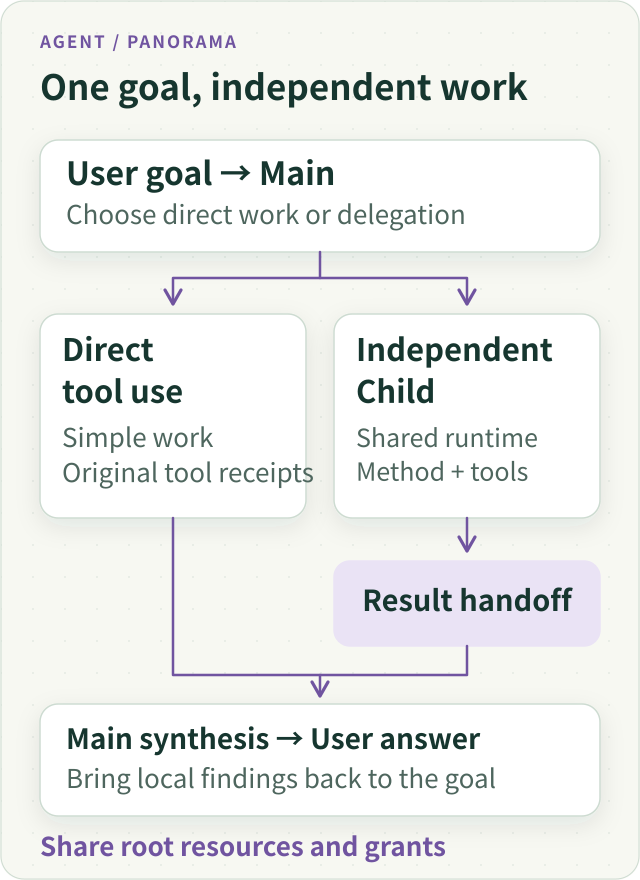
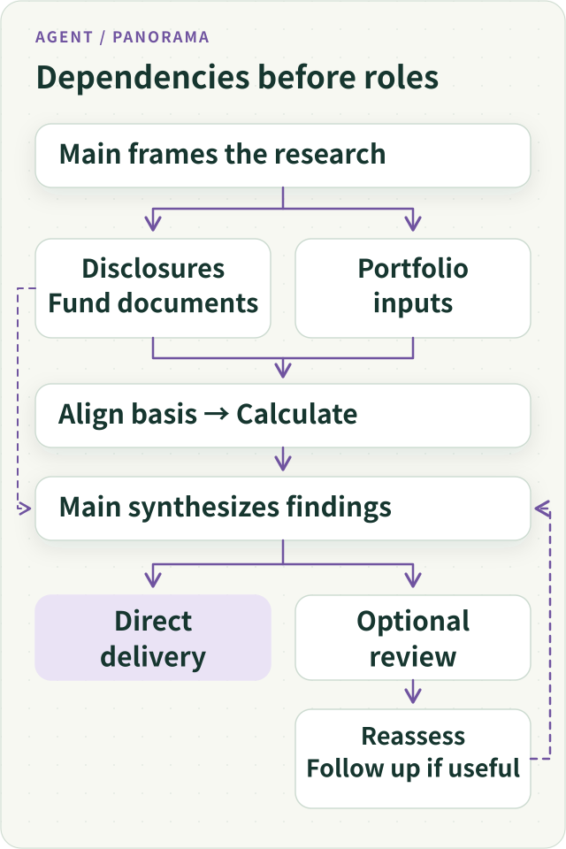
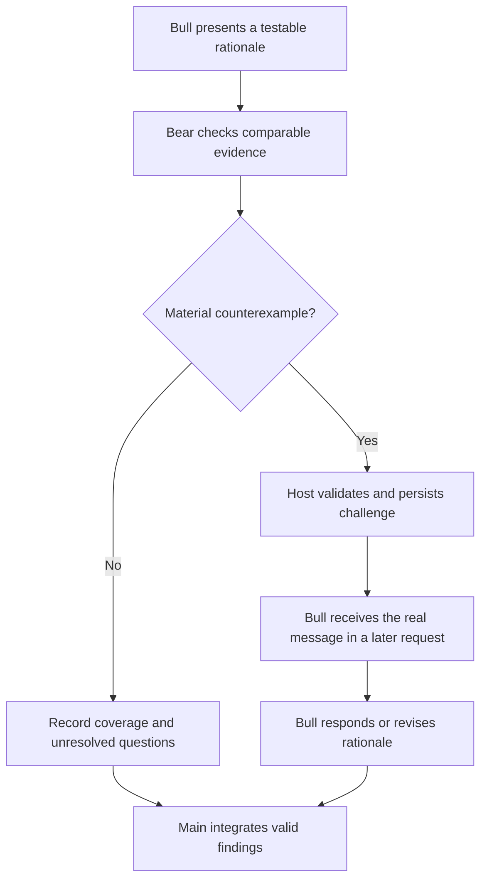
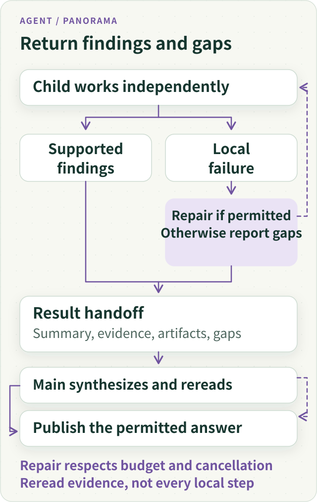
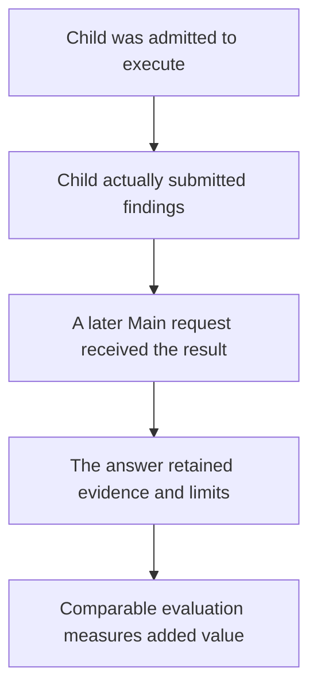
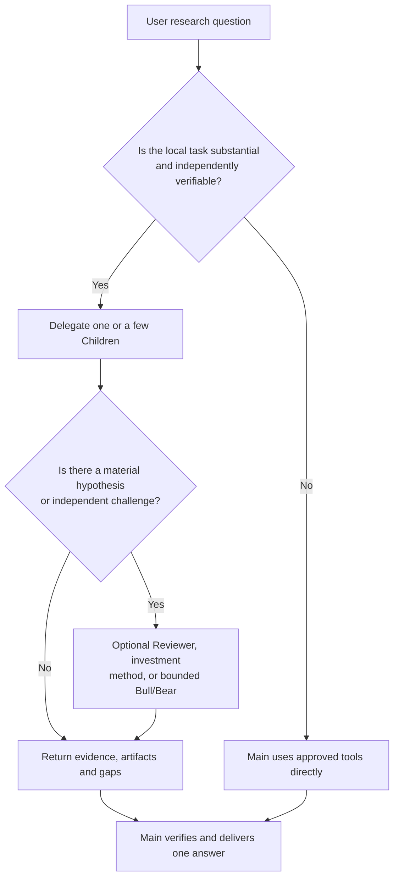

# Subagent Panorama: Independent Context, Specialist Work and Real Handoffs



**ETF Agent's Subagent system now goes well beyond Web, PDF, and Python “tool specialists.”** It includes a general Child, built-in specialists, six investment research methods, account-defined experts, an optional Research Reviewer, and bounded Bull/Bear challenges. They reuse one execution substrate but not one shared conversation history. Different working methods do not transfer tool permissions or responsibility for the final answer.

We initially introduced this system to reduce pressure on Main's context. Reading a PDF might involve repeated page searches; a Python study might need several debugging rounds. After isolating those processes, harder questions emerged: **Did the expert actually receive the original material? Did Main actually receive and use the finding? Which research judgment changed because another perspective was added?**

This article answers three questions: what we currently support and how those Children contribute to one fund research task; how our choices compare with industry approaches; and which lessons are supported by engineering evidence rather than assumed benefits. Web, PDF, and Python implementation details stay in their own articles. The main subject here is the collaboration system.

## 1. Why Subagents: Isolate Working History Without Fragmenting Problem-Solving

When a user asks whether adding a technology ETF will improve diversification, Main needs to retain the user's objective, original holdings, available cash, comparable data, and the ultimate decision criteria. It does not need to repeat every PDF page search, failed source lookup, or script rerun caused by a mismatched field in its later model requests.

The first benefit of a subagent is therefore **context isolation**: Main delegates a bounded question, Child uses permitted tools in its own model context, and the result returns as inspectable findings. Anthropic's explanation of [subagent context engineering](https://www.anthropic.com/research/effective-context-engineering-for-ai-agents) addresses the same underlying problem.

Isolation should not mean carving every tool into an incompatible role. If a Web Child finds a critical PDF footnote, it should be able to read the document within its original permissions. If a PDF Child discovers a newer issuer disclosure, it should not mechanically return to Main only to request a second specialist. **We delegate a meaningful unit of work, not a rigid sequence of predefined function calls.**

There is also a cost: a fresh Child may need to reread information already acquired by Main. Delegating everything can replace context bloat with redundant preparation and handoff overhead. The task's length, the amount of shared input, and whether it has an inspectable result determine whether isolation is worthwhile.

## 2. Our Subagent Family: One Execution Substrate, Several Types of Expertise

Three concepts must be distinguished. **A Child is an execution instance; a Profile defines a working method; Bull/Bear is a particular collaboration relationship between execution instances.** They do not form a mandatory pipeline in which everyone must participate.

### Figure 1: one Child execution substrate carries several expert methods



| Capability | Specific problem addressed | Important property |
| --- | --- | --- |
| **General Child** | Investigate a local question without domain-specific guidance | The ordinary baseline; no need to force specialist selection |
| **Web Explorer / PDF Reader / Python Analyst** | Find reliable sources, interpret documents, perform calculations and export artifacts | Specialization does not restrict every next step to one file format |
| **Research Reviewer** | Find missing counterexamples, sources, or material conditions | Advises on investigation or closure; does not approve the final answer |
| **Six investment methods** | Test the same investment rationale with different analytical questions | Different methods, same legitimately available factual basis |
| **Personal custom Profile** | Save a user's analytical order, domain habits, and constraints | Revision is frozen for the Run; later edits do not rewrite older work |
| **Bull/Bear collaboration** | Ensure a falsifiable rationale receives a real challenge and response | A bounded messaging relationship, not another omnipotent expert |
| **Remind (not a Child)** | Surface budget, time, and execution facts | Does not launch another model to re-derive existing counters |

This classification matters. **A specialist is not a permission role, and an investment perspective is not an independent investment adviser.** Being good at PDFs does not restrict all future work to PDFs. Applying an investment thinker's method does not provide that person's real-time opinions, let alone trading authority.

### Web, PDF, and Python: complete a local unit of work

Web emphasizes source discovery and cross-checking. PDF emphasizes sections, footnotes, charts, and actual reading coverage. Python emphasizes input alignment, code repair, computation, and output files. For managed PDF experts, we also use on-demand Skills, reference materials, and controlled scripts—without building another PDF Runtime or allowing arbitrary executable packages in personal Profiles.

For example, a fee investigation can begin on an issuer's website and continue into a prospectus footnote within the same Child. Python's value is not simply evaluating a formula: it is treating “inspect inputs → fix failures → recompute → export → state limitations” as one work unit. Details belong to [Web continuous reading](021-agent-web-research-from-search-to-deep-reading.md), [PDF evidence reading](024-agent-pdf-from-text-to-evidence.md), and the [Python workbench](agent-python-compute-workbench-evolution.md).

### Six investment methods: one factual basis, six lines of inquiry

We do not ask six experts to vote “buy” or “do not buy.” We want them to ask genuinely different questions about **the same authorized, comparable evidence**:

| Method | First question to investigate |
| --- | --- |
| **Markowitz** | How do the new weights change correlations and marginal risk? |
| **Taleb** | Are tail events, liquidity constraints, or fragility underestimated? |
| **Bernstein** | Does the decision fit the investment horizon, cash needs, and holding discipline? |
| **Bogle** | Are tracking, overlap, and total ownership costs sensible? |
| **Marks** | Does the current price compensate for the risk taken? |
| **Fama–French** | Could comparable return differences be explained by known risk factors? |

If a portfolio lacks an adequate, comparable return series, a Markowitz perspective cannot derive precise optimal weights merely from “more diversified sectors.” Without real fee data, Bogle cannot pronounce one fund the lowest-cost implementation. **The value of a method is both what it asks and which conclusions it refuses to claim without evidence.** The [six-method and hypothesis-falsification article](investment-perspectives-and-thesis-falsification.md) develops these distinctions further.

### Reviewer: scrutinize research quality without taking over Main

Research Reviewer is another type of Child. It can inspect authorized primary sources, seek contradictions or fragile assumptions, and suggest continuing, pivoting, finalizing, or suspending the research. It differs from “invite one more investment perspective”: its subject is **whether the existing research supports the conclusions already being considered**. Main need not obey every suggestion. Reviewer also does not become a new publication, trade, or user-approval authority.

## 3. How We Organize Them: Main Remains Accountable to the User

We do not duplicate the model loop, execution identity, budget, authorization, workspace, and Recovery machinery for every expert. **Main decides whether to delegate and synthesizes the response; Child operates in an independent context; Host controls tools and sources; shared root-run governance bounds every execution.**

### Figure 2: common Runtime, distinct methods, actual permissions



At least four facts must remain distinct.

**First: why was this expert selected?** Main may use General, a built-in specialist, or a personal Profile. New ordinary expert executions have been consolidated around an `agentId` selector: one complete expert definition per Child, rather than an arbitrary stack of legacy type fields. A directory description says what an expert is suited for; it does not prove natural model selection is always correct.

**Second: what input did it actually receive?** Main understanding the task does not mean Child received everything Main previously read. Inherited results depend on selected, authorized `inputRefs` with real source identity. Passing a URL, summary, or relationship description does not establish that the original evidence reached the model.

**Third: what is it permitted to do?** A Profile is a working method, not a new grant of authority. Source access, sandbox use, script execution, trading, publication, and budgets remain under the original Host and owner checks. Each Child also has its own progress coordinates and workspace ownership rather than one implicit global “current step.”

**Fourth: who owns the result?** Child returns interim or final findings. Main reads the necessary evidence, resolves conflicts, and delivers user-visible content. Reviewer may raise an independent challenge but does not become a final approval body. Remind merely surfaces known resource facts; a reminder cannot automatically authorize another Reviewer run.

For interaction ownership this is closer to the [OpenAI Agents SDK agents-as-tools / manager model](https://developers.openai.com/api/docs/guides/agents/orchestration) than to a handoff that moves the active user conversation to another specialist. We borrow the **responsibility model**, not an assertion that the two systems share an identical protocol.

## 4. One Fund Research Question Across the Whole Collaboration

The following uses **synthetic teaching data**, not a real named fund or a qualified live financial research benchmark.

The user asks: “I want to use 10% of my cash to buy a technology ETF. With more funds in my account, am I better diversified?”

Assume the original portfolio contains 50% broad equity fund, 30% bonds, and 20% cash. Technology accounts for 30% of the broad fund and 80% of the candidate ETF. Under this teaching example's assumptions of equal dates, complete coverage, and comparable sector classification:

| Scenario | Broad equity / tech ETF | Bonds / cash | Tech sector exposure |
| --- | --- | --- | --- |
| Existing A | 50% / 0% | 30% / 20% | 15% |
| Buy using cash B | 50% / 10% | 30% / 10% | 23% |
| Replace broad equity C | 40% / 10% | 30% / 20% | 20% |

The calculation multiplies portfolio weights by the technology-sector shares in each fund and sums the results. It measures **technology-sector exposure only**, not complete holdings overlap, covariance, or total portfolio volatility. A real study must also verify share classes, reporting dates, fee applicability, and input coverage.

### Figure 3: organize by questions and dependencies, not a fixed role order



Main can perform straightforward arithmetic itself, or delegate original-disclosure verification to one Child and long-document reading to another. Limited parallelism helps when the inputs are ready and the tasks really are independent; if a calculation requires a PDF to establish dates and share-class details, that dependency must be resolved first.

Different specialists can then contribute **different kinds of value**. Markowitz notices that the variance and covariance data are missing, so a change from 15% to 23% does not settle the overall risk question. Bernstein asks whether the 10% of cash is needed within six months. Bogle examines whether another fund implements the intended exposure at a better verified total cost. Reviewer asks whether “technology-sector weight” has been misrepresented as “complete diversification risk.”

The most useful Main answer may be: “**Owning more fund tickers does not prove better diversification; under this teaching model, scenario B actually increases technology-sector exposure.** If the user's goal is intentionally to increase technology exposure, compare valuation, costs, and cash requirements under that objective.” No voting and no averaging three incomplete opinions into an arbitrary buy percentage.

## 5. Bull/Bear: A Counterargument Must Actually Arrive and Receive a Response

Ordinary multi-perspective analysis may still produce three unrelated essays. Our bounded Bull/Bear pattern imposes a stronger relationship: **Bear challenges a testable claim; Bull has to receive the challenge during its actual subsequent execution and can revise or withdraw the reasoning.**

### Figure 4: bounded challenges and real replies



In the teaching scenario, Bear should not merely say “technology valuations may be high.” It should challenge H1: “Adding another technology ETF improves diversification,” and show the comparable sector-exposure change from 15% to 23%. Bull may retract H1 while leaving open whether *deliberately increasing technology exposure* is worth considering. **Withdrawing a failed rationale is more useful than manufacturing a compromise acceptable to both sides.**

In the execution mechanism, “model proposed a message,” “Host validated and durably accepted it,” and “the recipient's later model request actually contained it” are distinct facts. Pairing has bounded identities, rounds, budgets, and safe park/wake handling. Original receipts and source identity remain inspectable; the system cannot retrospectively invent a debate from chat summaries. **One participant's source permissions do not automatically pass to the other**, and agreement cannot authorize a transaction.

By comparison, Microsoft Agent Framework supports [Group Chat orchestration](https://learn.microsoft.com/en-us/agent-framework/workflows/orchestrations/group-chat) for a shared conversational process. Its documentation describes a coordinator broadcasting contributions so participants can operate with synchronized conversation histories. Our Bull/Bear path deliberately limits the discussion to **one material hypothesis and authorized source-bearing messages**, rather than maintaining an always-on discussion room. That is a decision about scope and cost, not a claim that general Group Chat cannot perform reviews or approvals.

The pairing, messages, Recovery behavior, and failure cases are covered by [bounded Bull/Bear dialogue](bounded-bull-bear-peer-dialogue.md).

## 6. Personal Experts: Methods May Evolve, but Old Executions Cannot Change Identity

We also want users to preserve their own research habits. Some check fees first; others begin with underlying holdings overlap; still others demand an explicit falsification condition for every allocation rationale. Saving a Prompt is easy. The difficult part is **how it is selected, which revision actually executes, and how that fact is reconstructed later**.

An ETF Agent personal expert is a Profile with account ownership, a revision, and a content fingerprint. Main receives a bounded catalog rather than everyone's full instructions. Once precisely selected, the method reaches the corresponding Child with its proper provenance. A Run freezes its snapshot. Later user edits apply to future Runs; Recovery reads the original revision. The expert catalog, favorites/presets, and explicit `@` selection are discovery or preference surfaces; they do not prove a Child was dispatched.

Another valuable distinction is **freeze the method, not an incorrect task description**. Main may initially request “precise complete-holdings overlap.” If Child learns that only top-ten holdings are available, it can submit a bounded `update` so that later work becomes “compute overlap within disclosed coverage and preserve the unknown remainder.” That does not rewrite the original user text, dispatch receipt, or tool permissions. A soft `relationHint` can express that another expert ought to check a finding, but text cannot create an automatic dependency scheduler or actual result consumption.

Mid-research user corrections have a similar rule: sending a question does not establish that its answer entered the intended Child. Adoption requires the response to reach the correct executor's actual subsequent model input. See [how user replies re-enter the original research](agent-durable-human-interaction-response-adoption.md).

At present personal Profiles are primarily **text-based methods**. Unlike expert products centered on independent persistent Workspaces, this approach intentionally avoids cloning a long-lived model instance, memory, and budget for every saved configuration. It reuses existing identity and Recovery, but a personal expert is not yet a permanent independent digital employee. The complete selection and version design is in the [custom expert article](agent-custom-expert-from-prompt-to-recovery.md).

## 7. The Hard Part of Handoffs: Doing Work, Reaching Main, and Changing the Answer

We treat a Child handoff as **reusable research output**, not one success flag. Relevant information includes findings, original sources and measurement dates, actual calculations or files, and unresolved gaps. Full search histories and debugging logs should not automatically flood Main.

### Figure 5: local failure preserves legitimate findings without hiding gaps



Several concrete engineering observations explain why this matters.

**In one Web handoff**, the Child mixed two citation types. Refusal was legitimate, but feedback encouraged deleting otherwise valid citations. The repair clarified the distinct reference roles so the model could preserve and resubmit supported findings; it did not weaken source validation.

**In one PDF study**, page images genuinely entered the model requests, but the model still misread some colors or shapes and failed to complete all cross-document checks. “The evidence arrived” and “the evidence was understood correctly” are different facts.

**In one Python run** using synthetic data, the Child encountered data-field and HTML-template errors, corrected them in its isolated workspace, recomputed, and exported a report. Main acquired the actual artifact and provided a download entry. This demonstrates a working local job and handoff—not that all real fund calculations are accurate or that the system is faster than one Main.

**In a historical-report continuation**, the reverse happened: Main's request contained a full prior report selected by the user, while Child did not actually select the relevant valid `inputRefs`. “Main read it” did not prove that Child read it. Across Recovery, unknown external effects, prior submissions, and confirmed results must also retain their original identities instead of being recreated from missing in-memory flags.

### Figure 6: five different levels of evidence from expert presence to actual value



In late October 2026, we performed a scoped comparison between actual Child submissions and excerpts in subsequent captured Main inputs. It demonstrates that **some expert text really reached Main**, not that the complete expert reports were adopted or that the user obtained better research than with a single agent. The denominator, sampling method, and limitations are in [evidence of specialist contributions](agent-subagent-contribution-evidence.md).

These levels direct debugging effort. If an artifact exists but does not reach Main, inspect projection and readback. If it arrives but vital limitations disappear, inspect synthesis and citation. If a specialist duplicates existing evidence, reconsider delegation rather than adding another “expert manager.”

## 8. Industry Practice in 2026: Shared Problems, Different Choices

As of **November 2026**, “Subagent” no longer describes one universal orchestration pattern. Public industry documentation can be compared along at least four questions: **control ownership, context inheritance, collaboration structure, and cost**. This table summarizes representative, documented mechanisms and emphases. **It is not a benchmark, and the absence of a feature from a short documentation summary is not evidence that a framework lacks it.**

| Representative approach | Officially documented emphasis | What it teaches us |
| --- | --- | --- |
| **OpenAI Agents SDK** | [Agents as tools versus handoffs](https://developers.openai.com/api/docs/guides/agents/orchestration): a Manager owns the reply, or a specialist takes over conversational control | Keep Main accountable for financial synthesis; selecting a role must not silently transfer publication responsibility |
| **Claude Code / Anthropic** | [Isolated contexts, custom permissions, and methods](https://code.claude.com/docs/en/sub-agents), distinct agent teams, and [research patterns](https://www.anthropic.com/research/multi-agent-research-system) emphasizing parallel discovery and distilled handoffs | Delegate well-defined investigations; multi-agent exploration earns its cost on suitably parallel, valuable tasks |
| **LangChain Deep Agents** | [General and custom subagents](https://docs.langchain.com/oss/python/deepagents/subagents), [isolated versus forked context](https://www.langchain.com/blog/organizing-context-in-a-multi-agent-harness), and async execution options | Clean contexts can duplicate preparation; explicitly consider isolation against useful inherited context |
| **Google ADK** | [Sequential/Parallel and custom workflows](https://adk.dev/agents/custom-agents/); [collaboration modes](https://adk.dev/workflows/collaboration/) distinguish Task, Chat, Single-turn, and return behavior | Fixed workflows suit known dependencies; dynamic research need not become a rigid specialist pipeline |
| **Microsoft Agent Framework** | [Sequential, Concurrent, Handoff, Group Chat, Magentic](https://learn.microsoft.com/en-us/agent-framework/workflows/orchestrations/) and other patterns | General group discussions aid iterative work; a financial counterargument can first be scoped to a bounded, inspectable message |
| **CrewAI** | [Sequential and Hierarchical processes](https://docs.crewai.com/en/concepts/processes), with a Manager distributing tasks and validating outputs | Explicit roles matter, but every research task does not require another dedicated Manager layer |

Three comparisons are especially important.

**First, Manager and handoff determine who owns the user conversation.** We keep financial synthesis with Main. That is not because handoffs are inherently unsafe, but because one local interpretation can easily be mistaken for a complete investment recommendation. A product that intentionally transfers the user interaction to a specialist may reasonably choose handoff instead; our ordinary experts have a different responsibility.

**Second, isolation versus inherited context is a real tradeoff.** Deep Agents' 2026 discussion of forked subagents is a useful counterpoint. A Child independently recollecting Main's existing information may waste work; inheriting the conversation can save repeated retrieval while also making the initial prompt larger and less isolated. ETF Agent currently favors explicitly selected, authorized result references with attention to *what actually reached the model*. That does not mean it has implemented Deep Agents' fork mode.

**Third, concurrency, group chat, and bounded challenges solve different problems.** Concurrency overlaps independent work; Reviewer checks research omissions; Bull/Bear tests whether a particular reason was challenged and answered. Deterministic steps can benefit from fixed workflows; open-ended investigations need room to revise the next task after new evidence. Treating all of this as interchangeable “multi-agent collaboration” conceals why another model call was justified.

Anthropic's multi-agent research article also warns that such systems can consume substantially more tokens than ordinary chat. Its internal results depend on specific models, tasks, and evaluation methods; they cannot be transplanted into ETF Agent performance or accuracy claims. **Industry practice now offers more collaboration patterns, not a proven formula for the optimal number of experts on every task.**

### Our Practical Trade-off: When Does Another Child Earn Its Cost?

### Figure 7: return the “one more expert?” question to the actual task



Our baseline remains **one Main with permitted tools**. One fee lookup or stable computation rarely needs a new Child. Long document investigation, repeated local debugging, or independently verifiable subquestions make better candidates for isolation. New evidence may update the local task description but should not silently update the method identity or authorization.

In practice, **not building something** is also a substantial design result: no separate Runtime per Web/PDF/Python role; no compulsory six-method fan-out; no Reviewer as an overriding final court; no extra model to compute Remind's known counters; no treatment of `relationHint` as a dependency scheduler; no long-lived digital employee Workspace automatically created for each personal Prompt.

To measure the net benefit, compare one Main, one Child, and multiple specialists on the same user question, source set, and comparable total budget. Evaluate **whether the question was answered, numbers are reproducible, critical limitations survived, and counterevidence changed a material rationale**, then examine overall tokens, wait time, physical attempts, and failures. Until that comparison exists, independent workspaces, frozen method identities, and reliable handoff mechanisms are meaningful engineering capabilities. **“More experts understand investments better” remains an unverified business hypothesis.**

## Conclusion: Specialist Work Still Ends in One Accountable Main Answer

We initially wanted Main to carry less local history. We learned to care even more about a stronger principle: **methods may differ, but evidence and execution identity must remain clear, and the user question must not lose its owner just because more experts are present.**

A general Child permits deep local autonomy. Investment methods and personal Profiles add replaceable research viewpoints. Reviewer and Bull/Bear create opportunities to check fragile assumptions. Original receipts and source identities make those paths inspectable and recoverable.

If another expert only produces another polished paragraph, the extra complexity is not worthwhile. **An additional Subagent is useful when it fills an important evidence gap, corrects a material rationale, or completes a local job Main should not carry—and its result genuinely contributes to the user's answer.**

<!-- open-etf-case:child@e1b8e4edde724548fab16d8ca4b205379bfa7f30 -->
The public repository contains a minimal [read-only Child handoff fixture](https://github.com/hpoenixf/open-etf-agent/blob/e1b8e4edde724548fab16d8ca4b205379bfa7f30/src/cli.mjs) to observe an isolated task and Main's readback. This is an offline scripted example, not the public full implementation of every expert described above.

```bash
node src/cli.mjs --case fixture-child --output runs/article-child
```
<!-- /open-etf-case -->

---

<!-- agent-article-sync:guidance:start -->
## Further Reading and Discussion

[Panorama series](/en/panorama) · [Chinese original](/articles/agent-subagent-context-specialization) · [Public article source](https://github.com/hpoenixf/eff-agent-article) (Stars welcome).
<!-- agent-article-sync:guidance:end -->
