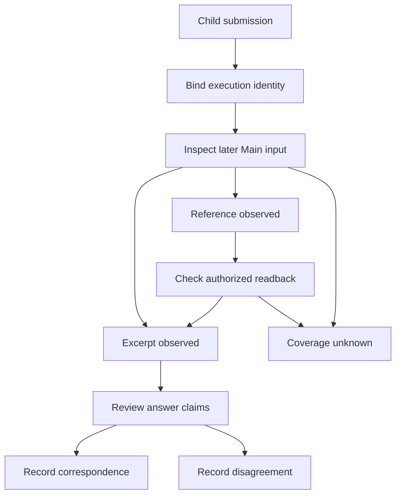

---
evidence:
  implementation: "Execution identities and handoffs can be inspected"
  scoped: "Recorded submissions matched to later Main-input excerpts"
  live: "Semantic adoption and incremental multi-agent quality not independently compared"
---

# How Do We Know the Main Agent Actually Used a Specialist’s Findings?

Three specialists ran, three reports came back, and the final answer still looked as though the main agent had written it alone. What, precisely, succeeded in this “successful multi-agent collaboration”?

The question is not merely whether specialists ran. We need to know what they submitted, what the main agent received, which final claims correspond to those findings, and whether the additional work was worthwhile.

**Admission, submission, presence in the main agent’s input, semantic adoption, and better answers are five different questions.** This article examines how to collect evidence at each level, rather than propose another orchestration framework.

## 1. Participation counts do not measure contribution

In a research evaluation recorded on October 30–31, 2026, the first 59 ended runs included 53 with at least one execution-identified Reviewer admission and 12 with at least one ordinary-specialist admission.

Those sets can overlap. Adding them does not produce “65 specialist research runs.” Reviewers perform a review role, while ordinary specialists perform other local work. An admission receipt establishes entry into execution, not completion of the assigned task.

Looking further, 48 runs contained at least one readable final submission, with 75 submissions in total. Matching by the same execution identity attributed 62 to Reviewers and 13 to ordinary specialists.

This establishes which specialists left readable work. It does not establish adoption. A Child may investigate and submit carefully, while the Main never receives the content, never follows its source references, or reasonably decides not to use the conclusion.

Therefore, **runs, execution instances, submissions, and model requests need separate denominators**. Otherwise, several impressive-looking counts can represent the same work more than once.

## 2. Break contribution into observable handoffs

Here, Main means the agent responsible for synthesis, and Child means a subagent performing local work. Investigation should begin with their existing execution identities and result references, not with a text-similarity score.

| Level | Minimum evidence | The question it can answer |
| --- | --- | --- |
| Execution admission | Run identity, Child identity, original admission receipt | Who was admitted to perform which work? |
| Submission | A readable final submission from that Child | What did it actually return? |
| Request input | Text, selections, or references in a later Main request | What did that particular Main invocation receive? |
| Claim correspondence | Claim-by-claim review against sources and specialist findings | Which judgments correspond, and were limitations preserved? |
| Incremental benefit | Comparable single-Main and multi-specialist outcomes and costs | Did the extra collaboration improve the user’s task? |

This is not an approval checklist that every answer must pass before being displayed. Not adopting a specialist’s suggestion may be a sound research decision. Missing observation evidence does not justify hiding other legitimately delivered content.

The purpose is to constrain claims about the system and direct the next investigation to the right layer.

## 3. What text matching establishes

To inspect handoff coverage, we took at most 20 candidate fragments of at least 40 characters from each readable final summary, then looked for them in captured Main inputs after the submission.

Of 75 final submissions, 70 had at least one matching candidate fragment, spanning 45 runs. This is useful evidence: some specialist text entered later Main inputs rather than remaining exclusively in Child history.

Calling it a “93% specialist adoption rate,” however, would be wrong.

First, text in context does not establish that the model changed a judgment because of it. Second, one matched fragment does not establish delivery of the entire summary, its evidence, or its limitations. Third, a missing match does not establish a failed handoff: the result might have arrived as a reference or through a rewrite or selection that this method did not cover.

The defensible description is **an input-coverage observation with an explicit sampling method**, not a semantic-adoption or answer-quality score.

Another attribution problem remains: the Main might already have seen the original source before the specialist submitted. Even agreement between the final answer and the specialist’s wording does not establish an independent contribution. Execution identity and request ordering narrow the inquiry; they do not automatically reveal the model’s internal causal process.

## 4. A fee-comparison example

The following teaching case is synthetic, not private material from the evaluation.

The Main is comparing two funds’ ongoing charges. A Child finds that a quoted rate applies only to a particular share class and excludes one-off transaction costs. It returns the rate, effective date, source reference, and both limitations.

**Case one: the Main receives only a result reference.** That establishes a route for further reading, not delivery of the rate’s source text in this turn. Check whether an authorized read occurred and what it actually returned.

**Case two: both rate and limitations enter the Main input, but the answer retains only the rate.** Transport may have worked, while synthesis broadened the claim beyond its valid scope. The appropriate repair is in research synthesis or expression, not another Child retry.

**Case three: the answer compares the correct share classes and preserves the fee scope.** This supports a readable correspondence between a specialist finding and a final claim. The Main may still have derived it independently from the same source. Demonstrating a quality improvement requires a comparable experiment.

All three cases disappear behind an undifferentiated `used=true` field.

## 5. A contribution record that does not acquire new authority

The following is a suggested diagnostic record for human review. It is a teaching design, not a claim that automatic semantic contribution assessment has been implemented:

```json
{
  "childExecution": "synthetic-child-1",
  "submission": "readable-final",
  "mainInput": "observed-excerpt",
  "claimReview": "not-assessed",
  "incrementalBenefit": "not-measured"
}
```

Such a view should refer to existing run, execution, submission, and request identities. It should not create a competing contribution ledger that can rewrite business facts. Content correspondence supports review; it neither grants permission nor substitutes for answer evaluation.



The input branches mean observed text, observed reference only, or insufficient evidence. A reference advances to text coverage only when an actual readback supports it. Claim review remains separate; disagreement is recorded without altering the original Child submission.

This separation also avoids misdirected repairs. A delivered Child result absent from the Main request points toward handoff or projection. Material present in the request but stripped of limitations in the answer points toward synthesis or citation. Repeated specialist work points toward delegation strategy and incremental value.

## 6. How to test whether specialists are worth it

At the benefit layer, launch counts and fragment matches are no longer adequate substitutes for comparison.

One possible next experiment fixes the user question, source versions, research date, model configuration, and total budget. Run a single Main and a multi-specialist setup, then blindly assess their final delivered answers. Record factual support, important omissions, basis errors, end-to-end time, all physical attempts, and unknown costs.

The question is not which setup has more specialists or longer output. It is whether important errors decrease, limitations survive synthesis, and additional resources buy useful information.

The budget comparison must be explicit. Equal per-agent budgets give the multi-agent setup more total resources. Equal total budgets ask how to allocate the same resources. Both are legitimate research questions; results from the first must not be presented as efficiency gains under the second.

Failed and unfinished samples belong in the record. Comparing only successful multi-agent examples against the entire single-Main set confuses execution selection with architectural benefit. The observations in this article have not completed that quality-and-cost comparison.

## Conclusion: establish the handoff before claiming contribution

Subagents first provide isolation of local work and a way to return usable results to a coordinating agent. Whether they add judgment value requires further evidence.

At the next multi-agent review, choose one important conclusion rather than count specialists. Follow **original submission → later Main input → final claim → original source**. Repair the layer where the chain breaks. Even when it holds, do not immediately label it a benefit.

**Input coverage is an engineering fact; semantic adoption is a content judgment; incremental value is a comparison.** Separating them helps identify collaboration worth keeping and collaboration that merely adds cost and length.

Further reading: [Subagents: Context Isolation and Specialization](agent-subagent-context-specialization.md) · [Trace Completeness Gaps](agent-trace-complete-observation-gaps.md) · [Attributing Report Costs](agent-report-cost-attribution.md)

More cases are available in [ETF Agent Engineering Notes](https://github.com/hpoenixf/eff-agent-article). Star the collection to support this work.
