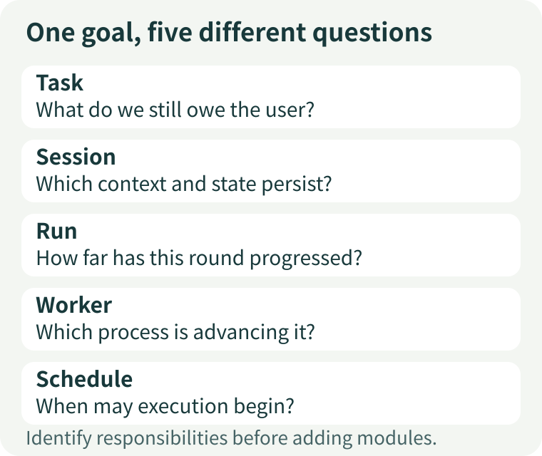
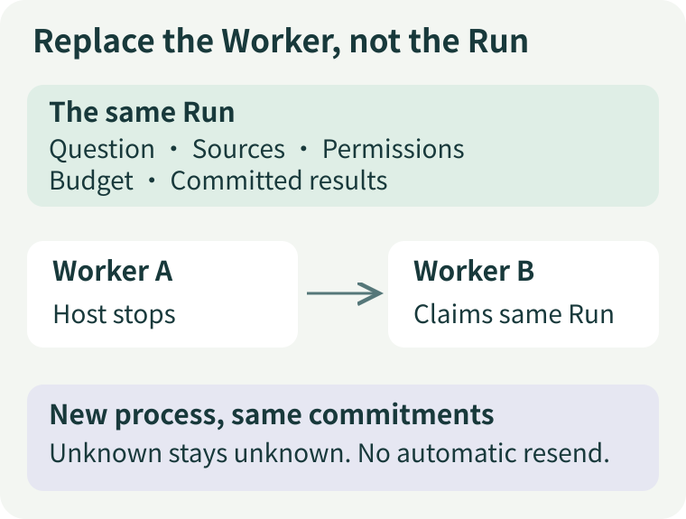
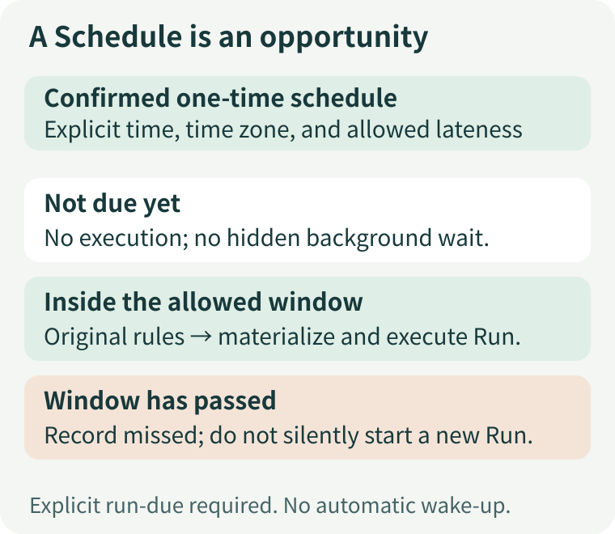
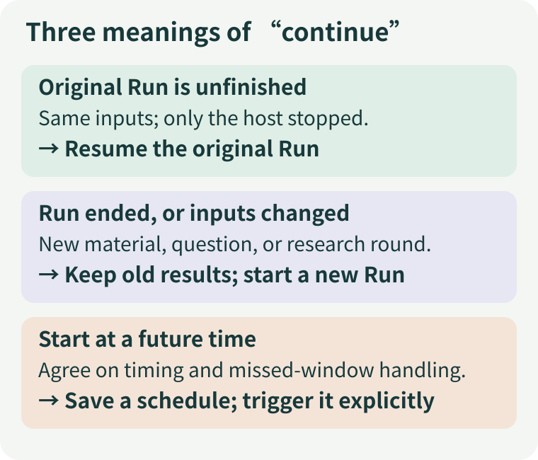

# Task, Session, Run, Worker, Schedule: What Is an Agent Actually Continuing?

“Let's stop reading here today and continue researching this material tomorrow.”

That sounds natural to a person. For software, it leaves several questions unanswered. Should tomorrow's work pick up the unfinished reading, or make a fresh assessment using new material? Does research continue after the chat window closes? Which progress should survive a machine restart? If today's report is already complete, does “continue” mean rewriting it?

All these questions use the same word, but they imply different operations. Calling Task, Session, Run, Worker, and Schedule simply “the task” may make code look tidy. When something fails, however, it becomes harder to explain **what must persist, what can be replaced, and what requires a new confirmation**.

This article uses a fund-research scenario to build a concept map. It is not a universal naming standard for frameworks. Different systems reuse the same names; we need to identify the responsibilities behind them.

## 1. One research task can involve more than one run

Suppose you are comparing two funds. Today you read their annual reports, tomorrow you add a fee announcement, and eventually you decide which differences deserve further investigation.

For the user, this is one research task: complete the comparison. For the execution system, it may involve three rounds: extract facts from annual reports, incorporate the new announcement, and review the report. Each round needs explicit inputs, available tools, execution limits, and an outcome.

**A Task answers “What do we still owe the user?” A Run answers “What may this round do, and how far has it progressed?”** One Run may complete a task, or several runs may contribute to it. Conversely, a Run ending does not necessarily mean the user's entire goal has been achieved. A run might successfully deliver an “insufficient evidence” report: the program has completed this round, but the research goal may remain unresolved.

Here, Task means a business-level goal. That does not mean every application needs a Task table. Open ETF Agent's local project stores a research definition in `tasks/<id>.json`, binding a question, configuration, and source snapshot. It is not a general-purpose, multi-stage project manager. Understanding responsibilities before adding a data model is more useful than introducing abstractions first.

[](../visuals/three-articles/continuity-five-questions.svg)

Figure 1. These concepts answer different questions. They are not five architectural layers that must call one another in sequence.

## 2. A Session preserves associations, not perfect model memory

Users often understand a session as a chat window. In engineering, Session may mean conversation history or a durable execution container. Its name alone does not tell you which.

At least three different things are involved:

- **Records in the interface:** what the user can look back at.
- **Context sent to the model this time:** what the model actually receives after selection, compression, or retrieval.
- **Durable execution records:** which steps have been committed, who may continue executing, and what remains unconfirmed.

These can be associated, but they cannot substitute for one another. Displaying yesterday's report does not mean today's model request includes it. Showing the model an old summary does not grant access to the original files. Reloading conversation history does not make it safe to repeat an external action that may already have been sent.

Open ETF Agent's `Session` leans toward the third responsibility: preserving Run state, checkpoints, execution leases, and result-related records. Treating it as a container that simply feeds every chat message back into the model misunderstands recovery. Project materials and durable reports also have their own storage locations; they do not all need to fit inside chat history.

Other systems benefit from the same distinction. [LangGraph's persistence documentation](https://docs.langchain.com/oss/python/langgraph/persistence) separates checkpoints of graph state within a thread from application data stored across threads. The lesson is not to adopt the same class names. It is that **preserving an interaction's state and preserving long-term knowledge are different storage requirements**.

## 3. Replacing a Worker must not replace the original commitments

Now change the scenario: the execution process exits halfway through reading an annual report. There is no new material, the question has not changed, and the user has not canceled.

Another process can take over. A Worker's job is to claim work, enter the existing executor, and observe the outcome. Being a new process should not let it submit an identical task again or receive a fresh full budget.

The public Worker's design has a concrete origin. An earlier executor associated external stopping with cancellation, but a background process exiting does not always mean the user canceled. Adding a separate Worker required distinguishing “this host stopped” from “this task was canceled.” The new Worker therefore still enters the original Runtime and retains the Run identity and execution authority in the Session, rather than copying a second model loop. [Public design record](https://github.com/hpoenixf/open-etf-agent/blob/96dba6123e337f54552c7c27bcb835929238a3d0/docs/evolution/v09-worker-lineage.md)

[](../visuals/three-articles/continuity-worker-handoff.svg)

Figure 2. The executor changes; the confirmed work definition does not. This is a simplified teaching diagram.

When several processes see the same work, reading the record first does not establish execution authority. In the public implementation, the original Session lease and write-generation checks determine who may advance execution. A previous executor that returns late cannot pretend to be the current holder and continue writing.

[Temporal's Worker documentation](https://docs.temporal.io/workers) also distinguishes Worker programs, entities, and processes, with executing processes obtaining work from task queues. Temporal provides a much broader durable-workflow infrastructure. The public single-Run Worker deliberately does not introduce a general queue or a second task state machine. A local teaching project does not necessarily need a full platform. When cross-machine orchestration, long-term operations, and complex scheduling become major requirements, reusing a mature system becomes more attractive.

One more boundary is easy to overlook: a host no longer waiting does not mean the provider stopped processing its request. When a request was sent but its result was not received, the new Worker must preserve “unknown,” not silently turn it into “never executed.” The value of preserving identity is being able to account for prior events precisely when outcomes are uncertain.

## 4. A Schedule preserves an agreement, not the research itself

“Continue tomorrow” can also mean something else: do not execute today; start at nine tomorrow morning.

That requires preserving an agreement about a future trigger. A Schedule concerns a time, time zone, definition version, and how late execution may still start. When due, it offers an opportunity to execute. The task's authorization, allowance, and execution rules still determine whether work can begin.

**The time arriving does not mean the model was called. A model call does not mean a report was delivered.**

[](../visuals/three-articles/continuity-schedule-window.svg)

Figure 3. An execution opportunity has boundaries. Whether to catch up after missing it must follow an explicit rule.

Open ETF Agent's public one-time schedules require an explicit `run-due` call; there is no resident daemon. Saving a future date does not automatically wake the computer. This module also does not supply recurring tasks or notifications. Materialization when due and association with the Run use the existing durable mechanism. Repeated scans do not automatically create another research round for an already completed schedule. [One-time scheduling guide](https://github.com/hpoenixf/open-etf-agent/blob/96dba6123e337f54552c7c27bcb835929238a3d0/docs/scheduled-tasks.zh-CN.md)

More scheduling features are not always better. A one-time, manually controlled exercise benefits from a deliberately small boundary. Long-term automatic execution additionally requires choosing and operating a real external wake-up mechanism, with explicit cancellation, lateness, and duplicate-trigger policies.

[Kubernetes CronJob documentation](https://kubernetes.io/docs/concepts/workloads/controllers/cron-jobs/) separates creating Jobs according to a schedule from executing them. It also explains that scheduling can miss or duplicate creation, so the work itself should be idempotent. A mature scheduler does not remove the application's responsibility to recognize “Is this the same execution?”

## 5. Before continuing tomorrow, make a choice

Together, these distinctions give us three questions for selecting the next step, without guessing an API first.

**Is the original Run unfinished, with the same question and materials?**

If only its host was interrupted, inspect the original state and let a Worker continue that same Run. Its original authorization, deadline, budget, and unknown effects carry forward. Recovery is not a reset. Changing processes cannot renew eligibility for a Run that has expired or reached a terminal state.

**Has the original Run ended, or do you want to add new material?**

That is a new research round. Preserve the old report and source version, and explicitly pass the new inputs to a new Run. It may still belong to the same business task, but yesterday's evidence must not be overwritten silently. This matters especially for fund reports: a new retrieval time is not a new disclosure date, and rerunning research does not establish that the source was updated.

**Do you simply want execution to begin at a future time?**

Save a confirmed schedule. It can refer to future work, but do not leave a model request sleeping until tomorrow. Decide who will wake the system, then check whether the execution opportunity is still eligible when triggered.

[](../visuals/three-articles/continuity-three-continues.svg)

Figure 4. The same natural-language instruction can require different operations depending on inputs and state.

For an existing, authorized, non-scheduled task in the public project, these commands illustrate the distinction. Replace `PROJECT` and `RUN_ID` with the original project and Run identity:

```bash
node src/research-cli.mjs run inspect --project PROJECT --run RUN_ID
node src/research-cli.mjs run work --project PROJECT --run RUN_ID
node src/research-cli.mjs run report --project PROJECT --run RUN_ID
```

`inspect` reads state, `work` attempts to advance the original Run, and `report` reads durable results. There is no implied budget reset to “give it another chance.” Real `work` requires provider setup, source access, and cost authorization first. See the [local research project guide](https://github.com/hpoenixf/open-etf-agent/blob/96dba6123e337f54552c7c27bcb835929238a3d0/docs/research-project.zh-CN.md) for initialization and input prerequisites. These commands explain interface semantics; they do not claim this article executed a real model task for the reader.

## 6. Five names do not require five modules

An application answering a single question can trigger a Run directly from the request; it does not need a Task manager just to complete an architecture diagram. A small script with no cross-process recovery requirement need not reproduce a workflow platform. Separate these responsibilities when the lifetime of “the same work” begins to exceed a call, a process, or a conversation.

A useful test is to ask which changes should not affect other things:

- Changing the user's window should not erase committed research.
- Replacing a Worker process should not change existing permissions or budget.
- Changing a new schedule's time should not silently rewrite an old Run's inputs.
- Completing one report should not automatically declare the entire business goal achieved.

What needs to remain stable is the work the user confirmed and its progress. Processes, pages, and model calls can be temporary participants around it. The next time you say “let the Agent continue,” ask: **Continue the goal, the context, the original execution, or a future opportunity?** Once that answer is clear, the recovery and scheduling interfaces usually become clearer too.

## Further reading

- [Expert, Subagent, Review, Judge: Why Another Model Is Not Always the Same Thing](./agent-expert-subagent-review-judge.md): responsibilities within a research round.
- [An Agent Does Not Need to Think Continuously](https://hpoenixf.com/eff-agent-article/en/articles/agent-autonomous-scheduled-research): the broader design of time- and condition-triggered systems, distinguishing private-system capabilities from the public example.
- [Hands-on Workshop](https://hpoenixf.com/eff-agent-article/en/articles/open-etf-agent-research-project-workshop): build a local research project from explicitly selected materials.
