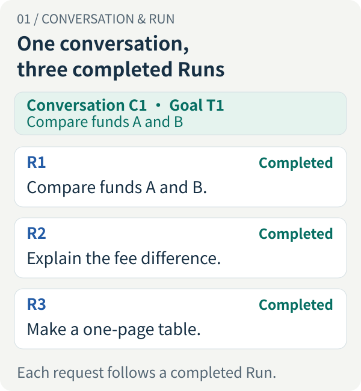
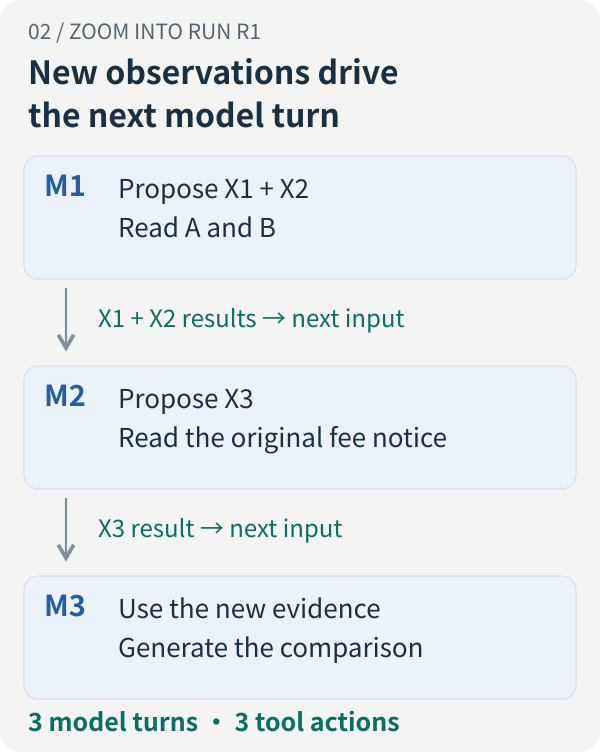
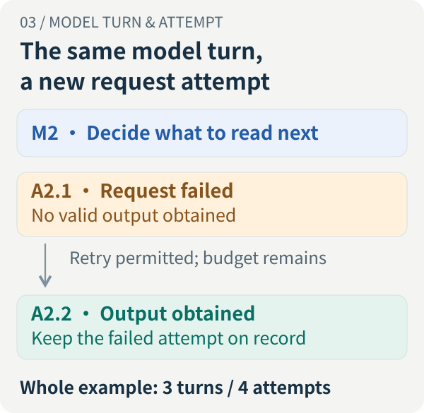
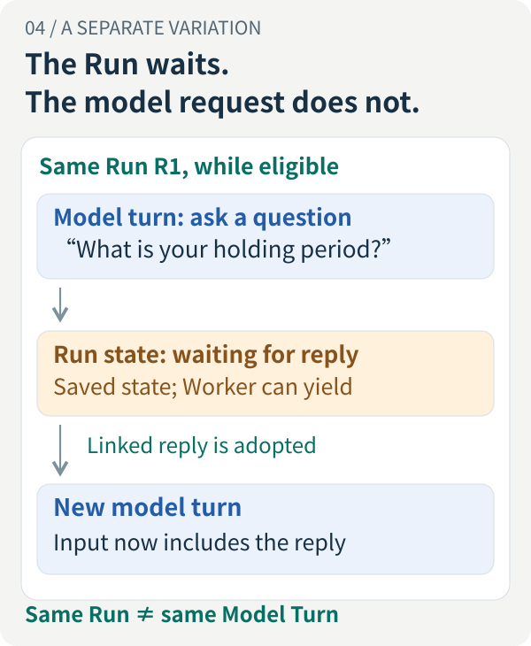
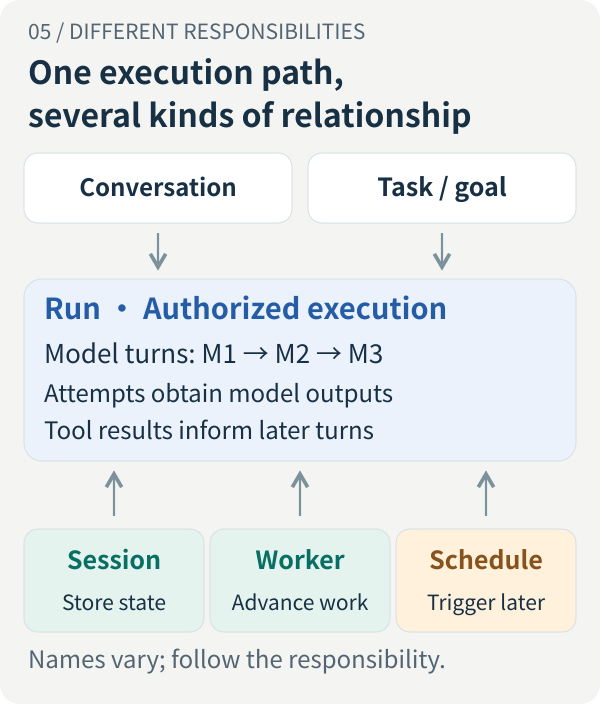

<!-- legacy-section-anchors -->
<span id="task-session-run-worker-schedule-what-is-an-agent-actually-continuing"></span>

# Agent Execution Identity Panorama: From a Conversation to Model Turns—What Actually Continues?

<LearningPathNav />

You ask an agent to compare two funds. It researches the material and delivers a report. You ask for a deeper explanation of the fees, then request a one-page table. The window never changes. Is this one task, three runs, or many model calls?

Now suppose the agent asks how long you plan to hold the investment and you reply, “Three years or longer.” Or a model request fails and is retried. Or the executing process restarts. Or you say, “Do it again tomorrow morning.” These all look like ways to continue, but the system is continuing different things.

You do not need to memorize a list of class names first. Follow one piece of work downward: **which goal the user is advancing, which decision the model is making, which requests the program actually sends, and which results it must preserve.**

This article uses fund comparison as a teaching example, not as an investment conclusion about particular products. Identifiers such as C1, R1, and M1 are illustrative labels, not a standard framework schema. Public implementation examples are pinned to Open ETF Agent v0.28.0; general design choices are distinguished from that version's supported behavior.

<!-- legacy-section-anchors -->
<span id="_1-one-research-task-can-involve-more-than-one-run"></span>
<span id="following-up-after-a-completed-answer-one-conversation-several-runs"></span>

## 1. Start with the chat: why can one conversation contain several Runs?

Suppose you make three requests, each after the previous answer is complete:

> You: Compare funds A and B using the available fee and holdings information, and identify the dates of the sources.  
> Agent: The comparison report is complete.  
> You: Explain the fee differences in more detail.  
> Agent: The additional explanation is complete.  
> You: Turn those findings into a one-page comparison table.  
> Agent: The table is complete.

There are at least three objects to distinguish.

| Object | What it means in this example | The question it answers |
| --- | --- | --- |
| Conversation | The same message thread, C1 | Which messages belong to this interaction? |
| Task | Goal T1: understand the differences between funds A and B | What does the user ultimately want to accomplish? |
| Run | Three independent executions, R1, R2, and R3: compare, explain, and tabulate | What may this execution do, and when does it end? |

[](../../visuals/en/run-identity/01-conversation.svg)

*Figure 1. This example starts a new Run for a request after the preceding execution has finished. The window remains continuous; execution is segmented.*

**A conversation preserves associations, a task expresses a goal, and a Run bounds an execution.** After R1 ends, R2 can read the earlier report and answer a follow-up. Maintaining a coherent conversation does not require R1 to stay alive indefinitely. The OpenAI Agents SDK's running guide likewise distinguishes the agent loop within a run from subsequent runs in a continuing conversation. [Runs and conversations](https://openai.github.io/openai-agents-python/running_agents/)

The figure is not a universal containment hierarchy. Ask “Help me polish an email” in that same window, and the conversation can remain unchanged while the goal changes. A research goal that lasts several weeks may also span different conversations. Whether to create an explicit task object depends on whether the product actually needs to manage that longer-lived goal.

Nor does a Run finishing normally prove that the entire task was accomplished. An agent can honestly deliver a report saying that the available evidence is insufficient to compare holdings. This execution has an outcome; the research goal still needs more material.

A Run should have an identifiable beginning and end. Admission establishes the question, available capabilities, and execution limits. Termination settles the outcome under that agreement, potentially because of failure, timeout, or user cancellation. Waiting for missing information can instead be an intermediate, unfinished state.

Completion depends on the promise. A usable answer may suffice for an answer-only request. When the request requires a saved, retrievable report, the model saying “The report is complete” is insufficient: the program must establish that the result was actually saved. The application’s execution agreement—not whether text has stopped streaming—defines the Run boundary.

<!-- legacy-section-anchors -->
<span id="one-run-can-call-the-model-and-tools-many-times"></span>

## 2. Zoom into the first research run: what happens inside it?

For now, examine only R1, not the later follow-ups.

Research need not consist of one model call that immediately returns a complete report. The program provides the current question, available tools, and relevant material. The model selects a next step. The program executes tools and presents new results to the model. The next step becomes clearer as observations accumulate.

For this article, a **Model Turn** is **one logical model decision organized by the host system**: ask the model for an output against a particular current input. That output may be an answer or a set of proposed tool calls. This is an observable interaction unit, not a count of the model's internal thinking steps.

Consider this simplified path:

| Model turn | What is new in its input? | What does the model propose next? |
| --- | --- | --- |
| M1 | The user's question, available material, and tools | Read the documents for A and B: propose X1 and X2 |
| M2 | Results from X1 and X2; B's fee explanation lacks an original source | Read B's original fee notice: propose X3 |
| M3 | The original explanation returned by X3 | Synthesize the material into a comparison answer |

[](../../visuals/en/run-identity/02-model-loop.svg)

*Figure 2. Model turns progress using new observations. Tool actions follow model outputs, and their results enter later model inputs. The diagram does not require parallel tool execution.*

The user asked once, but the agent made three model turns and proposed three tool actions. M1 proposing X1 and X2 does not make it two model turns. M3 calls no tool, but it is still a model turn.

With application-executed tools, the model produces structured calls, the application performs the operations, and their results are returned to the model. Anthropic's client-tool documentation shows this round trip and permits several tool calls in one response. [Client-tool round trips](https://platform.claude.com/docs/en/agents-and-tools/tool-use/overview)

### What matters is what the next decision actually receives

M2 does not automatically know a document's contents simply because the program read it. The system must include relevant results in M2's actual input, or provide references that the model can read through a subsequent action. Persisting a result and supplying it in a later request are different events.

A model turn is not a chat bubble either. Dozens of streaming chunks may belong to one response. An explanation and two tool-call proposals in that response may all belong to the same turn. Bubble counts, streaming-event counts, and tool counts cannot establish the number of model turns.

There is also an observability limit. Provider-hosted search, code execution, and other tools can perform steps inside the provider's service. A single client-visible API round trip does not reveal how many internal model turns occurred there. This article counts only what the host explicitly organizes and can observe. [Client and server tools](https://platform.claude.com/docs/en/agents-and-tools/tool-use/overview)

## 3. Model Turn versus Attempt: why can three turns send four requests?

Add one change to the example: M2's first model request receives a definite failure before any valid output. The failure qualifies for retry under this system's policy, and budget remains. The program resends the request for that decision, and the second attempt succeeds.

Research still makes three logical decisions—M1, M2, and M3—but it has sent one additional request.

**An Attempt records a concrete request attempt; a model turn identifies the logical decision that request serves.** Under this article's convention, M2's two attempts are A2.1 and A2.2. The failed A2.1 does not disappear when A2.2 succeeds.

[](../../visuals/en/run-identity/03-attempts.svg)

*Figure 3. The example preserves the logical turn and adds a request attempt. Three model turns now correspond to four requests, excluding any auxiliary model calls.*

This distinction is not an excuse to record another identifier. It answers different debugging questions. “Why did research switch to reading the original fee notice?” calls for M2's input and output. “Why did this decision take longer or cost more?” calls for every associated attempt, including failures, timeouts, and the actual model route.

### Resending a request differs from deciding with new information

A retry needs an explicit premise: the system is still trying to obtain the result of the original logical decision, and its policy permits that retry. If partial output has already triggered tools or content has been committed, the request must not simply be replayed from the beginning as though nothing happened. Continue from the original records and handle any unknown outcomes.

Once the model has proposed a tool call and the tool returns new material, the next model invocation is a new turn. If the system receives invalid output, adds feedback such as “This field is invalid; correct it,” and asks again, the input now contains a new observation. Under this article's convention, that is another semantic turn rather than a silent overwrite of the original request.

Frameworks may package these operations under different Step, Turn, or Retry definitions. That need not be wrong, but logs, budgets, and evaluations must use a consistent convention. Before interpreting `max_turns`, check whether it bounds model invocations, agent-loop iterations, or another unit. It does not necessarily mean how many exchanges a user may have.

### Hidden retries still send real requests

One SDK call in application code may already retry internally. The OpenAI Python SDK documents automatically retried errors and exposes `max_retries` for configuration. Adding an application-level retry loop therefore requires understanding what both layers do. [SDK retries](https://github.com/openai/openai-python#retries)

A system that needs precise request limits can centralize dispatch retries or observe attempts at the lower layer. Incrementing a counter only at the outer function boundary does not prove that only one request reached the provider.

A client timeout establishes only that a result was not obtained in time. It does not establish that the server did nothing or that the request cost nothing. Preserve unknown results and unknown usage rather than turning retry into a fresh budget with no history.

Failing over to another provider also changes the data recipient and capability requirements. The system must determine whether the original context may be disclosed to that provider and whether it supports the tools and parameters involved. Associating both requests with one logical turn explains their lineage; it does not authorize the new disclosure.

## 4. Tool actions: how far is a proposal from an actual effect?

In M1, the model proposes reading A's document. Call that action X1. The read has not yet happened.

For an application-executed tool, the normal path is to validate the call and permission, dispatch the read, obtain the result, preserve its association with the call, and prepare it for later model input. Invalid arguments or missing permissions can cause rejection before dispatch.

X1 therefore connects two important points: **which model output proposed it, and which later input included its result.** With only the first association, tools can remain busy while research never actually receives the material they obtained.

One further distinction matters: inclusion in the model input is inspectable; correct understanding and use in the conclusion require reviewing the answer. A successful tool receipt cannot establish semantic correctness.

### Several calls in one turn do not automatically establish dependency order

M1 can propose reading A and B together because the reads are independent. The host can execute them sequentially or, when authorization and resources allow, concurrently.

But if the second action requires an identifier returned by the first, the model cannot know that new identifier in advance. A later turn can construct the dependent call after the result arrives, or an explicitly defined composite tool can handle that dependency internally. Putting several calls in one response does not solve their data dependencies.

The v0.28.0 public teaching implementation advances tool calls sequentially within its existing runtime loop. Figure 2 shows that one model turn can propose several actions; it does not claim that this implementation executes them in parallel. [Public runtime loop](https://github.com/hpoenixf/open-etf-agent/blob/b34750d1515982dbaaaf4c1aa4da4c380173d753/src/runtime.mjs)

### Writes also require distinguishing repeated delivery from a new intention

Replace a read with saving a report. The remote service may have saved it successfully even though the receipt was lost. Asking the model to decide to save it again, or giving the same operation a brand-new identity, may produce a second result.

Safer handling depends on the tool's actual contract: query the original operation, or retry it with an idempotency identifier supported by the receiver. AWS's discussion of idempotent APIs addresses exactly this uncertainty: a missing response does not let a caller conclude that an operation never happened. [Safe retries and idempotent APIs](https://aws.amazon.com/builders-library/making-retries-safe-with-idempotent-APIs/)

A model protocol's `tool_call_id` primarily associates a call with its response. Whether it can also deduplicate business operations depends on whether the receiver recognizes, persists, and enforces that agreement. **Creating a UUID locally does not make a remote side effect happen exactly once.**

Repeating a read may be easier to accept, but the data could change. A new notice read today must not be represented as the original result supposedly obtained yesterday.

<!-- legacy-section-anchors -->
<span id="waiting-for-your-answer-several-exchanges-the-same-run"></span>

## 5. When the agent asks a question and I reply, which turn continues?

Set aside the complete three-turn example and consider an independent variation.

> You: Compare these two funds.  
> Agent: What holding period should this comparison focus on?  
> You: Three years or longer.  
> Agent: Understood. I will continue with that condition.

If the product treats this as clarification within the original research, the Run can remain R1. But **the model turn that asked the question has already produced its output. Continuing research after the reply generally requires a new model turn.**

[](../../visuals/en/run-identity/04-human-reply.svg)

*Figure 4. The authorized research execution continues; a model request is not left generating while it waits for a person. This independent variation is not added to Figure 2's three-turn count.*

The system needs to preserve which question is awaiting an answer. On receiving “Three years or longer,” it associates the reply with that question, checks whether the original execution remains eligible, and includes the reply in the next model input. Execution resources can be released during the wait; a live model response is unnecessary.

Open ETF Agent's ordinary interaction mechanism supports this bounded case: a task asks for missing information, the Worker yields, an explicitly associated reply is saved and adopted, and the same Run can continue. Waiting neither extends its original deadline nor replenishes its budget. Receiving the reply, adopting it, and finishing the report have distinct states. [Ordinary question-and-answer guide](https://github.com/hpoenixf/open-etf-agent/blob/b34750d1515982dbaaaf4c1aa4da4c380173d753/docs/human-interaction.zh-CN.md)

### A new message is not always the same kind of continuation

Answering a pending clarification question is different from interrupting research with “Stop comparing; generate a trading instruction instead.”

For an active Run, a product can queue a message, incorporate it at an explicit admission point for a later turn, or start another execution. The important part is specifying how that message was admitted. Input already sent to a model must not be retrospectively described as though it contained a later instruction.

New tool observations and permitted clarification replies can naturally change later inputs within the same Run. “Any input change requires a new Run” is therefore too absolute. The real questions are whether the change remains within the original task and authority, and whether the system has a defined admission mechanism.

This public version's ordinary interaction entry point does not supply external-effect approvals, expanded permissions, or arbitrary chat intervention during execution. Answering a research question does not also authorize access to another private document or execution of a trade.

<!-- legacy-section-anchors -->
<span id="_2-a-session-preserves-associations-not-perfect-model-memory"></span>

## 6. Where does Session fit? Do not turn the concepts into a tree

It is tempting to draw a tidy hierarchy: Conversation contains Task, Task contains Run, and Run contains Model Turn.

That can describe part of a particular product, not a universal model. Conversations and tasks may have crossing associations. A model turn produces tool actions whose results affect later turns. Session, Worker, and Schedule instead concern state, executors, and trigger timing.

[](../../visuals/en/run-identity/05-relationship-map.svg)

*Figure 5. A relationship map of execution and supporting responsibilities, not a five-layer architecture or a requirement to build five services. “Execution state storage” applies only to a Session that has that responsibility.*

Session is particularly ambiguous. Some SDKs use it to manage conversation history across several runs; Open ETF Agent's `Session` preserves Run state, checkpoints, execution leases, and related records. Identical names do not imply identical lifetimes or data. [Conversation management](https://openai.github.io/openai-agents-python/running_agents/) · [Public Session implementation](https://github.com/hpoenixf/open-etf-agent/blob/b34750d1515982dbaaaf4c1aa4da4c380173d753/src/session.mjs)

Instead of arguing about the name, distinguish these three sets of information:

| Information | Example in the fund comparison | What it does not establish |
| --- | --- | --- |
| User-visible conversation history | The first report is still displayed | The next model received the entire report |
| One model request's input | The question, selected history, tool results, and constraints | It is the entire conversation database or execution state |
| Durable execution state | The pending question, committed calls, remaining budget, and execution authority | The model understands these records, or remote actions are safe to repeat |

A checkpoint tells the program where execution may continue. Model context provides appropriate information for its next decision. Both may be derived from the same history, but they do not substitute for each other.

A practical design preserves the Run's identity while retaining the basis for each model turn's input. Later turns can receive more material without overwriting what earlier turns saw at the time. Research can progress, and its changing judgments remain explainable.

<!-- legacy-section-anchors -->
<span id="_3-replacing-a-worker-must-not-replace-the-original-commitments"></span>

## 7. When the Worker changes, what continues to count?

A Worker is a program or process that advances execution, not another investment expert. It invokes the runtime, sends model requests, organizes tool execution, and saves progress. Model services and tools may run elsewhere; the Worker need not perform every computation itself.

One process can handle several Runs over time. With suitable recovery support, one Run can span several processes. The lifetime of a process does not need to equal the lifetime of the work.

Open ETF Agent's Worker design record describes a concrete reason for separating them. The earlier external-stop path was connected to cancellation, but stopping an execution host does not always mean that the user canceled the task. The public adaptation therefore reuses the existing Runtime and Session while distinguishing host interruption from user cancellation, rather than copying another model loop. [Worker design history](https://github.com/hpoenixf/open-etf-agent/blob/b34750d1515982dbaaaf4c1aa4da4c380173d753/docs/evolution/v09-worker-lineage.md)

### Recovery is not one universal “call the model again” operation

Where execution stopped determines what can happen next.

| What is known before the process exits | A reasonable direction after takeover |
| --- | --- |
| The next request has not been sent | Recheck eligibility and decide whether to send from the existing progress |
| A tool result has been durably saved | Validate and reuse it, then advance |
| A request or write was dispatched, but its outcome is unknown | Query, reconcile, or follow an explicit recovery protocol; preserve unknown and stop the affected progression if it cannot be resolved |
| Final content is committed, but notification failed | Continue delivery from the committed result rather than rerunning research to repair notification |

This is a framework for recovery decisions, not a claim that every implementation supports every row. The public runtime preserves `MODEL_OUTCOME_UNKNOWN` for an unsettled model request. It attempts reconciliation for a dispatched tool and preserves `TOOL_OUTCOME_UNKNOWN` when it cannot establish the result. Replacing the Worker does not automatically make either state retryable. [Recovery branches](https://github.com/hpoenixf/open-etf-agent/blob/b34750d1515982dbaaaf4c1aa4da4c380173d753/src/runtime.mjs)

Other frameworks have their own recovery granularity. LangGraph re-enters the relevant node when resuming an interrupt; code before the interrupt can execute again, so its documentation requires those side effects to be idempotent. Having a checkpoint does not mean resuming seamlessly at a machine instruction inside the previous process. [LangGraph interrupt recovery](https://docs.langchain.com/oss/python/langgraph/interrupts)

### Preserving execution authority does not rewind the outside world

If two Workers read the same record, they cannot simply agree informally about who may write the next step. A lease bounds current execution authority, while write-generation or similar fencing checks reject a stale executor's late commits.

Preventing an old process from writing local state does not revoke a remote request it already sent. External effects still need appropriate queries, idempotency, or compensation. Execution-authority control and side-effect recovery have different responsibilities.

When continuing the original Run, already consumed budget, its original deadline, and committed results must carry forward. A process change must not expand permissions either. If access has been revoked, recovery may need to restrict subsequent operations under the actual policy. Continuous identity does not make earlier eligibility valid forever.

<!-- legacy-section-anchors -->
<span id="_4-a-schedule-preserves-an-agreement-not-the-research-itself"></span>

## 8. Schedule: does tomorrow continue the goal or revive an old execution?

You already have the report and say, “Run the comparison again at nine tomorrow morning.” The goal continues, but you are requesting a future execution.

A Schedule preserves a confirmed timing agreement and the work definition it references. Execution still requires an external trigger to check the due work and an executor to claim it. Saving a date does not automatically wake a model or a computer.

For recurring work, also distinguish a **schedule definition** from **one execution opportunity**. The rule “every day at nine” may remain unchanged for months, while today's occurrence and tomorrow's occurrence are different. Conversely, scanning the same nine-o'clock occurrence twice should not create two independent pieces of work.

A design can identify an occurrence by its schedule identity, definition revision, and scheduled instant; the actual fields depend on the system. Recognize whether you are observing the same opportunity again or reaching a genuinely new occurrence before deciding which Run to create or associate.

Open ETF Agent v0.28.0 provides a narrower, one-time mechanism. `run-due` must be invoked explicitly, after which existing mechanisms check and materialize the task. A schedule that misses its allowed window becomes `missed`, without an automatic replacement Run. Repeated scans do not automatically redispatch already materialized or completed schedules. There is no resident scheduler, recurring-task service, or notification service in this slice. [One-time scheduling guide](https://github.com/hpoenixf/open-etf-agent/blob/b34750d1515982dbaaaf4c1aa4da4c380173d753/docs/scheduled-tasks.zh-CN.md)

There is another question: which material will tomorrow's comparison use? If the confirmed work binds today's selected source snapshot, execution tomorrow means processing that snapshot later—not automatically acquiring tomorrow's new announcements. Timing and source refresh are separate mechanisms to define.

There is no need to leave a Run or model request sleeping until tomorrow. Nor are “start then,” “finish the research,” and “deliver the report to the user” the same promise. A saved schedule does not establish eventual delivery.

## 9. Turn the concepts into debugging skills: count the right things first

Return to Figures 2 and 3. The following is a simplified record of that teaching example, not a production trace:

```text
R1 / M1 / A1.1       Model returns proposals X1 and X2
R1 / X1, X2         Read results are saved
R1 / M2 / A2.1       Request fails; this example permits retry
R1 / M2 / A2.2       Model proposes follow-up read X3
R1 / X3             Original fee notice result is saved
R1 / M3 / A3.1       Input includes X3; model generates the answer
R1 / result V1      Final content is saved; delivery is recorded separately
```

Under this article's convention, that is **one Run, three logical model turns, four model request attempts, and three tool actions**. If saving the report uses another tool, count that action too. This example treats saving as a host-owned result commit.

Each count serves a different purpose. Model turns explain how research progressed. Attempts explain retries, routes, and latency. Tool actions identify actual reads or effects. Result versions identify the content the user obtained.

### Total model usage need not equal the main research turn count

The system may also call a model to summarize history or delegate part of the research to a Subagent. Those are real model calls, but they may not be counted as turns in the main research branch.

The public runtime marks summary calls as a separate purpose and handles them through a separate summary counter and shared model budget. Its main research `rounds` therefore cannot be used alone to infer total model usage. [Summary and research call accounting](https://github.com/hpoenixf/open-etf-agent/blob/b34750d1515982dbaaaf4c1aa4da4c380173d753/src/runtime.mjs)

A Subagent introduces another execution branch. One delegation from the main model may lead to several child model calls, tool executions, and retries before a result returns. Some systems organize that as a child execution within the parent Run; others create an associated child Run. Retain the branch and actual-request associations rather than counting one delegation as one model call.

That is also why fewer model turns do not necessarily mean lower cost. Work may have been batched into tools or moved into subagents or provider-hosted execution. Define the observation scope before comparing cost and latency, and do not substitute zero for unknown failed-request usage.

### “Still answering” in the interface also needs a specific owner

Suppose R1's completion notification arrives late, after the user has started R2. The client must not use that old event to mark R2 complete. It should not simply discard R1's valid result either; the result still belongs to the original research.

One viable design attaches the Run and relevant result version or stream sequence to events. The interface updates the corresponding work instead of using one global `isLoading` flag for every investigation. Independent execution branches also need their ordering interpreted separately; a local sequence number is not automatically a global timeline.

When a user says “It is stuck,” first identify the Run. Then determine whether it is waiting for a person, a model, a tool, or delivery of already saved content. Only then choose between supplying information, retrying a request, reconciling an effect, or reading an existing result again.

<!-- legacy-section-anchors -->
<span id="_6-five-names-do-not-require-five-modules"></span>

<span id="_5-before-continuing-tomorrow-make-a-choice"></span>

## 10. How do you use this without building a workflow platform?

These distinctions are ways to understand and record behavior before they are a list of tables to build.

A small, read-only, one-answer application can use its existing request identity for a Run. With just one model call, it may not need independent Model Turn storage. Conversation history can remain with the framework's existing Session rather than a second conversation manager.

When multi-step tool loops and retries appear, first make logical turns and physical sends distinguishable in logs. When execution must survive a process change, persist enough state and define recoverable phases. When a person must answer later, associate the pending question and reply. When work must begin in the future, add schedule and occurrence identity.

These mechanisms have costs: input versions, call receipts, waiting states, and recovery branches all require maintenance. Reuse responsibilities a framework already represents accurately; do not create a Manager for every term in the diagram. Permissions and side-effect correctness remain requirements of the task itself and cannot be dropped in the name of simplicity.

This decision table condenses the article for a design review:

| What changes? | What usually continues? | What must be new or checked again? |
| --- | --- | --- |
| A follow-up after a completed answer | The conversation, and possibly the business goal | A new Run's input and execution scope |
| An explicitly associated clarification reply | The original Run, if still eligible | Reply-adoption records and the later model turn |
| An eligible failure while obtaining a decision | The Run and, under this convention, the logical turn | A new attempt and remaining retry eligibility |
| A tool returns a new observation requiring a decision | The Run | A later model turn and the input it actually receives |
| A process exits and another takes over | Recoverable work and already committed facts | Current execution authority, recovery position, and unknown-outcome handling |
| The same schedule occurrence is scanned again | The occurrence and its existing Run association | Whether it has been materialized or executed; do not blindly create another |
| The next occurrence of a recurring schedule arrives | The schedule and long-term goal | A new occurrence; create or associate a Run under the schedule contract |

“Usually” leaves room for legitimate implementation choices. Systems may use different names or data structures, but they should be able to explain what remains the original work and what is now something new.

### Observe these distinctions in the public implementation

In an initialized local research project with its original material and authorization, use the original Run identity to inspect state, attempt advancement, and read results:

```bash
node src/research-cli.mjs run inspect --project PROJECT --run RUN_ID
node src/research-cli.mjs run work --project PROJECT --run RUN_ID
node src/research-cli.mjs run report --project PROJECT --run RUN_ID
```

These are interface examples for the v0.28.0 source workspace, not a claim that this article executed a real research task for the reader. See the [fixed-version project guide](https://github.com/hpoenixf/open-etf-agent/blob/b34750d1515982dbaaaf4c1aa4da4c380173d753/docs/research-project.zh-CN.md) for environment, initialization, and cost prerequisites; use the [current project entry point](https://github.com/hpoenixf/open-etf-agent) for later versions.

The public Session, Worker, ordinary blocking interaction, and one-time schedule are different slices of these ideas, not an arbitrarily composable chat product. In particular, this version's one-time schedules cannot be combined with capabilities such as Response or Child. The panorama explains relationships; it does not imply that every illustrated scenario is connected through one public entry point.

## Conclusion: a continuous experience depends on clear execution boundaries

Return to the opening conversation. The user can keep pursuing the same goal across several Runs. A Run advances through model turns. A logical turn may require several permitted request attempts. Tool actions produce real observations that inform later decisions.

Session preserves state that must survive. Worker supplies temporary execution capacity. Schedule makes future execution opportunities possible. They solve different problems while supporting the user's experience of continuing the work.

**The goal, valid evidence, and facts about what has happened need continuity. The same process, connection, or model request does not.**

When designing a Continue, Retry, or Resume button, first specify which object it acts on. Then ask whether the original execution remains eligible, which results can be reused, and what must be confirmed again. Those questions get closer to the actual problem than deciding how many modules to build.

## Further reading

- [Six-layer request panorama](./017-prompt-to-answer-six-layer-panorama-v3.md): how responsibility transfers from a request to a visible answer.
- [Long-horizon research panorama](./agent-long-horizon-research-panorama.md): how context, interruptions, and time connect across long-running work.
- [Expert, Subagent, Review, Judge](./agent-expert-subagent-review-judge.md): collaboration roles within one investigation.
- [Scheduled research](./agent-autonomous-scheduled-research.md): a broader design for schedules, triggers, and continuing research.

<!-- introductory-series-links:start -->

## Getting started: continue in order

Previous: [History, Context, Memory and Checkpoints — How Does an Agent Continue?](conversation-context-memory-checkpoints.md).

Next: [Agent Deep Dive: From One Report to Durable Execution and Specialist Collaboration](open-etf-agent-v010-system-design.md).

<!-- introductory-series-links:end -->
