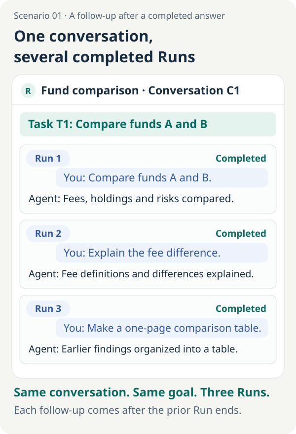
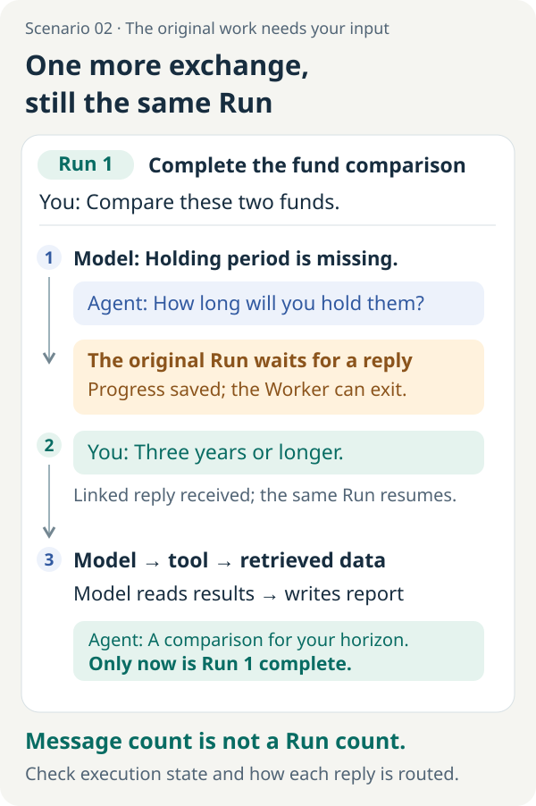
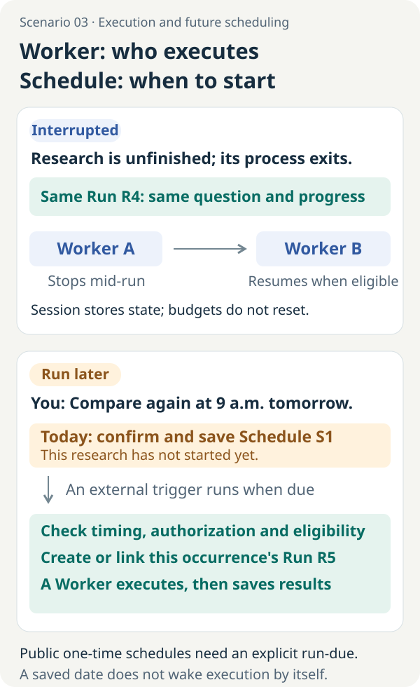

# Task, Session, Run, Worker, Schedule: What Is an Agent Actually Continuing?

<LearningPathNav />

In one chat window, you ask: “Compare Fund A and Fund B.” After the assistant gives a complete answer, you follow up: “Explain the fee differences in more detail.” Then you ask it to “put the results into a one-page comparison table.”

The window has not changed, and neither has your research goal. Has the same task been executing continuously in the background? Now suppose the assistant has not finished the comparison. It first asks, “How long do you plan to hold the investment?” You reply, “Three years or longer.” How should that exchange be counted?

To answer these questions, first distinguish **the conversation the user sees, the goal they want to achieve, and one execution by the system**. Once we extend the scenario to “the executing process exited” and “do it again at nine tomorrow morning,” Worker and Schedule also have concrete roles.

The fund comparison and chat interfaces in this article are teaching examples, not results from a real research run or screenshots of an existing public chat product. We consistently call the user-visible message thread a **Conversation**; frameworks may also call it a Thread or Session. In Open ETF Agent's code, `Session` has a separate responsibility for preserving execution state, which we will map explicitly below. The public implementation and commands use v0.28.0 as the example, through its local CLI/API entry points.

## 1. One research task can involve more than one run

### Following up after a completed answer: one conversation, several runs

Start with a common design: each independent request starts a run, which ends after that request has been handled. The three exchanges above then map as follows:

[](../../visuals/en/continuity-scenes/01-chat-and-runs.svg)

Figure 1. Each exchange is marked as complete. That is the condition used to distinguish runs in this example, not a universal rule that every user message must create a Run. Click the image to open the full diagram.

| Concept | What it corresponds to in this chat | What determines its boundary |
| --- | --- | --- |
| Conversation | The same chat, associating earlier and later messages | How the product organizes interactions and history |
| Task | Completing the comparison and understanding the differences between two funds | The business goal the user wants to achieve |
| Run | Each independent execution: the comparison, the fee explanation, and the table | Its inputs, permissions, budget, and termination conditions |

**A Task answers “What do we still owe the user?” A Run answers “What may this round do, and how far has it progressed?”** The first run may already have ended when the second reads relevant history and results to handle the follow-up. Keeping the chat history does not mean one Run has been executing continuously behind the entire conversation.

The three executions in the figure happen to serve the same goal. If you instead ask “Help me polish an email” in the same window, the conversation can remain the same while the business goal changes. Conversely, a long-term research goal can span several conversations. These concepts should therefore not be drawn as a fixed hierarchy of containers.

A Run ending also does not mean the whole goal has been achieved. It might deliver an “insufficient evidence” report: the program has completed this execution, while the user may still need to supply material for further research.

### Waiting for your answer: several exchanges, the same Run

Now consider another chat that looks similar. You request a fund comparison, but the assistant still needs your holding period. It asks; you reply “Three years or longer”; it continues the research. Your message supplies information the original execution is waiting for:

[](../../visuals/en/continuity-scenes/02-one-run-human-reply.svg)

Figure 2. One more exchange in the chat can still belong to the same Run. The Worker can yield while waiting; continuing after a reply still requires the original execution's deadline, budget, and permissions to remain valid. The interface is a teaching illustration.

Open ETF Agent's [ordinary question-and-answer mechanism](https://github.com/hpoenixf/open-etf-agent/blob/v0.28.0/docs/human-interaction.zh-CN.md) already supports this blocking interaction: the task asks for missing information, persists a waiting state, and continues the original Run after receiving an explicitly associated reply. Receiving a reply, adopting it into the original execution, and completing the report are distinct states. Waiting does not automatically extend the original deadline or replenish the budget.

That association matters. The system must know which question you are answering to pass “Three years or longer” back to the original research. Handling a new instruction inserted at any time during free-form chat requires a separate design: it might be queued, incorporated during execution, or assigned to a new run. This public entry point supports ordinary blocking questions and answers; non-blocking chat intervention and continuing terminal tasks are not enabled.

### One Run can call the model and tools many times

Run 1 in the first figure does not necessarily make just one model call. The model may decide what to investigate, tools may read annual reports and fees, and the model may request further checks after seeing their results before composing an answer. The question and waiting period in Figure 2 can also occur within that execution.

Therefore, **chat turns, model calls, tool calls, and runs should be counted separately**. Extracting facts from annual reports, checking fees, and reviewing the report can all be steps inside one Run. They count as separate runs only when the execution contract gives each its own start and end.

Here, Task means a business-level goal; not every application needs a Task table. The public project's `tasks/<id>.json` stores a single research definition, binding a question, configuration, and source snapshot. That does not make it a general-purpose, multi-stage project manager. Understand the responsibilities before choosing a data model.

## 2. A Session preserves associations, not perfect model memory

We can now answer “Are several exchanges in the same conversation one Session?” **If a chat framework calls a conversation a Session, that description can fit. It does not directly describe the project code referenced here.** The same name is used in two contexts, so we need to inspect its actual responsibility.

| Context | What the name refers to | What this article calls it |
| --- | --- | --- |
| A session in a chat product | Associated user and assistant messages and interaction history | Conversation |
| Open ETF Agent's `Session` | Run state, checkpoints, leases, and result-related records | Durable execution records |

In the fund-comparison example, the interface lets you revisit the first report. The next execution decides which earlier information to send to the model. Durable execution records help the system determine whether the original Run has finished, whether it is waiting for a reply, and who may advance it. [Session implementation](https://github.com/hpoenixf/open-etf-agent/blob/v0.28.0/src/session.mjs)

These are three related sets of information:

- **Records in the interface:** what the user can look back at.
- **Context sent to the model this time:** what the model actually receives after selection, compression, or retrieval.
- **Durable execution records:** which steps have been committed, who may continue executing, and what remains unconfirmed.

Displaying the previous report does not mean the next model request includes it. Showing the model an old summary does not grant access to the original files. Reloading conversation history does not make it safe to repeat an external action that has already been sent. Project materials and durable reports also have their own storage locations; they do not all need to fit inside chat history.

[LangGraph's persistence documentation](https://docs.langchain.com/oss/python/langgraph/persistence) separates checkpoints of graph state within a thread from application data stored across threads. The useful distinction is that preserving an interaction's state and preserving long-term knowledge are different storage requirements. Once those responsibilities are clear, the [five-questions diagram](../visuals/three-articles/continuity-five-questions.svg) provides a reference without requiring you to memorize every class name first.

## 3. Replacing a Worker must not replace the original commitments

During ordinary request handling, an executor must enter the model-and-tool loop, advance the Run, and save its results. Here, **Worker** means the process doing that work. It is not a character in the chat or an object that must be recreated for each tool call.

Now change the scenario: the execution process exits halfway through reading an annual report. There is no new material, the question has not changed, and the user has not canceled.

If recovery conditions are satisfied, another process can take over. A Worker's job is to claim work, enter the existing executor, and observe the outcome. Being a new process should not let it submit an identical task again or receive a fresh full budget.

The public Worker's design has a concrete origin. An earlier executor associated external stopping with cancellation, but a background process exiting does not always mean the user canceled. Adding a separate Worker required distinguishing “this host stopped” from “this task was canceled.” The new Worker therefore still enters the original Runtime and retains the Run identity and execution authority in the Session, rather than copying a second model loop. [Public design record](https://github.com/hpoenixf/open-etf-agent/blob/v0.28.0/docs/evolution/v09-worker-lineage.md)

Replacing the executor must preserve the original question, permissions, budget, and committed results. The [Worker handoff diagram](../visuals/three-articles/continuity-worker-handoff.svg) shows these relationships.

When several processes see the same work, reading the record first does not establish execution authority. In the public implementation, the original Session lease and write-generation checks determine who may advance execution. A previous executor that returns late cannot pretend to be the current holder and continue writing.

[Temporal's Worker documentation](https://docs.temporal.io/workers) also distinguishes Worker programs, entities, and processes, with executing processes obtaining work from task queues. Temporal provides a much broader durable-workflow infrastructure. The public single-Run Worker deliberately does not introduce a general queue or a second task state machine. A local teaching project does not necessarily need a full platform. When cross-machine orchestration, long-term operations, and complex scheduling become major requirements, reusing a mature system becomes more attractive.

One more boundary is easy to overlook: a host no longer waiting does not mean the provider stopped processing its request. When a request was sent but its result was not received, the new Worker must preserve “unknown,” not silently turn it into “never executed.” The value of preserving identity is being able to account for prior events precisely when outcomes are uncertain. Whether background work continues after the user closes a page also depends on how that host manages execution; the chat window being open or closed is not enough to decide.

## 4. A Schedule preserves an agreement, not the research itself

You already have the comparison report and say, “Run the comparison again at nine tomorrow morning.” The research goal continues, but the execution belongs in the future.

The system first needs to confirm and preserve an agreement about that future work: what to do, when to start, and which inputs and permissions to use. When the time arrives, a trigger checks whether execution is eligible. **Schedule** is the timing agreement. Putting it beside the interrupted-process scenario makes the distinction easier to see:

[](../../visuals/en/continuity-scenes/03-worker-and-schedule.svg)

Figure 3. The upper panel answers “Who continues the execution?” The lower panel answers “When does it begin?” These are independent scenarios. Saving a future date does not require leaving a model request waiting until tomorrow. Click the image to open the full diagram.

A Schedule concerns a time, time zone, definition version, and how late execution may still start. When due, it offers an opportunity to execute. The task's authorization, allowance, and execution rules still determine whether work can begin.

**The time arriving does not mean the model was called. A model call does not mean a report was delivered.**

The [execution-window diagram](../visuals/three-articles/continuity-schedule-window.svg) distinguishes being too early, being within the window, and missing it. Whether to catch up afterward must follow an explicit rule.

Open ETF Agent's public one-time schedules require an explicit `run-due` call; there is no resident daemon. Saving a future date does not automatically wake the computer. This module also does not supply recurring tasks or notifications. Materialization when due and association with the Run use the existing durable mechanism. Repeated scans do not automatically create another research round for an already completed schedule. [One-time scheduling guide](https://github.com/hpoenixf/open-etf-agent/blob/v0.28.0/docs/scheduled-tasks.zh-CN.md)

If you expect the comparison to include an announcement published tomorrow, you also need to specify how that new material becomes input to a new research execution. Fixing today's source snapshot and scheduling another execution does not automatically obtain tomorrow's material. The chat instruction in the figure explains the timing agreement; schedules in the public version must be submitted through its existing confirmation entry point.

A one-time, manually controlled exercise benefits from a deliberately small boundary. Long-term automatic execution additionally requires choosing and operating a real external wake-up mechanism, with explicit cancellation, lateness, and duplicate-trigger policies.

[Kubernetes CronJob documentation](https://kubernetes.io/docs/concepts/workloads/controllers/cron-jobs/) separates creating Jobs according to a schedule from executing them. It also explains that scheduling can miss or duplicate creation, so the work itself should be idempotent. A mature scheduler does not remove the application's responsibility to recognize “Is this the same execution?”

## 5. Before continuing tomorrow, make a choice

Now return to “Let's stop reading here today and continue researching this material tomorrow.” The same sentence needs to be interpreted against the original state:

| What you are actually doing | What to establish first | How execution proceeds |
| --- | --- | --- |
| Asking a follow-up after a complete answer | The original Run has ended; identify the new request's inputs | Usually create a new Run, which can be associated with the original conversation and business goal |
| Answering a clarification question from unfinished research | The reply is linked to the original question, and that Run remains eligible | Accept the reply and continue the original Run |
| Recovering after the research process exits | The original state, execution authority, remaining budget, and unknown outcomes | A Worker continues the original Run |
| Starting another research execution tomorrow morning | The confirmed work definition, trigger time, and wake-up mechanism | Save a Schedule and execute after eligibility checks when due |

The boundary around new material also needs to be explicit. The public project binds a confirmed input snapshot. Under that contract, changing the research question or adding independent new material calls for preserving the earlier report and source version, then defining explicit inputs for new research. A reply associated with the original clarification question follows the supported interaction mechanism; receiving a message alone does not mean recreating the task. Fund reports especially need to retain their time references: a new retrieval time is not a new disclosure date, and rerunning research does not establish that the source was updated.

Recovery retains the original authorization, execution deadline, budget, and unknown effects. Changing processes cannot renew eligibility for a Run that has expired or reached a terminal state. The [three kinds of continuation diagram](../visuals/three-articles/continuity-three-continues.svg) reviews host recovery, new research, and future schedules; Figure 2 covers waiting for an associated reply during execution.

For an existing, authorized, non-scheduled task in the public project, these commands illustrate the distinction. Replace `PROJECT` and `RUN_ID` with the original project and Run identity:

```bash
node src/research-cli.mjs run inspect --project PROJECT --run RUN_ID
node src/research-cli.mjs run work --project PROJECT --run RUN_ID
node src/research-cli.mjs run report --project PROJECT --run RUN_ID
```

`inspect` reads state, `work` attempts to advance the original Run, and `report` reads durable results. When a Run is waiting for a user reply, first submit the associated answer as described in the [ordinary question-and-answer guide](https://github.com/hpoenixf/open-etf-agent/blob/v0.28.0/docs/human-interaction.zh-CN.md), then advance the original execution. Real `work` requires provider setup, source access, and cost authorization first. See the [local research project guide](https://github.com/hpoenixf/open-etf-agent/blob/v0.28.0/docs/research-project.zh-CN.md) for initialization and input prerequisites. These commands explain interface semantics; they do not claim this article executed a real model task for the reader.

## 6. Five names do not require five modules

An application answering a single question can trigger a Run directly from the request; it does not need a Task manager just to complete an architecture diagram. A small script with no cross-process recovery requirement need not reproduce a workflow platform. Separate these responsibilities when the lifetime of “the same work” begins to exceed a call, a process, or a conversation.

To decide whether to separate these responsibilities, revisit the scenarios and ask which identities must persist and which can change:

- The chat window can stay the same while the user introduces a new goal or starts a new Run.
- A Run waiting for an associated reply can continue after the user supplies the information.
- Replacing a Worker process should not change existing permissions or budget.
- Changing a new schedule's time should not silently rewrite an old Run's inputs.
- Completing one report should not automatically declare the entire business goal achieved.

What needs to remain stable is the work the user confirmed and its progress. Processes, pages, and model calls can be temporary participants around it. The next time you say “let the Agent continue,” first establish the state of the original execution. Then decide whether you are advancing the goal, answering its pending question, recovering that execution, or arranging another opportunity to run.

## Further reading

- [Expert, Subagent, Review, Judge: Why Another Model Is Not Always the Same Thing](./agent-expert-subagent-review-judge.md): responsibilities within a research round.
- [An Agent Does Not Need to Think Continuously](https://hpoenixf.com/eff-agent-article/en/articles/agent-autonomous-scheduled-research): the broader design of time- and condition-triggered systems, distinguishing private-system capabilities from the public example.
- [Hands-on Workshop](https://hpoenixf.com/eff-agent-article/en/articles/open-etf-agent-research-project-workshop): build a local research project from explicitly selected materials.


<!-- introductory-series-links:start -->

## Getting started: continue in order

Previous: [History, Context, Memory and Checkpoints — How Does an Agent Continue?](conversation-context-memory-checkpoints.md).

Next: [Agent Deep Dive: From One Report to Durable Execution and Specialist Collaboration](open-etf-agent-v010-system-design.md).

<!-- introductory-series-links:end -->
