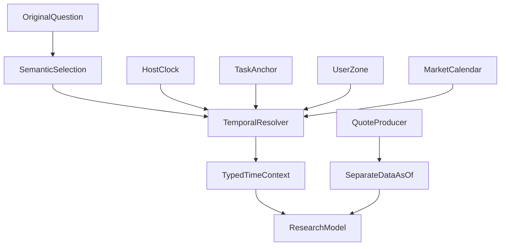

# When an Agent Says “Today,” Which Day Does It Mean? Task Time, User Time, and Market Sessions

On Saturday morning, an investor in Guangzhou opens a research agent and asks, “How did U.S. technology stocks do today?” The question appears to need only one date. But Guangzhou has entered Saturday while the U.S. Eastern time zone may still be on Friday. A finished Friday market session and newly retrieved quote data are two more distinct facts.

If Web search defaults to Beijing time, the model prompt uses a UTC date, and the market adapter treats “recently retrieved” as “latest trading session,” every module can be internally consistent while the final answer is wrong. **Time is not a string to format casually. It is a set of facts with different sources and purposes.**

This article explains how we designed and partly implemented A36 temporal semantics in ETF Agent. The model interprets which time the user is asking about; deterministic code resolves that selected meaning; qualified market sources provide sessions; quote data retains its own as-of timestamp.

## 1. “Today” Depends on at Least Five Facts

| Time concept | Question answered | Source of authority |
| --- | --- | --- |
| Current instant (host now) | What UTC instant is the system observing now? | Host clock |
| Task anchor | At what instant was the original question accepted? | Original Conversation/Run |
| User local date | Which date applies in the user's explicit or preferred time zone? | Qualified zone binding and IANA rules |
| Market session | When is the specified venue scheduled to open or close; which session is complete? | Venue calendar with source and coverage |
| Quote timestamp (dataAsOf) | As of what time does this quote, NAV, or indicator actually apply? | Data producer and original source receipt |

Even when the first four are resolved, the fifth need not exist. A calendar saying that Friday’s scheduled regular session ended does not establish that a vendor returned Friday’s final close. A quote may be pre-market, delayed, or missing. Publication time, retrieval time, and fund reporting period cannot fill one another's gaps either.

In older paths, “latest market session,” “most recently retrieved data,” and “research performed today” can collapse into one date. That is not just concise writing; it deletes distinctions that matter for investment reasoning.

## 2. A Synthetic Request with Distinct Time Identities

Consider a **synthetic example for timezone interpretation only**: a research request is accepted at `2026-10-24T00:00:00Z`. In `Asia/Shanghai`, that is Saturday at 08:00. In `America/New_York`, it is Friday at 20:00 (Eastern Daylight Time applies on that date in 2026). This calculation does not claim that we queried actual market status that day.

```json
{
  "referenceInstantUtc": "2026-10-24T00:00:00Z",
  "taskAnchorUtc": "2026-10-24T00:00:00Z",
  "user": {
    "timeZone": "Asia/Shanghai",
    "source": "account",
    "localDate": "2026-10-24"
  },
  "market": {
    "venue": "XNAS",
    "marketLocalDate": "2026-10-23",
    "latestCompletedCalendarSession": "unknown",
    "calendarStatus": "unavailable"
  },
  "quoteDataAsOf": "unknown"
}
```

The unknown fields are deliberate. A timezone conversion alone cannot establish a completed, source-confirmed market session or quote finality. In a real execution, the calendar and quote producer each supply an independent receipt.



The final two paths must remain parallel: calendar evidence establishes scheduled sessions, while data evidence establishes when a returned value applies. Merging them creates false precision on holidays, vendor delays, and timezone changes.

## 3. The Model Selects Meaning; Deterministic Code Resolves It

“How did U.S. stocks do today?” may ask about the latest trading performance or today’s financial news. “Last trading day” asks for a particular venue session. The A03 research model interprets this language and clarifies material ambiguity when necessary. We rejected Host keyword rules such as “U.S. stocks always means last close” or “today always means Beijing time.”

A36 consumes an **already selected** temporal meaning, reference instant, zone, and available calendar facts. It resolves them reproducibly. It neither chooses the research strategy nor grants access to sources. Web/Search receives explicit typed time windows rather than introducing a second, hidden text rule that rewrites “this year” or “today.”

Timezone provenance needs an order of precedence: **explicit selection for this request > saved account preference > validated device-reported IANA zone > unknown**. Unknown is a valid result. The system must not infer a user's zone from IP address, interface language, or a financial market default. “Use New York time” changes interpretation of this query, not the account’s saved preference.

IANA `America/New_York` rules handle the EDT/EST transition. Hardcoding UTC−4 or UTC−5 as a permanent offset would silently break a valid request at another time of year.

## 4. Recovery Must Not Recompute the Original Task Date

Imagine that a user asks on Friday night for an analysis of “today's figures.” The run pauses and resumes after midnight. If recovery overwrites the original task anchor with the latest Host now, “today” changes inside the same research task. Earlier evidence and later queries are no longer comparable.

We therefore separate a moving `hostNowUtc` from the original `taskAnchorUtc`, which is sealed by the original Run and retained through same-run recovery. Explicit absolute ranges and user-set cutoffs are not reinterpreted merely because the process restarted or Web search ran again.

Schedule occurrences and their own time zones still belong to the existing scheduling Owner. “Deliver by 7 p.m.” belongs to the delivery Owner. Source `publishedAt` and `dataAsOf` remain with their actual producers. Unifying temporal semantics means unifying the **interpretation seam**, not taking over every timer, publication decision, or approval.

## 5. Trading Calendars Cannot Be Derived from Weekdays

Markets observe holidays, exceptional closures, early closes, and venue-specific rules. Knowing that it is Friday in New York does not establish that XNAS is open. Knowing the conventional 16:00 close does not prove that no exceptional suspension occurred.

Our first market-calendar scope is therefore bounded to regular U.S. cash-equity sessions with an identified **source, version, venue, time zone, and coverage interval**, supplied through the original B01/Market data path. A36 consumes eligible sessions and distinguishes the current market-local date, target session, and latest calendar-confirmed completed session. When the evidence is absent, it returns `partial` or `unavailable` rather than guessing from weekdays. Pre/post-market periods, individual halts, additional venues, and fund reporting calendars remain separate future work.

A qualified schedule still says only what was scheduled within its coverage. It does not certify executions, quote freshness, or that a company actually published a particular report. **Session confirmation and market-data confirmation are separate evidence chains.**

## 6. Three Cases Where Unknown Must Survive

| Scenario | What can be established | Correct response |
| --- | --- | --- |
| User zone known; qualified market calendar unavailable | Host resolves the user date; B01 lacks market evidence | Give the user-local date, but leave session completion unknown |
| Qualified source confirms an early close; quote still lags | B01 calendar and quote producer return separate facts | Distinguish calendar-completed session from earlier `dataAsOf` |
| The original Run resumes after midnight | Recovery retains the task anchor; Host now has moved | Resolve relative language using original task time; do not rewrite the question |

None of these branches should automatically erase independent, authorized research prose. A23 Publication still handles local degradation of evidence attachments. A36 does not become a global answer gate or force repeated retries to hide source unavailability.

## What Exists and What Remains Unverified

As of **October 24, 2026**, ETF Agent main contains the timezone binding, UTC current time and frozen task time projection, consolidation of Web temporal rules, and a bounded Nasdaq 2026 schedule source with structured Market consumption. That optional calendar source requires explicit enablement and is **disabled by default**. These implementation seams and scoped local observations can support a precise description of the design.

A36’s original P0 acceptance is still open. The implementation merge does not establish that a normal authenticated research request consumes a qualified real calendar end to end, nor does it substitute for PostgreSQL/browser qualification or formal close. This article does not claim consistent live answers to “latest trading day,” and it never treats the synthetic example as live market evidence. A-share, Hong Kong, fiscal-year, and fund-reporting periods require their own qualified sources and scoped acceptance instead of an empty generic calendar framework today.

The lasting engineering distinction is: **the model can interpret the user's temporal intent, code can resolve the chosen time precisely, and calendar and quote producers must independently establish what they know**. Only then can a research answer responsibly use the word “latest.”

## Further Reading

[Scheduled research after a conversation](https://hpoenixf.com/eff-agent-article/en/articles/agent-autonomous-scheduled-research) explains when the next task begins. [Financial data: time, definitions, and reproducibility](https://hpoenixf.com/eff-agent-article/en/articles/031-fintech-data-time-and-reproducible-numbers) explains source dates and computation. This article addresses the temporal meaning of ordinary research requests.

This is part of [ETF Agent Engineering Notes](https://github.com/hpoenixf/eff-agent-article). A Star on the public collection is welcome.
