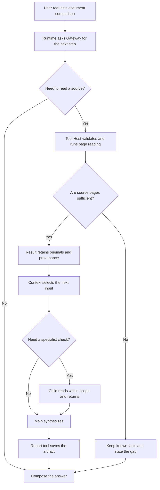

# Agent Intermediate: Ten Core Modules in Open ETF Agent

<LearningPathNav />

The introduction followed an Agent Loop: **AI chooses an action from the current information, a tool returns a result, and AI decides what comes next.**

Open the project and more names appear: Gateway, Skill, MCP, Memory, Session, Child. Why are they there, and how do they connect to that loop?

Use the [fixed v0.15 version](https://github.com/hpoenixf/open-etf-agent/tree/74bd5aa455ccaeb2994eb22aa744affde660bfa2) as our code base, grouped into ten areas for learning. Keep the same task: compare the two Atlas Notes guides and explain changes and shared conditions in free-edition exports. These are the repository's synthetic teaching documents.

**Start with the first three parts, then see how the others join them.** These ten groups are a reading map; they can cooperate inside one program.


## Six-layer capability map: what gets added here?

Compared with the beginner map, **colored chips emphasize new domains in this article**: Skill methods, MCP connectivity, Result provenance, Memory, Session/Worker, specialist Child, and Artifacts. Muted chips are the model, Runtime, Tool Host, and entry path already introduced. Every solid chip links to a pinned v0.15 source file.

<PanoramaViewer src="/eff-agent-article/visuals/learning-stage-maps/intermediate-en.svg" label="Intermediate six-layer map: ten core modules and newly introduced domains" :source-links="true">
<div class="v3-owner-map-scroll">
  <object class="v3-owner-map" type="image/svg+xml" data="/eff-agent-article/visuals/learning-stage-maps/intermediate-en.svg" role="img" aria-label="Intermediate six-layer map: ten core modules and newly introduced domains">
    <a href="https://hpoenixf.com/eff-agent-article/visuals/learning-stage-maps/intermediate-en.svg">Open the six-layer SVG map</a>
  </object>
</div>
</PanoramaViewer>

**Scope:** this is a reading map of ten module groups, not a trace of one execution. T1, `skill-mcp`, retrieval, and specialist examples run separately; unsupported domains are not drawn.

## Start with the problem: why is a three-line Agent Loop not enough?

The introduction's `while` loop explains **who chooses the next action**. An application still has to answer different questions: **Who authorizes access? Where do the acquired facts live? Can the work continue after a failure? Which result can the user actually read?**

Expand the same synthetic Atlas Notes comparison. Guides A and B now come from a document service; the reader wants a saved report they can reopen later. A loop does not satisfy those requirements on its own.

| Change in the task | What a bare loop does not provide | Capability that addresses it |
| --- | --- | --- |
| The model says “read page one of B” | Natural language is not permission to access a file | Tool Host validates inputs and scope; MCP connects a tool provider |
| B has a version, original text, and row counts | A derived summary cannot replace the source | Result retains provenance; Context selects material for the next turn |
| The user prefers a comparison table | Presentation preferences should not be hard-coded into every request | Skill carries a comparison method; Memory can supply an authorized preference |
| The work waits for a user or continues in another process | Process-local variables are not durable task facts | Session retains the task; Worker drives the same Runtime |
| One detail needs independent checking | Main need not carry every source-reading step in its own context | A scoped Child returns checked material to Main |
| The report must be reopened | “I saved it” is not a storage receipt | Artifact and report tools retain a readable result |

That is why ten capabilities appear: **not to wrap a simple loop in ten arbitrary layers, but to give each additional responsibility a clear owner**. When reading code, ask which confusion a module prevents before asking how it joins the loop.

## 1. Get the loop running

### 1. Model access: hand a decision to AI

The model interprets requests, selects tools, and organizes answers. The Gateway handles requests and responses for the model service, giving the runtime results such as a tool call or an answer.

For the comparison, AI may read A first and choose B after receiving A's contents. Developers need to consider what material goes into a model call and how to receive the proposed action.

Code entry: [gateway.mjs](https://github.com/hpoenixf/open-etf-agent/blob/74bd5aa455ccaeb2994eb22aa744affde660bfa2/src/gateway.mjs).

### 2. Runtime: connect one turn to the next

The runtime drives the loop: call the model, receive an action, execute it through a tool, and supply its result to the next turn. A user request can contain several such exchanges.

**AI chooses the next task-level action; the runtime makes those actions operate within the program's rules.** It manages tool scope and execution limits, while returned results give AI new material for another decision.

Code entry: [runtime.mjs](https://github.com/hpoenixf/open-etf-agent/blob/74bd5aa455ccaeb2994eb22aa744affde660bfa2/src/runtime.mjs).

### 3. Tool Host: connect a model request to a function

Reading a page, calculating a change, and saving a report are concrete operations. The Tool Host brings together their descriptions, argument validation, and execution entry points.

For example, `read_page` takes a document identifier and page number and returns the page. `save_report` takes content and sources and saves a report. Frontend and backend developers can begin with existing functions or APIs and add the descriptions a model needs.

Code entry: [tools.mjs](https://github.com/hpoenixf/open-etf-agent/blob/74bd5aa455ccaeb2994eb22aa744affde660bfa2/src/tools.mjs).


These three parts form the main execution path. The capabilities below connect back to it.

## 2. Provide a method and connect information

### 4. Skill: explain how to approach a class of tasks

A product-guide comparison can align edition scope, identify changes and common conditions, and present a table. A Skill packages that reusable method so the model can read it when needed.

Open ETF Agent includes comparison instructions and a supporting checklist. Focus first on how the method enters a task, then on how tools perform its operations. The general format is described by [Agent Skills](https://agentskills.io/home).

Code entry: [skills.mjs](https://github.com/hpoenixf/open-etf-agent/blob/74bd5aa455ccaeb2994eb22aa744affde660bfa2/src/skills.mjs).

### 5. MCP: connect tools offered by another program

When a separate service provides documents, the application needs to discover its tools and call them through an agreed protocol. MCP provides that connection.

The repository's `skill-mcp` example reads method instructions, then retrieves synthetic documents through a local MCP server. The model sees an available page-reading capability; the program establishes the connection and exchanges results. The [official architecture overview](https://modelcontextprotocol.io/docs/learn/architecture) explains this client-server relationship.

Code entry: [mcp.mjs](https://github.com/hpoenixf/open-etf-agent/blob/74bd5aa455ccaeb2994eb22aa744affde660bfa2/src/mcp.mjs).

### 6. Results and context: retain information and select the next input

After a tool reads original material, Result retains the content and its source. Context organizes material for the next model call. Retrieval locates relevant passages as the collection grows, while compaction organizes working notes.

Think of original material as a bookshelf and context as a desk. Put export pages on the desk for an export comparison; locate other pages for a question about offline use.

Code entry: [context.mjs](https://github.com/hpoenixf/open-etf-agent/blob/74bd5aa455ccaeb2994eb22aa744affde660bfa2/src/context.mjs). Understand how material enters a call before exploring Result, retrieval, and compaction in detail.

### 7. Memory: reuse appropriate information across tasks

A user may permit storage of a preference such as “start product comparisons with a table.” Later tasks can retrieve it and include it in their current context.

The public implementation supports explicit saving, correction, and forgetting, plus the read-only consumer introduced in v0.14. Begin with what to retain, when to retrieve it, and how it enters the next input. Preferences guide presentation; product guides supply product facts.

Code entry: [memory.mjs](https://github.com/hpoenixf/open-etf-agent/blob/74bd5aa455ccaeb2994eb22aa744affde660bfa2/src/memory.mjs).

## 3. Make research work useful beyond one turn

### 8. Reports and artifacts: retain the analysis

A user may need an answer, a Markdown report, or a CSV file. Report and artifact capabilities retain that content, and a reader provides access to existing results.

T1 produces a `report.md`; separate examples demonstrate CSV output. For now, follow how a model organizes content and a tool saves it. Detailed revision management belongs in the focused article.

Code entry: [artifacts.mjs](https://github.com/hpoenixf/open-etf-agent/blob/74bd5aa455ccaeb2994eb22aa744affde660bfa2/src/artifacts.mjs).

### 9. Session and Worker: continue a task beyond one command

The earliest example finishes in a single process. Longer tasks benefit from saved progress that a later executor can continue. Session records the task, and a Worker drives a selected task through the existing runtime.

The public code also has a human-response example: it asks a question, accepts an answer through the CLI, and continues the original task. Begin with that experience of a task retaining progress and incorporating an answer; persistent-execution details can come later.

Code entry: [session.mjs](https://github.com/hpoenixf/open-etf-agent/blob/74bd5aa455ccaeb2994eb22aa744affde660bfa2/src/session.mjs).

### 10. Specialist Child: delegate a focused piece of work

v0.15 introduces one serial source-checking specialist. Main delegates a question; Child reads original A/B pages in its own context and returns sources and observations; Main continues to the report.

The useful idea is **how two loops hand work back and forth**. The parent addresses the overall request; the child addresses a smaller check. Child uses the same runtime with focused instructions and a narrower tool scope.

Code entry: [specialist-child.mjs](https://github.com/hpoenixf/open-etf-agent/blob/74bd5aa455ccaeb2994eb22aa744affde660bfa2/src/specialist-child.mjs). The next article follows this actual code path.


## 4. Follow one task through the ten capabilities

Here is the document comparison as a responsibility flow. **It is an explanatory diagram, not a literal trace from one execution.** The specialist branch is optional; the introductory T1 example does not activate every module.


These three frames are a reading overview, not one live trace. The dashed bypass in frame two skips Child when no specialist is needed. No read is required, or sources are insufficient: an answer may still be composed, but gaps must remain explicit. The original diagram retains every branch.

<details>
<summary>Read the complete relationships and text reference</summary>



</details>

Three decisions matter. The model may choose an action, but Runtime and Host decide whether a call is permitted under the actual scope, schema, and budget. A successful read of A alone does not prove that the A/B comparison is complete. And delegation is a deliberate branch, not a subagent started for every question.

### What actually crosses between modules?

Frontend and backend developers often think in DTOs; an agent also benefits from explicit handoff contracts. This is a **conceptual illustration, not the real Open ETF Agent API schema**:

```json
{
  "request": { "task": "compare_free_exports", "versions": ["A", "B"] },
  "toolCall": { "name": "read_page", "documentId": "atlas-b", "page": 1 },
  "source": { "documentId": "atlas-b", "version": "B-2026-02", "page": 1 },
  "observation": { "formats": ["CSV", "Markdown"], "maxRows": 300 },
  "coverage": { "aRead": true, "bRead": true },
  "nextAction": "synthesize"
}
```

An `observation` is derived from material; a `source` points back to the original. Even a correct observation does not make version identity, provenance, or authorization dispensable. The actual result and receipt schemas remain defined by the referenced fixed commit.

### The model proposes; code establishes facts


The model may propose actions and interpret evidence; code must enforce scope, actual source identity, and storage facts. All five responsibilities remain below.

<details>
<summary>Read the complete relationships and text reference</summary>

| Question | What the model can do | What code must enforce |
| --- | --- | --- |
| Read A or B next? | Choose from the task and current evidence | Restrict tools and documents to the permitted scope |
| Is there enough information? | Decide whether to continue researching | Never turn an unread page into an acquired Result |
| How should the changes be explained? | Compare meaning and write a clear account | Do not let model prose invent calculation or source identities |
| When should a specialist help? | Propose a specific checking question | Limit the Child's inherited scope and budget |
| Should the report be saved? | Compose the intended output | Confirm the write through an actual storage receipt |

</details>

A Skill may teach “compare equivalent dimensions first”; **it is not an access grant**. MCP makes tools discoverable; **it is not a permission slip**. Memory may carry “use a table first”; **it is not evidence for guide B**. Separating these concerns solves many problems that otherwise look like prompt tuning.

## 5. Three failures teach more than ten names

**Case A: A was read, but B was not.** You can support “A exports CSV,” but not “B added Markdown.” Degrade to a report that states what is known and what is missing; never ask the model to invent B. The check is whether the saved Result contains the B source and page, and whether the report labels incomplete coverage.

**Case B: Child asks for a document outside its scope.** Even a persuasive explanation must not widen access. The public v0.15 source-checking Child is limited to `read_page`, a fixed document set, and a bounded budget. The meaningful test is whether the Host rejects the out-of-scope call—not whether the prompt politely asks the Child to stay inside its instructions.

**Case C: Worker disconnects after a tool was dispatched but its outcome is unknown.** “Call it again” cannot safely stand in for a known outcome, particularly for tools with persistent side effects. Distinguish confirmed completion from dispatched-but-unknown work; inspect durable state and existing artifacts before choosing a supported continuation. This is a design principle, not a claim that every historical checkpoint is restorable.

These failures test **evidence integrity, authorization integrity, and execution integrity**. You do not need a full distributed system on day one, but your first prototype should make each failure observable.

## 6. Grow from a small project into an application

You need not implement ten capabilities at once. Add responsibility when a requirement actually calls for it, and attach an observable acceptance condition.

| Iteration | Add | Minimum acceptance condition |
| --- | --- | --- |
| First: minimum loop | Gateway, Runtime, Tool Host | Real tools execute, results enter the next turn, and limits stop the loop |
| Second: trustworthy sources | Skill, MCP, Result, Context | A/B comparison cites sources; missing pages do not produce invented differences |
| Third: longer-term work | Memory, Artifact, Session, Worker | Preferences can be corrected, saved reports can be reread, and supported tasks continue |
| Fourth: bounded delegation | Child collaborating with Main | Out-of-scope work is rejected; derived observations remain distinct from originals |

This order is **teaching advice, not a claim that every historical release shipped exactly this way**. Runtime constraints and verification evidence still belong to each fixed source version.

## Explore three examples in the same v0.15 checkout

Using the [v0.15 environment installed in the introduction](./agent-in-15-minutes.md#try-the-example-in-five-minutes), run these independently:

```bash
# Method instructions and MCP document tools
npm run demo -- --case skill-mcp

# Locate and read material about offline use
npm run demo -- --case retrieve-reread --query "offline editing"

# Main delegates to one source-checking specialist
node src/specialist-cli.mjs run --session runs/learning-specialist
```

The first two commands print their own run directories and reports. Use a new dedicated session directory for the third; the next article explains its report and handoff. Default commands simulate model actions with a script while executing actual document reads, tool operations, and file writes, so no model API key is required.

These are **independent examples**, each demonstrating a group of capabilities. Additional entry points are in the [current project guide](https://github.com/hpoenixf/open-etf-agent/blob/main/docs/module-guide.md).

## Next: where do ten capabilities sit in six layers?

The ten capabilities are not synonyms for six layers. **Modules describe responsibilities; layers identify handoffs from task initiation to a user-visible result.** A module may participate in several stages.


Read the six layers as handoff positions, not six services that must run in sequence. A module may participate in several layers. Broader publication governance and product UI remain outside the teaching scope described here.

<details>
<summary>Read the complete relationships and text reference</summary>

| Layer | In the Atlas Notes example | Capability introduced here |
| --- | --- | --- |
| **L1 Task input and trigger** | The user asks to compare A and B | Task input; scheduled triggers can be added later |
| **L2 Identity, session, and context** | Select permitted documents and retained material | Session, Context, Memory, and applicable Skills |
| **L3 Agent decision and execution** | AI chooses to read, check, or synthesize | Gateway, Runtime, Main/Child |
| **L4 Tools and domain capabilities** | Actually read pages and retain originals | Tool Host, MCP, Result |
| **L5 Result publication and delivery** | Save a report that can be read back | Report and Artifact; broader publication governance comes later |
| **L6 User interface** | The reader opens the right task's report | CLI establishes readback; a product UI handles presentation and reconnection |

</details>

**Deep Dive adds fewer new nouns and asks harder questions instead:** How can a number be traced to its source? How does a task cross a process boundary? How can a specialist's summary avoid replacing primary evidence?

Continue with [**Agent Deep Dive: From One Report to Durable Execution and Specialist Collaboration**](./open-etf-agent-v010-system-design.md). Then use the [Six-Layer Request Lifecycle](./017-prompt-to-answer-six-layer-panorama-v3.md) to place these concrete mechanisms in the larger system.

[Back to Introduction](./agent-in-15-minutes.md) · [中文](../../articles/agent-ten-modules.md) · [Open ETF Agent (stars welcome)](https://github.com/hpoenixf/open-etf-agent)
