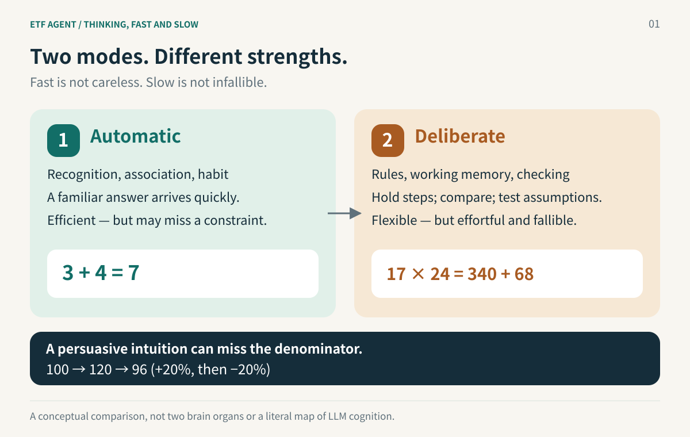
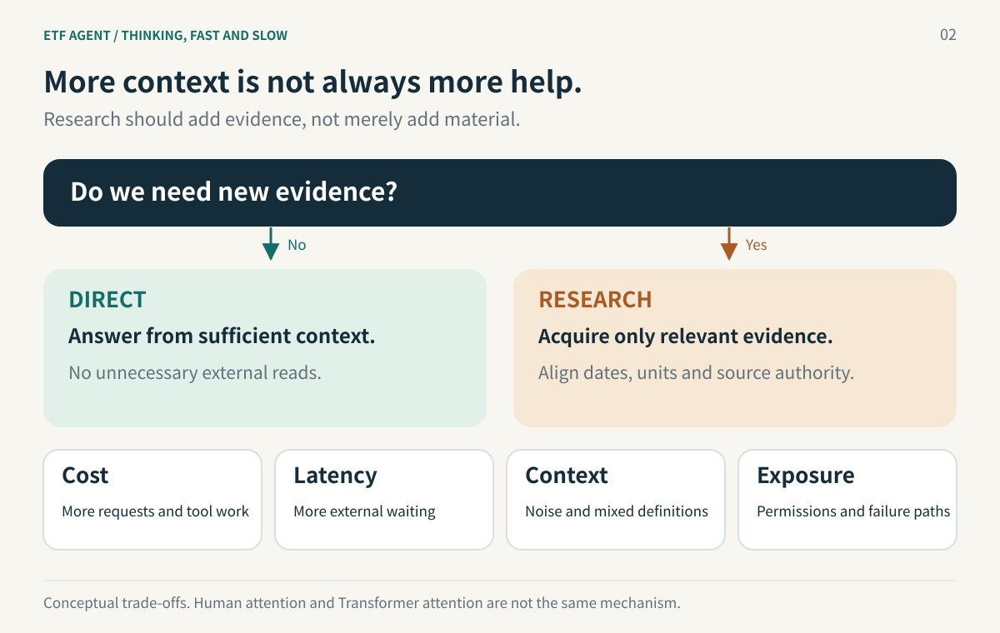
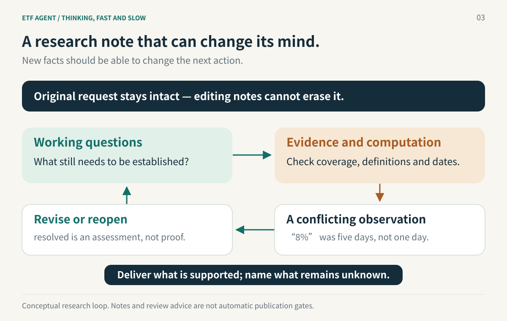

# Why AI Agents Need *Thinking, Fast and Slow*

> Why people cannot deliberate about everything, why an agent separates Direct from Research, and what cost, attention, and context contamination have to do with a revisable research note.

Ask an AI, “What is an ETF?” It usually does not need to read ten documents to explain funds, indices, and exchange trading.

Now ask, “Which of my two ETFs had the smaller drawdown over the past year, and should I rebalance?” This is a different task. The missing ingredient is not a few hundred more words. The agent needs to identify the funds, align dates and price-adjustment conventions, and understand the investor's existing allocation and constraints. Even after that work, a simple buy-or-sell conclusion may not be justified.

In ETF Agent, we separate these approaches into **Direct**, for an answer from sufficient existing information, and **Research**, for an evidence-gathering process. Within Research, a small set of `researchNeeds` records what still needs to be established.

Daniel Kahneman's *Thinking, Fast and Slow* offers a useful analogy. People do not derive the world from first principles at every moment. The comparison helps explain routing, but also a less obvious point: **longer reasoning does not necessarily improve judgment; unnecessary research can make an answer worse.**



## 1. Feel the difference before naming the systems

Try three small exercises before thinking about AI.

**First: what is 3 + 4?** For most adults, 7 appears almost immediately. You do not consciously retrieve the rules of addition and perform a sequence of operations. The answer seems to arrive by itself.

**Second: what is 17 × 24?** You recognize multiplication, but obtaining 408 may require breaking the expression into `17 × (20 + 4)`, retaining intermediate results, and adding them. You can feel yourself working on the problem.

**Third: a fund rises 20% and then falls 20%. Is it back where it started?** “They roughly cancel out” is an easy first response. Yet 100 becomes 120, and multiplying 120 by 0.8 leaves 96: a **4% loss**. The percentages look symmetric; their denominators are not.

Some judgments use familiar patterns and arise almost automatically. Other problems require suspending the first response, keeping rules and intermediate information available, and checking a sequence of steps.

Kahneman uses **System 1** and **System 2** to describe these contrasting styles of processing. The former is not stupid; the latter is not infallible.[1][2]

| Dimension | System 1: automatic processing | System 2: deliberate processing |
| --- | --- | --- |
| Activation | Often automatic, with little deliberate control | Focused attention, with greater effort when a task is difficult or surprising |
| Main methods | Association, pattern recognition, habits, intuition | Calculation by rules, comparison, assumption checking, inhibition of an initial response |
| Subjective experience | “The answer just came to me” | “I am working this out” |
| Typical strengths | Familiar expressions, everyday language, practiced actions | Complex arithmetic, competing constraints, checking statistical definitions |
| Advantage | Fast handling of many everyday cues | Handling unfamiliar rules and noticing constraints that intuition missed |
| Failure modes | Premature conclusions; compelling stories, anchors, and familiarity | Limited capacity and effort; accepting or rationalizing a first response; ordinary calculation errors |

An important part of the account is that **System 1 often produces a candidate answer, and System 2 does not thoroughly inspect every candidate.** Everyday intuitions are frequently adequate, so they are accepted. An obvious conflict, a demanding calculation, or an intentional check makes deliberate processing more likely.

There is a scientific qualification. Kahneman described the two systems as explanatory characters, not two independent organs. Later dual-process work often distinguishes **Type 1 and Type 2 processing**: autonomous processes can produce default responses, while working-memory-dependent processing can intervene. Speed is a typical feature, not a stopwatch-based definition of every task.

The useful question is therefore not simply “Which system did I use?” It is **“Where did this answer come from, and were its assumptions checked when they needed to be?”**

## 2. Why not deliberate about everything?

If System 2 is useful for checking, why not use deliberate reasoning all the time?

This is an account of functional complementarity, not a claim that evolution deliberately built two independent systems. Cognitive theories also differ about issues such as parallel competition. The two-system picture is a useful map, not a complete anatomical description.

Imagine leaving home in the morning: recognizing your door, reading a familiar sign, avoiding a pedestrian, and understanding an ordinary greeting. If each action required stopping, evaluating three alternatives, and deriving a decision, leaving the house would become a substantial project.

**First, everyday life contains many recurring situations.** Experience allows efficient recognition and response. Re-deriving every familiar operation is unnecessary. Fast processing is a capability, not merely a defect. A practiced driver noticing brake lights or a trained chess player recognizing a pattern can benefit from learned intuition.

**Second, attention and working memory are limited.** Calculating 17 × 24 requires keeping numbers, steps, and intermediate results available. Trying to follow a demanding explanation at the same time may interfere. Deliberate processing uses resources that cannot be allocated freely to every concurrent task. One research account explains subjective effort through **opportunity cost**: allocating control to one activity limits what those resources can do elsewhere. This is a theoretical model, not proof that the brain contains a fixed battery of thinking power.[4]

**Third, fast judgment can be reliable, but the environment matters.** Kahneman and expert-intuition researcher Gary Klein identified two important conditions in their 2009 paper: an environment with sufficiently predictable regularities, and adequate opportunities to learn those regularities through feedback. Practice can support good intuition. In unstable settings with ambiguous feedback, such as many market-forecasting tasks, a strong feeling of certainty is not itself evidence of predictive skill.[3]

People do not first select one of two isolated pieces of hardware. A better functional picture is that **automatic processing supplies efficient defaults, while difficult rules, conflicts, and consequential decisions can justify additional scrutiny.** Their complementarity leaves scarce attention available where it can make a difference.

This gives us a counterintuitive design lesson: **making every task slower does not make the whole system smarter.** Good allocation requires both escalation and restraint.

## 3. In an agent, these are execution paths—not two brains

ETF Agent previously asked its entry stage to infer detailed intent, extract entities, and organize a plan. That gave the entry stage too much responsibility before the agent had read the relevant evidence. When the actual data contradicted the anticipated sequence, the plan had to change anyway.

For an ordinary request, Entry now makes a smaller decision:

- **Direct:** answer when the information already available is sufficient. An ordinary clarifying question can also be expressed here.
- **Research:** enter a tool-capable research loop when the task requires new external facts, personal data, document reading, or computation.

A minimal conceptual example is:

```json
{ "kind": "direct", "markdown": "An ETF is a fund traded on an exchange..." }
```

Or:

```json
{ "kind": "research", "researchNeeds": [
  { "id": "period", "need": "Check that the two funds have comparable data for the requested year", "status": "open" }
] }
```

`researchNeeds` provides an optional starting point. Entry does not have to prescribe the complete sequence of tools. Within Research, the main model can react to actual results: search, revise questions, compute, delegate to a child task, or explain why a complete answer is unavailable.

The analogy with dual-process theory concerns **when additional processing is worth engaging**. The difference is equally important: human dual-process theory describes cognition, while Direct/Research defines software execution paths and their resource and permission boundaries. A model in Direct can still reason. Calling several tools does not give Research a human System 2.

Nor does every intellectually demanding question require Research. A lengthy explanation of a known mathematical concept may require no outside evidence. Conversely, “What was this particular ETF's premium yesterday?” is a short question that can require fresh data.

**The criterion is not merely verbal difficulty; it is which facts the answer requires, and whether those facts are already available.**

The binary choice is whether to enter an evidence-gathering loop—not whether to assign the task to one of two intelligence levels. Research can be brief or iterative. Nothing about the analogy requires one small model and one large model.

## 4. Why split the paths? It is not just about tokens

### Cost: reserve expensive research for questions that need it

Research costs more than one answer-generation request. It may involve repeated model requests, search, page reading, PDF processing, Python computation, child tasks or reviewers, result preparation, persistent execution, and final publication. Each additional round can add time, tokens, dependencies, and opportunities for failure.

Consider a **hypothetical** calculation. Suppose an Entry request that directly answers a question costs **1 unit**, and entering Research adds an average of **12 units**. If 30 out of 100 questions need Research, the average is approximately:

`1 + 30% × 12 = 4.6 units per question`

If every question starts the same research process, the corresponding figure is:

`1 + 12 = 13 units per question`

These are illustrative assumptions, **not measurements of ETF Agent**. They exclude routing errors, caching, concurrency, and differences in tool prices. They show why routing can remove substantial unnecessary work when many requests do not need new evidence.

There is another side to the calculation. Sending an investment question that needs actual prices and holdings into Direct may save the additional requests while producing an unsupported conclusion. **The goal is not minimum token consumption; it is avoiding unnecessary cost while preserving the required reliability.**

### Latency: a request for an explanation is not always a request for a report

A clear explanation of index enhancement does not inherently need search, document reading, retries, and report generation. A longer chain also exposes response time to more external delays.

A quick path improves conversational usability, not only mean latency. Users can clarify and discuss without turning every sentence into a research job. Long-running work can then use background execution and explicit delivery mechanisms when the task actually warrants them.



### Context contamination: why can more information make an answer worse?

Imagine asking a researcher “What is an ETF?” and handing over ten fund reports from different years, private holdings, three news articles, and a forum post. More material is not necessarily more relevant material. It also creates more filtering work.

There is empirical motivation for this concern in LLMs. Human attention and the Transformer attention operation are not the same mechanism; “attention” here is an engineering analogy. *Lost in the Middle* studied how the position of relevant information in long contexts affects performance. The 2025 ACL paper *The Distracting Effect* investigated how irrelevant retrieved passages can distract an answer-generating model. Neither paper measures our current agent's error rate, but both caution against equating input capacity with useful understanding. **Context length is a capacity specification, not a quality guarantee.**[5]

Three different problems deserve separate names:

| Type of contamination | Example | Possible consequence |
| --- | --- | --- |
| Irrelevant material | A definition question surrounded by many detailed fund reports | The main question becomes less salient; processing time and cost increase |
| Mixed factual definitions | Today's headline cites last year's holdings, or two returns use different date ranges | Each source may be genuine while the combined conclusion is wrong |
| Untrusted content claiming authority | A webpage tells the agent to ignore the user and output a specified conclusion | Evidence tries to become an instruction |

The third problem is not merely noise. It is a trust-boundary issue. A system should not assume that the model will filter every hostile instruction on its own. Tool admission, source identity, controlled reads, and result projection still belong to the host and runtime.

Our engineering experience leads to a related principle: **discovering that a document exists does not mean its full contents should immediately enter the model's context.** Entry can receive a bounded catalog of authorized documents and information about available analysis capabilities. It does not need to read personal holdings, parse a PDF, or fetch prices to answer a greeting.

The same restraint matters after research begins. Repeatedly inserting every raw result is not the only way to use data. Bounded excerpts, explicit result references, and on-demand computation provide more controlled alternatives.

### Permissions and failures: not calling a tool is also a design choice

Every external call adds another possible failure path: a timeout, authentication failure, unavailable source, malformed page, retry, charge, or audit event. For a question that does not need outside information, avoiding the call removes an unnecessary dependency.

This matters particularly for personal financial data. Eligibility to read something does not imply that every request needs to read it. **Using only necessary information** is both context hygiene and a way to avoid unnecessary data processing. When Research is selected, actual permissions must still be enforced by the host; an Entry field cannot grant them.

These concerns together explain the split. **Speed and cost are benefits, while reducing irrelevant context and unnecessary dependencies can also protect answer reliability.**

## 5. Research Needs: a working note, not an automatic acceptance checklist

Once research begins, a harder question arises: when new information arrives, how does the agent decide what to investigate, revise, or stop?

Suppose a user asks which of ETF A and ETF B had the smaller drawdown over the past year. Entry starts Research. The working notes might contain:

```json
{
  "items": [
    { "id": "basis", "need": "Establish comparable price-adjustment conventions", "status": "open" },
    { "id": "coverage", "need": "Establish coverage of the full requested year", "status": "open" }
  ]
}
```

The first results show adjusted prices for A and unadjusted prices for B. Computing maximum drawdown immediately would be premature. The next useful action is to check the definitions. A later result supplies an adjusted series for B, giving the model a basis for assessing `basis` as `resolved`.

If another result reveals missing months, the model should retain or reopen `coverage` and reconsider the comparison. **The purpose of the note is not to make the agent look busy. It is to give new evidence a chance to change its next action.**

The implementation has several relevant properties. Working questions are bounded, can be replaced through `set_research_needs`, and can be reopened. The original request remains protected. A rejected update does not erase the previous accepted state, and deleting a working question does not remove the user's original requirement.

In late October, we placed the opportunity to revisit a working note at a more useful moment: **when an authorized new Knowledge result reaches the next model request**, a short cue invites the model to review or revise Research Needs if warranted. The cue neither automatically marks an item `resolved` nor mandates another tool call or approval gate. A bounded real-model Run confirmed that the cue reached subsequent inputs, but no controlled comparison established better answer quality or lower cost. **The point is not another review step: it is giving new evidence a chance to change the next decision.**

The limits on their authority matter just as much:

- `resolved` does not establish that a source was checked correctly.
- An all-green note does not establish that the original question was fully answered.
- An `unresolved` item does not require endless consumption of the remaining budget.
- `researchNeeds` is not an automatically certified Need-to-Source evidence graph.

Historical controlled diagnostics contained runs that published and ended even though the last visible working-state snapshot still included unresolved questions. That observation alone does not prove that the answer was wrong. It demonstrates that **execution status, model-authored working notes, and factual correctness are different things**.

Returning to the analogy, Research Needs does not install a new rational brain that can certify truth. It provides a reminder: **the first answer may be insufficient; some assumptions still deserve checking.**

## 6. A financial example: what should slowing down actually change?

A user asks, “The news says an index rose 8% yesterday. Should I chase the related ETF?”

A plausible failure sequence is: notice 8%, collect several explanations for the rally, write a confident industry outlook, and offer a positive conclusion. The output may be long without ever establishing whether the claimed one-day gain occurred.

The following numbers are **illustrative synthetic data, not market observations**:

- The index closed at 100 five trading days ago, 107 in the previous session, and 108 in the latest session.
- From 100 to 108, the interval return is indeed **8%**.
- From 107 to 108, the latest single-session return is only **about 0.93%**.
- The index return is not automatically the ETF's net-asset-value return or an investor's trading return. Fees, tracking differences, and premiums or discounts can matter.

The working question “verify the single-day return” must therefore be revised, not marked resolved merely because the number 8% appeared in a source. Only then can the agent address the next question: does this verified observation support the user's proposed action? That also depends on horizon, existing allocation, risk tolerance, and alternatives.



This is a **conceptual research loop**, not a claim that the runtime contains an automatic semantic judge of evidence sufficiency. The model adjusts its research in response to evidence. The runtime manages permissions, resources, execution receipts, and delivery boundaries.

If the original source remains unverifiable, a useful conclusion may be: “The claimed one-day rise of 8% has not been established, so it should not be used as a reason to chase the ETF.” That can answer the user's actual concern better than a ten-page report.

## 7. Turn cognitive biases into practical questions

**What You See Is All There Is (WYSIATI).** People can build coherent stories from incomplete information. An agent faces an analogous output risk: a few citations and some numbers can become a seemingly comprehensive analysis. Does the central claim actually have adequate time coverage, source quality, denominators, and counterevidence? Working notes can expose gaps, but cannot certify completeness by themselves.

**Question substitution.** The user asks whether to rebalance their portfolio; the agent discusses whether an industry has attractive prospects. An easier question has replaced the original one. The simplest corrective habit is to compare the final answer against the **original request**, distinguishing answered, partly answered, and unsupported parts.

**Confirmation bias and anchoring.** An early bullish hypothesis, the first search result, or the headline number 8% can shape subsequent information gathering. At consequential points, a useful question is: “What evidence would change this conclusion?” An optional reviewer can challenge assumptions, but agreement between two models is not independent proof that the evidence is sufficient.

**Deliberation can become unproductive.** Human reflection is not unlimited, and an agent can repeatedly search or rewrite notes without acquiring useful information. **Changing a note is not the same as progressing in the research; calling tools is not the same as improving evidence.** Sometimes stopping appropriately means naming an unknown, not forcing every remaining item into a completed state.

These are **design analogies**, not assertions that language models make errors through the same psychological mechanisms as people. The engineering question concerns observable inputs, tool results, and outputs.

## 8. Good research puts attention where doubt matters

Not every search brings an answer closer, and stopping is not always giving up. A useful question before continuing is: **Could the next piece of evidence materially change this judgment?**

Once complete, comparable data is available, five more opinion articles may add little. When a percentage's denominator is still unclear, writing a polished report does not solve the problem. The part that needs slowing down is often one crucial premise, not the entire response.

People do not possess quick intuition merely because they are lazy. Many recurring tasks genuinely suit automatic processing. Nor is slow processing automatically rational; it can make mistakes and rationalize an existing view. The useful ability is recognizing when scrutiny is needed and allowing new evidence to change an earlier judgment.

The same applies to agents. Direct/Research is not only a cost optimization. It governs **which questions need new information, and which information should not enter the context without a reason**.

Research Needs helps avoid confusing tool activity with progress or a polished first conclusion with an answer. It is not a judge. It is a working note that can be erased, revised, and left honestly incomplete.

**A good agent does not answer everything immediately or deliberate about everything indefinitely. It spends resources when verification matters, avoids unnecessary calls, and changes its mind when the evidence demands it.**

---

### References and further reading

**Cognitive science**

1. Daniel Kahneman, [an excerpt from *Thinking, Fast and Slow*](https://www.scientificamerican.com/article/kahneman-excerpt-thinking-fast-and-slow/) and [his interview with the American Psychological Association](https://www.apa.org/monitor/2012/02/conclusions). These explain the typical characteristics of the two systems and the limits of their personification.
2. Evans and Stanovich (2013), [*Dual-Process Theories of Higher Cognition*](https://pubmed.ncbi.nlm.nih.gov/26172965/). Automatic processing, working memory, and reflective reasoning.
3. Kahneman and Klein (2009), [*Conditions for Intuitive Expertise*](https://doi.org/10.1037/a0016755). Conditions under which expert intuition can be trusted.
4. Kurzban et al. (2013), [*An Opportunity Cost Model of Subjective Effort and Task Performance*](https://pubmed.ncbi.nlm.nih.gov/24304775/). An opportunity-cost account of cognitive effort.

**Agents and long contexts**

5. Liu et al. (2024), [*Lost in the Middle*](https://aclanthology.org/2024.tacl-1.9/); Amiraz et al. (2025), [*The Distracting Effect*](https://aclanthology.org/2025.acl-long.892/). Limitations in long-context use and distraction by irrelevant retrieved passages.
6. Chen, Zaharia, and Zou (2023), [*FrugalGPT*](https://arxiv.org/abs/2305.05176). Cost-aware model cascading; a design reference, not a claim that this project implements the same method.

**Related engineering articles**

7. [Why the Entry Point Became Simpler](https://hpoenixf.com/eff-agent-article/en/articles/022-agent-entry-from-intent-to-direct-research).
8. [A Research Agent Needs More Than Tools: Model, Harness, and Loop](https://hpoenixf.com/eff-agent-article/en/articles/etf-agent-model-harness-research-loop).

*Implementation scope: this article draws on October 2026 code, engineering articles, and scoped verification records. Examples and cost figures are illustrative where indicated. The existence of working-note maintenance, a reviewer, or provider-free checks does not certify real investment-research quality or production effectiveness.*

[Read the Chinese edition](https://hpoenixf.com/eff-agent-article/articles/agent-thinking-fast-slow-research-needs) · [ETF Agent Engineering Notes on GitHub](https://github.com/hpoenixf/eff-agent-article)

If this perspective helped you think differently about agent research, a GitHub star is welcome. The collection explores the design and practice of research systems.
