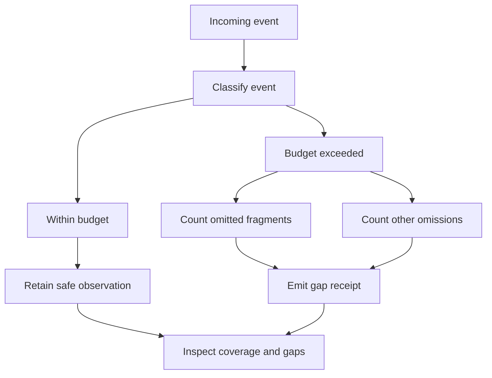

---
evidence:
  implementation: "Protocol-omission classification implemented"
  scoped: "Recorded long-run audit and controlled gap checks"
  live: "Historical omissions remain missing; long-run coverage impact unmeasured"
readingBrief:
  takeaways:
    - "A complete trace query only exhausts available records; pagination, model capture, tool stages, durable delivery, and research correctness need separate conclusions."
    - "The repair classifies omitted fragments and other protocol events within existing limits. Historical categories remain unknown, and improved long-run coverage has not been established."
    - "When traces are missing, inspect original action receipts, publication revisions, and actual requests. Missing observation is not nonexecution, and filling a chart does not justify replaying effects."
  appliesTo:
    - "Engineers diagnosing long-running trace gaps, streaming event budgets, or disagreements between observability and original execution receipts."
  notFor:
    - "Not a recovery of missing history, a tool-success metric, or an already delivered complete per-call coverage system."
---

# The Trace Says Complete. Why Can’t We Reconstruct the Agent Run?

A research run had ended. The trace query returned `complete`, yet there was no answer-publication event. The tempting conclusion was that the agent had never published an answer. Reading the original publication history for that same run, however, returned a nonempty answer that had already been saved.

Neither system necessarily lied. We had confused two questions: **Did the query finish reading the available records? And did execution leave all the records we needed?**

For a long-running agent, observability must describe the coverage of its records, not merely display them. Otherwise, a complete-looking timeline can be a complete presentation of an incomplete account.

## 1. Complete needs an object

This case comes from a research evaluation recorded on October 30–31, 2026. Of 120 planned runs, 59 had ended at that checkpoint. These were distinct execution instances, not necessarily 59 different questions, and they were not the final results of the entire campaign.

The query reader labeled all 59 trace readbacks `complete`. A turn-by-turn inspection nevertheless found 17 model-turn outputs missing. Across 41 runs, there were 42 tool-protocol gaps, with receipts reporting 851,339 omitted events in aggregate.

The units matter. Those were **17 missing model-turn outputs**, not 17 runs with no output whatsoever. The omission counter described events reported by the observer. It was neither a tool-call count nor an independently deduplicated event total.

The query’s label could still be correct: it had exhausted the records available within its query scope. The collector might already have omitted some facts because of capacity limits, unsupported protocol paths, or other collection failures.

| Completeness dimension | The question it answers |
| --- | --- |
| Query pagination | Are there any unread pages within this query scope? |
| Model-content capture | Were this turn’s input and output retained? |
| Tool-protocol observation | Which stages, from fragments through dispatch and receipt, were recorded? |
| Durable execution and delivery | Which actions, answers, or files were confirmed by their original owning modules? |
| Research conclusions | Are the final claims supported, and do they answer the user’s question? |

These dimensions are related, but none automatically certifies the next. Exhausted pagination does not establish complete content capture. Complete content capture does not establish complete tool-stage coverage. A saved answer does not establish correct research.

## 2. Why streamed tool calls exhaust observation budgets

A single tool call can arrive as many streaming fragments. The function name, argument string, and termination information appear incrementally, and the SDK aggregates them into a complete proposal.

The executor may still see one proposed call. The observer may have seen a large number of events. Without separating these units, one call with long arguments can consume a substantial share of the entire run’s observation budget.

At the time of this case, the application observer used a 512-event budget per run and a separate 256-event limit for provider/SDK fragments. The intent was to prevent fragments from consuming all the space needed for normalization, validation, dispatch, and result receipts, while leaving room to describe omissions.

That is a useful tradeoff, not a completeness guarantee. Non-fragment events accumulate too. Among the 41 runs with an `event_limit` gap, 35 reached a maximum non-gap event ordinal of 511. Reserving capacity reduced fragment crowding; it did not guarantee enough capacity for an arbitrarily long run.

Consequently, observing a dispatch event does not establish that every dispatch was recorded. Conversely, a gap does not establish that the entire tool lifecycle disappeared. Both interpretations overreach.

## 3. The repair explains omissions rather than pretending they vanished

Increasing the limit would be the most direct reaction. It would also increase storage and export pressure, retain more potentially sensitive content, and merely move the next saturation point.

The implemented change was narrower: **keep the existing limits, but count omitted fragments separately from other omitted protocol events.** New gap receipts add `omittedFragmentEvents` and `omittedOtherEvents`, while retaining the total in `omittedEvents`.

The following is a teaching example with constructed values, not a raw receipt from a real run:

```json
{
  "stage": "gap",
  "reason": "event_limit",
  "omittedEvents": 259,
  "omittedFragmentEvents": 2,
  "omittedOtherEvents": 257
}
```

It helps distinguish fragment omissions from capacity pressure on other event categories. But `other` must not be renamed “execution events”: it can include SDK aggregation, termination, and other protocol categories. It cannot tell us how many tool executions were lost from the trace.



Budget exhaustion can come from the overall event limit or the fragment sub-budget. An omitted event increments the counter for its own category, not both branches. Collection failures remain separately recorded rather than being hidden inside capacity omissions.

For historical receipts without these category fields, the categories remain unknown. They must not be backfilled as two zeros. The change improves the interpretability of new data; it does not recover old events or establish an improvement in real long-run coverage.

## 4. Where to look when the trace is missing

The missing-publication example is instructive. We queried the original publication module’s history reader using the same run and access scope, and retrieved the saved answer. We did not rerun the model or insert an imagined publication event into the historical trace.

The investigation followed ownership of the facts instead of giving the observability platform exclusive authority over their interpretation.

To establish whether a tool executed, inspect its original action and result receipts. For saved text, inspect the publication version. For a retrievable file, inspect the artifact identity and actual readback. To determine whether material entered a later model request, inspect that request’s input. Langfuse provides a diagnostic view across these records; it does not replace them.

Three cases lead to different actions.

**The trace is missing, but the owning module has evidence.** Preserve the trace gap alongside the independently confirmed fact. Do not replay execution merely to make the timeline look complete, especially when execution has durable effects.

**Both sources have records, but the content or versions differ.** Recheck run, action, request, and version identity. Similar timestamps or text are clues, not permission to combine different versions into one delivery.

**Neither source provides enough evidence.** The result is uncertainty, not proof that nothing happened. Improve collection for future runs rather than asking a model to invent a plausible history.

An equally important constraint is non-interference. A synchronous observer exception, rejected asynchronous export, or collection limit must not erase an answer already independently authorized and saved.

## 5. The next step is not a bigger Boolean

We also joined durable action records to trace call identities within each run. Some actions matched dispatch and receipt stages, some matched other events, and some had no matching trace records. This is an entry point for investigating observation coverage, not a tool-success rate.

A useful next design would expose which stages have evidence for a known call, rather than add another global switch named `fullyComplete`. That is a proposed direction, not a complete mechanism delivered by this repair.

Three questions are more useful during an investigation: What exactly is complete? Do missing parts have an identity and an observed reason? Does the original execution owner retain an independently checkable fact?

**Trustworthy observability does not make every cell green. It makes the difference between evidenced facts and unrecorded facts visible.** Once “not observed” becomes “did not happen,” failure diagnosis, cost accounting, and model evaluation all inherit the same faulty premise.

Further reading: [From Trace to Trustworthy Observability](025-agent-langfuse-from-trace-to-trustworthy-observability.md) · [Evidence of Subagent Contribution](agent-subagent-contribution-evidence.md) · [Not Every Agent Failure Is a Model Failure](agent-failure-is-a-boundary-problem.md)

More cases are available in [ETF Agent Engineering Notes](https://github.com/hpoenixf/eff-agent-article). Star the collection to support this engineering work.
