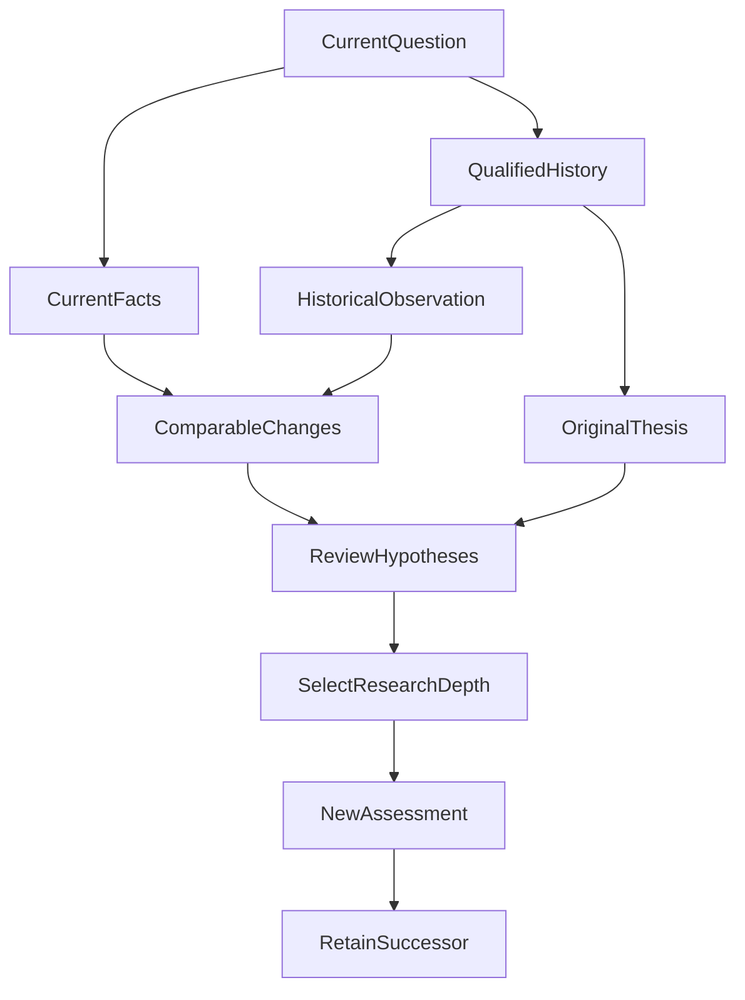

# After the Weekly Report, Does the Agent Remember Why It Made That Call?

*An engineering case study in historical observations, original investment theses, and versioned corrections for continuous investment research.*

**The most valuable thing to retain across investment reviews is not just the previous report. It is why the conclusion was reached and which future evidence would require it to change.** A polished historical summary alone can tempt a model to rewrite yesterday's reasons using today's information.

Imagine that three months ago an agent reviewed a fund portfolio and found its allocation broadly reasonable, while flagging technology-sector concentration as an issue worth monitoring.

Three months later, the user asks: “What has changed about the risks? Do the reasons for holding still stand?”

An agent with only the current holdings and an old HTML report can run a fresh analysis. It may not know **which evidence supported the original conclusion, which hypotheses were made, or what conditions were supposed to trigger reassessment**. Worse, it might reconstruct plausible historical reasons using what it knows today.

During the second and third phases of building weekly portfolio reviews in ETF Agent, we shifted the engineering question from “Can we generate a report every week?” to “**Can a past investment analysis be retrieved, compared, amended, and tested against later evidence without rewriting its history?**”

This does not mean adding a longer prompt-based Memory or copying every old conversation into a new one. We need to retain different historical facts: portfolio observations, the actual structured thesis produced by an investment method, later user corrections, and the provenance and access boundaries of each.

> **Implementation and public-release scope (October 2026):** This is an account of phased work and controlled verification in the private ETF Agent application, under specified authorization, database, and fixed model-gateway conditions. It does **not** mean that the public [Open ETF Agent](https://github.com/hpoenixf/open-etf-agent) release offers a runnable complete weekly-review, Investment Thesis, or user-correction workflow. Multi-period research quality and decision usefulness still require independent evaluation.

## 1. The real problem begins after delivering the first report

The initial goal was straightforward: obtain authorized portfolio information, perform research, create an HTML report, and return a link to a file that can actually be downloaded.

Once the process repeats, however, yesterday's report becomes a potential input to tomorrow's analysis.

An initial review may examine an allocation, a later review may observe changed weights, and a still later review may find overlapping underlying exposures. A user does not merely want three independent PDFs or HTML pages. They want to know **what changed enough to reconsider a previous judgment**.

Phase two therefore established qualified historical observations and cross-period comparison.

The system retains eligible Portfolio Observations, report revisions, observation dates, cutoffs, source relationships, and method identities. These are **research snapshots of what was observed then**, not a second live Portfolio or Ledger.

The distinction is operational. A holdings snapshot from two months ago is not today's holdings. A source that was once available is not automatically readable by a new Run without its required access authority.

Financial comparisons also have their own semantics.

Suppose a portfolio's market value rises from 1,000,000 to 1,100,000 in its reporting currency. That alone does not establish a 10% investment return. Contributions, withdrawals, cash flows, prices, and exchange rates may all play a role. When currency, share class, time period, computation method, or completeness differs, the affected comparison must remain unavailable or qualified.

A first review has no previous-week change. A review following a three-week gap should not invent a week-over-week comparison: it can say “since the last review” and retain the actual dates. Missing cash-flow history does not turn a change in assets into performance, although independently supported risk observations can still be delivered.

That solves the first problem: **comparing historical financial facts without inventing equivalence**. It does not yet answer whether the earlier investment rationale still holds.

## 2. The turning point: the report survived, but the original reasoning did not

The first snapshot design deliberately retained qualified portfolio observations and source locators instead of copying arbitrary Python output, temporary script logs, or untrusted artifacts into long-term storage.

That was a reasonable boundary at the time: keep eligible facts without turning every execution by-product into permanent research authority.

Later we added supported built-in weekly and strategic-allocation analysis methods. These methods could produce structured Investment Theses containing assumptions, expectations, applicable objects, evidence, and review conditions.

A real gap emerged: **the authorized built-in method could finish and the HTML report could be retained, yet the History reader could not recover the complete original method document**.

If a future agent only reads a prose summary and asks another model to turn it back into a structured thesis, it risks inventing a hypothesis that the original method never produced.

We did not respond by retaining all script output. Instead, only supported built-in weekly or strategic method envelopes that satisfy the existing execution proofs are retained with their original `record`, `context`, and `results` in the existing research snapshot. History then exposes an exact `method` locator for subsequent reading.

Qualification does not depend on JSON shape alone. It also checks the original built-in script execution, Host receipt, the sealed invoking model turn, recorded authorization and analysis lineage, and the result actually exposed to the model.

There is a subtle identity trap here: the method's internal `context.run_id` and the Host Run UUID can belong to different namespaces. A literal string mismatch is not, by itself, grounds to reject a valid invocation. The relevant proof is the full trusted execution relationship.

Focused production-seam tests reproduced the missing method document before the change and verified its admissible readback afterward. Arbitrary, fabricated, foreign-scope, or unknown-origin script results remain excluded.

**We retained the original material from which a model inferred an investment thesis; we did not certify the inference as permanently correct.**

## 3. Investment Thesis: turning “bullish” into a testable hypothesis

“Remain bullish on technology assets” is difficult to evaluate over time. If prices rise, the original view can be called correct; if prices fall, the same speaker can say the long-term thesis remains intact. Without a frozen original rationale, almost any later outcome can be rationalized.

A structured Investment Thesis must retain more than the bottom-line conclusion.

| What to retain | Example meaning | Why it matters |
| --- | --- | --- |
| Objects and dates | Which funds, indexes, or portfolios; when evaluated | Prevent an object-specific judgment becoming universal |
| Original hypotheses and expectations | What the model believed and why | Prevent retrospective rewriting |
| Horizon and review conditions | When and under what circumstances to revisit | Set a meaningful time and scope boundary |
| Falsification conditions | What new evidence could challenge the thesis | Make disconfirmation possible |
| Supporting and opposing evidence | Source and result identities | Distinguish old grounds from new findings |
| Attribution and version | Model inference, user confirmation, successor correction | Avoid laundering an inference into the user's intention |

Consider this **synthetic teaching example**, not an observation of anyone's real portfolio:

> Several funds may have overlapping industry exposures. If subsequent qualified look-through evidence shows materially more overlap, reassess the diversification claim rather than counting how many fund tickers are held.

A later review can inspect the original portfolio scope, the evidence available then, and the stated review conditions, before asking whether the new evidence is comparable.

The contract also supports attributed overall research assessments: `Supported`, `Challenged`, `Invalidated`, and `Inconclusive`. These are research judgments, not instructions to trade.

An important distinction is between **no assessment was performed** and **an assessment was performed and explicitly recorded as Inconclusive**. A missing historical assessment does not mean the original analyst concluded “insufficient evidence.”

Likewise, making money does not automatically validate the thesis; losing money does not by itself invalidate every underlying risk argument.

An earlier `allocation-rationale-review@1` method has five local labels—`supported`, `weakened`, `mixed`, `unchanged`, and `not_assessed`. We did not mechanically vote or translate those local pillar labels into the new overall thesis states. Their subjects and evidentiary authority differ, so historical readers preserve their original meaning.

## 4. Model inference and user confirmation must remain separate revisions

Suppose the agent infers: “This user holds growth assets, so the user has a lasting preference for growth investing.”

That may be a plausible hypothesis. It is not an authenticated statement of the user's investment objective. The position might be temporary, inherited, or already on the way out.

The built-in method can therefore record a `model_inferred` thesis. A `user_confirmed` correction requires an actual authenticated user action.

Now suppose the user says: “This is a transitional allocation, not my long-term target.”

The correct history should not silently change the report from three months ago into one claiming the user never favored growth assets. It should append a **successor with an author, timestamp, and explicit predecessor**.

Phase three reuses the existing Artifact Archive:

- The original HTML bytes and digest remain immutable so readers can see the report as originally delivered.
- The authenticated correction is recorded separately, bound to its report, author, and revision.
- The research snapshot gains a new version; a stale read handle cannot use an old version identity to obtain a newly attached correction.
- A current valid handle can read the updated version; the original managed deletion and expiry rules still apply.

This is not a new Event Sourcing platform for all agent state. Martin Fowler's [Event Sourcing](https://martinfowler.com/eaaDev/EventSourcing.html) describes why it can matter to know how a current state came to be. The W3C [PROV-DM](https://www.w3.org/TR/prov-dm/) similarly provides general concepts for provenance, activities, and responsible actors.

Our design draws on related ideas but implements only a bounded, versioned history and provenance relationship. It does **not** claim a complete Event Sourcing implementation or compliance with PROV.

The payoff is the ability to answer separately:

“What did the agent originally conclude?”

“What did the user correct later?”

“Which facts are actually authorized for the current review?”

These should not all collapse into one mutable Memory statement that overwrites its predecessor.

## 5. How should the next review use what the previous one left behind?

Storing history does not mean loading every previous report into the model.

The existing History workspace provides a bounded catalog of eligible historical candidates. Here, “workspace” means a history-reading surface, not the newer module for managing long-term goals. A new Run can select relevant reports, snapshots, and method locators for exact reading. A missing item in a bounded listing is not proof that no historical report exists. A historical locator also does not automatically grant fresh access to the original external source.

Valid comparisons return to current authorized Portfolio facts and historically qualified observations with compatible scope and measurement basis. Old judgments remain dated and attributed assessments, not current investment truth.

That History read path answers “which qualified materials were retained?” The newer **Research Workspace** addresses a different question: what should persist when independent Runs continue to serve a user's goal for weeks? It associates a versioned, user-maintained goal with distinct Runs and exact versions of their original Publications, and it can retain an optional, source-attributed research Checkpoint. It does not copy authoritative report bodies or become a second research executor capable of bypassing existing authorization.

In the opening technology-concentration example, at least three kinds of state must remain distinct. The **long-term goal** is the user's intention to track portfolio exposures. The **Investment Thesis** captures a falsifiable, source-bound hypothesis formed by a particular study. A **Checkpoint** is the model's suggestion about what to inspect next—for example, outstanding verification of the latest underlying holdings disclosure. A Checkpoint cannot overwrite a user goal, and a suggestion to investigate further does not silently revise an older Thesis. The next study must qualify its own source reads under a new Run and produce its own dated judgment.

A possible research path looks like this:

This is an illustration, **not a mandatory fixed DAG for every weekly review**. Workspace may organize goals and associations, but it cannot replace the History and Publication access checks shown by the qualified-material path.

If eligible history is sufficient and little has changed, the model may write a concise review and reuse prior qualified results. A material change in portfolio risk, index construction, or evidence challenging an old hypothesis may justify deeper investigation. Missing evidence must remain missing, rather than being rendered as “no change.”

Design is not the same as demonstrated model behavior. Phase three verified that the existing Runtime can support Deep mode and qualified historical/result reads; it **did not establish that real models consistently select the right depth or reduce research cost**.

## 6. Scheduling gives research a rhythm, not investment truth

Ongoing review also needs a schedule. Phase three reuses existing Schedule, Task History, and in-app notices. It does not keep one conversation Run alive forever.

Each occurrence launches a finite new research task under an actually confirmed recurring definition. A one-time question or the model's own preference cannot create a standing subscription.

Keeping a report and notifying the user are also different effects.

In the controlled acceptance, a `quiet` signal could preserve its report while suppressing an ordinary notice; `material` produced the applicable app notice; `unknown` was not silently interpreted as a quiet period. Retrying a failed notice reused the original report/notice identity rather than rerunning research.

These outcomes used fixed model-importance signals with real application wiring. They demonstrate cooperation between bounded scheduling, report history, and notification policy. They do **not** demonstrate that a real model reliably knows which investment developments deserve a user's attention.

A scheduler can create the opportunity for long-term research. It does not supply the quality of that research.

## 7. What the engineering evidence shows—and what it does not

The implementation has real, bounded evidence beyond a proposed schema.

First, the original investment method result was absent from the historical read path. After the repair, the normal application, authenticated interface, real PostgreSQL, actual registered built-in Python method, and fixed model gateway completed a scoped path from original method through HTML/Archive and historical reading to user correction, version isolation, and managed deletion. Negative checks retained rejection of forged origins, foreign scopes, and stale handles.

Second, some real-model weekly research attempts still failed to assemble or were cancelled without a complete report. Another actual HTML export encountered missing analysis-source identity. Those failures belong to their corresponding source and execution owners; they are not evidence that the thesis module solved every adjacent delivery problem.

Phase three has an implemented and controlled runtime path across the specified protocol, application, and database conditions. Real-model understanding of investment theses, quality across multiple reporting periods, and actual decision support still require independent validation.

**November 1, 2026 update:** Research Workspace P0 has been merged into the private main branch. Bounded engineering evidence covers goal revisions, associations across Runs, precise historical-material reading, and optional Checkpoints. It remains **disabled by default**. The complete application type-check entry timed out while enumerating compiler inputs, and formal full-scope acceptance, real-account paths, and long-term financial research quality have not been established. This does not upgrade the original weekly Investment Thesis work by implication, nor make Workspace a runnable capability in the public `open-etf-agent` repository.

A crucial limitation remains: even when the entire original method document is retained, its numeric-observation status can be `partial` if no qualified Portfolio Observation was obtained. A successfully preserved analysis envelope does not magically certify the underlying financial numbers.

## 8. What Should the Next Weekly Review Actually Test?

The work progressed through three different capabilities: deliver a real research artifact, compare qualified historical observations on compatible bases, and retain original investment theses, user corrections, and successor revisions. The third step gives weekly reports a chance to become continuing research rather than a series of unrelated documents.

But **preserving a reason does not prove the next run will actually test it**. Storage and version handoffs have scoped engineering evidence; the quality of real multi-period investment research and its value to users still need independent verification.

In the next review, we want three things: retrieve the original conclusion and its data date; identify new facts that strengthen, weaken, or overturn its assumptions; then state when holding the original course remains reasonable and when a fresh decision is warranted. If the observations are not comparable, preserve that uncertainty rather than reconstructing a convenient historical story.

**Useful long-term memory does not preserve conclusions as permanently true. It gives the agent a way to change its mind without rewriting the past.**

---

Related reading: [Why the Weekly Review Spec Was Split into Three Phases](https://hpoenixf.com/eff-agent-article/en/articles/agent-weekly-review-staged-delivery) explains the engineering delivery sequence. [A Trustworthy Evidence Chain for Financial Agents](https://hpoenixf.com/eff-agent-article/articles/financial-agent-trustworthy-evidence-chain) (Chinese original) covers provenance and eligibility across research tools. This article addresses historical portfolio observations, original theses, and later corrections; it is not investment advice.

More engineering notes are available in the [ETF Agent collection](https://github.com/hpoenixf/eff-agent-article). If these case studies are useful, please consider giving the repository a **Star**.
