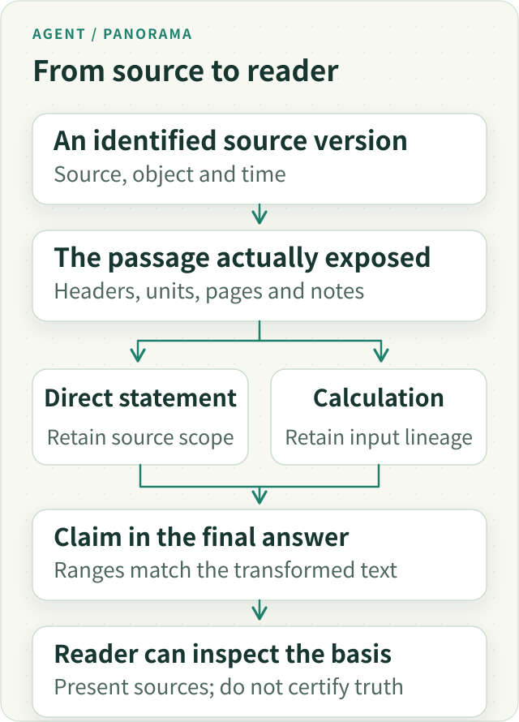

# Agent Citation Panorama: From Original Material to Checkable Claims

**A citation is a route for checking a claim, not a certificate of correctness.** It helps us find the material a model relied on. It does not, on its own, establish that the material supports the conclusion or that the conclusion answers the user's question.

That distinction should shape research-agent design: make provenance and attribution dependable, and keep content judgment separate. Citation counts, source completeness, and attractive scores must not stand in for checking the reasoning.

In ETF Agent, we took a detour. We originally wanted to know whether research material was complete, but gradually let those mechanical states make quality judgments about the final answer. The important change was not a more elaborate citation score. It was to stop asking one kind of evidence to settle a different question.

## 1. Four Separate Questions Behind a Reliable Answer

Suppose a user asks whether Fund A and Fund B create excessive overlapping exposure. The agent reads both holdings disclosures and produces a cited answer. Four questions remain distinct:

| Question | What it actually examines |
| --- | --- |
| Is the material authentic? | Whether the relevant source was acquired and its identity, date, and access eligibility apply |
| Is the citation correctly attributed? | Whether the statement refers to the material actually read |
| Does the material support the conclusion? | Whether the original text, figures, and limitations justify this inference |
| Does the answer resolve the question? | Whether the user receives a supported, qualified explanation of overlapping exposure |

The diagram shows levels of examination, not an implication that success at one level automatically establishes the next.

*Figure 1. These are progressively deeper checks. An authentic source does not imply sound reasoning, and sound reasoning does not imply relevance to the question. Open for the full figure.*
The first two mainly establish traceability. The last two require understanding content and the user's objective. We made the earlier infrastructure increasingly complete while assuming the later judgments had been solved along with it.

Citations remain valuable. They turn “the model says it checked” into “we can locate what it actually checked.” They provide the beginning of an examination, not its completion.

## 2. How an Authentic Citation Can Accompany an Overstated Conclusion

Consider a teaching example. A source lists Fund A's technology, financials, and industrials allocations as 30%, 20%, and 10%. The model writes, “Fund A has low risk.” Even an authentic, correctly attributed, current citation would not supply enough support.

Sector allocation describes where assets are invested. Low risk also depends on asset classes, concentration, volatility, drawdown, and what the user means by risk. The problem is not citation formatting; the conclusion exceeds what the material establishes.

Return to the two-fund comparison. Suppose the sources show six shared stocks among the top-ten holdings. That supports an observation about overlap in those disclosed positions. It does not directly establish excessive redundancy across the entire portfolio. The analysis still needs the overlapping weights, disclosure coverage beyond the top ten, and the user's allocation to each fund.

A subtler failure occurs when every sentence is correct but the question remains unanswered. Listing technology allocations of 30% and 28% and fund sizes of CNY 5 billion and CNY 8 billion, each with a source, still does not explain whether overlapping exposure warrants attention.

**Start verification from the conclusions that affect the decision and work back to their material—not from the number of citations and an assumed quality score.** A directly reported figure requires an object, date, and value check. An analysis or recommendation additionally requires checking the premises introduced by the reasoning.

## 3. The Handoffs Behind One Citation

Treating citations as links attached after generation misses the hard part: after extraction, slicing, computation, compaction and delegation, which original object does the evidence still identify?

The following lifecycle is a responsibility map. It does not require a separate service at each step.

*Figure 2. Original identity survives handoff. Calculations retain their input relationships; a model’s analysis does not become original source material by acquiring a citation.*

**First, acquire an identifiable source version.** A URL says where to look; a version says what was read. The same URL may change tomorrow, and similarly named PDFs may belong to different dates. Retain the object, source and relevant time. A content hash helps compare bytes, but is neither permission nor automatically a citable source.

**Second, preserve the passage actually delivered.** PDF page coordinates must correspond to the text or image the model received. If extraction reads a full page but projection keeps half a paragraph, do not claim the model saw the entire page. A search snippet is not a fully checked report. Headers, units and notes often matter more than an isolated number.

**Third, connect analysis to its inputs.** A derived result needs its method and input relationships. “Python ran” establishes execution, but we still need the column, interval, missing-value treatment and report interpretation. Keep original tables, calculated artifacts and model interpretation distinct so a summary does not become a second independent source downstream.

**Fourth, bind citations to the final answer.** Formatting, numerical substitution and paragraph reorganization can invalidate old character offsets. Handle markers and ranges against the transformed answer. Do not paste previous offsets into a new version or rewrite original evidence to fix a display problem. A claim may span sentences; the reader should see which portion its evidence supports.

**Fifth, make readback usable.** A card or marker should expose an intelligible name, date, location and access limitation rather than an opaque internal ID. Keyboard, touch and narrow-screen readers should be able to open it. The UI presents existing relationships; successful rendering does not certify semantic correctness.

Each handoff can lose information. Repair the producer that lost it: restore headers, retain passage identity or fix transformed coordinates. Asking the model to guess a URL, invent a plausible ID or attach markers everywhere cannot restore a broken chain.

### Two Sources Can Support Three Different Calculations

These are **complete synthetic holdings**, aligned to the same date and basis. They illustrate inference, not real portfolio advice.

| Holding | Fund A weight | Fund B weight | Smaller weight | Exposure with A 60%, B 40% |
| --- | --- | --- | --- | --- |
| X | 40% | 20% | 20% | 32% |
| Y | 30% | 50% | 30% | 38% |
| Z | 30% | 0% | 0% | 18% |
| W | 0% | 30% | 0% | 12% |

The same holdings support three different statements: two shared names, X and Y; 50% complete-holdings overlap when summing the smaller weight per holding; and 38% exposure to Y under the given allocation. The sources are the same, but the questions differ.

With only top-ten disclosure, report the known overlapping contribution using the original weights and state the coverage. Do not import the complete-data 50% example or renormalize partial data and call it exact whole-portfolio overlap. Without the user’s allocation, the illustrative 60% and 40% cannot be filled in as real positions. A correct citation cannot supply missing premises.

## 4. Why We Stopped Certifying Answers Through Source Completeness

The original design had a reasonable purpose. Research consumes many sources, so we wanted to distinguish essential, supporting, and optional material, and track which of the user's subquestions had been addressed.

For a holdings comparison, both holdings datasets and their dates are central. Manager background or related news may be supporting material. This classification organized research; it was not intended to predict an “85% probability that the answer is correct.”

The difficulty arose in later interpretation. Historical statuses such as `grounded_answer` and `advisory_answer` distinguished answers with more complete and incomplete material. These fields have been retired from the current terminal contract; their names appear here only to explain the design's history.

When “the essential material was obtained” came to mean “the final answer is sufficiently justified,” the system crossed an unchecked reasoning step. Receiving two holdings disclosures does not establish a correct comparison of their weights. Collecting product documents does not establish that one fund is clearly superior.

Actual runs supplied another counterexample: across four consecutive research runs, all 57 source reads were classified as essential. Reminding the model that classification affected the final answer state did not meaningfully change the distribution. The categories had largely lost their discriminating value.

But the more important issue was not poor classification performance. **Even perfect essential/supporting/optional classification describes the acquisition of material; it cannot certify the final reasoning.**

We therefore stopped trying to optimize that classification into an answer-quality judgment. Source status remains useful when it describes only the facts it actually establishes.

## 5. Why Citation Coverage Recreates the Same Problem

Could we replace completeness with the proportion of cited paragraphs? Three cited paragraphs out of four gives 75% coverage.

That measures association, not support. If a source only reports a 15% return over the previous year, citing it does not establish the claim that the fund suits conservative investors.

Mechanical coverage targets can also change what the model optimizes for. Organizational sentences do not all need citations; the basis of analytical advice depends on context. Treating every uncited sentence as unsupported can encourage a model to attach a link everywhere rather than reason more carefully.

We did not replace an evidence-completeness score with a citation score. **An easily counted signal can help diagnosis, but its measurability does not make it the quality we actually care about.**

This is not an argument against metrics. It is an argument for defining what a metric measures before deciding which conclusions it supports.

## 6. Preserve Usable Content When a Citation Breaks

An unavailable URL, malformed marker or missing attachment binding is different from lacking permission to display an answer. Turning all of them into whole-answer rejection gives an auxiliary checking feature disproportionate authority.

Our current division of responsibility favors local handling. Presentation can omit a bad attachment or identify an unavailable source. Producers repair their own missing source data. Independently authorized prose and other valid content remain. Researchers qualify or correct semantic shortcomings; citation-count rules cannot make that judgment for them.

Actual permission, privacy, account isolation and content-identity problems remain protected by their original owners, scoped to the affected content or effect. Preserving prose does not mean deleting real private dependencies, bypassing access controls or displaying unchecked material as verified.

Time matters too: **old sources can explain the past without establishing the present.** “Why did we reach that conclusion then?” can be answered from a retained version. “Does it still hold now?” requires checking facts that could change the conclusion. Neither reread everything merely to explain history nor treat old holdings as current because the report had citations.

After a source changes, distinguish the cited version from today’s page. If evidence overturns a prior conclusion, preserve a linked correction instead of silently rewriting the old answer as though it had always been right. A citation system earns long-term value by explaining the basis of earlier judgments after circumstances change.

## 7. Another Model Can Review the Answer, but Its Output Remains a Judgment

Asking an independent model whether the source supports a statement or whether the answer addresses the question is closer to the task than counting citations or matching keywords. The reviewing model can still miss material, misunderstand qualifications, or disagree about ambiguous inferences.

We therefore distinguish mechanical checks from semantic review. Code retains source identity, read records, applicable dates, citation correspondence, and affected content. Review examines specific conclusions for support, contradiction, missing premises, and relevance to the question.

The latter results are reasoned, inspectable opinions—not unquestionable system truth. Missing material should remain a limitation. “No error was found” must not silently become “correctness was proved.”

This division strengthens rather than devalues citation infrastructure. A traceable source relationship lets reviewers examine where a model distorted the material, where it made a reasonable inference, and where it did not answer the user at all.

It does not require an additional model call for every sentence. Looking up one explicit field and comparing two investment proposals warrant different review effort. The useful question is where examination can affect the conclusion.

## 8. The Takeaway Is Not “Distrust Citations”

We retained source and citation infrastructure and withdrew the quality certification it should not have owned. What was read, which version it represented, and which statement used it are still facts worth maintaining carefully.

**For product designers, citations should open the original material and its qualifications, not decorate an answer with a “verified” badge. For engineers and reviewers, identify the claims that drive the conclusion, examine whether the material supports them, and then check whether they address the user's actual question.**

Keep the two outcomes distinct: how far source and attribution checks reached, and which support or uncertainty remains in the interpretation. A valid citation should not endorse reasoning automatically; difficult semantic judgment should not prevent automation of the facts that can be checked.

Reliability improves not when citation markers grow denser, but when a reader can trace a consequential conclusion to its basis, understand the reasoning, and identify its limits.

**Citations make an answer easier to examine. Content judgment after that examination determines how much confidence it deserves.**

### Further Reading

[Panorama Series](/en/panorama) · [Chinese edition](/articles/ai-citations-do-not-prove-reliability).

[The Expensive Part of AI Coding Is Deciding What Deserves Verification](ai-coding-judgment-and-verification.md) discusses how to allocate verification effort. [A Trustworthy Evidence Chain for Financial Agents](https://hpoenixf.com/eff-agent-article/articles/financial-agent-trustworthy-evidence-chain) explains how original material passes through tools, calculations, and delivery (Chinese original).

More case studies are available in [ETF Agent Engineering Notes](https://github.com/hpoenixf/eff-agent-article). Stars and counterexamples that challenge these judgments are welcome.
