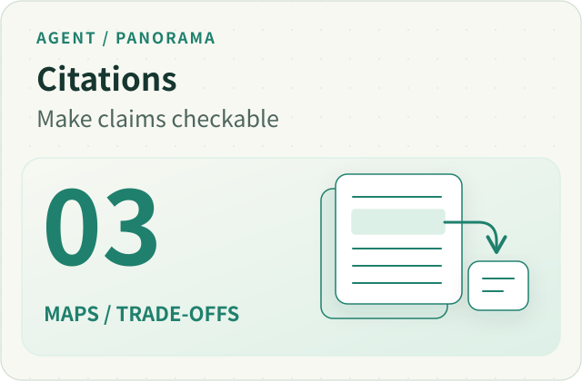
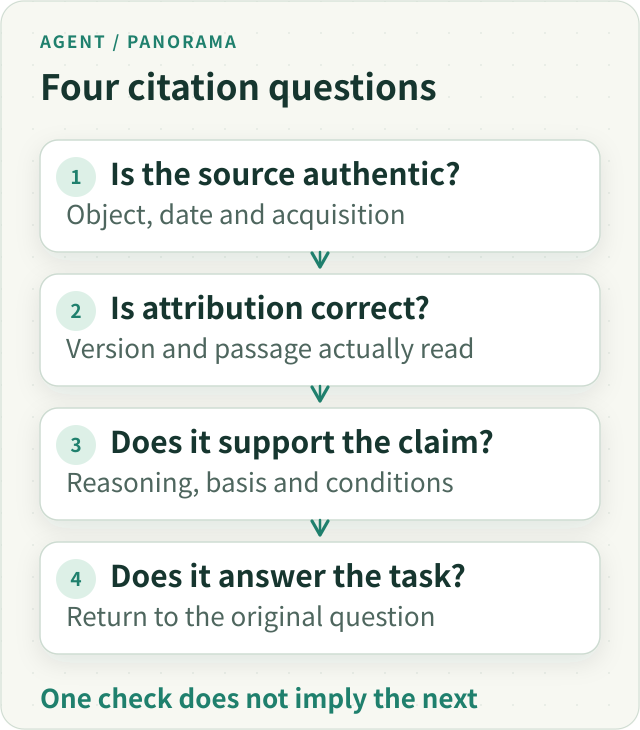
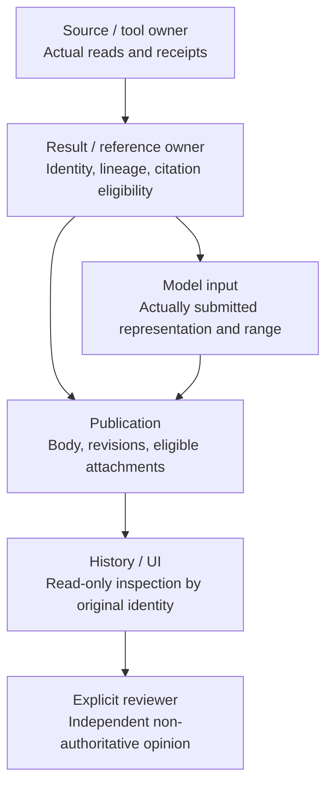
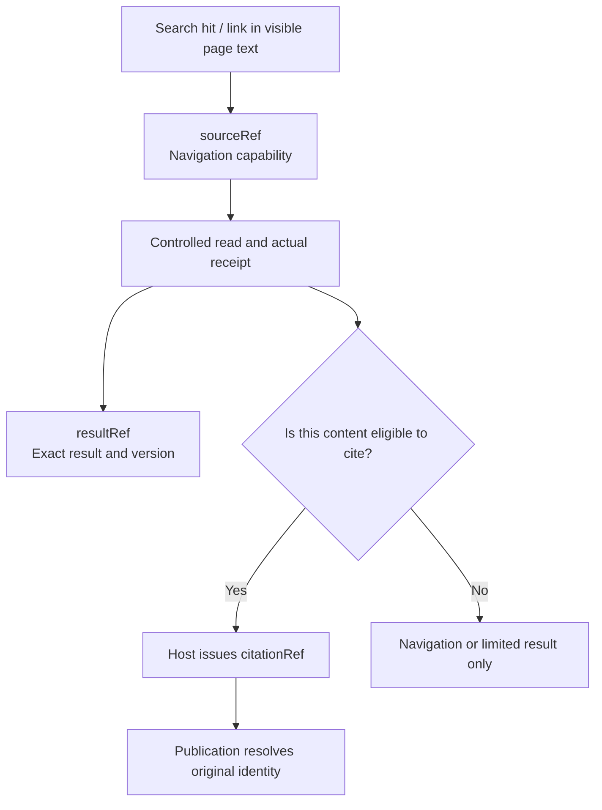
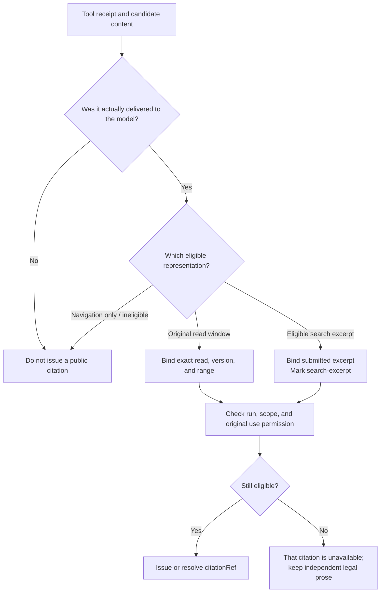
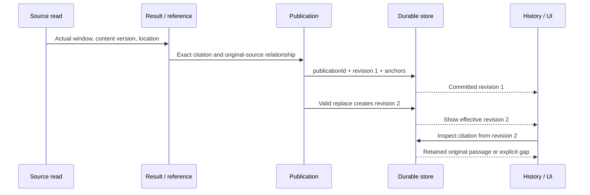
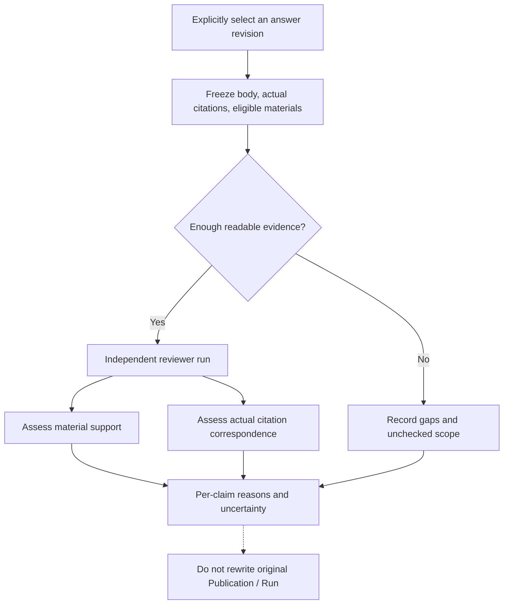

---
readingBrief:
  takeaways:
    - "Source identity, citation correspondence, material support and task relevance are separate questions. A valid reference establishes an inspection relationship, not the truth of a conclusion."
    - "The Host issues references from actual reads, submitted ranges and use eligibility. Excerpts remain excerpts; revisions and historical inspection bind original versions, not today’s webpage."
    - "Broken public attachments affect their citations while private dependencies stay protected. Independent reviewers assess support and correspondence without controlling the original publication or terminal state."
  appliesTo:
    - "Building citation issuance, revision binding, original-passage inspection and optional review, or diagnosing attribution and identity drift across the delivery path."
  notFor:
    - "Certifying answer truth through citation counts, coverage or reviewer output; live-model review accuracy and production enablement are not established here."
---
# Designing Agent Citations: From Host-Issued References to Revision-Safe Independent Review

**A citation is a route to verification, not a certificate of correctness.** A link can lead a reader to a web page without proving that an agent read that version. A valid citation handle can prove an attribution relationship without proving that the conclusion follows from the cited material.

What a research agent needs is not the largest possible number of references, but an infrastructure that answers concrete questions: **Who may issue a citation? Which exact material does it identify? Can a reader inspect it after a revision? And who decides what happens when the citation is wrong?**

This article focuses on general-purpose citation infrastructure. It comes from a real engineering progression: first, the model was expected to supply evidence IDs; then the Host began issuing eligible citation capabilities. Source-completeness signals once influenced answer grades; later, those semantic grades were removed. Finally, durable versions, original-passage inspection, and independent review required distinct responsibilities. Financial methods, portfolio calculations, and market-time semantics remain in the separate financial evidence-chain article.

## 1. Why a URL Is Not Enough to Explain a Citation

Consider a **synthetic teaching scenario**. A user asks: “Does SDK 2.4 still support `legacyLogin()`?”

The same documentation address, `docs.example.invalid/sdk/auth`, contains different statements at two points in time:

| Version originally read | What that document says | What it can support |
| --- | --- | --- |
| SDK 2.3 documentation | `legacyLogin()` still works but is deprecated | “Supported in 2.3; migrate away” |
| SDK 2.4 documentation | `legacyLogin()` was removed; use `loginWithToken()` | “Not supported in 2.4” |

Suppose the model answers, “SDK 2.4 still supports `legacyLogin()`,” and includes the genuine documentation URL. The link exists and the domain is correct. The current page might even state that the method was removed in 2.4. None of that explains the contradictory conclusion. The model may have relied on an older search excerpt, bound the wrong document version, or misunderstood a correctly read passage.

Four questions must be kept separate:

*Figure 1. These are separate verification layers; satisfying an earlier layer does not prove a later one.*

**Source identity** asks whether a particular read happened, was retained, and was eligible for use. **Citation correspondence** asks whether a marker points to that read. **Material support** asks whether the text supports the statement. **Task relevance** asks whether the response actually resolves the user's SDK 2.4 question.

The first two admit substantial deterministic verification. The latter two require understanding the content and the user's goal; neither can be replaced by a reference count or a universal Boolean. The infrastructure therefore has to narrow its authority while making its observable facts stronger.

## 2. Do Not Build a Manager That Declares Everything “Trusted”

Citations cross source acquisition, tool receipts, retained results, model inputs, publication, and historical inspection. If every consumer independently parses URLs, versions, and permissions, the rules drift. If one central manager produces `trusted=true` instead, unrelated kinds of authority collapse into a single decision.

Our eventual choice was to **unify mechanical interpretation of results and references while keeping each owner responsible for its own effects**.

*Figure 2. The arrows show consumption of facts, not a new authority over access, publication, or semantic truth.*

The division of responsibility matters:

- **The source producer** answers what actually happened: which content, range, time, and tool receipt were obtained. A URL cannot replace these facts.
- **The result and reference owner** interprets identity, derivation, representation, and existing citation eligibility consistently. It neither re-grants source access nor certifies the truth of a sentence.
- **The model-input path** records the exact window eventually delivered to the model. A full tool return, a summary, a fitted excerpt, and what the model actually saw are not automatically the same.
- **Publication** owns acceptance and disposition of the answer body, attachment binding, replacement revisions, and durable commit. A citation error does not inherently confer veto power over the whole answer.
- **History and UI** read from committed identities under the current viewer's access rules. Rendering a source card does not make the argument correct.
- **The reviewer** can identify wrong attribution or an unsupported inference, but cannot rewrite the original publication or take over the original run's execution authority.

In October 2026, result governance consolidated duplicated identity interpretation previously scattered across computation, recovery, native reads, and the publication adapter into one logical owner. This was not a new pass-through `CitationManager`. Actual implementation and consumers moved to the shared owner; consumers stopped rebuilding identical eligibility decisions from the same snapshot. Time-sensitive permissions and effect-specific checks remained with the owners that have those effects.

## 3. Why `sourceRef`, `resultRef`, and `citationRef` Are Different

Seeing three types of references in a system may suggest that they should be collapsed into a single ID. But each answers a different question.

| Reference | What it identifies | What it does not grant |
| --- | --- | --- |
| `sourceRef` | A registered source that this run may navigate or read under its current rules | Proof that its contents were read, or permission to cite them |
| `resultRef` | An exact retained result, version, selection, and receipt | Read authorization or original-source authority |
| `citationRef` | A reference issued by the Host under existing evidence-eligibility rules | Proof of semantic entailment, or automatic cross-run reuse |

*Figure 3. A result can be used for analysis or navigation while still lacking authority to appear as an external citation.*

For example, `find_in_public_source` can locate text within an already admitted source and return an opaque cursor, but does not thereby create a new evidence identity. A `run_analysis_python` result may have a `resultRef` and full input lineage, but its calculated value is not an original sentence in a web page. An artifact ID identifies another kind of generated file or output; a download receipt alone does not turn that artifact into the original source.

**Do not collapse identifier existence, object readability, and citation eligibility into one permanently valid state.** The same source in a different run, after revocation, or after a content change may require a different determination.

There are two distinct forms of sameness to resist as well: two reads can share a URL but differ in content version; two sources can have the same byte hash but different authorization. URL equality must not merge the former, and content equality must not transfer the latter's permissions.

## 4. From Model-Guessed Evidence IDs to Host-Issued Citations—and a Later Correction

In an early protocol, the model supplied internal-style `evidenceIds` when publishing. Knowing a source identifier, however, did not tell the model whether that identifier represented actual publishable evidence. It could insert a search-result ID, a partial-read navigation ID, or another observation ID and wait for the Runtime to reject it.

The September 28, 2026 Q17 diagnostic exposed that confusion. One attempt cited a search or market ID; another used a partial read that lacked publication eligibility. Both were refused. After the model used an eligible read reference, the first publication was accepted. This observation demonstrates the **protocol distinction and its rejection paths**, not the quality of the research as a whole.

The protocol then made the model use the `citationRef` supplied by the Host. The Host checks the run/scope, original evidence identity, and actual eligibility before issuing or resolving it. The model does not get to declare internal `evidenceId` values or source authority for itself.

But the September rule was not the end of the design. **On October 6, we recognized that a controlled search excerpt may itself be evidence that the user has explicitly permitted the agent to use.** If that excerpt was genuinely submitted to the model, categorically treating it as navigation-only made an unreadable full page unnecessarily block a useful, limited answer.

The revised design preserves the distinction between representations. A permitted search excerpt that actually entered the model request can receive an **excerpt-scoped citation**, explicitly marked `representation=search-excerpt`. This can support a statement about what the returned excerpt reported. It does not pretend the agent read the full original page.

*Figure 4. Eligibility follows actual receipts, model exposure, and use permissions—not the model's URL, label, or assertion that it has read something.*

An excerpt needs its own per-hit identity, timestamps, submitted content, and representation level. A URL, title, raw unsubmitted provider response, or the name of a search action is insufficient. A subsequent full-page read can supply **new, more detailed evidence**; it cannot retroactively relabel the original search excerpt as page text.

This is why neither “nothing categorized as discovery can be cited” nor “all discovery can be cited” is a sound universal rule. An action name describes what happened; **what may be cited is the actual material exposed under the applicable permission for that use.**

## 5. Why a Bad Citation Should Not Make the Entire Answer Disappear

The cost of turning references into a publication gate becomes apparent during failures. An October 6, 2026 source audit found a reachable path in which a generated answer could be rejected as a whole because of one invalid `citationRef`, a ninth citation, or an unavailable public-source attachment. The model could then spend more turns trying to repair a link before the user saw any answer.

This does not mean every body should always be displayed. The correct distinction is between **an optional inspection attachment that is broken** and **a genuinely protected content effect that must be refused**.

| Situation | Appropriate scope of action | What must not happen |
| --- | --- | --- |
| Invalid public citation syntax, foreign-run handle, or missing eligibility | Omit or qualify the affected citation attachment | Do not fabricate a valid source or erase independently permitted prose |
| More citations than the display limit | Degrade the excess while retaining eligible references that fit | Do not veto thousands of words because of the ninth citation |
| Missing original window, mismatched hash, or changed historical URL | Report that the original material cannot be inspected | Do not fetch the current page and impersonate the previous version |
| Unapproved private dependency, wrong account, or wrong scope | Refuse the protected effect | Do not remove a citation or change the model's label to launder the actual dependency |
| Replacement conflict or durable-store failure | Preserve the last valid revision and report delivery state accurately | Do not claim the uncommitted content has been saved |

The October 16 publication-governance change returned body disposition to its original Publication owner. Runtime, citation adapters, recovery, and projections provide observed facts instead of erecting another “fix the citation before finishing” gate. Source authorization, real dependencies, revision compare-and-swap, and durable commits retain their original protections.

A portable principle follows: **a broken citation does not prove the answer false, and it does not prove the answer safe.** Restrict the failing effect first; let the owner with actual authority decide what happens next.

## 6. Bind Citations to the Final Revision, Not to a Mutable Web Page

A research answer is not necessarily generated once and then frozen. Parts may be streamed, replaced in place, committed durably, and later opened through History in another process. A reference recorded only as a URL or an old string offset can quietly change meaning along this route.

*Figure 5. A replacement has its own anchors in the final body. Historical revision 1 is retained; old offsets are not copied blindly into revision 2.*

Four identities in this process must not substitute for one another.

**The source version** identifies what bytes or normalized content were read at that time. **The exact read-item ID** points to the specific passage or table item. **The parent tool-observation ID** identifies the invocation that produced it. **The `publicationId / revision`** identifies the committed answer revision that contains the reference. One parent observation may contain several read items; replacing a child item ID with the parent ID merely to simplify recovery destroys precision.

This is more than a theoretical risk. On October 21, real PostgreSQL inspection showed that JSONB object-key reordering changed a serialization-based identity for a PDF table read item. The fix retained the original reading ID and stable production DTO ordering rather than removing the hash check.

A separate browser path received a full answer over SSE, but a later empty History projection during a pending save cleared the visible body. The fix coordinated delivery and historical reads for the same run; it did not ask the model to regenerate the answer. On October 24, another integration exposed review attachments missing from live events, while a cold History read had received the parent observation ID where it needed the exact read-item ID. Both were fixed at their original production or relay seams, retaining the distinct identities.

The shared lesson: **stored in a database, delivered over SSE, and rendered as a link are three different facts from “still inspectable under its original identity after reopening.”** Verification must cross production, commit, delivery, cold read, and actual inspection, rather than only testing a citation component.

Historical recovery has a separate safety rule. A durable citation receipt can explain an earlier publication, but cannot resurrect an old `sourceRef` as a new read/find capability in another process. History uses the current viewer's access rules. A new run that wants to read again requires its own admission and live source registration.

## 7. Why We Removed Runtime's “Trustworthy Answer Grade”

An early design classified source requirements and projected terminal grades such as `grounded_answer` and `advisory_answer`. The motivation was understandable: a long research run needs to distinguish required materials from supporting or optional ones.

A real diagnostic provided a sharp counterexample. Across four research runs and 57 source reads, **all 57 of 57 were marked required**. We reminded the model that its classifications would affect the final grade, but the distribution did not meaningfully improve. A model-authored requirement label was not a reliable source of authoritative terminal truth.

Yet even perfectly classified materials would have shown only how the research was organized. They would not prove that the model understood the correct SDK version, used a sound comparison method, or answered the question. Replacing a “source completeness” score with “citation coverage” would have reproduced the same mistake: attaching valid citations to a wrong conclusion does not make that conclusion true.

The October 1 cleanup therefore removed these Runtime-owned authoritative semantic grades, while preserving the facts the system can actually verify: model requests, Host reads, exact citation bindings, permissions, budgets, durable receipts, and the identities of accepted answer revisions.

**The stronger a mechanical fact becomes, the more carefully its claimed meaning must be bounded.** A valid `citationRef` says that a relationship exists. Whether the cited material supports the claim remains a question for a reader or an independent evaluator with the necessary context.

## 8. An Independent Reviewer Checks Two Things, but Does Not Own Publication

Asking another model “Are the citations correct?” sounds simple. In practice, the task must be divided into at least two judgments.

Consider the synthetic SDK example again. The answer correctly states that SDK 2.4 removed `legacyLogin()`, but it cites the SDK 2.3 document. The reviewer may also receive the SDK 2.4 document as additional material. It should report: **the material set supports the claim, but the reference actually attached to the claim is wrong**. The existence of support elsewhere cannot retroactively fix the cited relationship.

*Figure 6. Review is a separate bounded operation, not an automatic final gate before publishing the original research.*

Our on-demand review entry first fixes the answer, actual citation mapping, supplemental materials, representation levels, source versions, and known gaps into a review package. A separate model then returns its opinions. It does not rerun the research, search for more evidence on the user's behalf, read arbitrary private paths from the input package, or inherit the original run's permissions or request budget.

The output distinguishes “supported,” “contradicted,” “insufficient evidence,” and “unable to assess,” while also locating the claim, actual citation, supporting passage, and reasoning. Fabricated quotations, ambiguous locations, truncated responses, and uncertain dispatch are kept as uncheckable or unchecked—not converted into “no issues found” or a universal trust score.

The independent JSON/Markdown reports, default-off behavior, and separate resource receipts received bounded offline and PostgreSQL verification. **That does not establish live-model review accuracy, false-positive rates, or production enablement.** The reviewer's result is an inspectable advisory opinion, never an automatic correction or invisible veto over the original answer.

## 9. How to Verify the Architecture Without Trusting a Diagram

Useful verification starts from failure modes and tests specific invariants, not from the number of references in an answer.

1. **Identities cannot be laundered.** Same URL but different versions, same figure from different origins, foreign run/scope, and invalid hashes must not merge into a plausible-looking citation.
2. **Exposure cannot be invented.** If the model received an excerpt, the system can only claim that representation. Unread PDF pages, unsubmitted content, and parent observations cannot impersonate exact read items.
3. **Failure stays local.** Broken public attachments become explicitly unavailable while independent permitted prose survives. Private dependencies, revision conflicts, and account isolation still deny the effects they actually protect.
4. **Versions survive real readback.** Publication, replacement, live stream, PostgreSQL commit, fresh-process History, and browser inspection must agree on the original citation/revision relationship. “Saved” and “seen live” are separately observed.
5. **Review cannot take authority.** Disabled review adds no model requests. Enabled review only consumes fixed eligible inputs, retains unknown outcomes after timeouts, and leaves the original Publication, budget, and terminal state unchanged.

These invariants have bounded implementation and contract evidence across result ownership, original passage inspection, reviewable conclusions, and on-demand evaluation, including isolated database and browser paths. They show **how the mechanisms preserve identity, authorization, and delivery**. They do not establish that a live model consistently interprets documents correctly, or that external sources will remain available indefinitely.

We deliberately did not build another global “trusted-evidence database,” nor promote the reviewer into a terminal authority. The smaller authority of each mechanism makes its verifiable claims more defensible.

## 10. Conclusion: What a Citation System Should—and Should Not—Prove

A reusable citation system begins by naming its objects clearly: navigation clues, exact source-read windows, search excerpts, derived results, and committed historical references each provide different capabilities.

It then names the decision owner: the Host and result/reference owner verify identity and eligibility; Publication owns the answer body and revisions; History preserves inspectable original relationships; the reviewer provides independent opinions. The parts cooperate without impersonating one another.

Finally, it deals honestly with failure: **a bad citation must not generate invented evidence; missing historical details must not become today's web page; an uncertain reviewer must not turn into a pass; and independently permitted prose must not vanish merely because an auxiliary attachment is broken.**

Returning to the SDK 2.4 question, the reader needs neither nine decorative footnotes nor a universal confidence badge. The useful outcome is access to **the version that was actually read at the time**, a clear relationship between that text and the claim that the method was removed, and an honest account of what was not checked.

**Citations make a judgment reviewable. Only the subsequent review can address how much confidence that judgment deserves.**

### Further Reading

[The Trustworthy Evidence Chain for Financial Agents (Chinese original)](../../articles/financial-agent-trustworthy-evidence-chain.md) addresses a different layer: maintaining reproducible business reasoning across financial data conventions, calculations, delegated agents, and delivery. It does not replace this article's general citation issuance and inspection mechanism.

[Chinese original](/articles/ai-citations-do-not-prove-reliability) · [Panorama series](/en/panorama) · [ETF Agent Engineering Notes](https://github.com/hpoenixf/eff-agent-article).

If you find an instructive counterexample, please share it through [GitHub Issues](https://github.com/hpoenixf/eff-agent-article/issues). If these engineering retrospectives are useful, a Star on the article repository is appreciated.
