# Designing Agent Citations: From Host-Issued References to Revision-Safe Independent Review

An agent answers that a fund charges a certain fee and includes a real URL. The link is not fabricated—yet it may describe a different share class, another disclosure date or a search result that never entered the model's actual input. Even stranger, the original material may have been saved but the citation becomes unreadable after a restart. At the other extreme, one bad reference once threatened to block an otherwise authorized answer in its entirety.

**The interesting problem is not how to append URLs to sentences. It is how to ensure that a citation refers to the specific, permitted, versioned material actually exposed to the model—through context fitting, result externalization, publication revisions and historical recovery.**

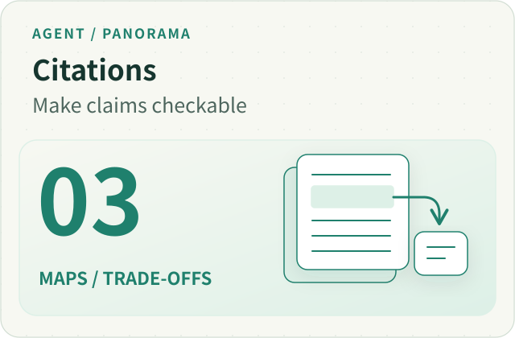

## 1. Surprise One: A Correct URL Can Still Be the Wrong Citation

Consider a synthetic software-documentation example: the same URL says an interface remains available in version 2.3, then says it was removed in version 2.4. A model claiming “2.4 still supports it” might cite the perfectly correct address. That address does not establish **which version was read, which passage was submitted, or whether the passage supports the claim**.

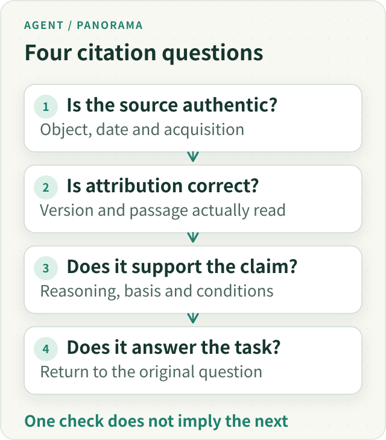

We therefore separate four questions: **source identity**, **citation-to-source correspondence**, **support for the actual claim**, and **relevance to the user's task**. Deterministic software can do much of the first two. The latter two still require domain rules, reproducible calculations or a bounded independent reviewer.

## 2. Do Not Give a Universal Citation Manager the Power to Declare an Answer Trustworthy

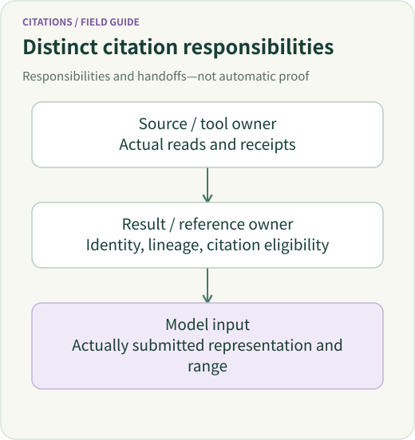
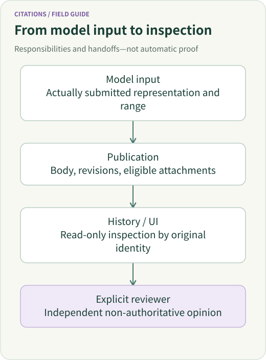
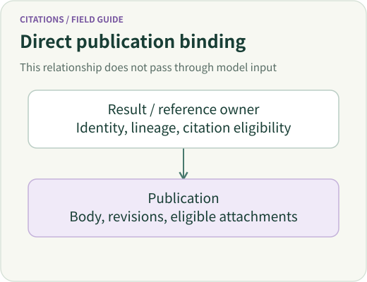

We did not introduce an all-knowing “trusted answer” authority. The Host records controlled sources and what was actually submitted to a Run. Original Source/Result owners retain scope, version and authorized rereading. Publication owns revisions and eligible citation attachments. An optional reviewer may dispute correspondence and sufficiency; it does not rewrite executed tools or own the answer's publication.

Three identities serve different purposes:

| Identity | What it names | What it does not imply |
| --- | --- | --- |
| `sourceRef` | Original source and its version/scope | The model has read its whole contents |
| `resultRef` | An authorized tool result and a rereadable selection | The later model request actually included it |
| `citationRef` | A scoped, Host-issued reference handle | The assertion has been independently verified |

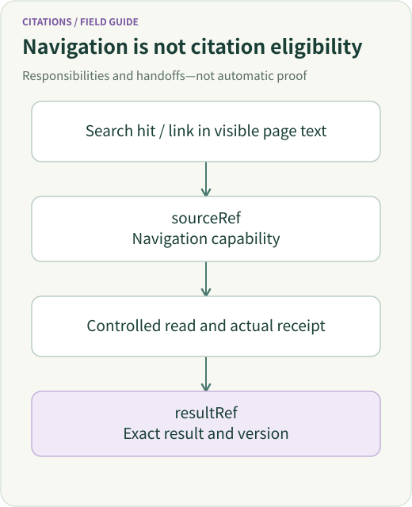
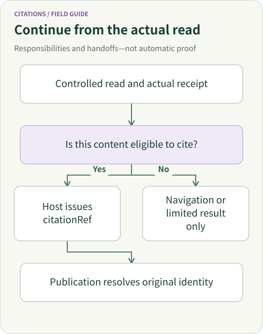

## 3. Surprise Two: A Search Result Existed, but the Model Never Saw It

An early design asked the model to provide internal `evidenceIds` when publishing. It could guess a search hit number or a partial-read ID, but could not establish that either was eligible for the particular answer. We moved to Host-issued `citationRef` handles while making an important distinction: **a permitted search excerpt may be cited as an excerpt; it may not impersonate a full-page read**.

Result externalization created a less obvious handoff. A search returns excerpts A, B and C; candidates are placed in the controlled result store; the model later selects B. Neither “B existed in search” nor “B was read from storage” proves it was included in the **final fitted model request**. Capacity fitting or a hook might remove it, or the selected field projection might omit the citation identity.

The current rule activates an excerpt-scoped reference only when **the exact complete selection joins to the original Host binding from the same receipt**, and **the actual final model request contains both the excerpt and its corresponding reference identity**. A shared URL, a copied candidate from another Run or a model-supplied ID cannot create that historical fact.

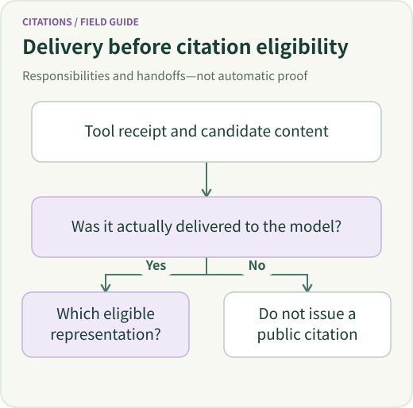
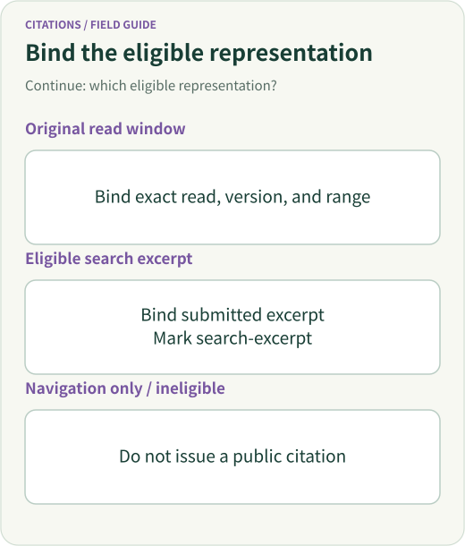
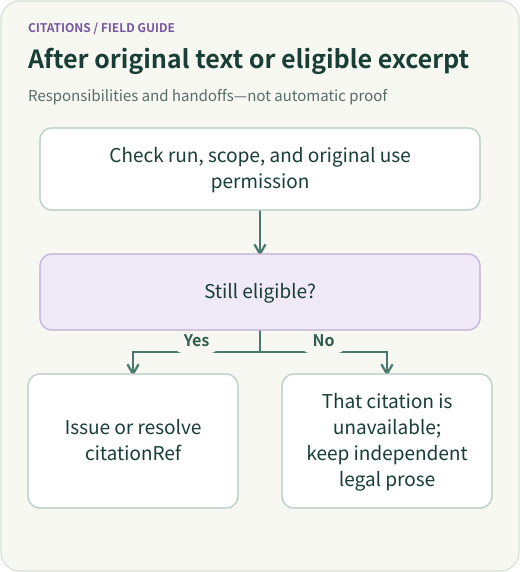

This does not require fetching a full page for every answer. When the excerpt can support a narrowly qualified statement, retain its `search-excerpt` representation. When a number, rule or date requires more detail, read the page through the existing authorized path. **The action's name and URL do not define evidence granularity; the representation actually submitted does.**

## 4. Surprise Three: The Source Was Persisted but the Historical Citation Would Not Open

Publication history, citation attachments and the live tool panel have different lifecycles. We encountered a citation displaying only “Structured source” because financial JSON was carried in an MCP text block while the display projection lost provider and instrument metadata. In another case, PostgreSQL's JSONB key reordering changed a serialization hash, causing the original read-item identity to fail validation after reopening.

Adding another UI hyperlink would not solve either failure. The stable path must carry **original producer → actual exposure → publication revision → historical readback** identities. Serialization must follow the original producer's stable DTO conventions; recovery cannot invent a new identifier from a reordered object. Two reads of the same URL remain two separately versioned material observations.

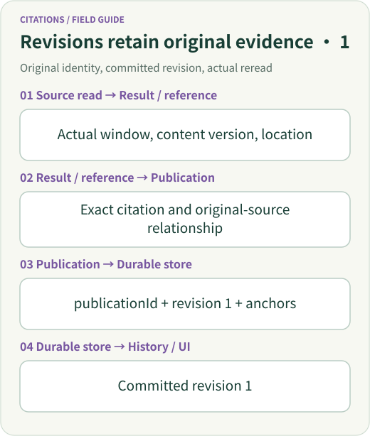
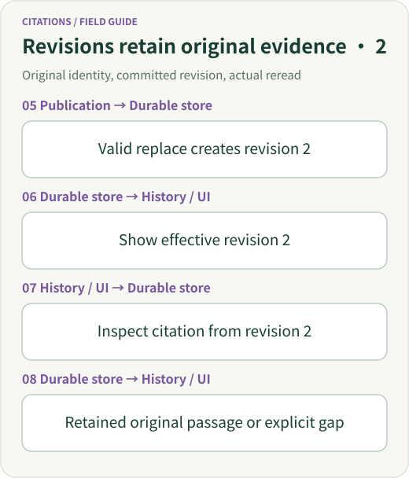

The resulting detail view uses the original Publication revision and original Source/Result version. A page's current content never silently replaces an unavailable historical excerpt. Opening a citation does not require rerunning the model or recreating the original tool call.

## 5. Why One Bad Citation Must Not Swallow an Independently Authorized Answer

An earlier rule gave citation eligibility too much power over publication. One invalid public `citationRef`, a ninth reference beyond a display limit or a missing optional public-source attachment could reject **thousands of words of otherwise legitimate text** and make the model spend another turn trying to fix a link.

We removed that external “repair every citation before publishing” veto and scoped each failure:

- **Invalid optional public citation:** omit or mark the attachment; retain independently authorized prose.
- **Genuinely unauthorized private dependency:** reject the protected effect. Removing the citation must not launder the underlying scope violation.
- **Conflicting publication revision or failed persistence:** Publication preserves the last committed version and reports the actual result.
- **Historical source unavailable:** History says the original material cannot currently be inspected; it never fetches today's URL to impersonate that old source.

This is stricter, not more permissive: optional display faults cannot veto unrelated text, while real permission failures remain binding.

## 6. The Industry Baseline and Why We Chose a Host-Bound Contract

[LlamaIndex's CitationQueryEngine](https://developers.llamaindex.ai/python/framework-api-reference/query_engine/citation/) constructs citation-bearing source nodes and lets developers control citation chunk granularity, which is useful for ordinary RAG question answering. Common retrieval pipelines also return source nodes or document URLs as references. They help users **locate relevant material**.

Our long-running system also needs to answer what was submitted *at a particular time*, under which grant, after fitting and selection, and how that identity survives answer revisions and recovery. Generic retrieval and citation machinery does not remove the need for these application contracts.

We therefore place deterministically checkable citation eligibility at the Host's original receipt and **actual model input exposure**, while leaving semantic support to separate review. A Host-issued handle is not proof that the model reasoned correctly, but it is an inspectable link to the representation the model was entitled to use.

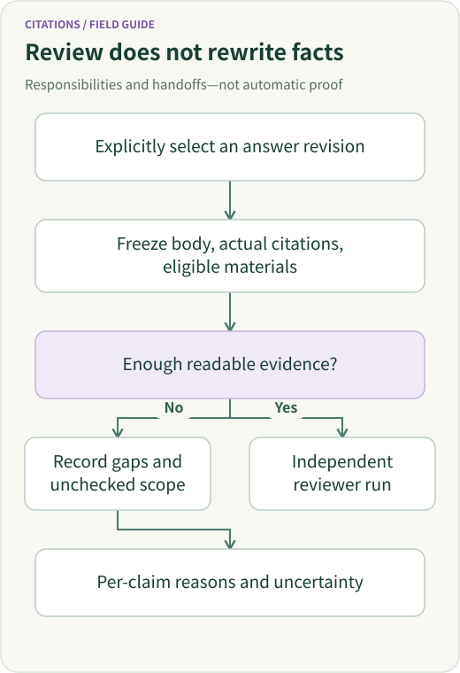
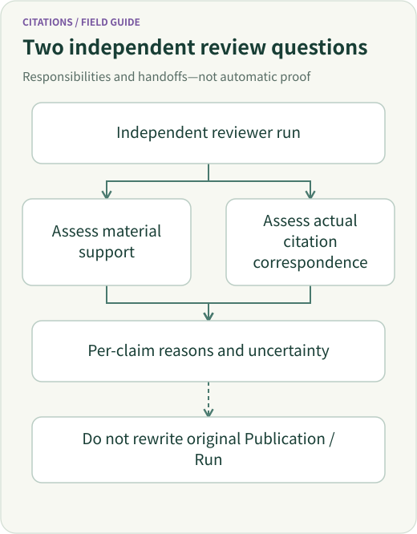

## 7. Where to Look Next Time a Citation Feels Wrong

First identify **the exact original source version and read result**. Then check whether the selected passage and reference identity were both included in the later model request. Next find the committed answer revision. Only then ask whether the cited material actually supports the assertion. A failure at any one step should be attributed to that source, attachment or argument; it should not create authority in another layer.

**A good citation system enables precise investigation and lets valid work continue. It does not stamp every answer “trustworthy.”**

Related reading: [Financial Agent Trustworthy Evidence Chain (Chinese original)](/articles/financial-agent-trustworthy-evidence-chain) covers financial dates, arithmetic and cross-agent evidence lineage; [Agent Evaluation](honest-agent-evaluation.md) discusses how to judge source support. More essays are available in [ETF Agent Engineering Notes](https://github.com/hpoenixf/eff-agent-article).