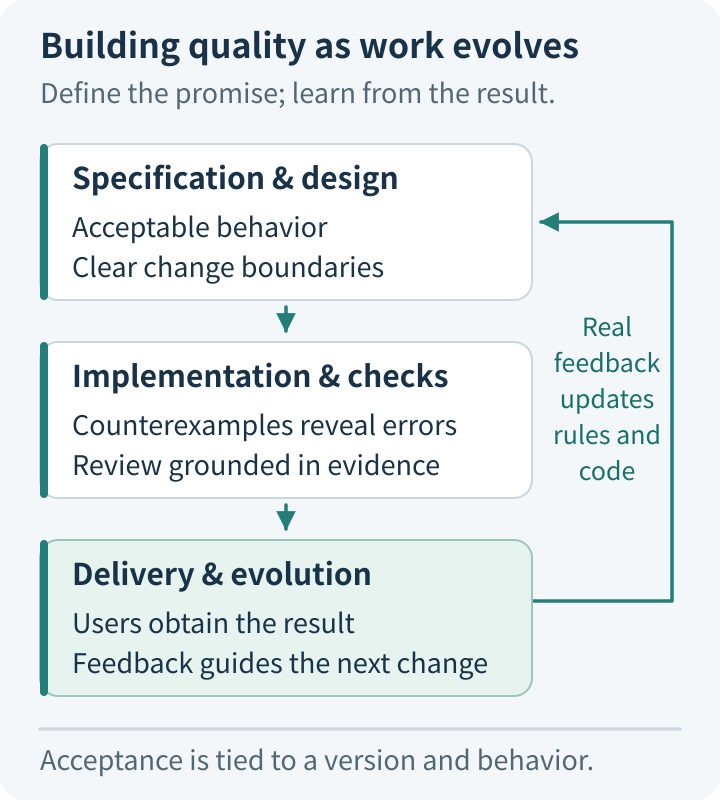
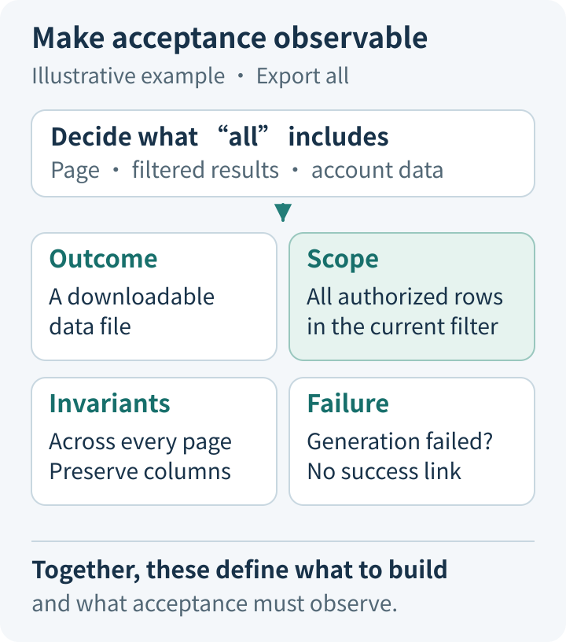
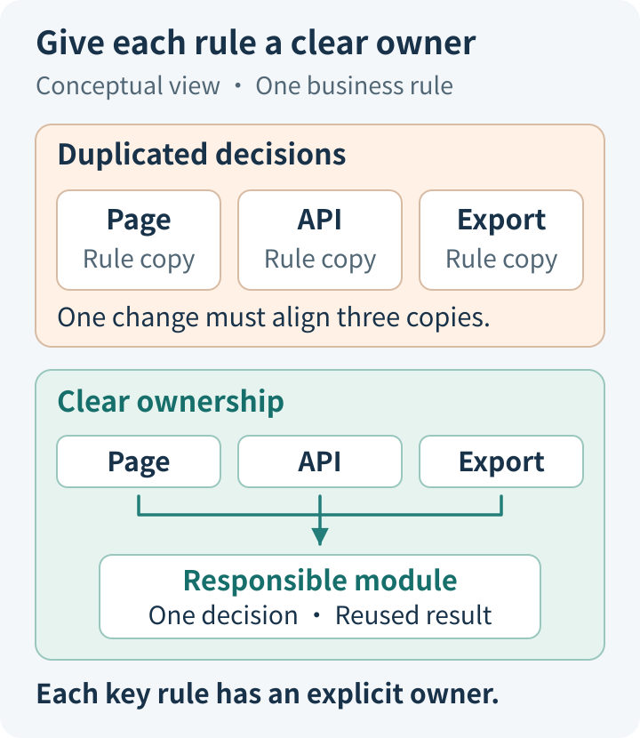
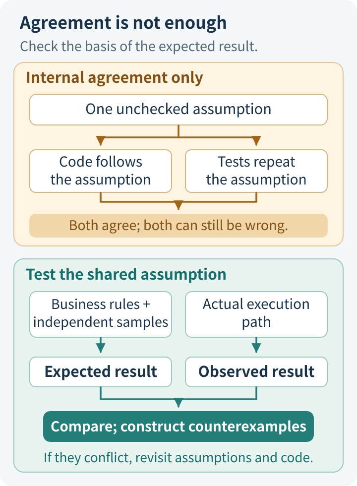
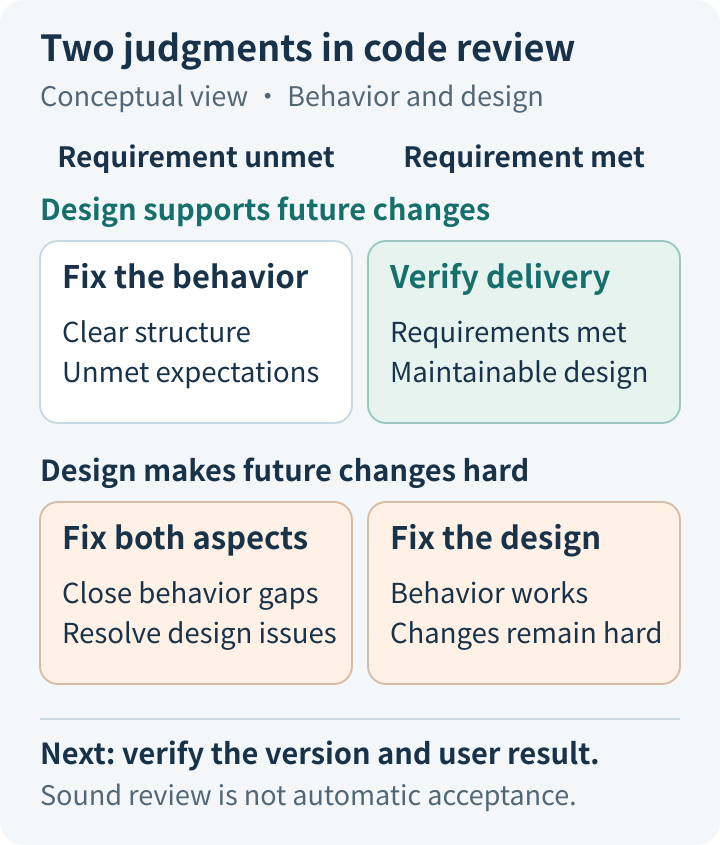
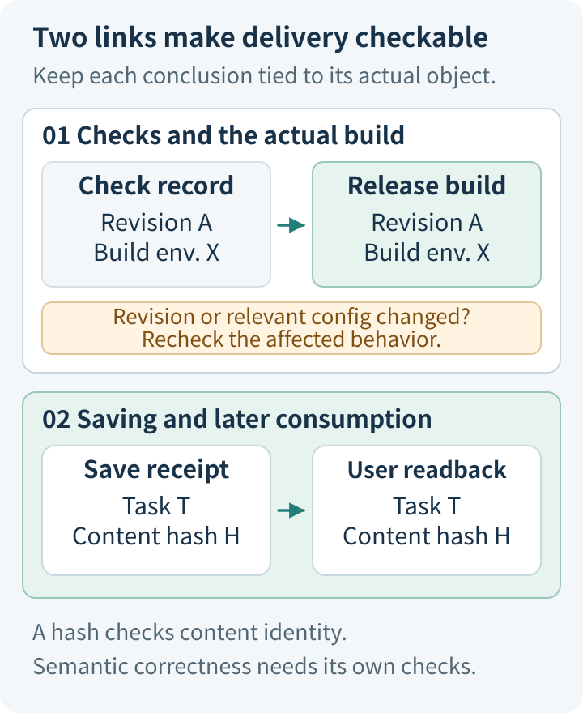
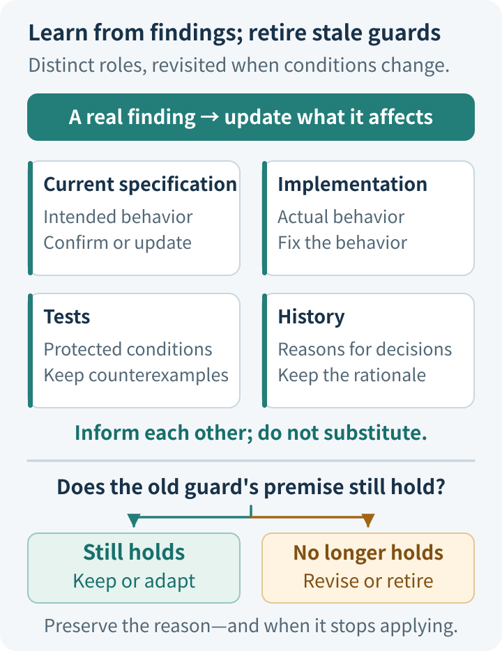

# AI Coding Quality Panorama: Taking Responsibility for the Whole Project When AI Writes Most of the Code

When AI can write the implementation, add tests, and update documentation, a project can quickly look complete. Yet all three outputs may inherit the same misunderstanding: treating the current page as the entire dataset, treating an unknown value as zero, or treating the end of a task as successful delivery.

Judging quality therefore requires three questions to be answered together: **Is the promised behavior clear? Can the existing checks detect important mistakes? Will the system still be understandable and correctable when it changes again?**

This extends an engineer's attention from a piece of code to the whole development process. Requirements define what is acceptable. Architecture determines how a change fits into the system. Tests and review provide grounds for judgment. Actual delivery checks whether those grounds carry through to the user's result. Feedback from operation informs the next round of work.

This article follows those relationships. Our Agent Engineering Suite and Open ETF Agent, alongside industry approaches to specifications, testing, and review, serve as concrete references where they help explain the argument. The central question remains: **Why do we have reason to accept this change, and can we re-examine those reasons when the conditions change?**

## 1. Define what is acceptable before judging whether the implementation is correct

Business meaning separates “the code runs” from “the feature meets the requirement.”

Suppose a page needs an “Export all results” feature. Does “all” mean the current page, the results matching the current filters, or every record the account is authorized to access? If the data continues to change after the user clicks, which point in time should the export reflect? If some content is unavailable, should the whole operation fail, or should it deliver the portions that remain valid on their own?

These choices affect both implementation and tests. Without an explicit decision, AI can still produce internally consistent code and assertions that agree with it. The team then has difficulty distinguishing an implementation omission from a change in requirements.

**A contract gives people something concrete to discuss before important disagreements become code.**

### Express the goal as observable behavior

A useful contract need not be long. It should establish the input scope, the expected result, the conditions that must remain true, and the behavior on failure.

For example, an export requirement might say: include every authorized record matching the current filters, regardless of pagination; preserve the existing column definitions; and do not display a successful download link if generation fails. These statements already support several concrete judgments. “Improve export capabilities” does not.

Failure boundaries deserve particular attention. Does a missing optional attachment invalidate the main text? Can an external request be retried after a timeout? What happens to side effects that have already occurred when the user cancels? There is no universal answer independent of the business. The important point is to place each decision with the people and modules that can take responsibility for it.

Once AI participates in implementation, the contract serves another purpose: it helps an engineer see whether a change implements the goal or quietly changes the goal to accommodate the current code.

### Specifications preserve decisions, but decisions still need factual grounds

[GitHub Spec Kit](https://github.github.io/spec-kit/reference/agentic-sdd.html) provides a useful division of work: the Spec describes user behavior and goals, the Plan addresses the technical approach and constraints, and Tasks organize execution. It also checks for conflicts and omissions across those materials. This structure preserves the intermediate decisions between intent and implementation. Whether the original requirement makes sense still has to be established from business facts.

In [Agent Engineering Suite](https://github.com/hpoenixf/agent-engineering-suite), we use the Grilling and Spec workflows for a similar purpose: identify ambiguities that affect scope, compatibility, and delivery, then turn the decisions into verifiable tasks. These workflows guide how an agent organizes its work; they cannot decide the business answers for the team. See the [Spec workflow](https://github.com/hpoenixf/agent-engineering-suite/blob/89c272c22c19f79582fde01eb25859547b6ac3ff/skills/aes-spec-flow/SKILL.md).

The investment should remain proportionate. A few clear conditions in an existing issue may be enough for a simple copy or styling change. Behavior spanning several modules, external side effects, or long-term compatibility changes are stronger reasons to preserve a full specification and design decisions. Documentation is valuable to the extent that it removes important ambiguity.

## 2. Keep changes understandable so that quality checks remain affordable

Once the contract is clear, quality work does not automatically become a matter of running more tests. We still need to establish where the behavior belongs and which boundaries the change crosses.

If the same business rule appears in a page, an API, a background task, and an exporter, changing it requires understanding several places at once. Missing one location may not produce an immediate exception, but it can make the entry points behave differently.

This structure also affects testing. As tests require more elaborate setup and diagnosing a failure requires more context from across the repository, teams become more likely to run only the cheapest subset. **Maintainability affects our future ability to detect mistakes, making it part of quality itself.**

### Give important decisions a clear home

Dividing responsibilities starts with a question: who has the authority to make the final judgment about a particular fact?

For example, a page can display that a task has been canceled, but stopping the backend from continuing to publish results depends on the logic that actually controls execution and publication. A caller can submit query conditions, while the records it is allowed to access must be determined within the relevant authorization boundary.

A good interface hides internal coordination while preserving meaningful outcomes. Accepted, executed successfully, result unavailable, and status unknown may each require a different response from the caller. Collapsing them into a single `success` leaves the caller to guess at distinctions it needs.

This does not require immediately adopting microservices, adding managers, or rebuilding a platform. Bringing related responsibilities together inside an existing module may already reduce duplicated state. A new mechanism has a sound justification when the existing boundary cannot support the real requirement.

A public Open ETF Agent proposal illustrates this tradeoff. Selected values from source material are used in a calculation and then in a report and CSV, while the design continues to use the existing responsibilities for results, tool execution, and file delivery. It does not introduce a separate results store for this feature. The [published design](https://github.com/hpoenixf/open-etf-agent/blob/afbfb9865539c18c9358ac65c822f929aaa6e872/openspec/changes/result-reference-consumption/proposal.md) gives source provenance and comparison conditions a common place to be checked, allowing downstream consumers to reuse the same determination.

### Organize a change around one complete behavior, and make constraints enforceable

A “small change” should concern a behavior change that can be explained, verified, and reversed. It may span several files, but it should not also absorb unrelated dependency upgrades, directory rearrangements, or general-purpose abstractions. Reviewers can then connect each part of the change to the same purpose.

Context should follow these boundaries too. Help AI find the current contract, relevant implementation, actual entry points, and verification methods. When a special branch needs explaining, consult the reason for it in the history. Feeding all old material into the context at once can make current requirements harder to identify.

OpenAI describes a useful practice in [Harness engineering](https://openai.com/index/harness-engineering/): keep the repository's entry document short and point to detailed knowledge, while using custom lints and structural tests to enforce architectural rules such as dependency direction. Some design requirements can then be checked mechanically, and failure feedback can help an agent find the appropriate correction.

The transferable mechanism is to turn recurring, well-defined constraints into automated checks over time. Architecture itself still requires judgment. Teams need not copy another team's layers, nor turn every stylistic preference into a rule that blocks development.

## 3. Give checks a chance to expose mistakes, beyond confirming that the code runs

With the contract and structure in place, the next question is whether the implementation fulfills them.

A passing test means that no contradiction was found among the current inputs, execution path, and assertions. If the expected result was derived from an incorrect implementation, the test can be very stable without providing a new basis for judgment.

For example, the code under test might convert an unknown amount to zero, while the test calls the same conversion function to construct its expectation. Or the implementation exports only the current page, and the test also obtains its “expected records” from that page. Such checks can establish internal consistency without examining the original business interpretation.

**An informative check should let us explain where it would fail if the implementation went wrong in an important way.**

### Derive expectations separately from execution results

Independent expectations can come from explicit business rules, small examples that can be checked by hand, a trusted reference implementation, or invariants that do not depend on the current implementation.

For example, an export can check that the record identities match the intended set, not merely that the totals are equal. A sort can check both ordering and preservation of elements. Monetary calculations need explicit currency, precision, and rounding rules. The expectation need not be complicated; it must constrain the implementation rather than restate it.

Our [Open ETF Agent row-selection test](https://github.com/hpoenixf/open-etf-agent/blob/afbfb9865539c18c9358ac65c822f929aaa6e872/test/result-consumption.test.mjs) uses a small synthetic table containing 100, 999, and 250, with a requirement to compare the first and third rows. If the current read window contains only the first two rows, the comparison must be rejected even when that window was returned in full. It must not substitute 999 for 250. This counterexample checks whether the operands actually entered the selection; an assertion that “the read succeeded” would miss the essential condition.

The independence comes from the grounds for judgment, not simply from starting another agent. Different reviewers given the same incorrect summary can still repeat the same misunderstanding.

### Use counterexamples to learn more from each check

Counterexamples can be derived by considering the opposite of the goal: under what conditions could the system appear successful while violating the contract?

Common cases include missing records at the end of a result set, duplicate submissions, the wrong currency, an outdated version, and different arrival orders for cancellation and completion. Event order is also an input. When correctness depends on ordering, testing a single successful sequence is insufficient.

Industry tools can broaden these checks, but they address different questions.

With [fast-check](https://fast-check.dev/docs/introduction/why-property-based/), the author first states a property that a class of inputs should satisfy. The tool then generates many inputs. When it finds a failure, it shrinks the case to make it easier to understand and provides information for replaying it. This can explore combinations missed by hand-picked examples. Engineers still have to choose the properties and input ranges.

[Stryker](https://stryker-mutator.io/docs/) makes small mutations to an implementation and runs the existing tests to see whether they detect the changes. It asks directly: “If this piece of logic were broken, would the tests still pass?” That adds information beyond code coverage. Some mutations do not change observable behavior and need analysis, so a surviving mutant is not automatically a defect. See the explanation of [equivalent mutants](https://stryker-mutator.io/docs/mutation-testing-elements/equivalent-mutants/).

These tools need not be applied to every part of a codebase. They are more valuable for critical rules, complex state changes, or modules that still let mistakes through despite high coverage. For ordinary low-risk changes, clear examples and targeted checks are often sufficient.

### Check whether the result reaches its actual consumer

Correct functions do not guarantee correct behavior when combined. A calculation may have been written to storage without entering the next model request. A page may report a successful save while its download link still returns an older file.

Verification should therefore continue through the important handoffs. Check both what the producer emits and what the next consumer actually uses. Appropriate simulation can isolate a problem, but a simulated success does not establish that the real external system completed the operation.

This also distinguishes two kinds of work. When AI helps build ordinary software, verification can focus primarily on well-defined product behavior. When the product itself uses a model at runtime, we must also examine how it selects material, constructs its argument, and handles unknowns. A correct engineering path and a semantically correct answer each need suitable evidence.

## 4. Review the implementation—and the grounds for trusting it

Automated checks work well for rules that have already been expressed clearly. Review must also address other questions: do the rules omit important conditions, do the current tests actually cover the promises, and does this design make future changes harder?

Reviewers therefore need access to the original requirements, the actual changes, and relevant execution results. Reading only the implementer's list of completed work makes it easy to inherit the same choices and explanations. Fixing a comparison base and including the actual scope of changes makes it possible to know what was reviewed.

### Assess requirements and engineering quality separately

The requirements assessment concerns promises to users: has anything been omitted, implemented incorrectly, or added beyond the agreed scope? Are important failure conditions handled? The engineering assessment concerns the system itself: responsibilities, complexity, dependencies, duplicated state, and the difficulty of future maintenance.

Neither assessment can replace the other. Tidy code can omit a business condition. A feature that works in a demonstration can depend on special cases that are difficult to change further.

[Google's code review guidance](https://google.github.io/eng-practices/review/reviewer/looking-for.html) addresses functionality, design, complexity, tests, and documentation. Its [review standard](https://google.github.io/eng-practices/review/reviewer/standard.html) also calls for improving overall code health while allowing beneficial changes to keep moving. This balance matters: review should protect the future without delaying progress indefinitely over personal preferences or local imperfections.

In Suite's [two-axis review method](https://github.com/hpoenixf/agent-engineering-suite/blob/89c272c22c19f79582fde01eb25859547b6ac3ff/skills/aes-code-review/SKILL.md), we keep separate conclusions for engineering standards and requirements implementation. Findings need a specific location, triggering conditions, and supporting grounds. The method organizes review; whether a review finds valuable issues still depends on the judgment exercised.

### Pay particular attention to changes in tests and failure boundaries

AI can readily change the implementation and its tests together. “Everything passes now” therefore invites another question: why did it fail before? Did the fix preserve the contract, or did it change the assertion to match the current implementation?

Tests can change, but the reason should be explicit. When the business contract formally changes, old assertions need updating. Removing an essential condition merely to make a candidate implementation pass removes the protection it provided.

Review also needs to seek failure boundaries absent from the existing tests. A [public development record](https://github.com/hpoenixf/open-etf-agent/blob/afbfb9865539c18c9358ac65c822f929aaa6e872/openspec/changes/result-reference-consumption/evidence.md) from Open ETF Agent illustrates this value. After the relevant happy-path checks passed, a later review still found that invalid references for optional calculations or attachments could fail the entire run, preventing delivery even of independently valid main text. The fix confined these failures to the affected parts being unavailable while preserving delivery of the independent text.

The finding mattered because it identified a condition the existing checks had missed and explained why that condition violated the task contract. It also shows why more reviewers add information only when they contribute new grounds, perspectives, or counterexamples.

A review should be able to end once the necessary fixes are complete. Formatting, naming, and similar matters already covered by reliable tools need not repeatedly consume human attention. Substantiated functional errors and important design problems take priority; ordinary suggestions can wait for a suitable later improvement.

## 5. Tie completion to the user's result from the same version

Even after design, implementation, testing, and review, the correspondence can be lost at the final step.

The code changes after tests run. Local verification uses one set of dependencies while the release build uses another. A background task finishes, but the user downloads a previous file. The earlier checks may have been entirely real; they simply did not examine what was ultimately delivered.

A completion decision must therefore establish two things: **the version checked is the version being accepted, and the result the user obtains belongs to this task.**

### Preserve the conditions under which a check's conclusion holds

A “tests passed” message should be traceable to a specific code version, runtime environment, input conditions, and actual output. The record need not be elaborate. If existing CI, build metadata, and pull requests already express this, keep using them.

The essential point is not to quietly relabel an old result as new verification. One version passing does not automatically establish that later changes pass too. A configuration change that directly affects behavior may also require the corresponding checks to be repeated.

Suite's [evidence tools](https://github.com/hpoenixf/agent-engineering-suite/blob/89c272c22c19f79582fde01eb25859547b6ac3ff/skills/aes-spec-flow/toolkit/docs/evidence-format.md) do a limited but explicit job here: check structural relationships among tasks, observation records, and referenced artifacts; check that summary views agree with their inputs; and retain the original version associated with historical completion records. They do not run the tests or treat a correct record format as correct business behavior.

This division applies to other tools too. Programs are well suited to maintaining definite correspondences. Whether the checks are sufficient and the remaining risk acceptable still requires project judgment. Compressing every conclusion into a single green status hides these distinctions.

### Verify delivery through the way users consume it

For a page feature, acceptance should reach the actual page interaction and result. For a reporting task, it should at least reach the report content and attachments. For an asynchronous task, it should also check whether a later query can retrieve the original result.

[Playwright's best practices](https://playwright.dev/docs/best-practices) emphasize user-visible behavior, user-facing locators, and test isolation. These practices bring frontend checks closer to the path users actually take. The assertions still need to represent the business outcome: the appearance of a button or a successful request does not necessarily mean the business operation has completed.

Open ETF Agent's [delivery checks](https://github.com/hpoenixf/open-etf-agent/blob/afbfb9865539c18c9358ac65c822f929aaa6e872/test/result-consumption-cli.test.mjs) use another concrete technique. After the generating process exits, a separate process retrieves the report and CSV through the existing read interface and checks that they refer to the same calculation and original source. Compared with obtaining a successful result in memory, this also checks the handoff between persistence and later consumption.

Content identity has limits too. Matching the hash of the retrieved content to the persistence receipt can establish that the retrieved content corresponds to what was saved. It cannot establish that every statement in a report is correct. Data selection, calculation, and semantic checks each still serve their own purpose.

After release, verification also needs to connect to monitoring and recovery. Observations should cover the outcomes promised by the change. A staged rollout needs to exercise the conditions that changed. Beyond rolling back software, consider how to correct data already written or content already sent. The necessary investment depends on the actual side effects; every small change does not need a full release platform.

## 6. Let findings improve the next change, and retire safeguards that no longer apply

If a fix survives only in a chat transcript, the next agent may not know why a branch exists, which mistake a rule once prevented, or which old approach has been retired.

Quality therefore also depends on how knowledge is preserved and updated. Specifications, code, tests, and history all matter, but they answer different questions.

| Material | Main question it answers |
| --- | --- |
| Current contract | How should the system behave now? |
| Implementation | How does it currently carry out that behavior? |
| Tests | Which conditions and counterexamples currently protect it? |
| Historical records | Why was this approach chosen, and which old assumptions no longer hold? |

These four sources need to be checked against one another, but none can replace the others. A behavior existing in the code does not by itself make it a business promise. A limitation appearing in a historical record does not mean it remains valid forever.

### Preserve the reasons and update the current account

A real finding usually leads to several different changes: implementation fixes the error, tests retain a useful counterexample, current documentation explains how the system works now, and history explains the origins of important tradeoffs.

We address these activities through Suite's [History](https://github.com/hpoenixf/agent-engineering-suite/blob/89c272c22c19f79582fde01eb25859547b6ac3ff/skills/aes-history/SKILL.md) and [Docs maintenance](https://github.com/hpoenixf/agent-engineering-suite/blob/89c272c22c19f79582fde01eb25859547b6ac3ff/skills/aes-docs-maintenance/SKILL.md) workflows. What deserves preservation is the reasoning that will affect later decisions, rather than a log of every command. Usage documentation should follow the current implementation and actual verification.

For example, if an optional attachment can fail while independently valid main text is still delivered, the current contract should describe that behavior, tests should protect it, and history should explain why the distinction was needed. During a later refactoring, an agent can then understand the branch's purpose and decide whether it is still necessary.

Retiring outdated safeguards is equally important. When the business contract has formally changed, old tests may need rewriting or removal. A temporary compatibility layer should not remain forever after its consumers have gone. Every safeguard adds execution, comprehension, and maintenance costs. Keeping it requires a reason that still holds.

### Allocate effort according to the consequences of error, and retain a stopping condition

Quality work cannot exhaust every possible mistake. Proportionate effort considers what happens when an error occurs, how readily it can be detected, and whether recovery is possible.

A reversible styling adjustment usually does not need a full architecture review. Monetary amounts, permissions, persistent state, and irreversible side effects deserve stronger grounds, counterexamples, and human judgment. Repeated, stable rules can gradually be automated. Decisions still subject to substantive disagreement should remain explicit discussions.

A change can be considered complete when its key promises have been verified, important counterexamples are handled correctly, substantive review findings are resolved, and the user journey works in the corresponding version. Relevant risks that remain uncovered should also be addressed by limiting the scope of use, adding observation, or explicitly accepting them. Further checking should be driven by a new question or a gap in the evidence.

Engineers can delegate much of the implementation and execution to AI while retaining responsibility for goals, important tradeoffs, and acceptance criteria. When the core logic cannot be explained or the effectiveness of a check cannot be justified, the next step is to revisit the relevant code and grounds for judgment, rather than simply obtain another “pass.”

**A project that can be responsibly maintained should make today's reasons for acceptance clear and make it possible to re-examine them as tomorrow's changes arrive.** That capability runs through contracts, design, verification, review, and delivery, with real feedback continuing to correct it.

## Implementations and further reading

[Agent Engineering Suite](https://github.com/hpoenixf/agent-engineering-suite) provides the task organization, review, and evidence maintenance methods discussed here. [Open ETF Agent](https://github.com/hpoenixf/open-etf-agent) provides the corresponding public designs, implementations, and checks. The two projects respectively supply development methods and runnable examples.

Readers who want hands-on practice can use the <a href="/eff-agent-article/downloads/ai-coding-quality-panorama/practice-guide.en.md" download>experiment guide</a> and <a href="/eff-agent-article/downloads/ai-coding-quality-panorama/readback-result-consumption.mjs" download>readback script</a> to run the synthetic-data example, inspect the actual report and CSV, and examine historical task records. Follow the primary-source links in each section for the industry approaches; there is no need to adopt every tool at once.

Related topics: [Evolving documentation, code, and tests together](docs-code-tests-evolve-together.md) · [Deciding what deserves verification](ai-coding-judgment-and-verification.md). If these methods and teaching implementations help you, consider giving the open-source projects above a Star on GitHub.
