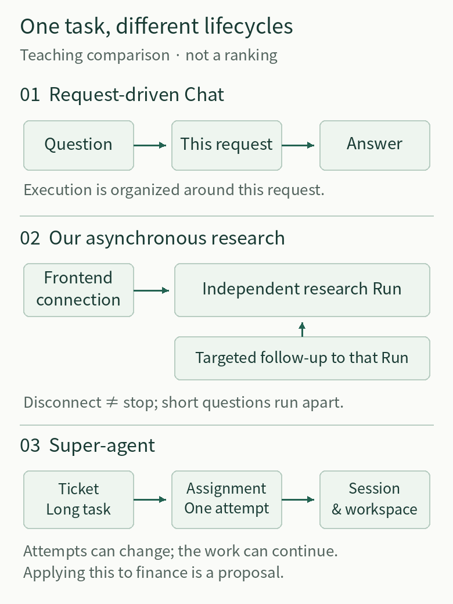
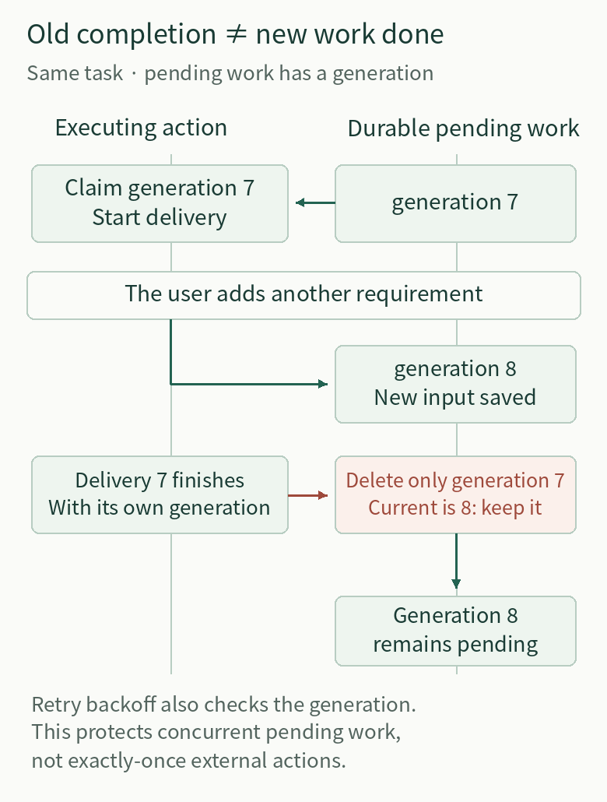

# From Investment-Research Chat to Ongoing Research: Lessons from DeepSeek Super-agent

*Putting investment-research Chat AI, our asynchronous research Agent, and Super-agent into the same task to compare three ways of working together.*

Ask each system to “compare two ETFs tracking the same index,” and their first answers may look similar. The differences emerge after the research begins: the user asks about a term, changes the fee assumptions, supplies a new disclosure, or returns the next day to continue.

How does investment-research Chat AI respond? What has our asynchronous research Agent already solved? And what does DeepSeek Super-agent prompt us to examine?

**The comparison is not about which system is smarter. It is about how each organizes research that changes, waits, and gets interrupted.** The value of the underlying mechanisms becomes clear only along that task's path.

First, the scope: “investment-research Chat AI” here means a typical single-conversation, request-driven design, not every commercial product. “Our system” refers to the practice described in our earlier [article on asynchronous background deep research](https://github.com/hpoenixf/eff-agent-article/blob/cae66cfbee8cb5731027abc451620441afd29c77/articles/agent-background-research-collaborative-experience.md), not a catalog of everything in our repository. DeepSeek Super-agent is an [official public research prototype](https://github.com/deepseek-ai/dsh-superagent-prototype/tree/6337fc823ce20251c8de8085948165c81aaa701e) for coding collaboration. It is neither a production investment-research product nor equivalent to its internal version or every proposal in its design articles.

We will follow a teaching scenario: investigate two ETFs tracking the same index, checking fees, tracking performance, and disclosure dates. Along the way, the user asks about terminology, changes the comparison assumptions, and supplies a document; eventually, the research must wait for information and deliver a report. Applying Super-agent to this scenario is a proposed transfer of its mechanisms, not a claim that it already implements these financial capabilities.

*An instructional comparison, not a maturity ranking. Financial uses of Super-agent are hypothetical adaptations.*

## 1. Are We Handing Over a Question or a Piece of Work?

### Investment-research Chat AI: organize work around this answer

In the request-driven architecture assumed here, the user asks a question, and the system retrieves information, analyzes it, and produces an answer. It may call many tools or produce a long report, but that request remains the main execution boundary.

This is a good fit for explaining tracking error, reading an announcement that has already been uploaded, or comparing materials at hand. If information is missing, the answer can identify the gap, and the user can provide more in the next request. Simplicity is an advantage: when the question is short, the inputs are complete, and the result will be consumed immediately, there is no need to establish long-term task management first.

The difficulty arises when the work does not end with the answer. One document is still missing, and the user leaves. The next day, they return with it, having discussed several other questions in between. Even with the complete conversation saved, the system must still determine which work is being resumed, which constraints remain in force, and which earlier conclusions are now outdated. Conversation history supplies material; it does not automatically supply complete task state.

### Our asynchronous research: give the research its own execution identity

The earlier article already separated research from the chat box. Within one conversation, a long research task continues along its own Run, while short questions execute independently. The frontend connection is a way to observe the research: collapsing the panel or losing the connection does not mean stopping it. We did not introduce a permanently running foreground Agent to do this; we reused the existing research, control, recovery, history, and publication capabilities.

This changes the relationship between the user and the work. The user no longer has to wait beside a single answer. After research starts, they can ask other questions or explicitly adjust the original task. A stop operation belongs to a particular research task, not to the entire input box.

So Super-agent's value to us cannot simply be summarized as “keeping background tasks running.” We already do that.

### Super-agent: further separate long-lived work from an individual assignment

The prototype uses a Ticket to hold the authorized scope and working relationships, an Assignment to record a particular execution attempt, and a persistent worker session to carry it out. The task can remain, the session and directory can be reused, and an individual execution attempt can end, be replaced, or recover. Its [domain model](https://github.com/deepseek-ai/dsh-superagent-prototype/blob/6337fc823ce20251c8de8085948165c81aaa701e/docs/001-domain.md) explicitly states that task state must not simply follow whether an execution session is open or closed.

In coding collaboration, writing code, waiting for review, receiving feedback, and making revisions all belong to the same piece of work, but not necessarily to the same execution. Applied to investment research, resuming a comparison after the user provides more material likewise requires preserving the research goal while allowing the execution to move to a new attempt.

For a Chat product, the lesson is to make long research addressable, resumable, and stoppable, rather than merely extending a response. For us, the more useful question is whether our existing identities cover these different time scales: does interrupting the current request inadvertently terminate the whole research task, and can recovery reconnect existing results to the original work?

We have encountered a fault in which cancellation of a local request was mistaken for the end of the research. That shows why these boundaries deserve attention, but it does not mean we must rename our existing structures Ticket and Assignment. **What needs to be adopted is the distinction between lifecycles, not the object names.**

## 2. How Can the User's Next Message Avoid Both Topic Drift and Lost Requirements?

While research is running, the user says:

- “What does tracking error mean?”
- “For that comparison, calculate fees over the same holding period.”
- “I've added a revised document. Use this version instead.”

All three messages appear in the same chat area, but they should not follow the same execution path.

**Request-driven Chat AI** can place them all in the subsequent conversation and let the next request process them with the history. For a simple exchange, that is natural. Once multiple research tasks run in parallel, however, “what we were discussing most recently” is not enough. A terminology question may contaminate the research, while an explicit adjustment may be treated as a separate answer. Especially after a long history has been summarized, fee assumptions, dates, and instructions such as “use the revised version” cannot be left to the luck of paraphrasing.

**Our asynchronous research** already makes an explicit distinction. Independent short questions receive independent answers and are not automatically injected into background research. Requirements added in the original research panel point directly to that Run. Natural-language adjustments need an associated target, with clarification when it is unclear. Handoff uses the saved original message rather than having an entry model rewrite the user's intent.

This solves a handoff-determinism problem, not a model-comprehension problem. If the target is explicit, do not make the model guess again. If the original text has been saved, do not replace it with a summary.

**Super-agent** deals with external discussion threads. In a thread subscribed to by an existing task, a human follow-up goes first to the worker responsible for that task. The worker continues if it is within scope and hands it back if it belongs to another task or exceeds that scope. As long as a worker still owns the message, the main session cannot independently turn it into a new piece of work. Threads followed only for context are distinguished from this handling responsibility. The [follow-up and authorization rules](https://github.com/deepseek-ai/dsh-superagent-prototype/blob/6337fc823ce20251c8de8085948165c81aaa701e/docs/002-authorization.md) guard against two places making decisions about the same message and doing the work twice.

There are two lessons for investment research.

First, **relevant information and instructions to execute must remain separate**. A fund announcement may enter the research context without its text acquiring authority to direct the Agent. A supplementary document can change the evidence; it cannot create a broader task authorization. “Include trading costs” and “execute trades for me based on the comparison” cannot be treated as equivalent additions merely because both appear under the original task.

Second, explicit task relationships should be handled as directly as possible. Chat products can provide a targeted follow-up entry. We already have that handoff and do not need another central routing Agent. What is more useful to borrow is the constraint on out-of-scope handback and duplicate handling: which requirement the original research should receive, and which needs separate confirmation, must not be left to several executors guessing independently.

The prototype is not a universal authorization defense, either. It checks the policy version when a new task decision takes effect, but some enforcement of semantic scope during execution still depends on the worker Agent checking itself and handing work back. “Authorization was recorded” must not be exaggerated into a claim that every tool operation has passed an enforced safety proof.

## 3. Waiting and Failure Test Each System's Execution Boundaries

Suppose the two funds' materials refer to different dates, preventing a rigorous comparison for now. The user says they will supply another document later and asks the system to preserve the work already completed.

**In request-driven Chat AI**, a reasonable response is to deliver the current findings and information gaps, then continue when the user makes the next request. For occasional queries, this is sufficient. A mismatch appears only if the product promises ongoing research while still requiring the user to repeatedly ask, “How is it going?”

**Our asynchronous research** already has the foundations for background execution and recovery. It should not be described as having to wait for the next conversational turn. The next checks are more specific: where does execution pause while waiting for information; can a new document enter the original research; can an adjustment be taken up promptly when resources are constrained; and does recovery repeat work that was already completed?

**Super-agent** divides these concerns among events, scheduling, and recovery. Waiting for a human answer, waiting for a thread event, executing, queueing, and being blocked by failure each have different supporting facts. For investment research, “continue after the next disclosure” additionally requires a real connection to the relevant data event, plus a definition of which disclosure counts and what should trigger resumption. Telling a model to “keep tracking” does not mean the system knows how to wait.

### Scheduling first: when the system is busy, who gets to continue?

Beyond its normal worker capacity, the prototype reserves an extra slot for a human follow-up or status request. Waking an existing task also takes priority over starting a new one. New tasks therefore cannot indefinitely crowd out a person's correction to existing work.

The implementation does more than count “Agents currently running.” Starting a workspace and creating a session both involve waiting. If two tasks check capacity first and then start asynchronously, both may claim the last slot. `WorkerSlots` reserves capacity synchronously before the asynchronous wait, counting both starting and running tasks and releasing the reservation if startup fails. The [executor source](https://github.com/deepseek-ai/dsh-superagent-prototype/blob/6337fc823ce20251c8de8085948165c81aaa701e/src/executor/dsh.ts) implements that constraint.

For a Chat product, this is the next step beyond “the input box still accepts typing”: the system must actually be able to take up a change. For us, the right approach is to examine correction priority within our existing short-question concurrency, research budgets, and provider capacity, rather than copying one extra slot. Single-process scheduling capacity is not a substitute for provider limits.

### Crashes next: if a message was saved, how could the research still miss it?

Writing “revised document received” to the database and then calling the research executor seems to leave just one step. If the process crashes immediately before that step, the input is saved, but the follow-on action may leave no durable record.

Super-agent saves the task change and pending action in the same local transaction, then uses a durable queue to deliver input to sessions, dispatch work, or send replies. A crash before commit rolls both back; a crash after commit leaves the outstanding work recoverable. Model and network calls run outside the transaction rather than holding a database transaction open while waiting. The [Effects implementation](https://github.com/deepseek-ai/dsh-superagent-prototype/blob/6337fc823ce20251c8de8085948165c81aaa701e/src/app/effects.ts) also handles a race subtler than a crash.

Suppose “use the same holding period” is being delivered to the research. Before delivery finishes, the user adds, “use the rates in the revised document.” The pending delivery for the same task is updated. If the older delivery deletes the pending action by task ID alone after succeeding, it may also delete the work associated with the new requirement.

The prototype maintains a `generation` for pending actions. An older action claims generation 7; while it runs, the pending action becomes generation 8. On completion, the older action may delete only a record whose generation matches its own. It has no authority to delete generation 8. Backoff updates after failure are subject to the same constraint.

**The task ID tells the system which research task this is. The pending-action generation tells it which version of the work has actually completed.** That is the practical user-experience significance of this mechanism: the second requirement is not swallowed just because delivery of the first one succeeded.

*Generation checks protect local pending work, not exactly-once external effects or model understanding.*

### Recovery must recheck execution eligibility, not merely resend messages

During delivery, the user may stop the research, or the system may replace the older execution. After an asynchronous wait and before actually delivering to the session, the prototype rechecks that the task is open and that the assignment is still current. A new delivery also waits for an older background stop operation to finish, preventing a late cancellation from clearing the new message.

It further distinguishes “delivered” from “entered into session history.” Cancellation or an error can still occur after an input is claimed from the inbox, so claiming it cannot immediately count as the model having read it. Recovery handles unread input using saved facts rather than replaying every message. These distinctions are visible in the [recovery and input records](https://github.com/deepseek-ai/dsh-superagent-prototype/blob/6337fc823ce20251c8de8085948165c81aaa701e/src/core/assignments.ts).

The lesson for us is to test these failure windows in the original message-handoff and recovery paths, not to claim that our whole system lacks persistent tasks or to build another recovery manager. Local transactions, generations, and execution identities each own a part of correctness. None can undo an external action that has already happened, and none proves that the model has actually understood the new fee assumptions.

## 4. Three Meanings of “Done” Must Return to What the Researcher Actually Received

**Request-driven Chat AI** usually ends the current interaction when it generates an answer. If the user only wants to understand a concept, that is an appropriate completion criterion. Long research, however, cannot be judged solely by whether the answer has ended. When information is missing, a fully formatted report may still contain only partial findings.

**Our asynchronous research** already treats execution, body publication, and history readback separately. The frontend must locate the correct result through the original Run rather than guessing that it is “the last answer.” The earlier article also retained a real limitation: the interaction was completed, but a report's inference that one tracking constraint was “twice as strict” lacked a like-for-like basis and was withdrawn after checking primary sources.

We therefore already know that a correct interaction, continued task execution, and correct financial analysis are different accomplishments. An additional collaboration mechanism cannot certify the last one.

**Super-agent** defines completion in terms of coding work. A worker Agent may report readiness while a PR still awaits review and subsequent outcomes. An execution session being temporarily idle does not mean the Ticket is closed. The displayed stage is computed from facts such as failed delivery, unanswered questions, reports, and assignments rather than maintained as another independent “completion state.”

For investment-research products, this suggests making deliverables and outstanding items explicit: the report is readable but a document is still missing; a decision is needed from the user or the data source has not updated; the result has returned to the original research entry or has merely been generated inside the executor. Do not compress these distinctions into one green “Done.”

### There is still a journey from generating a report to the user receiving it

Super-agent's outbox saves a message receipt and its pending send together, recording successful sends and discarded messages separately. But a database transaction cannot encompass a remote GitHub request. A comment may already have been posted when the process crashes before recording local success, so retrying can still post a duplicate.

The prototype addresses this window at the channel layer as well. GitHub comments contain a stable marker, and retries check whether the corresponding comment already exists. Feishu sends use a stable idempotency key. The [outbox](https://github.com/deepseek-ai/dsh-superagent-prototype/blob/6337fc823ce20251c8de8085948165c81aaa701e/src/app/outbox.ts) and [GitHub channel](https://github.com/deepseek-ai/dsh-superagent-prototype/blob/6337fc823ce20251c8de8085948165c81aaa701e/src/sources/github-channel.ts) jointly handle delivery; “the model has already replied” is not sufficient.

This still does not establish end-to-end exactly-once delivery. GitHub's check-then-write is not an atomic remote protocol, and the marker can be modified. What is worth transferring is the treatment of identity and receipts throughout the delivery chain, not a comment marker copied directly onto a financial report.

Chat products adding asynchronous delivery through email or messaging need this layer. We already have body publication and history readback and should reuse those facts first, checking the relevant deduplication boundaries when crossing external channels. Source dates, calculation denominators, and checks for counterevidence remain part of the research-quality chain; a delivered-message status cannot replace them.

## Different Lessons Do Not Require the Same Architecture

We can now separate the same ETF task into clear pieces: answer the terminology question independently; carry the fee assumptions into the original research through the original message; update the evidence with the supplementary document; define when waiting for information can end; reconnect to the original task after an interruption; and continue checking facts after the report is delivered.

For typical investment-research Chat AI, the first addition worth making is usually the relationship between messages and work: give long research an independent identity, distinguish a short question from an adjustment or a new task, and add background execution and delivery according to the product's promises. Do not start by introducing several permanently running Agents and hoping they coordinate themselves.

For us, the earlier article already covered decoupling chat from long research. Super-agent's more valuable lessons lie at the seams: can new tasks crowd out a human correction; can completion of an old delivery swallow a new requirement; can recovery repeat external actions; and can the relevant event genuinely wake waiting work? We can inject faults and exercise complete tasks along the existing mechanisms without inventing another manager for each problem.

Super-agent's team Router, thread subscriptions, and code workspaces have their own contextual assumptions. Sophisticated mechanisms do not make it a superior replacement with proven investment-research quality.

These three approaches are not a maturity ranking. It is reasonable to keep lightweight Chat for simple questions, just as it is reasonable to keep an existing asynchronous research system simple. Whether heavier mechanisms are warranted depends on whether the work genuinely needs collaboration to continue across time, events, and failures.

**For investment-research AI, the change worth pursuing is this: the user need not repeatedly restate a research task, yet the system can still take up new requirements, recognize outstanding work, and return results that can be checked.** That is the underlying lesson DeepSeek Super-agent offers us.

---

[Read online](https://hpoenixf.com/eff-agent-article/en/articles/deepseek-superagent-continuous-research) · [All articles](https://hpoenixf.com/eff-agent-article/en/catalog)

If these engineering lessons help, consider starring the [article repository](https://github.com/hpoenixf/eff-agent-article).
