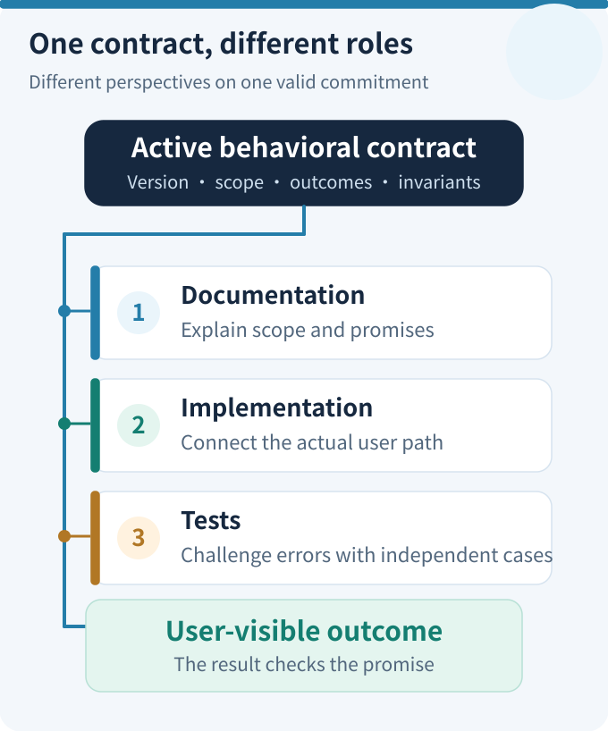
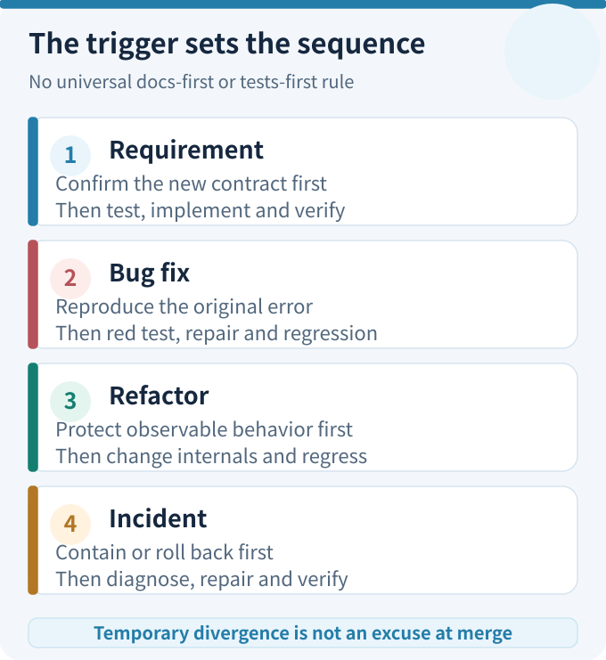
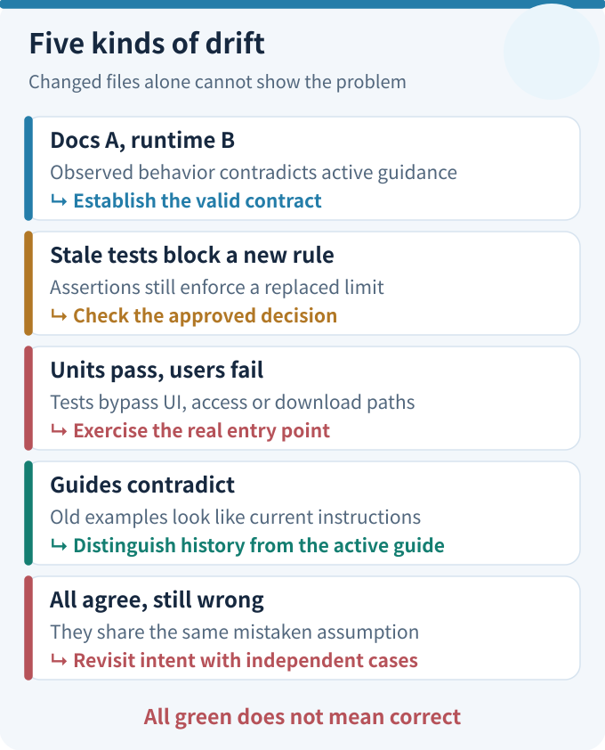
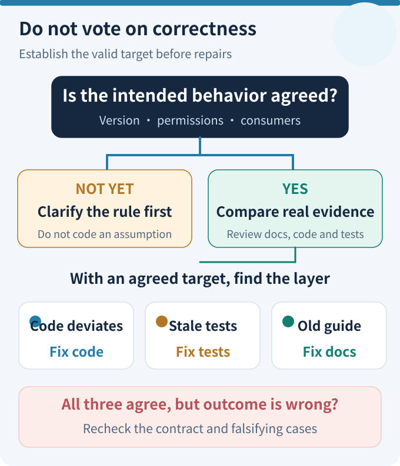
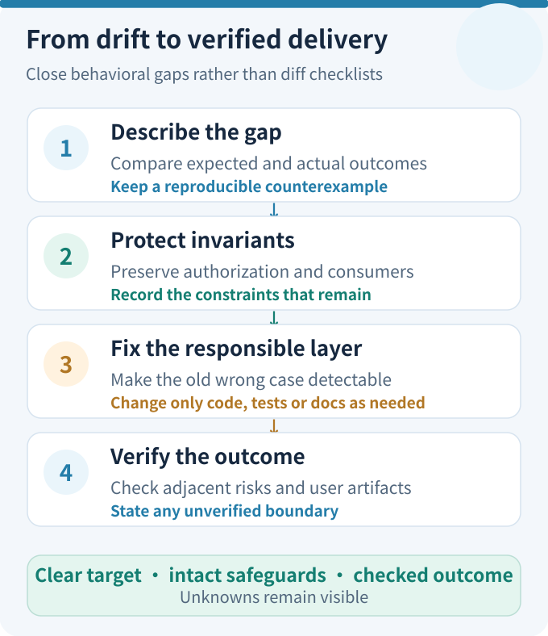

# When Tests Outgrow Implementation: Keeping Docs, Code, and Tests in Step

After a requirement changes, documentation may say "export all results," the code may still export only the current page, and the test suite may be entirely green. Should the team change the code first, fix the tests first, or update the documentation? What if all three agree but misunderstand the user's need?

The difficulty is that **these artifacts have no universal order of precedence or universally correct update sequence**. Documentation communicates agreements; code executes; tests challenge assumptions through concrete examples. The basis for deciding what each should say is the currently valid behavioral contract, checked against actual observations. Temporary disagreement during development can be intentional. Disagreement left unexplained at delivery is a maintenance defect.

This article offers an operational method for requirements, bugs, refactors, and migrations: classify the change, choose the sequence, find drift using complementary checks, decide which layer owns the discrepancy, and make that reasoning reviewable in an ordinary pull request.

## 1. Before Comparing Files, Decide What Counts as the Current Agreement

A common mistake is assuming that documentation always holds the truth, green tests imply correctness, or the current code establishes the requirement. They answer different questions.

<figure>
  
  <figcaption style="text-align:center;color:var(--vp-c-text-2);font-size:.88rem;line-height:1.6">Figure 1 | Distinct responsibilities, not a rigid pipeline · <a href="../../visuals/en/docs-code-tests-evolve-together/contract.svg">Open full-size figure</a></figcaption>
</figure>


| Source | What it can establish | What it cannot establish by itself |
| --- | --- | --- |
| Active requirement, design decision, or API contract | How the system **should** behave; which old rules were replaced and which protections remain | That the implementation already satisfies the agreement |
| Current documentation (specs, guides, examples) | How that agreement is presented to developers and users | That every statement still applies to today's version |
| Current code and its real execution paths | What is actually called, returned, and persisted | That the observed behavior is desirable |
| Tests and their prepared expectations | Which concrete scenarios are checked and which regressions could be detected | That the test oracle is correct or that untested paths work |
| User actions, production symptoms, or controlled end-to-end observations | Whether the outcome reaches the user through the relevant entry point | That every other condition or long-term scenario is correct |

The first row helps establish the **target**. The other rows provide **implementation and observation evidence**. An "active contract" need not be a file called `Spec`. It might be an approved business rule, an API compatibility commitment, an ADR, or explicit acceptance criteria. Its version, audience, and approval status matter. An old requirement does not remain valid just because it still appears in a document; an unapproved idea does not become the requirement because someone implemented it.

Use this decision sequence:

1. **Fix the scope and time:** Which version, user entry point, mode, and consumer are we discussing? Is this a correction of agreed behavior or an authorized change to it?
2. **Locate an accountable agreement:** Which rule defines the expected outcome, and who confirmed the change? When documents conflict, check decision and change history rather than voting by modification timestamp.
3. **Gather independent perspectives:** What do the docs say, what does the actual code path do, what do the tests assert, and what does the user obtain?
4. **If the intended behavior remains disputed, resolve that dispute first.** Rewriting code or test assertions cannot substitute for a product decision.

Synchronization therefore does not mean making three artifacts identical. It means making each artifact fulfill its own role in support of **one valid behavioral commitment**.

## 2. What Comes First? Choose a Sequence for Each Change Type

The source of the change determines the order, not the file extension. "First" means establishing the evidence needed for the next decision, not imposing the same test-driven development ritual on every team.

<figure>
  
  <figcaption style="text-align:center;color:var(--vp-c-text-2);font-size:.88rem;line-height:1.6">Figure 2 | Choose the sequence by trigger · <a href="../../visuals/en/docs-code-tests-evolve-together/sequence.svg">Open full-size figure</a></figcaption>
</figure>


| Change type | Start with | Next action | Confirm before delivery |
| --- | --- | --- | --- |
| New feature or changed business rule | Confirm the new contract and the constraints that must stay; update the relevant specification | Write tests that distinguish old and new behavior, implement, and iterate | New behavior passes; old protections remain; user entry works |
| Bug against an unchanged requirement | Reproduce the symptom and identify the **current** expected behavior | Add a regression case that fails for the old bug, then fix the code | The case actually catches the bug; correct docs need no artificial change |
| Behavior-preserving refactor | Lock down observable behavior, consumers, and the regression baseline | Add characterization tests where needed, then refactor internals | Contract unchanged; only stale architecture descriptions need updates |
| API, protocol, or data migration | Define coexistence, consumer compatibility, and explicit exit criteria | Preserve compatibility checks; move implementation and documentation in stages | Old consumers exited or remain protected; retirement is justified |
| Stale test expectation | Verify the requirement version and the behavior the assertion once protected | Correct, split, or remove the obsolete assertion; edit code only for an actual defect | The replacement catches errors without losing independent protections |
| Incorrect guide or outdated example | Compare implementation, tests, current contract, and real entry point | Correct the guide or its generated output | Do not change correct runtime behavior just to make files differ |
| Production incident or urgent security issue | Contain impact first: roll back, isolate, or restrict | Capture reproduction evidence, repair behavior, add tests, update affected guidance | Containment is not root-cause closure; complete the follow-up checks |

For example, **requirement changes usually start with agreement, bugs with reproduction, and refactors with a protected baseline**. Emergencies may demand containment before tests. That is a justified exception to the normal sequence, not permission to omit later verification.

Test-driven development is useful when a failing test can clearly state the intended change, but it is not compulsory for every task. Discovery may require a feasibility spike first, intermittent production failures may require observability first, and a small copy change may need only lightweight checks. What matters is that, by merge time, the team can say what evidence supports the intended behavior.

There is also a difference between *during development* and *after delivery*. A red test and an outdated guide halfway through a branch may represent a deliberate intermediate state. An unexplained conflict among active agreements on the main branch is another matter. The sequence organizes the work; **verifiable consistency at integration time is the result**.

## 3. How to Detect Drift: Inspect Four Different Perspectives

Text similarity between docs and code is not enough. Start with a concrete change or failed user journey and trace the relevant contract, assertions, execution path, and resulting artifact.

<figure>
  
  <figcaption style="text-align:center;color:var(--vp-c-text-2);font-size:.88rem;line-height:1.6">Figure 3 | Move from symptom to diagnosis · <a href="../../visuals/en/docs-code-tests-evolve-together/drift.svg">Open full-size figure</a></figcaption>
</figure>


### 3.1 Narrow the Search Before Scanning the Whole Repository

Read the pull request's purpose, then compare its branch with the intended baseline:

```bash
git diff --name-only origin/main...HEAD
git diff origin/main...HEAD -- src/ tests/ docs/
rg -n 'old-field|old-error-code|old-rule' src tests docs
```

These are generic examples; adapt paths and search terms to the repository. A match from `rg` is a lead, not proof. Historical notes can legitimately contain deprecated names. Conversely, the absence of an old string does not establish correct behavior.

Work backward from the **changed behavioral contract** instead of enforcing "every change under `src/` requires a docs edit." Pure internal refactors may leave user guides untouched. Changes to permissions, public APIs, errors, or durable data formats do justify checking affected consumers, tests, and documentation.

### 3.2 Recognize Five Distinct Signals

| Signal | How to discover it | Avoid this false conclusion |
| --- | --- | --- |
| Docs state A while runtime does B | Compare active guidance with entry-point calls and observed responses | Do not choose A or B until the current contract is established |
| Tests enforce an old rule that a new requirement superseded | Run affected assertions and review the decision that changed the rule | A failing test does not automatically mean the implementation regressed |
| Code and unit tests agree, but the user receives the wrong output | Execute the actual entry point and inspect arguments, steps, and final artifacts | Unit tests may bypass UI wiring, authorization, or real dependencies |
| Two guides contradict each other or old examples remain searchable | Check canonical pages, versions, history, and redirects | Historical material can be valid when its period is explicit |
| All three agree, but the business outcome is still wrong | Challenge the assumptions with independent examples and consumer feedback | Green checks cannot approve a misunderstood requirement |

Three complementary strategies emerge: **change-diff checks** find likely omissions, **contract checks** catch broken interfaces and assertions, and **outcome checks** determine what reached the user. None is a substitute for the others.

### 3.3 What Can CI Check, and What Still Needs Review?

Static checks can catch broken links, deprecated symbols, non-executable examples, or unrefreshed generated artifacts. Type checks, schema validation, and consumer contract tests can expose certain integration incompatibilities. A small number of real-entry tests can catch missing connections. With consumer-driven contracts such as [Pact](https://docs.pact.io/), the focus should be the **requests and responses that actual consumers depend on**, not reproducing every provider implementation detail as a test expectation.

CI cannot reliably determine whether the business now wants one page or all pages. Nor can it decide that two matching files automatically overrule the third. Leave questions about intended semantic changes and still-valid protections to review; automate structural consistency, behavioral regressions, and observable execution evidence. This is more useful than inventing a large "documentation synchronization score."

### 3.4 Tests Must Distinguish Correct Behavior from a Plausible Wrong One

Ask a reverse question: **would this test fail if the old bug reappeared?**

If the previous export implementation handles only the current page and the new contract requires all pages, a fixture with ten orders cannot distinguish them. A fixture with fifty matching orders spread over three pages can. Checking that the file contains fifty rows is still too weak: duplicated pages may produce the same count. Compare actual order IDs with a pre-established expected set.

Avoid generating the entire expected result with the exact production function under test. A shared production field definition may help frontend and backend stay consistent, but a key business scenario should still independently assert required columns and their order. Otherwise implementation, docs, and tests may all **omit the same column**.

## 4. When Artifacts Disagree, Which One Should Be Fixed?

Start by writing two sentences: **the currently authorized target behavior is...** and **the observed behavior is...**. Then locate where the discrepancy belongs. The table below is a triage guide, not an automatic authority rule.

<figure>
  
  <figcaption style="text-align:center;color:var(--vp-c-text-2);font-size:.88rem;line-height:1.6">Figure 4 | Correctness is not decided by voting · <a href="../../visuals/en/docs-code-tests-evolve-together/triage.svg">Open full-size figure</a></figcaption>
</figure>


| Observed state | Check first | Primary repair |
| --- | --- | --- |
| A new rule was approved, while old code and old tests agree with each other | Was the old restriction explicitly superseded? | Update relevant docs and expectations, then implement the new rule |
| Docs express the active contract, code deviates, and tests catch it | Does the failure occur on the real path? | Fix code; keep valid tests; do not rewrite correct documentation |
| Code meets the contract, but tests still demand the old behavior | Does the old assertion protect anything independently valuable? | Refactor or replace that assertion; do not roll correct code backward |
| Code and tests are correct, but the guide describes an old entry point | Who reads the guide, and for which version? | Update commands, examples, and redirects as appropriate |
| All three agree, yet the user outcome is wrong | Is the requirement ambiguous or the user path untested? | Reconfirm intent; add independent examples and end-to-end evidence |
| Old and new consumers coexist, and an old check starts failing | What is the compatibility window and actual exit criterion? | Preserve transition protections, migrate consumers, then retire checks |

The central rule: **never decide correctness by a two-out-of-three vote among documentation, code, and tests**. Two old artifacts can agree on a restriction that is now obsolete. Conversely, a new implementation may have silently widened a permission boundary, while a test was written to accept whatever it returns.

Classify the dispute as "target undecided," "implementation mismatch," "obsolete expectation," "stale documentation," or "insufficient evidence." Resolve target decisions before implementation work; add real observations where evidence is missing. Do not hide uncertainty behind weaker assertions just to make a pipeline green.

## 5. An End-to-End Repair Loop

Use this compact loop for any drift you find:

<figure>
  
  <figcaption style="text-align:center;color:var(--vp-c-text-2);font-size:.88rem;line-height:1.6">Figure 5 | A verifiable repair loop · <a href="../../visuals/en/docs-code-tests-evolve-together/closure.svg">Open full-size figure</a></figcaption>
</figure>


1. **Describe the discrepancy**, not just the failure message: "the contract requires every matching order, but the file contains only the current page."
2. **Name the invariants** that cannot be lost, such as authorization, filters, output fields, error semantics, or compatibility obligations.
3. **Choose a falsifying check:** construct the smallest input that reveals the old wrong behavior. If that is not currently possible, record whether data, environment, or entry point is missing.
4. **Change the smallest responsible surface:** fix the button if it fails to pass filters; change the exporter only when its own pagination is wrong.
5. **Run affected and adjacent regression checks:** include relevant consumers and authorization paths, not only the test you just edited.
6. **Update outward-facing guidance:** touch current instructions only where the contract or entry point changed; preserve historical rationale and label obsolete guidance appropriately.
7. **Observe the result through the user path:** distinguish mocked, integrated, and production verification, and state exactly which layers were exercised.

The closure criterion is not "docs, code, and tests all have a diff." It is **a settled target, supporting behavioral evidence, intact protections, non-misleading current instructions, and visible outstanding uncertainties**.

If a particular effect can only be observed after a production rollout, the PR can specify that post-release check. Do not present an unexecuted real-world test as completed.

## 6. One Teaching Example from Sequence to Diagnosis

We will keep just one example, with enough detail to show decisions rather than merely tell a long story. **The order-export behavior and numbers below are synthetic teaching material, not an actual ETF Agent order feature.**

Originally, the agreement was "export the current page": twenty displayed orders. Docs, code, and tests all enforced that rule. A new decision changes it to: **export every filtered order the current user is authorized to view, regardless of page; retain column names and order; show an explicit message when there is no data.**

Under the requirement-change row in Section 2, confirm the rule and retained protections first. Replace the old "at most twenty" assertion with a cross-page scenario, then update export logic and the button. Prepare fifty matching orders across three pages (20, 20, and 10), plus orders outside the filter or the user's access scope.

A good test verifies not merely fifty rows but **exactly the fifty intended order IDs**, expected fields, exclusions, and the empty case. Otherwise a repeated page and an omitted last page could still produce the expected count.

Suppose backend unit tests are green, but the UI button passes only the current page array into the old function. That is a **mismatch between call paths**, not another business-rule change. Fix the button wiring and add a check from the actual click to the downloaded file, rather than changing the expected count back to twenty.

Alternatively, suppose only the old assertion still demands twenty rows while code already satisfies the new rule. Fix that assertion, not correct code. But preserve checks for "do not export unauthorized orders" and "do not export orders outside the filter." **Retiring one obsolete restriction is not permission to delete an entire regression suite.**

This one example now illustrates four decisions: which artifact leads, how drift becomes observable, which surface is responsible, and which old guarantees still matter.

<!-- Preserve legacy consolidated-article section fragments without duplicating the essay. -->
<a id="do-not-discard-the-old-tests-as-a-group"></a>

## 7. Keep, Refactor, Consolidate, Retire, or Delete Old Tests?

Do not delete a test merely because it fails, or keep it forever because it once mattered. Classify it by the **currently valid behavior** it protects:

| Treatment | When appropriate | Check before acting |
| --- | --- | --- |
| Keep | It guards a valid requirement or a unique risk | Would it catch a real regression rather than just a changed internal call? |
| Refactor | Business behavior is stable, but the assertion is tied to old internals | Does the behavior-oriented replacement still catch the original failure? |
| Consolidate | Cases repeat the same observable effect | Are distinct failure paths still detectable afterward? |
| Defer retirement | Old routes, protocols, or consumers still exist | Are the compatibility window and exit conditions explicit? |
| Delete | The old requirement is revoked, the check adds nothing, or migration exit is established | Who now protects any remaining risk? |

A real ETF Agent constraint illustrates why removing an obsolete assertion must not remove safety protections: a missing or expired execution claim may make a task a **candidate for further inspection**, but it does not prove that the original executor stopped or authorize resuming execution. When old recovery expectations change, protection of active execution and later admission checks must remain.

Similarly, retirement of scans used solely for a migration away from an older runtime depends on actual production wiring, current behavioral protection, and the safety of historical data still needing to be read. A retired package name appearing in a comment is not a live dependency, and green tests alone cannot certify that migration is finished. Tests using a fake clock must also check whether the database clock used by the decision actually receives the same time conditions.

These examples establish **invariants and exit criteria**; they are not arguments for adding a new process for every past repair.

<a id="_6-why-synchronization-itself-can-slow-development"></a>

## 8. Reduce Future Synchronization Work Instead of Adding Endless Checks

The economical approach is not making three artifacts change manually on every commit. It is **removing unnecessary duplicate facts while preserving necessary independent judgments**.

Facts that can be derived mechanically should be generated or referenced where reasonable: API schemas, types, field mappings, CLI option descriptions, and some reference docs may use an existing authoritative definition. CI can compare generated output with its source. Explanations that code cannot derive—why a behavior is allowed, the scope of business permissions, or a design trade-off—must remain explicit in appropriate documents.

Tests cannot fully share their answers. A production field definition can be reused, while critical business scenarios must independently check required export columns, ordering, and meaning. This echoes the engineering advice in [Google Testing Blog's discussion of testing behavior rather than implementation](https://testing.googleblog.com/2013/08/testing-on-toilet-test-behavior-not.html): reduce assertions coupled to internals while preserving observations that distinguish correct behavior from wrong behavior.

A practical maintenance stack has three levels:

1. **Cheap, always-on checks:** types, schemas, links, executable examples, generated files, and affected unit tests.
2. **Risk-triggered checks:** consumer contracts, compatibility, permission regressions, migration paths, and critical entry-point integrations.
3. **Review judgments:** whether the contract truly changed, which old behavior remains valid, whether test expectations are independent, and whether the intended outcome reaches users.

Not every change needs a new synchronization audit report. Explain the decision in the existing PR instead of creating another register that must itself be kept in sync. Tom Manshreck discusses integrating documentation into engineering work in [the documentation chapter of *Software Engineering at Google*](https://abseil.io/resources/swe-book/html/ch10.html). The practical extension here is to **automate checkable relationships and review relationships that require judgment**.

### Three ETF Agent Practices Worth Borrowing

The current engineering specifications, implementation and tests support three practical patterns:

- **Scenario-driven changes.** OpenSpec scenarios state inputs, expected behavior, and preserved constraints. Some tasks connect RED/GREEN observations to generated verification views; generating that view is not reported as a fresh test execution.
- **Executable test-layer declarations.** Static, unit, integration, smoke, and E2E layers have declared entry points. Routine tests use fake gateways instead of paid models, and mock success is not presented as proof of the live user journey.
- **Read-only drift diagnosis by default.** Selected Research verification paths classify missing sources, stale hashes and unexpected sources. Correcting an active plan requires explicit write authority; frozen historical evidence is not silently refreshed.

These are practices for **traceability of responsibilities, source identity and verification scope**, not proof that every specification is correct or the entire product is production-qualified. A small team can adopt falsifying scenarios, test-layer honesty and concise PR discrepancy notes without copying the full governance process.

The earlier article reported one dated snapshot of ETF Agent's committed working set as of October 27, 2026: 49,425 nonblank lines of current engineering docs and instructions, 248,636 lines of implementation and scripts, and 380,853 lines of tests and helpers. Tests were about 1.53 times the implementation by that measure. These figures indicate the scale of potentially maintained material, **not test quality, coverage, or an ideal ratio**. The useful question is which distinct regression each retained protection can still catch.

<a id="_7-where-to-start-when-the-next-requirement-arrives"></a>

## 9. A Small Pull-Request Record You Can Reuse Tomorrow

No new system is necessary. Five fields in the existing task or PR description are sufficient to start:

```text
Change: export scope moves from "current page" to "all authorized matching orders."
Preserve: filters, authorization scope, output columns, and column order.
Affected: button -> export entry -> paginated retrieval -> downloaded file;
          current guidance and old row-count assertions.
Counterexample: fifty matching orders across three pages, plus filtered-out
                and unauthorized rows.
Evidence: the new test must catch the old path; check module and button paths;
          compare exact order-ID sets; explicitly mark any unrun live check.
```

If only the test is stale, change only the test. If only the guide is stale, change only the guide. "Checked, no update needed" is a valid outcome. Do not generate meaningless diffs to obtain three green boxes.

A reviewer can now ask, in order: **What establishes the current contract? Would the counterexample detect the old wrong behavior? Does the real user path reach the intended implementation? Are authorization and other invariants intact? Are remaining uncertainties disclosed accurately?** Answering those questions is stronger evidence of maintainable evolution than matching file counts.

## 10. Conclusion: Align Commitments, Not File Edits

Documentation explains the current agreement. Code performs it. Tests independently challenge the promise with examples. Actual user paths check whether the result reaches its destination. What changes first depends on whether the trigger was a requirement, a defect, a refactor, a migration, or a documentation correction.

The three can temporarily diverge; they can also be wrong together. The goal is not to move every file in lockstep. It is to identify the still-valid commitment when a conflict appears, fix the responsible layer, and leave evidence of the critical behavior before integration.


<!-- agent-article-sync:guidance:start -->
## Further Reading and Discussion

- [Specs, Evidence and Verifiable Engineering Closure](026-agent-spec-evidence-workflow.md): maintain behavioral agreements, observed execution, and completion judgments separately.
- [Engineering Knowledge: Context, Memory and Retirement](027-agent-context-document-history.md): distinguish knowledge that should guide current work from material kept for reference.
- [Chinese edition](/articles/docs-code-tests-evolve-together) · [Architecture Principles and Engineering Methods](/en/principles)

Join the discussion in the [GitHub collection](https://github.com/hpoenixf/eff-agent-article). If these engineering examples help your work, consider giving the repository a Star.
<!-- agent-article-sync:guidance:end -->
