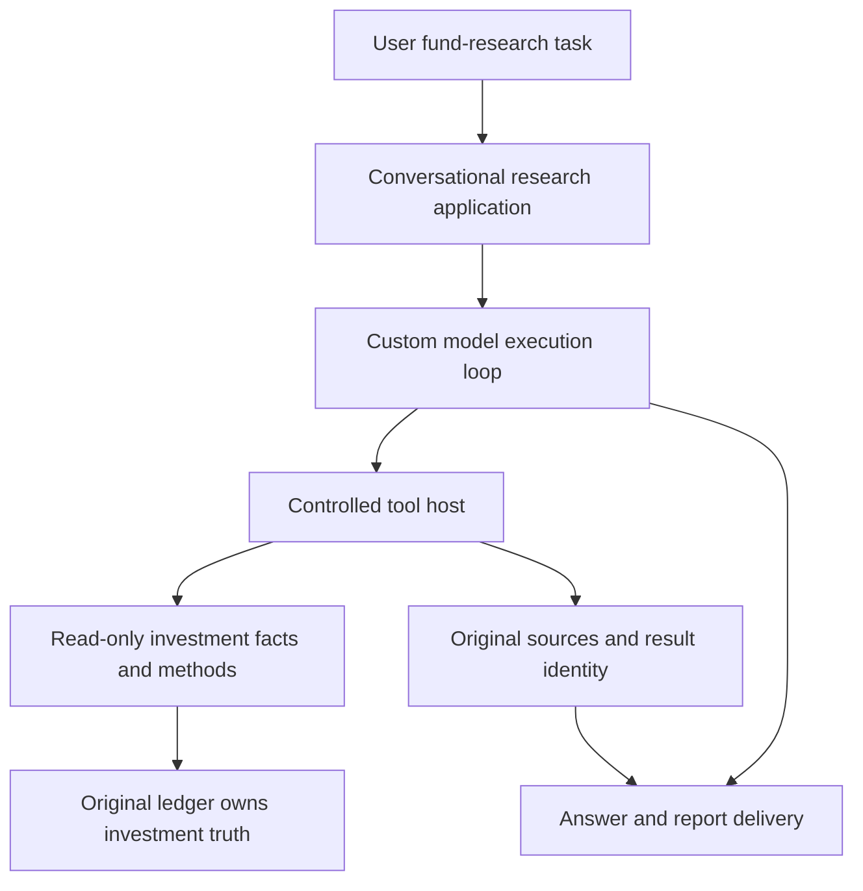
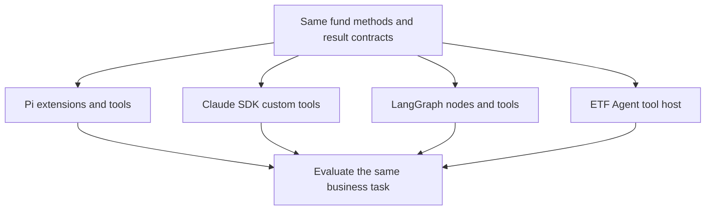
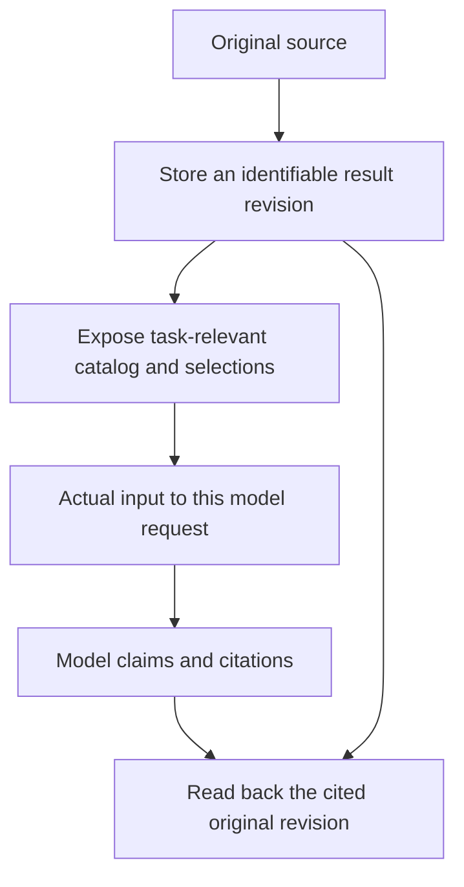
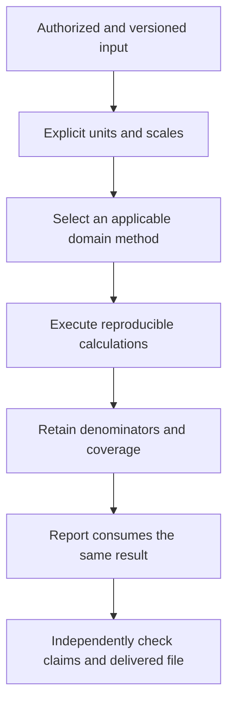
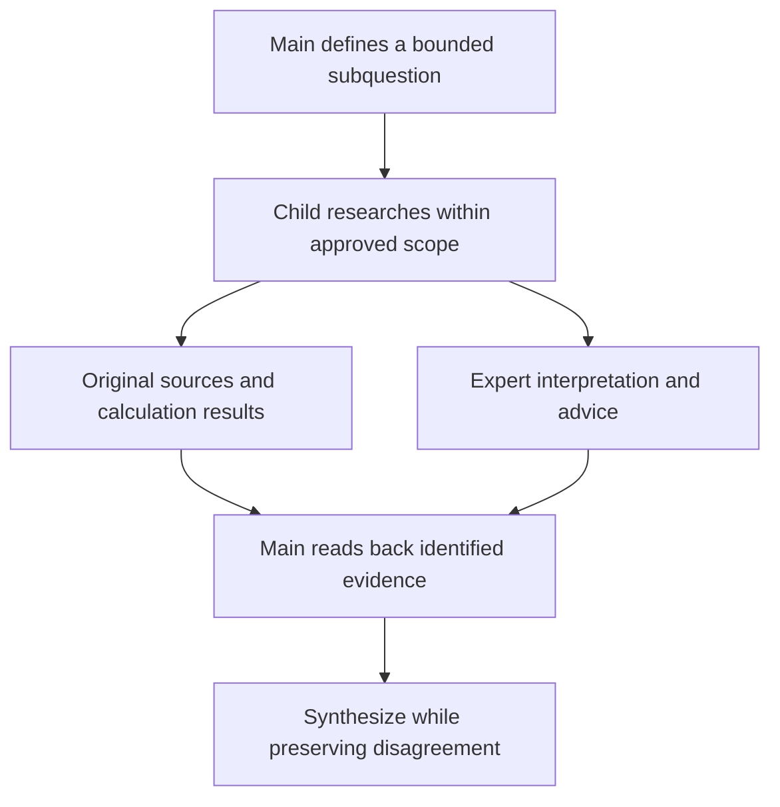
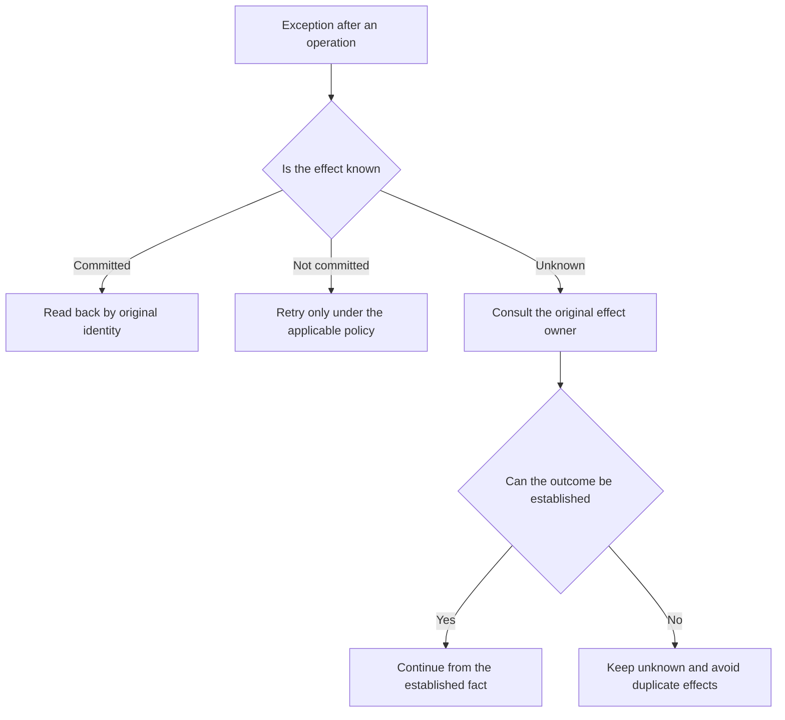
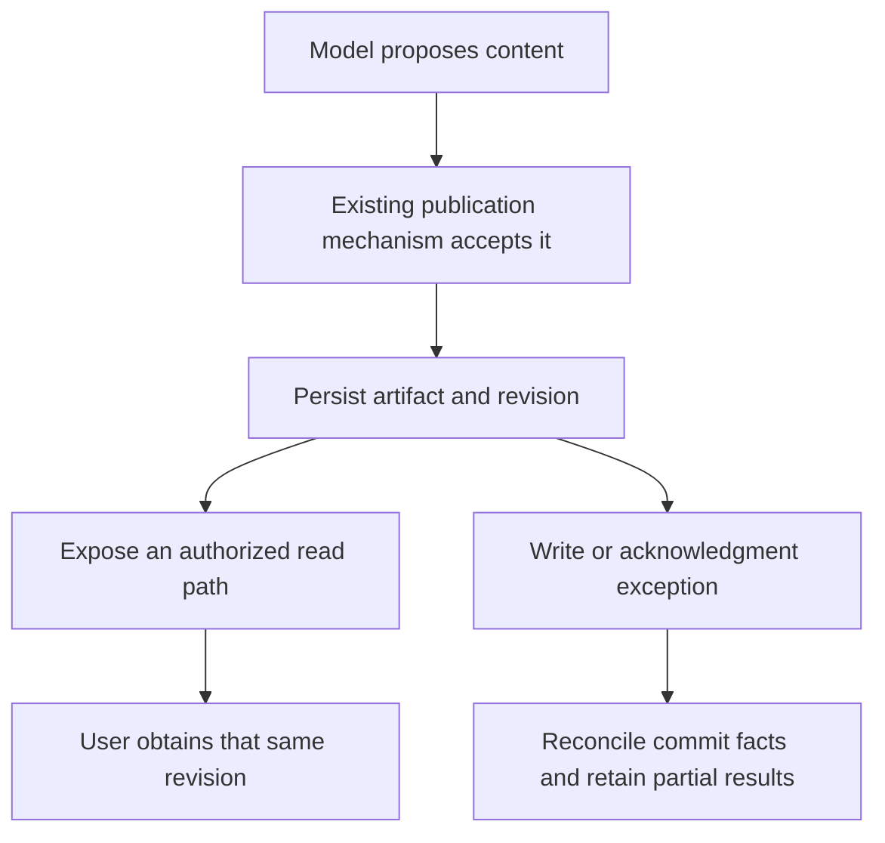
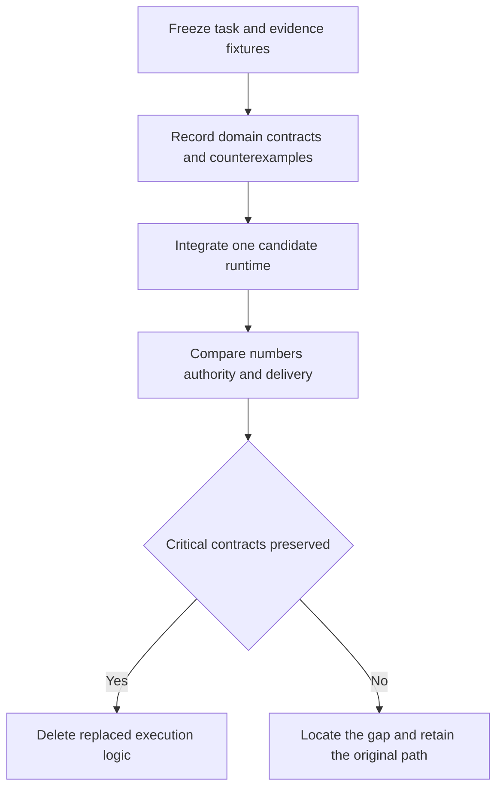

# From a General Harness to Financial Research: A Four-Way Architecture Comparison of ETF Agent

> Engineering · Follow one fund-research task to examine what a custom system adds and what it must maintain.

The need for financial domain capabilities can be discussed at the level of principles. Engineering teams face a more concrete question: if Pi, Claude Agent SDK and LangGraph already provide substantial execution infrastructure, why does ETF Agent maintain its own runtime, result store, publication and recovery mechanisms? Which differences are justified, and which are ongoing maintenance liabilities?

This is not a product leaderboard. The four systems have not been run on a shared model, source window, budget and question set for this article. No comparative win rate, financial accuracy or cost ranking is claimed. The comparison uses two kinds of evidence: mechanisms documented by the general frameworks, and specific behaviors supported by inspected ETF Agent implementation and original verification records.

The source cutoff is November 2, 2026. Private ETF Agent is an evolving research application. Public Open ETF Agent is a separate teaching implementation; its reproducible reference here is the commit corresponding to v0.15.2. Neither establishes the other's complete capabilities, and private features are not presented as immediately available to public-code readers.[8]

The main judgment is this: **preserve financial methods, relationships between facts and authority, research-result identity and checkable delivery; continuously test whether Pi, Claude Agent SDK or LangGraph can replace unnecessary custom execution infrastructure.** Existing code is not evidence that it must exist forever.

## 1. Put the four systems on a comparable footing

### Compare responsibilities, not feature-list length

Pi is a lightweight programmable agent harness. Claude Agent SDK provides an agent loop with tools, permissions, sessions and subagents. LangGraph emphasizes stateful orchestration and durable execution. ETF Agent is an application and collection of domain capabilities organized around fund research.[1][2][3]

The first three primarily address execution. The fourth must also define the business task, its methods and its delivery. Attaching fund-data tools to an application does not automatically improve its general framework capabilities. Conversely, a general SDK need not include a fund-share-class model to support a financial application.

| Dimension | Pi | Claude Agent SDK | LangGraph | ETF Agent |
| --- | --- | --- | --- | --- |
| Primary role | Minimal extensible execution environment | Programmable agent execution capabilities | Stateful orchestration and runtime | Fund-research application and domain capabilities |
| Main reuse units | Extensions, skills, SDK, RPC | Tools, MCP, hooks, subagents, sessions | Graphs, nodes, state, persistence | Domain methods, results, authorization, delivery contracts |
| Source of financial rules | Application | Application | Application | Project domain implementations |
| Evidence used here | Official mechanisms | Official mechanisms | Official mechanisms | Inspected source and bounded original verification |
| Four-way empirical benchmark | Not performed | Not performed | Not performed | No paired benchmark against the other three |

“Application” is not a negative rating. A good general framework should not choose every financial business's return formula, account policy or data vendor.

### ETF Agent is not merely a wrapper around Claude Agent SDK

In the inspected private implementation, conversational research uses a custom Native ModelTurn loop. A model gateway integrates protocol and provider adapters, while a server-side host manages tools. References to Claude, Pi or compatibility extensions do not mean those SDKs own the core execution.

This matters to the comparison. Drawing “Claude SDK plus financial plugins” hides the protocol, resource, recovery and delivery work the project actually owns. Claiming that ETF Agent fully replaces all three frameworks would overstate the evidence in the opposite direction. It is a domain-driven system that also carries significant general engineering responsibility.

The following diagram describes responsibilities, not a proposal for additional deployed services. Existing modules in one process can own these functions.

### Figure 1. Current responsibilities, not four frameworks stacked together



## 2. Define acceptance through a complete task

### Teaching input and expected outputs

Use a synthetic CNY 120,000 portfolio: Funds A, B and C represent 45%, 30% and 15%, with 10% cash. A and B track the same index. The user contributes another CNY 20,000, wants lower concentration while keeping 10% cash, and explicitly does not authorize trading.

The task should deliver four things: explain same-benchmark allocation, calculate supportable underlying exposure, establish the cash constraint after the contribution, and identify missing data or user conditions. Partial research is legitimate. Omitting part of the question while labeling the entire task successful is not.

These inputs are not real account data. The four implementation routes below are design comparisons, not completed runs of four systems. The illustrative arithmetic is independently checkable; framework quality differences still require a genuine paired experiment.

### A small baseline is sufficient to begin

Start with one main agent, read-only source tools, a portfolio-calculation method and a report-saving interface. Do not enable specialists, long-term memory, automatic approval or background scheduling by default. A simple baseline reveals whether the research works and what later mechanisms actually improve.

Same-benchmark allocation can first be established as 75%. If known underlying weights in Company X are 8%, 10% and 6%, total-asset exposure is 7.5%, or CNY 9,000. After the contribution, assets are CNY 140,000 and target cash is CNY 14,000, leaving CNY 18,000 for additional fund purchases.

These calculations assume no market movement, fees or other flows, and compatible definitions of underlying weights. A real system must carry those premises into the result, rather than inserting three correct numbers into a report with no identifiable inputs.

### Acceptance includes cases that cannot be calculated

If C's underlying holdings are missing, benchmark duplication and the cash constraint may remain supportable, but an exact company-level overlap must not be invented. If the funding source changes, the cash calculation must be reconsidered. If account authorization is withdrawn, subsequent reads and computations must respect the original access contract.

These branches test the design more effectively than adding tool calls to a happy path. They require research to revise its plan after new observations while limiting restrictions to actual dependants, rather than deleting unrelated valid findings.

## 3. Where would the code live in each implementation?

### Pi: expose stable business capabilities as tools

One reasonable design connects fund-source reading, portfolio computation and artifact storage through Pi tools or extensions. A skill explains the research procedure and when to choose each method. Pi owns the model/tool loop; the application owns real authorization, source storage and business data.

Pi explicitly distinguishes the minimal core from MCP, subagent and confirmation behavior added by users. Selection should enumerate the integration work required, rather than counting everything an extension could implement as an out-of-the-box feature.[1]

This can be a strong starting point for short, single-user, read-only research. Multi-user service deployment, persistent background tasks and complex delivery require a separate examination of lifecycle contracts. A successful terminal demonstration does not establish those production conditions.

### Claude Agent SDK: reuse established execution mechanisms

Another design runs the main agent through the SDK, invokes the same methods through custom tools or MCP, and integrates application checks through permissions and hooks. Define a subagent only when independent source work is useful. Much session and tool-execution infrastructure need not be rewritten.[2]

The application still decides which customer may read which portfolio and how outputs appear in its product. Permission to invoke a tool does not grant the tool access to every account. Session resumption does not keep old authorization valid forever. The SDK supplies control mechanisms; the application supplies their business meaning.

The selection question is not whether the SDK “knows finance.” It is whether its execution semantics and deployment model can support the actual tool, authority and delivery contracts. When they can, preserving the domain core while deleting a duplicate runtime is a serious option.

### LangGraph: make state and waiting explicit

Source acquisition, deterministic calculation, model analysis and user clarification can be organized in a graph. A model node may still contain an autonomous tool loop. The graph manages stage relationships, state and waiting; each individual search need not become a permanent node.[3]

Graph state should retain the goals, revisions and result references required for correct continuation, not accumulate every PDF and tool response indefinitely. Large sources can live in appropriate storage. An in-memory or persistent checkpointer must be chosen according to actual restart requirements.[4]

Explicit state handoffs are valuable, but state schemas, node boundaries and recovery behavior remain maintenance responsibilities. A giant state object and dozens of unnecessarily small nodes do not become sound architecture merely because a graph framework executes them.

### ETF Agent: own more execution work to preserve existing contracts

ETF Agent already has seams for reading, result identity, domain calculation, publication and recovery. The task can reuse those contracts. The project must also handle model-protocol differences, tool lifecycles, resource reservations and exceptional settlement.

That is neither inherently superior nor inherently wrong. The questions are whether research actually consumes the mechanisms and whether their maintenance cost is justified. Incremental convergence may be safer than a wholesale migration for an established system. A new application should not copy the entire structure merely because this case study uses a custom runtime.

### Figure 2. Domain contracts are the shared asset



## 4. Do not duplicate investment truth in the conversation layer

### Research must not create a second, quietly changing ledger

ETF Agent separates investment state from conversational research. The root investment modules own authoritative ledger, allocation and confirmation facts. The conversation layer consumes approved reports and sources through read-only interfaces. Producing analysis must not silently create an actual execution record.

This separation is valuable during migration. Replacing a model or runtime should not move the ledger into another agent database. A new executor should satisfy existing read-only and result contracts, not acquire additional permission to modify financial truth.

Research scenarios must also remain distinct from actual holdings. The model may simulate allocating new money to an asset category, but that scenario must not overwrite the account snapshot. Its value comes from comparison, not from recording a hypothesis as an event.

### One authoritative object can have several legitimate projections

The interface displays values and weights. A calculation may need shares, NAV and currency. The model may need only a task-relevant summary. These projections can share an authoritative source without reconstructing independent, drifting datasets.

Important unknowns must survive projection. An unavailable valuation must not become zero in the model summary. An unauthorized account must not appear as an empty account. Once business meaning is lost during projection, later model intelligence cannot reliably recover it.

This is where an adapter earns its place: transform an upstream representation into what a consumer needs while preserving identity, definitions and limitations. A JSON pass-through that forces every caller to interpret all original details usually lacks that depth.

### Check authority at consumption seams, not just admission

Initial authentication does not establish that every later action in a long task remains valid. Sources may be revoked, runs may change, and users may submit corrected data. Actual reading and export must check concrete identity and scope under the original contract.

Inspected ETF Agent verification includes a controlled counterexample in which a corrected source had been denied but a replacement placeholder still reached Python input. The repair belongs at the original source-consumption seam: prevent ineligible input from entering calculation while permitting a legitimate fresh read. That supports a claim about the specific input path, not system-wide financial correctness.

## 5. Result storage makes consumed evidence inspectable

### Acquiring a source is not the same as showing it to the model

Search returning a link is not reading the document. Reading a document is not delivering its entire table into context. Saving a result is not proof that a later model request consumed it. Each distinction can change a financial claim.

For example, a tool may retrieve complete holdings while the model receives only a few summary rows. A report saying “all underlying positions were analyzed” would exceed the actual input. One successful tool event cannot prove the claim.

ETF Agent's result identities and reading relationships connect original material, projections, selections and subsequent consumption. They establish inspectability, not comprehension, and do not independently establish that a citation supports an argument.

### Externalizing large results should not discard usable evidence

Keeping original results in storage and reading them on demand can reduce context load. The model still needs to discover available content, know what it has read, understand what remains, and obtain the relevant selection.

An opaque identifier without a usable catalog and reading tool can make research harder despite successful externalization. Storage and discoverable access must be designed together; context savings are not the only objective.

Original content, working notes and long-term memory also need separate identities. Notes help continuation but do not replace evidence. Persistent preferences need their own validity and authorization conditions; a tool response does not automatically belong in a permanent user profile.

### Figure 3. Follow stored results through actual consumption



### What should survive a runtime migration?

Original result revisions and domain source relationships remain useful under Pi, Claude Agent SDK or LangGraph. The adaptation is usually how catalogs, observations and selections reach the executor, not a redefinition of financial facts.

Do not make the execution framework own every storage concern either. Conversation messages, graph state, reports and source revisions have different lifecycles. Where a suitable storage seam already exists, integrate with it rather than creating a competing state authority beside it.

## 6. Financial computation must remain connected to the delivered report

### A numeric kernel must not choose the business method

The inspected ETF Agent design assigns units, decimal arithmetic, rounding and residuals to a numeric kernel. Portfolio, fee, return and exposure methods remain with their domain owners. The kernel is not a central institution authorized to approve every financial conclusion.

This avoids both repeated ad hoc money arithmetic and a global interface that conceals incompatible return definitions, fee policies and business prerequisites. Shared arithmetic is useful without centralizing every domain decision.

Statistical methods may still use floating-point arithmetic with declared tolerances. Calculation, transaction-settlement and display precision need not be identical. Decimal representation does not prove source truth, and two decimal places are not a universal financial policy.

### The same 0.02 may require a different display conversion

A source reporting 2 percentage points differs from an older method representing a decimal difference as 0.02. Multiplying every field named percentage_points by 100 could display the former as 200 percentage points.

Preserve source representation and the producing method's scale contract instead of guessing from magnitude. This is well suited to deterministic tests because inputs and independent expected outputs can be explicit.

Repairing one conversion does not certify every number in generated prose. Structured amounts can consume the result directly, while explanation still needs semantic evaluation. Promoting a local calculation improvement into a global financial publication gate can create new responsibility conflicts.

### Coverage must not disappear through normalization

Suppose underlying coverage for A, B and C is 60%, 70% and 40%. Disclosed fund-underlying coverage is 54% of total assets. Cash is 10%; the remaining 36% is unexplained at the fund-underlying level. Company X's 7.5% cannot be divided by 54% and then relabeled total-asset exposure.

The method should deliver coverage with the calculation. A renderer receiving only a bare `weight` can lose the denominator while formatting or sorting. Its result contract should identify whether a metric describes the whole portfolio, fund assets or the disclosed sample.

### Figure 4. Correct arithmetic is an intermediate stage



### A concrete engineering advance: the original result reaches delivery

Inspected controlled verification takes synthetic portfolio sources through the original MCP seam into real Python methods and a renderer, saves HTML through the existing Artifact repository, and reads identical bytes and a matching hash through the actual HTTP handler.

The significance is not the number of tests. It closes a gap between a tool producing a result and the delivered report actually consuming it. This supports identity and delivery claims for that path. Synthetic inputs and the absence of complete independent financial review mean it does not establish that real private-account research is qualified.

The same verification preserves missing-target and inapplicable-source branches. A legitimate report need not contain a number in every field. It should distinguish available values, missing conditions and partial results without fabricating a universal pass.

## 7. The hard part of subagents is not starting another process

### General frameworks already provide ways to delegate

Claude Agent SDK provides subagents with independent context, instructions and tool restrictions. Pi can support such patterns through extensions or composed instances; LangGraph can organize work through subgraphs and other compositions. Starting a second model task is not financial differentiation by itself.[1][6]

The meaningful questions concern task identity, readable sources, budgets, cancellation, return paths into the main agent and whether the final research improves. These responsibilities often already have owners; a specialist subsystem should reuse them rather than clone authority and accounting for every expert.

### Hand off evidence and opinion separately

A child may read a source and produce advice such as “check this assumption further.” The main agent must distinguish the source from that interpretation. Naming a role Reviewer does not grant its prose factual certification authority.

The public Open ETF Agent serial source-checking Child example separates original results from derived advice. The main agent consumes both without promoting advice into original-source authority. This is a bounded teaching mechanism, not a complete parallel expert platform.[8]

Claude SDK's context isolation prevents the main agent from absorbing every intermediate detail. Applications needing exact financial evidence should additionally design controlled source references or artifact handoffs. Summaries improve efficiency but cannot replace original numbers that require independent inspection.[6]

### Figure 5. Specialization needs an inspectable handoff



### A Reviewer is not a new global veto authority

Automated review can find omissions, offer counterevidence or flag numerical risks. Its output should not implicitly rewrite source truth, the investment ledger or every publication decision. Otherwise, temporary unavailability of an auxiliary model can halt valid independent research.

Recent inspected ETF Agent work aligns Reviewer eligibility with the original resource owner's actual reservation for a Child request. This fixes resource definitions and triggering conditions; it does not establish improved financial error detection.

Optional specialists impose normal-path costs. When resources are insufficient or independent review adds no task-specific value, not starting an optional Reviewer can be the right behavior. Mandatory permission checks must not be disabled under the same rationale.

### Multi-agent effectiveness needs its own denominator

A terminal Child proves a subtask reached an execution outcome. Its text entering a main-agent request proves a handoff occurred. A citation in the final answer still does not prove the opinion was correct. Improved research requires independent examination and a reasonable baseline.

Keep real-model observations separate from controlled verification. Without paired quality, cost and natural-user-task evidence, specialist run counts are not financial success rates. Multiple files from one run are not independent successful samples.

## 8. Recovery concerns unsettled facts, not simply replaying messages

### Four kinds of continuation have different meanings

Session continuation concerns conversation context. Graph recovery concerns execution state. Long-task continuation concerns remaining goals and staged outputs. Report readback concerns a particular delivered revision. They can cooperate but cannot be represented by one generic recovery checkbox.

Claude Agent SDK can resume or fork sessions. Its file checkpointing tracks changes made by specified file-editing tools; it is neither general rollback of external transactions nor a rewind of the conversation. Equating file restoration with reversing a ledger event or external instruction misreads the capability.[7]

LangGraph checkpoints graph state and supports interruptions. Resumption may execute the beginning of a node again, so side effects still need the documented idempotency treatment. Stored graph state does not make all external effects reversible.[4][5]

### ETF Agent's contribution must be stated in terms of specific effects

A useful custom-runtime increment connects acquired sources, committed answers and pending interaction to the original task, avoiding unjustified regeneration and duplicate execution. Merely having a Run table does not establish that behavior.

Consider a clarification already durably accepted while the task prepares to park. Before the parking acknowledgment is established, committed, demonstrably uncommitted and uncertain states must remain distinct. The old executor cannot freely continue while a new executor also takes ownership. This is execution ownership, not a state the model should infer from prose.

Closing a foreground connection, explicitly canceling research and crashing a process are also different events. Handling must follow the task's promised foreground or background semantics. Not every disconnect requires recovery, and host termination does not automatically mean user cancellation.

### Figure 6. Establish the effect before choosing a retry



### Reconstructing the entire old execution graph may be unnecessary

Sometimes the user only needs the committed report or a new research round. Reading the completed artifact by identity is then simpler than recreating every historical call. Enter a recovery protocol only for unfinished work that actually needs continuation.

Design around the promised user result rather than resurrecting all internal state. Every additional internal object made part of a cross-version recovery contract increases migration and retirement obligations. Compare simpler result preservation wherever detailed execution restoration is unnecessary.

## 9. Delivery needs its own facts without becoming a universal gate

### “Saved” in model prose does not make a file retrievable

Delivery spans the model, tools, storage, HTTP routes and interface. The model may receive a success message while the user has no accessible link. A streamed page may display a new answer while the download route serves an older revision.

ETF Agent's Artifact and Revision concerns establish identifiable, readable outputs. The public teaching implementation also separates completed execution from unreviewed semantics, preventing one `completed` field from implying complete financial validation.[8]

The appropriate implementation depends on scale. A local one-off script that writes and actually opens a file may be sufficient. Multi-session access, revisions, asynchronous recovery and authorized downloads make explicit version and receipt relationships more valuable.

### Lost acknowledgment is a useful concrete counterexample

Inspected controlled verification distinguishes failure before writing from a committed write whose acknowledgment was lost. The former cannot produce a fake link; the latter should not blindly save another artifact. Obtain commit facts from the original writer and read back using the original identity.

This does not create exactly-once semantics for every external system. It clarifies one report-writing path. If storage remains uncertain, retain that uncertainty instead of declaring success to make the task appear complete.

Independent valid text already delivered to the user need not disappear because optional export fails. Text and file delivery can have different completion states. Describe the actual outputs instead of forcing an inaccurate all-or-nothing result.

### Publication should own only its own decisions

Methods can report missing inputs, proxy qualifications and diagnostics. Reviewers can advise. Access mechanisms can deny unauthorized reads. None should casually add another global switch capable of canceling every answer.

Necessary protections still apply: do not expose unauthorized private sources or describe failed persistence as successful. Unavailable additional diagnostics, however, do not automatically invalidate independent findings. Each restriction needs a concrete affected result and a legitimate responsible owner.

### Figure 7. From generated content to an obtainable revision



## 10. Long-research context is not one giant summary

### Conversation, sources, goals and preferences are not interchangeable

ETF Agent's context and Workspace work supports reuse of goals and original material across runs. Conversation history helps establish what the user meant. Working summaries support continuation. Original sources support evidence. Stable preferences support personalization.

Treating an old assistant response as the user's own statement, or a compressed summary as a primary source, can change the task during continuation. Even a full history store needs a deliberate choice of what the current request should consume; injecting everything is not the default answer.

Reusing sources across runs also requires permission and revision checks. A remembered reference does not grant the new run every permission of the old one. Memory existence and present eligibility are separate facts.

### Compaction should preserve a path back to the evidence

Summaries can reduce context load for long reports and many tool results. They should remain identifiable as derived material and retain original revision references. Important numbers and disputed claims should be reread, not permanently replaced by one compressed conclusion.

When context is short, compaction may add calls and information-loss risk without benefit. If exact readback is cheaper than summarization, skip the summary. Simple queries should not pay the full cost of every governance enhancement.

### Align with existing framework capabilities

Pi's session trees and extensible compaction, Claude SDK's sessions and context handling, and LangGraph's thread state and stores can all participate. What ETF Agent needs to preserve is not a competing feature named Memory, but contracts preventing summaries from rewriting goals, evidence or permissions.[1][2][4]

Maintaining custom context assembly is justified only if existing extension points are insufficient or migration changes required input behavior. An interface claiming multiple-runtime support does not establish semantic equivalence in compaction, recovery and citation handling.

## 11. Budgets and observability matter, but are not financial value by themselves

### Tokens, request capacity and investment capital are different budgets

Model-call budgets constrain research resources. Concurrent capacity controls dispatch. The user's contribution defines an investment scenario. All may be called budget, but merging them into an ambiguous state risks changing allocation because research resources are low, or reacquiring call allowance during recovery.

A custom runtime must handle reservation, dispatch, completion and uncertain settlement. Reuse framework usage events where suitable, but missing usage is not zero cost, and a timed-out external request is not necessarily an unsent request.

These capabilities support long research, yet remain general execution infrastructure. A task's financial label does not turn every protocol repair into a financial-method innovation.

### Complete traces can still describe poor research

Recording requests, tool results, Child handoffs and artifact identity helps distinguish missing acquisition, missing model consumption, non-adoption and publication failure. Better observation reduces misattribution.

A complete trace cannot replace independent calculation or establish the quality of reasoning. A system may record an incorrect process with exceptional fidelity. That has diagnostic value, but does not prove improved investment research.

ETF Agent's Scorecard separates engineering capabilities from financial self-use value for this reason. Better instrumentation earns observability credit; improved natural tasks need separate evidence.

### Privacy belongs in observation design

Collecting every raw holding, image and model payload for convenience may expand exposure unnecessarily. Retain sufficient identity and behavior while applying the actual admission rules to sensitive content. When content is withheld, describe the observation as incomplete.

A sanitized log is not the complete effective model input. Recording that an image was sent does not establish that every number was read. Diagnostics should preserve such unknowns instead of filling missing fields with a reassuring verified label.

## 12. A small public patch illustrates the cost of a custom runtime

### Tool-call identity can span streaming fragments

Open ETF Agent v0.15.2 handles a narrow case: once a nonempty tool-call ID exists for an index, a later SSE fragment with `id: null` preserves that identity. A first null ID, null on a new index, conflicting strings and invalid final arguments remain rejection cases.[9]

The predicate is small, but it sits at a critical gateway-to-executor seam. Excessive strictness rejects a usable continuation; excessive permissiveness can confuse calls. A sound repair retains positive and negative cases rather than deleting identity validation.

The public record distinguishes executed source, controlled null-fragment regressions and real-model batches. Successful live streaming does not show that the batch actually contained a null continuation. Earlier compound errors cannot retrospectively all be assigned the same cause.[9]

### It is an execution responsibility, not financial differentiation

Reliable call identity matters for ordinary document reading as much as fund research. The case explains custom-runtime maintenance, not superior financial expertise over general SDKs.

Reusing a framework that already handles a required protocol may reduce work. A special gateway can justify bounded custom compatibility. The decision should follow actual requirements and maintenance cost, not the label custom or third party.

List these responsibilities during migration analysis. Removing protocol adapters and streaming state without harming domain behavior would be a measurable maintenance benefit. Before an experiment, it remains a hypothesis rather than an established saving.

## 13. Read the Scorecard without overstating the project

### Capability envelopes are not measured competitor ratings

ETF Agent's comparison method includes fund research, a Claude SDK capability envelope, a Pi Harness envelope, and separate engineering and strategic dimensions. A reference maximum describes target capabilities; it does not mean a competitor scored that maximum in a shared test.

An internal candidate score cannot be interpreted as a percentage of Claude, and a research-axis score is not answer accuracy. Averaging distinct axes into an authoritative overall winner is also inappropriate.

This article uses the rubric's questions, not a new formal score. It changes no frozen weights and counts no writing activity as product progress. The latest archived candidate and the current product head may refer to different versions and must remain identifiable.

### Record implementation, verification and outcomes alongside one another

A capability can be integrated but supported only by controlled tests. Another can have real-model observations without independent financial review. These are different evidence dimensions, not decimal positions on one maturity ruler.

| ETF Agent observation | What inspected material supports | What it does not establish |
| --- | --- | --- |
| Native research entry and tool host | Relevant execution structure and separation of responsibilities | Long-term reliability of every model and protocol |
| Synthetic portfolio through Python to HTML | Specific source, calculation, save and readback seams | Independently qualified real-account research |
| Controlled lost-acknowledgment repair | Checked commit facts and readback branches | Exactly-once effects for arbitrary external systems |
| Child results entering Main | An observed handoff | Correct expert advice or investment benefit |
| Research workspace reuse | Bounded cross-run source and goal continuation | Proven multiweek natural-user value |
| Public v0.15.2 examples | Fixed teaching mechanisms and a narrow repair | Publication of every private capability |

The table locates real progress within what it proves. Engineering foundations can be valuable while financial tasks still need independent qualification. There is no need to erase either fact.

### Better diagrams must not hide the important remaining gap

The inspected qualification work includes historical public cases and independent checks, while original-question and unseen-variant revalidation, real personal portfolios and natural-user acceptance remain incomplete in the relevant scope. A manually corrected report does not complete an autonomous-agent acceptance task.

The next useful investment may therefore be one complete public-fund task rather than another subsystem: obtain a report through the ordinary entry, independently inspect identity, dates, fees, cash, coverage and key claims, then run a variant not used during debugging.

If developer intervention is still required, retain that gap. Separately recording repaired infrastructure and completed user tasks helps choose the next work more accurately.

## 14. Rebuilding today: what should be deleted and preserved?

### Preserve domain facts and business responsibility first

Preserve the ledger's unique authority, read-only research scope, fund and share-class relationships, dates and definitions, reproducible methods, source and derived-result identities, and the relationship to delivered revisions. These affect meaning and user outcomes directly.

Preservation does not require keeping the original files or class names. New SDK tools or graph nodes can consume the same capabilities. Migration should remove unnecessary implementation, not protect every historical line of code.

### Evaluate replacement of general execution complexity

Model-turn loops, protocol assembly, session storage, ordinary subagent startup and generic hook lifecycles deserve comparison with mature alternatives. If an existing framework satisfies the requirements, previous investment alone is not a reason to expand a duplicate kernel.

Matching API names is insufficient. Cancellation, budget, recovery and artifact-identity differences can change behavior. Characterize the contract with existing positive and negative cases before deciding which adapters remain and which old logic can disappear.

### Defer advanced capabilities without stable consumers

Cross-business organizational handoffs, unlimited expert nesting, elaborate memory and automated decisions should not block the first useful fund-research delivery. Each requires its own task and authorization rationale.

Do not maintain three complete execution adapters merely to claim future portability. Choose one real candidate and validate a bounded task. A second actual consumer can justify a shared interface. Hypothetical pluggability can otherwise become prepaid compatibility cost.

### Figure 8. Migrate contracts, not identical wording



## 15. A practical migration and verification sequence

### Freeze inputs before freezing the model's phrasing

Prepare synthetic portfolios, product identities, disclosure dates, complete and incomplete holdings, fee assumptions and expected calculations. Preserve the full user question so executors face the same conditions. Final prose need not be identical, but decisive numbers, limitations and authority behavior should be comparable.

Reserve an unseen variant, such as replacing new money with a transfer from existing cash or changing the cash target. It should change a method premise, not just rename a product. Once exposed during debugging, it is no longer an independent holdout and should be relabeled honestly.

### Run three different kinds of checks

Domain tests without model calls check units, formulas, coverage and authorization counterexamples. Execution integration checks examine tool results, cancellation, recovery and report readback. Real-model tasks test method selection, consumption of decisive results and completion of research.

Progress can be staged, but evidence cannot be substituted across levels. Passing arithmetic tests does not show that the model selects the method. Fluent model output does not excuse a deterministic error. Downloading a file does not prove its conclusions.

### Compare quality, latency and resources, not only successes

Use comparable source windows and configurations. Record completeness, clarification, human intervention, consequential errors, obtainable artifacts, elapsed time and cost. Missing cost remains unknown rather than being inferred as free.

Preserve failures. Unavailable sources, incorrect method choices, permission refusals and delivery faults affect experience differently and belong to different repair owners. Accurate attribution is more useful than assigning every failure to insufficient model intelligence.

### A valid migration conclusion may be “not worthwhile”

A candidate SDK may remove protocol code while requiring a complicated recovery adapter. Short tasks may gain little from additional graph-state modeling. Keeping a bounded existing implementation while waiting for a clearer trigger can be reasonable.

Conversely, if a mature framework satisfies most contracts, retaining a duplicate kernel needs stronger justification. Architecture should be revisable by evidence, not start with a decision to build everything and reinterpret every difference as support.

## 16. Use public code for learning without implying a financial product guarantee

### Fixed versions are more useful than floating screenshots

The public reference is Open ETF Agent commit `34124cefc6df289e08518173789210b45a716451`, package version 0.15.2. Its README describes a module-by-module teaching research agent using synthetic default examples, not a live fund-research or trading service.[8]

Use the Node.js version supported by that repository and run the default document comparison. Dependency installation may access the network; the example needs no model key. The commands below are a fixed reproduction entry, not a receipt of a fresh execution performed for this article.

```bash
git clone https://github.com/hpoenixf/open-etf-agent.git
cd open-etf-agent
git checkout 34124cefc6df289e08518173789210b45a716451
npm ci --ignore-scripts --no-audit --no-fund
npm run build
npm test
npm run demo -- --case document-compare
```

Inspect the relationships among sources, report, run records and readback. Do not infer investment-advice quality from demonstration output. Restricted live-model entry has separate data and cost admission; another operator's authorization is not inherited.

### Private cases and public teaching need separate identities

The private system supplies a richer application context; the public implementation lets readers inspect selected mechanisms. Private verification cannot be attached to a public release as if it were the same system, and public module count does not establish private user value.

Inaccessible original records must not be presented as a universally reproducible tutorial. This article therefore provides public mechanism essays and fixed code references. Private behavior is identified as an inspected project case without exposing holdings, raw payloads or private file links.

### An engineering comparison should permit disagreement

A reader should be able to argue that an existing SDK could replace a custom mechanism, that a particular fault is not financial, or that a report lacks independent quality evidence. Those objections help identify worthwhile investment rather than diminish the project.

The strongest comparison acknowledges reasonable alternatives and explains a choice under specific conditions. Where experiments are missing, preserve the design judgment and hypothesis instead of manufacturing precise ratings.

## Conclusion: ETF Agent's value should survive deleting execution code

Following one task shows how much execution infrastructure is already reusable. Pi supplies a minimal extensible environment, Claude Agent SDK established agent execution, and LangGraph stateful orchestration. All can host financial domain logic; none must be displaced wholesale by a financial framework.

ETF Agent's distinctive work concerns responsibility around investment truth, source identity, calculations, research results and actual delivery. Controlled verification explains these seams while also showing why they cannot substitute for independent financial quality or natural-user-task acceptance.

Custom protocol, lifecycle and recovery costs deserve equal attention. A null fragment, a lost storage acknowledgment and an expert result never consumed by Main all show that general execution infrastructure is more than writing a loop once.

The next objective is not to declare victory over another framework. It is to complete more real fund questions through ordinary entry points with checkable, obtainable results, while continuing to replace unnecessary custom execution complexity with mature mechanisms.

**When runtimes can change without losing financial meaning, specialists can be disabled without losing a sound baseline, and disputed reports can be checked through their sources, calculations and delivered revisions, a domain system has accumulated engineering capability worth preserving.**

---

## Sources and further reading

[1] [Pi official site](https://pi.dev/): minimal core, extension capabilities and deliberately omitted built-ins.

[2] [Claude Agent SDK overview](https://code.claude.com/docs/en/agent-sdk/overview): distinct from the direct API Client SDK and hosted Managed Agents.

[3] [LangGraph overview](https://docs.langchain.com/oss/python/langgraph/overview): deterministic and model-driven steps can be combined.

[4] [LangGraph persistence](https://docs.langchain.com/oss/python/langgraph/persistence): checkpointers and cross-thread stores.

[5] [LangGraph interrupts](https://docs.langchain.com/oss/python/langgraph/interrupts): recovery and side-effect idempotency.

[6] [Claude Agent SDK subagents](https://code.claude.com/docs/en/agent-sdk/subagents): context isolation, tool restrictions and handoffs.

[7] [Claude Agent SDK sessions](https://code.claude.com/docs/en/agent-sdk/sessions) and [file checkpointing](https://code.claude.com/docs/en/agent-sdk/file-checkpointing): session resumption, file restoration and external transactions are distinct.

[8] [Open ETF Agent fixed-version README](https://github.com/hpoenixf/open-etf-agent/blob/34124cefc6df289e08518173789210b45a716451/README.md) and [package.json](https://github.com/hpoenixf/open-etf-agent/blob/34124cefc6df289e08518173789210b45a716451/package.json).

[9] [v0.15.2 streaming-ID continuation repair and verification scope](https://github.com/hpoenixf/open-etf-agent/blob/34124cefc6df289e08518173789210b45a716451/docs/verification/v0152-stream-null-continuation.md).

Read the principles companion, [After General-Purpose Agent Frameworks, Why Build Financial Domain Capabilities?](./vertical-financial-agent-principles-panorama). Related mechanisms are explained in [Financial Agents in Context](./financial-agent-system-panorama), [Numeric Kernels and Domain Calculation](./agent-numeric-kernel-exact-units-rounding), [Subagent Panorama](./agent-subagent-context-specialization) and [Answer Publication](./019-agent-answer-publication).

Discuss concrete trade-offs or star the [Agent engineering collection](https://github.com/hpoenixf/eff-agent-article). Keep the evidence scope of public teaching code separate from the private research system.
