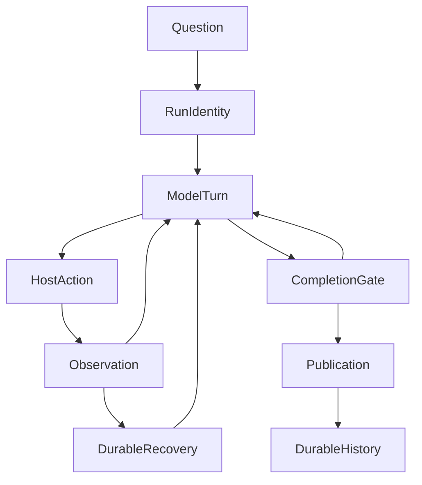

# From Retrieval to Sustained Research: Model, Harness and Loops in ETF Agent

> This article describes ETF Agent's engineering state in late October 2026. Its fund-research walkthrough is a **constructed teaching example based on existing mechanisms**, not an unedited real-model trace or proof that an entire financial research task has passed acceptance. The [six-layer lifecycle V3](/en/articles/017-prompt-to-answer-six-layer-panorama-v3) maps responsibilities; this article examines how an actual research question is supposed to progress.

## 1. Why finding sources does not finish the question

Imagine an investor asking: “Has the sector concentration of my fund portfolio increased? Use the latest disclosures and currency movements to explain the risks and the arguments for changing—or keeping—the allocation.”

Search can quickly locate several reports. A tool can return numbers successfully. Yet those documents may not answer the question. Two holdings reports may have different cutoff dates. A fund's equity-sector weights and an investor's allocation among funds have different denominators. An article republished today may simply repeat data from months ago.

The real task is neither “find more pages” nor “generate a long report.” It repeatedly asks: **What is known now? What is missing? Which facts conflict? What should be investigated next? Which conclusions are conditional? What was actually delivered to the user?**

ETF Agent has gradually adopted a particular engineering approach: the model handles research judgment; the existing execution system records authorized actions and enables safe continuation; financial facts and deterministic calculations retain their own authority. Model, Harness and Loop describe this arrangement. They are not three new platforms waiting to be stacked together.

## 2. Separate judgment from proof that an action actually happened

The **Model** handles semantic decisions. It can decompose the question into look-through sector exposure, reporting dates, currency risk and alternative allocations. It can choose tools, revise an interpretation in light of new evidence and ask a child agent to examine a counterexample. Saying “I searched” is not an execution receipt. Saying “finished” cannot override settled Host state.

The **Harness** is neither merely a system prompt nor a second brain supervising the model. It includes model-request preparation, admitted tools, budgets and capacity, lifecycle receipts, context fitting, durable Run identity, recovery and publication handoffs. It makes model proposals execute within real permissions and observable effects. A harness may itself implement the agent loop; it is misleading to define Harness and Loop as mutually exclusive layers.

**Financial capabilities** supply independent constraints. Which holdings came from an original disclosure? What was the cutoff date? Which denominator does a weight use? Which currency and FX timestamp apply? Can a calculation be reproduced? The model may explain numbers, but generating plausible language cannot authorize source data, arithmetic or actual business effects.

| Question | Judgment or authority | Common failure |
| --- | --- | --- |
| What to research next and which counterexamples matter | Main model's research judgment | Runtime rules mechanically choose the research strategy |
| Whether a tool was admitted, executed and settled | Existing Run Grant, Host and ActionRuntime owners | Treating a proposed tool call as a successful execution |
| Which source revision and arithmetic support a result | Source/Result and financial facts/calculation owners | Treating a Python number as a validated investment conclusion |
| Whether to park, resume or publish | Existing Recovery/Control, CompletionGate and Publication owners | A single `completed` field supposedly certifies every stage |

Our choice is therefore not to make “the Harness manage everything.” We **keep deterministic authority with its existing owner and research strategy with the model**. A newly invented umbrella coordinator would usually create competing interpretations of authorization, recovery and result versions.

## 3. A loop is not a picture of endless repetition

At execution level, Native Research has a small central cycle: `AgentTurn` proposes the next move, `ActionRuntime` executes admitted actions and records receipts, and `CompletionGate` decides whether the run can continue or terminate according to established runtime facts.

This depicts **possible handoffs**, not edges that must fire in every task. Direct answers need not use research tools. When resources or authorization are insufficient, the system can stop and truthfully deliver partial results. Recovery must not replay settled tools. Formal answer content goes through Publication, rather than being declared delivered by the model.

What matters more is that the same architecture can be understood at three time scales.

### 3.1 A model turn: observations alter the next action

Main might first retrieve NAV figures, then request a holdings disclosure. If the disclosure is older than expected, the next Main turn can change course: examine the original filing, explicitly adopt a historical reference date, or state that current holdings are unavailable.

This is not a DAG that blindly executes “search A, search B, search C.” **A settled observation can change the plan.** Only currently authorized receipts can become model input. A complete document read by a Child and an excerpt actually consumed by Main are different evidence-consumption facts.

### 3.2 Within one Run: working questions can reopen

ETF Agent's optional `researchNeeds` are model-authored working questions. An item may change from `open` to `resolved`, and reopen if subsequent evidence contradicts the original assumption. This helps Main track unresolved questions during long research, without turning the list into a deterministic evidence-coverage meter.

For example, “confirm the latest sector exposure” may appear resolved until the classification scheme changes. Main can reopen it. Conversely, a list whose every item is `resolved` does not prove citation correctness, arithmetic validity, original-question coverage or successful delivery. The model handles sufficiency judgments; CompletionGate and Publication settle their own facts and do not replace independent financial-quality review.

### 3.3 Across time: waiting and recovery are not restarting

A long task may exhaust context, encounter a failed tool, lose its process, require a human response or continue in the background. Recovery should resume under the original Run identity, authorization, budget and settled receipts. User corrections travel through existing Control mechanisms, becoming effects only after the targeted research owner adopts them.

When the original Run has terminated, explicit Continue starts a **new, linked Run**. It does not silently pretend the old run never ended. Future scheduled research also needs to preserve previous conclusions and their original conditions. Launching another run does not, by itself, mean that an investment thesis has been correctly updated.

This across-time continuity is a meaningful engineering capability, but it also opens a different product-quality question: a background run may truly execute without ultimately yielding a trustworthy research result.

## 4. Walk one fund-research question through these time scales

The following is a **plausible design path**, not a claim that the full sequence has already passed production acceptance.

**First, preserve the question and permissions.** The user wants to compare sector and currency risks. Account identity, original Run Grant, accessible portfolio data and approved tools are independently established. Main may choose Research but cannot enlarge data access on its own.

**Second, obtain applicable sources.** Main uses read-only financial tools for portfolio and fund facts. A Web or PDF Child may examine original report text. Search snippets are candidates; they cannot stand in for the original report's tables, cutoff dates and qualifications.

**Third, resolve a time conflict.** Today's reposted “latest holdings analysis” actually cites an older filing. Main must distinguish event, disclosure, reposting and holdings `dataAsOf` dates. If historical holdings are all that exist, the answer should say “as of the disclosed period,” not fabricate today's exposure. A36 temporal semantics has a partial implementation, while qualified live calendar sourcing, consumption in ordinary authenticated research and end-to-end acceptance remain open.

**Fourth, calculate without hiding uncertainty.** Comparing portfolio sector weights requires fund-allocation denominators, underlying holdings coverage, industry classifications and suitable FX dates. Deterministic tools can multiply and sum inputs; missing holdings, overlap, fees and currency assumptions still require explanation. A precise decimal is not proof that the data and method are correct.

**Fifth, collaborate only when it helps.** If two disclosures disagree, Main may delegate close reading to a Child or ask a Reviewer to check for omissions. Multiple agents add value when they supply genuinely different evidence or counterarguments, not merely different role names. A reviewer's opinion, a human reply, formal financial approval and an actual trade remain different authorities.

**Sixth, deliver complete, partial or unknown results accurately.** Independently valid explanations can be published during the run. A final answer should identify data dates, sector-exposure denominators, important risks, reasons not to change the portfolio and unresolved gaps. A downloadable report, durable storage and fresh History must be confirmed through their actual delivery mechanisms. Tool success, model termination, file generation and user retrieval are four different states.

The important feature is not the six-step ordering: **step three can force step two to repeat; step five may happen during any turn; insufficient data in step four may cause step six to remain Partial**. Research is continuously shaped by observations and constraints.

## 5. Why we did not add a “research commander”

Predefined workflows work well for stable, enumerable tasks. Open-ended research encounters discoveries and counterarguments that cannot be listed in advance. A DAG prescribing “fetch ten reports, then obtain three expert ratings” may produce an attractive final artifact even when the original documents are stale or decisive information is missing.

The opposite extreme puts every control in a prompt. It asks the model to “verify carefully” or “comply with every rule,” without ensuring that a financial effect was actually approved, a committed tool will not execute twice after recovery, or an answer file can still be retrieved in another session.

ETF Agent takes a middle course: **one Main research loop, optional small Child delegations, methods supplied through Skills where appropriate, tools and recovery constrained by their original deterministic owners, and financial judgment grounded in actual facts**. If two capabilities only need to share materials and tools, another Agent is rarely justified just to make the architecture symmetrical.

There is relevant external engineering precedent. Anthropic's [Building effective agents](https://www.anthropic.com/engineering/building-effective-agents) discusses the tradeoff between composable workflows and model-directed agents. Its [long-running harness research](https://www.anthropic.com/engineering/effective-harnesses-for-long-running-agents) explores cross-context handoffs. These are external references, not evidence that ETF Agent has proved better financial research quality.

## 6. Where we stand: substantial execution machinery, an unfinished financial outcome

This is not a system starting from zero on Model, Harness and Loop.

- **Mechanisms with explicit existing contracts:** A framework-free Native Loop, Main/Child lifecycles, original Run authorization and resources, tool receipts, result citations, Publication, durable continuation and optional working research questions. Asynchronous delivery and short foreground replies alongside background research also have bounded engineering verification.
- **Code or scoped evidence with important qualifications:** Market-time interpretation, human interaction, research-progress presentation, investment-perspective collaboration and different recovery paths vary by default-off configuration, source integration and acceptance scope. Listing a capability does not mean it is available or accepted for every user.
- **The outcome still unproven:** One complex fund question, from ordinary ingress, autonomously validating documents, calculating correctly, answering the user's actual concern and delivering both an accessible report and consistent fresh History. Existing research samples exposed problems involving cash, totals, classification and report retrieval. Passing local infrastructure checks does not erase those outcomes.

At publication time, the project had explicitly **stopped automatically adding paid financial-quality reruns**. The current priority is to repair existing reports and confirm their accessibility. Subsequent financial-quality phases remain unverified. More paid real-model comparisons require renewed explicit authorization; publishing this article does not trigger them.

This makes “we have built most of it” more precise: **the execution architecture is substantial; the bottleneck is moving from the availability of capabilities to sustained correction and the delivery of genuinely useful research conclusions**.

## 7. Deepen the existing owners, not the layer count

| What needs strengthening | A more useful verification question | Existing responsibility |
| --- | --- | --- |
| **Financial time semantics** | When repost, disclosure and data-cutoff dates conflict, can the system avoid calling holdings “current” while still permitting a qualified historical study? | Existing temporal semantics, market sources and fund facts |
| **Research conclusion revisions** | When evidence overturns an earlier inference, can the original conclusion, reason for revision and citations survive without relabeling old facts as new? | Research, Source/Result, Publication and Thesis/History |
| **Actual deliverables** | Can the user retrieve the correctly classified cash and totals, final text, report file and reviewable History? | Financial calculation, Publication, Artifact and conversation delivery |
| **Review and human adoption** | Can logs and UI distinguish a Reviewer's opinion, a user's response, business approval and committed effects? | Reviewer, HIO, Run Control and business-effect owners |

These are **questions for testing and refining existing ownership**, not proposals for four new modules or a separate compliance gate. Start from recorded failures, already approved samples and narrow deterministic checks; do not automatically initiate unapproved paid model experiments or real financial actions.

A mature financial research agent is not defined by longer loops or more specialists. Each turn should move closer to the user's question through reliable observations. When it cannot continue, it must still explain what is known and unknown—and get the real output into the user's hands.

---

[Six-layer lifecycle V3](/en/articles/017-prompt-to-answer-six-layer-panorama-v3) · [Result provenance](/en/articles/tool-results-outside-model-context) · [Trustworthy financial evidence](/en/articles/financial-agent-trustworthy-evidence-chain) · [Asynchronous research delivery](/en/articles/agent-asynchronous-research-time-bound-delivery)

[ETF Agent engineering essays on GitHub](https://github.com/hpoenixf/eff-agent-article) — if this engineering case is useful, consider giving the repository a Star.
