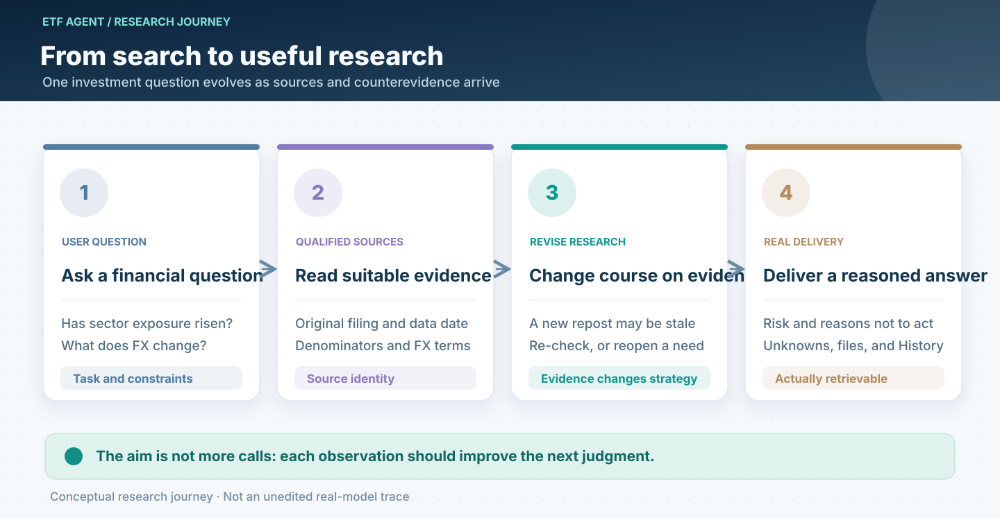
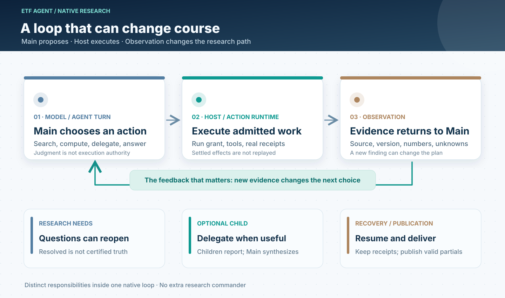
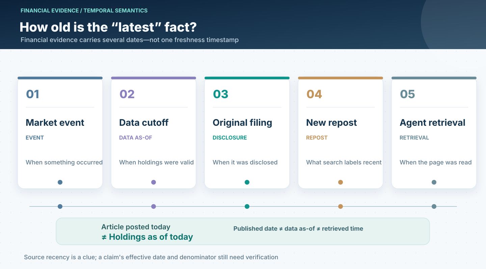
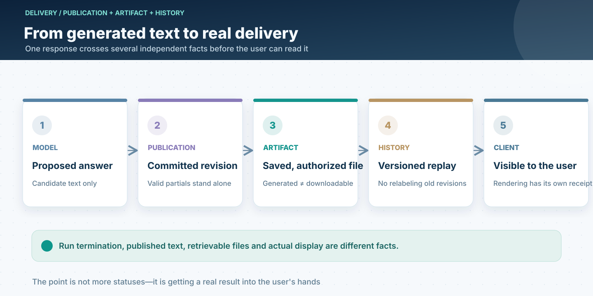

# A Research Agent Needs More Than Tools: How Model, Harness, and Loop Work Together

> The [six-layer panorama](/en/articles/017-prompt-to-answer-six-layer-panorama-v3) explains which parts of an Agent own which responsibilities. To understand why an Agent continues researching, changes direction, or revises its initial view, we need another lens: **how it works through one question over time**. This article draws on mechanisms already built into ETF Agent. The fund-investment scenario is a composite illustration, not a verbatim production trace.

## 1. The investor wants a judgment, not ten searches

Suppose someone asks: “Has my fund portfolio become more concentrated in certain sectors? Given currency movements, should I change the allocation?”

Several different questions hide inside that sentence. Which reporting date do the holdings belong to? How do sector weights inside individual funds translate into exposure at the investor's portfolio level? Which FX date makes a cross-currency comparison meaningful? If exposure changed, was it due to prices, fund trading, or the investor's own allocations? Might holding the position still be reasonable?

If an Agent merely receives an instruction to “research thoroughly” and loops through search-and-summary tools, it can produce an impressive report by combining different dates and incompatible denominators.

**Our central design insight while building ETF Agent is that tools expand information access, while a research loop makes revised judgment possible. Trustworthy execution and source relationships make those revisions auditable.**

An essential distinction follows: **more information is not automatically better research; longer execution is not automatically deeper reasoning**. Unless an observation changes the next action or the current conclusion, the loop is just repetition.

## 2. Model exercises judgment; Harness connects it to actual execution

Open-ended investment research is hard to prescribe as a fixed workflow. A disclosure may introduce a different industry classification. Two apparently independent sources may turn out to cite the same outdated filing. Only after reading can Main decide whether to search further, switch methodology, delegate original-document review to a Child, or qualify the conclusion as historical.

That is the **Model's** job: understand the investor's concern, select methods, compare evidence, form hypotheses, and respond to counterevidence.

The **Harness** is the environment in which these choices can actually execute. It prepares what the model may see and call, records whether a tool was really dispatched, binds receipts to a particular Run, controls resource limits, resumes safely after process loss, and hands content to publication. A harness can *contain* the agent loop; the two are not mutually exclusive architectural layers.

Finance brings a third kind of authority: **source facts and calculations**. Disclosures, holdings, exchange-rate timestamps, and deterministic arithmetic have their own data and execution contracts. The model can interpret them, but a sentence saying “I verified it” cannot amend the original numbers. An analytical recommendation cannot approve a trade on the user's behalf.

This led us away from the idea of an omniscient supervisory Agent. Instead, three kinds of work remain distinct:

| What must be decided | Primary responsibility | Transferable lesson |
| --- | --- | --- |
| What to investigate next and how to respond to counterevidence | Main model | Leave open semantic questions to the component capable of interpreting them |
| Tool permissions, settled receipts, budgets, and continuation | Existing Host, Runtime, and Recovery owners | Ground execution in verifiable events rather than model narration |
| Data provenance, numeric definitions, and actual business effects | Source/Result, finance tools, and business owners | A generated number or recommendation carries no automatic factual or execution authority |

**A model should not act as a transaction manager, and the Harness should not pretend to be an investment analyst.** The gain is not necessarily fewer lines of code; it is fewer competing sources of truth.

## 3. The point of a loop is not repetition—it is a changed strategy

ETF Agent's Native Research does not rely on an additional general-purpose graph workflow. Its execution rhythm is `AgentTurn → ActionRuntime → CompletionGate`.

`AgentTurn` lets Main propose an action using currently authorized context. `ActionRuntime` executes admitted actions and makes settled results available. `CompletionGate` handles continuation, resource limits, and completion according to existing runtime facts. A subsequent model turn can consume the new observation—and change what it had intended to do.

Three time scales make this especially useful.

**First, an observation changes the next action.** Main may discover that a fund's NAV is current but its disclosed holdings are from a previous quarter. It should not therefore describe today's sector exposure as known. It can seek the filing, use an explicitly dated historical view, or state that the needed data is unavailable.

**Second, research questions can reopen within the same Run.** ETF Agent's optional `researchNeeds` hold model-authored working questions. “Confirm changes in sector exposure” may once have been marked `resolved`, only for Main to discover that the reported holdings cover too little of the fund. The model can reopen the question. This permits genuine revision without turning working-note status into a completion gate. A `resolved` flag is not a certificate of financial correctness.

**Third, continuation across time must not recreate the past.** Existing durable execution and recovery preserve the original Run identity, grant, budgets, and settled tool receipts. If a process disappears, the system continues from the durable position instead of rerunning actions that already took effect. User corrections to background work travel through the original control mechanism. An explicit Continue after a terminal Run starts a linked new investigation.

These distinctions explain why ETF Agent has repeatedly concentrated Main, Child, Memory, Recovery, and Publication responsibilities in their original owners: **research strategy should be allowed to change, but recorded execution history should not change along with the model's opinion**.

## 4. Finance makes time—and the denominator—part of the answer

In generic technical systems, freshness is often modeled as one timestamp. An investment claim may involve several: market-event time, the holdings `dataAsOf` date, original disclosure date, correction date, news repost date, and the moment an Agent fetched the material.

Imagine an article published this morning that quotes a fund's six-month-old portfolio. The search result is recent; the portfolio is not. Similarly, a quarterly holdings report and a newer NAV observation may both be accurate without describing the same portfolio at the same instant.

ETF Agent's existing Web/PDF reading, source identity, ResultRef, temporal semantics, and market tools provide different pieces of this problem. Source/Result preserves provenance and derivation relationships; temporal semantics explains user-relative dates and market sessions; finance tools supply the actual holdings or market-data definitions. The model consumes those materials and decides how to investigate contradictions or qualify its language.

There is also an easily missed arithmetic issue:

`Portfolio sector exposure ≈ Σ (investor's allocation to fund × that fund's weight in the sector)`

This is a simplified relationship to illustrate denominators, not a complete financial formula. Actual analysis must consider cash, non-equity assets, look-through coverage, overlapping exposures, reporting periods, and currencies. A Python calculation can be numerically precise while answering the wrong question if the lineage and assumptions get lost between fund-level data and portfolio-level conclusions.

The broader insight is that **a financial Agent needs to preserve the number, its denominator, and the date when that number was valid**. A citation link points the reader somewhere. A traceable relationship among sources, transformations, and conclusions explains what the analysis actually depends on.

## 5. Subagents should divide research work, not vote on the conclusion

Some investment questions benefit from specialists. ETF Agent already has Child lifecycles, different research methods, investment perspectives, and bounded bull–bear conversations. That does not imply every investigation needs a fixed team of expert personas.

A better rule is for Main to delegate when an independent branch is useful. One Child can compare two original filings; another can recalculate sector look-through within authorized data access. Different investment perspectives can challenge the premise that a rise in concentration automatically calls for selling.

A Child returns **its own result and source relationships**. Main consuming the Child's summary is not equivalent to Main reading the entire source document. A Reviewer flagging a possible issue contributes an opinion, not an automatic veto over publication or permission to place a trade.

The right question about multi-agent collaboration is therefore not “how many agents participated?” It is **whether the extra branch supplied missing evidence, better arithmetic, or a counterargument that actually changed the judgment**. If not, fewer Children may be clearer, cheaper, and easier to resume safely.

## 6. A finished Run is not the same as a delivered result

It is tempting to define completion in terms of internal events: the model stops calling tools, the Run terminates, a report string is generated, and the task is marked successful.

The investor cares about something different: does the report actually describe their portfolio? Do cash and total allocations reconcile? Why was that recommendation made? Can they open the file? Will the same evidence still appear when they return?

ETF Agent's existing Publication, Artifact, History, and progressive-answer mechanisms separate these facts. Independently sound partial explanations can be delivered early; a final answer can be committed later. Files have their own durable identity and access conditions. History should replay the correct version. A background study can continue while the user asks a separate short question.

This is not a call for a complicated approval workflow around every sentence. Quite the opposite: **deliver what can stand on its own, and describe what remains unknown without disguising it as finished research**. A Run may stop because the question has been sufficiently addressed, resources ran out, it is waiting for an external event, or the user cancelled. One attractive `completed` value should not erase those distinctions.

## 7. Three design choices worth carrying into other Agents

If we distill these engineering lessons into a single investment-research story, the interesting part is not the number of modules. It is three choices.

**First, let the model change its mind.** Do not turn it into a natural-language wrapper around a rigid workflow. New disclosures, contradictory sources, and counterevidence should affect the next research action. But changing a strategy does not require rewriting execution history.

**Second, give every deterministic fact one owner.** Authorization, source identity, arithmetic, tool receipts, recovery, and publication each have a real place where their effects are settled. Connecting them into an investigation does not justify adding a commander that can overrule every owner.

**Third, work backward from the deliverable rather than treating architectural complexity as value.** Recoverable loops, collaborating Children, and traceable citations matter because they help an investor receive a study that explains its dates, denominators, evidence, and reasons *not* to act.

A good investment-research Agent need not know every answer. It should recognize when to continue investigating, when to revise a belief, and when only a qualified conclusion is justified. **The goal is not a loop that never stops; it is a system that can be corrected by evidence without losing the evidence.**

---

[Six-layer panorama V3](/en/articles/017-prompt-to-answer-six-layer-panorama-v3) · [Financial evidence chain (Chinese original)](/articles/financial-agent-trustworthy-evidence-chain) · [Research results and provenance](/en/articles/tool-results-outside-model-context) · [Asynchronous research and delivery](/en/articles/agent-asynchronous-research-time-bound-delivery)

[ETF Agent engineering essays on GitHub](https://github.com/hpoenixf/eff-agent-article) · If these design choices are useful, consider giving the repository a Star.
