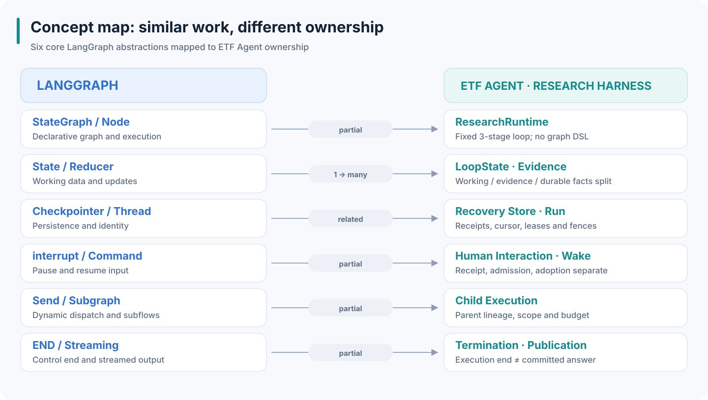
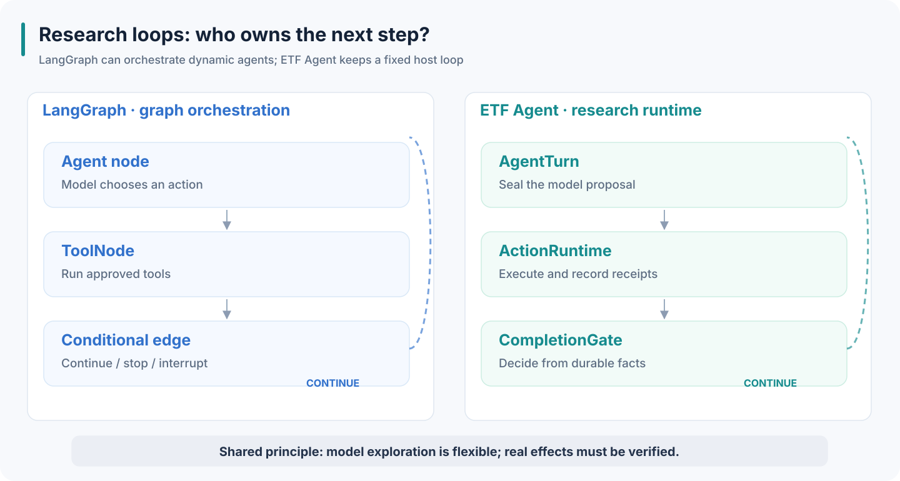
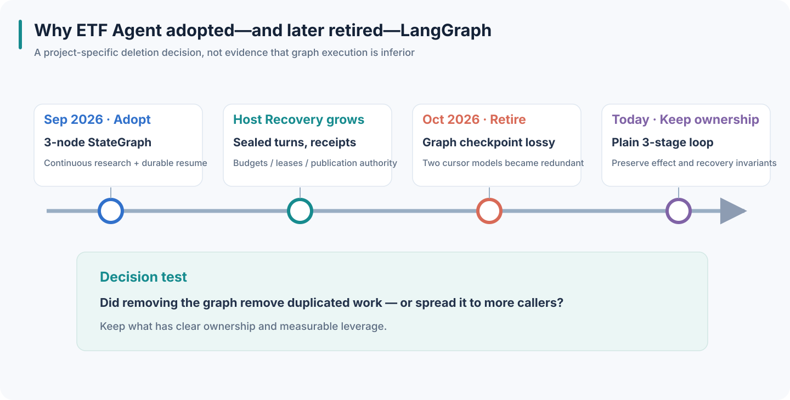
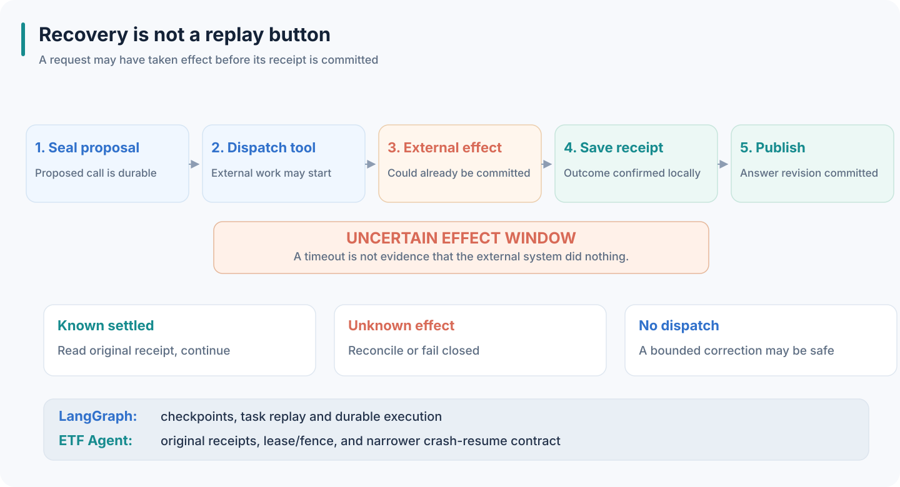
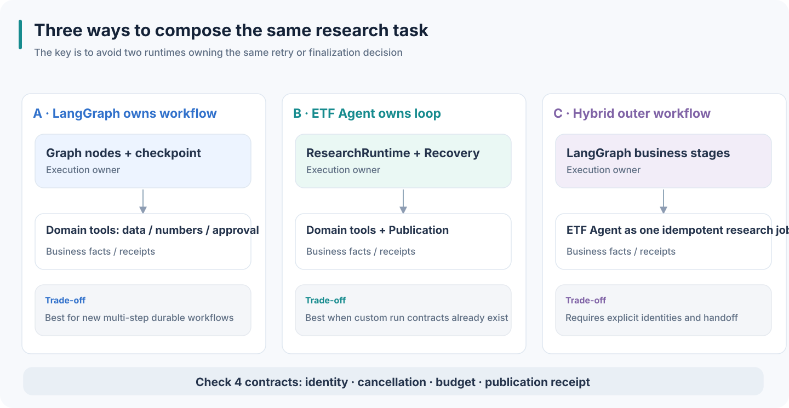

# ETF Agent vs LangGraph: Concept Mapping, Recovery, and Research Delivery

ETF Agent has a direct history with LangGraph: we once used LangGraph.js to organize our research loop, then removed that layer.

That history invites two premature conclusions. Did removing the graph mean that graphs cannot support autonomous research? Or did we simply rebuild LangGraph ourselves when we introduced our own persistence and recovery? Neither conclusion survives a close examination of the execution contracts.

**LangGraph is a general-purpose, stateful orchestration runtime. ETF Agent is a research application and harness that assigns ownership to execution, evidence, authorization, and delivery.** Some of their mechanisms overlap; others belong to different layers. Whether adopting LangGraph is valuable depends on which responsibilities it takes over—and what complexity actually disappears from the application.

This comparison is grounded in the **ETF Agent private application reviewed on November 8, 2026**. The publicly runnable teaching project is **Open ETF Agent v0.25.0**, which has a different scope. The LangGraph API references below use Python terminology, while our historical integration used LangGraph.js; language-specific APIs and versions should not be conflated.

**Public disclosure boundary:** Private-application module names appear as architectural landmarks, not as links to private source files or as promises that their implementation is public. The independently inspectable teaching code is linked near the end.

Consider a synthetic task: **compare the overlapping holdings of two funds, investigate incompatible disclosures, ask the user a clarification when needed, and save a sourced report.** It is an architectural example, not a real investment recommendation.

## 1. Compare the right layers first

LangGraph positions itself as low-level orchestration infrastructure for stateful and potentially long-running agents. It supports durable execution, interrupts, streaming, and workflows that mix deterministic steps with model-driven decisions. It does not prescribe a particular financial research method. See the [LangGraph overview](https://docs.langchain.com/oss/python/langgraph/overview).

The surrounding ecosystem matters:

| Layer | LangChain ecosystem | Comparable ETF Agent responsibility |
| --- | --- | --- |
| Execution and recovery | LangGraph | Research loop, run control, continuation cursor, persistence |
| Model and tool abstractions | LangChain | Model gateway, tool visibility, tool execution, adapters |
| Agent working environment | Deep Agents | Skills, context handling, child agents, execution environment |
| Serving and operations | LangSmith / Agent Server | Background work, service APIs, observability, evaluations, deployment |

These categories are not mutually exclusive. Deep Agents already includes subagents, planning, filesystem operations, and context tools; Agent Server provides deployment primitives as well. Comparing the entire ETF Agent application with the bare LangGraph library as a feature contest would therefore be misleading. See [official product distinctions](https://docs.langchain.com/oss/python/concepts/products) and [Agent Server](https://docs.langchain.com/langsmith/agent-server).

Our current main research loop is hosted by ETF Agent itself; the model gateway uses Vercel AI SDK provider adapters. Compatibility names associated with Claude or Pi do not imply that either SDK owns the main execution loop. This is relevant because the application must maintain the loop and its recovery wiring itself.

## 2. Which ETF Agent modules correspond to LangGraph concepts?



*Figure 1 · Responsibilities are comparable, but API or behavioral equivalence is not implied.*

A **mapping** here means “where similar responsibility is performed.” It does **not** mean that the objects can be substituted directly. Some map to a single function, some to multiple modules, and others have no general-purpose counterpart in our application.

### 2.1 Execution, state, and dependencies

| LangGraph concept | Closest ETF Agent module or object | Relationship and key difference |
| --- | --- | --- |
| `StateGraph` — a builder for nodes, state, and edges | `createResearchRuntime` and the loop in `research-runtime.ts` | **Partial.** We have no general graph DSL, compilation, or arbitrary topology API. |
| `CompiledStateGraph` / `Pregel` — compiled graph and engine | Research loop, tool execution, and Child scheduling jointly advance work | **No general equivalent.** A Main turn is not a Pregel superstep; there is no general channel engine. |
| `State` — data evolving through the graph | `ResearchLoopState`, `ResearchRun`, `createResearchRunEvidenceContext()`, and private module state | **One-to-many.** Working view, durable facts, evidence, and published output are separated. |
| `Node` — a schedulable work unit | `onNativeAgentTurn`, `onNativeActionRuntime`, `onCompletionGate` | **Related.** These are lifecycle stages, not interchangeable arbitrary graph nodes. |
| Edge / conditional edge / `Command(goto=...)` | `nextNode`, `requestedRoute`, conditional transitions | **Partial.** We use a fixed sequence and conditional continuation, not a general jump command. |
| Reducer — combines channel updates | `mergeResearchObservations` and per-owner updates | **Related.** No generic channel reducer registry; merging is not evidence verification. |
| Node `Runtime.context` and separate `RunnableConfig` | `ResearchRuntimePorts`, `ResearchProductionRuntimeOptions`, `ResearchTurnContext` | **One-to-many.** Dependencies, observations, and authorization remain distinct concepts. |

A naming trap is worth making explicit. `StateGraph` constructs a graph; `compile()` produces a `CompiledStateGraph`, which uses Pregel to execute it. A node's injected `Runtime` carries context, store handles, and stream-related utilities. `RunnableConfig` is injected separately. Our `ProductionRunContext` instead composes various application-module operations and state. Authorization still requires its own `ResearchGrantedAuthorization` contract: putting a value in context does not authorize an effect. See [LangGraph runtime source](https://github.com/langchain-ai/langgraph/blob/e5e37b5d70dbfd93c7006bd90a658c6179a95946/libs/langgraph/langgraph/runtime.py).

### 2.2 Identity, checkpoints, and long-term storage

| LangGraph concept | Closest ETF Agent module or object | Relationship and key difference |
| --- | --- | --- |
| Thread / `thread_id` — persistent execution context | `StoredConversation.id` is closest for user-facing continuity | **Partial.** Recovery is scoped by `scopeId + ResearchRun.runId`; a thread cannot simply be renamed a conversation. |
| Run / `run_id` — execution identity | `StoredRun`, `ResearchRun.runId` | **Related.** One conversation may have several runs, each with its own admission and budget; tracing IDs and server-side Run resources also differ. |
| `checkpoint_id` — historical checkpoint locator | `ResearchCheckpoint.revision` and its content identity | **Partial.** Checkpoint revision, execution fence, and publication revision are different counters. |
| Checkpointer / PostgresSaver | `ResearchCheckpointRecoveryStore`, `createPgResearchCheckpointRecoveryStore` | **Related, not interchangeable.** Our store also carries receipts, budgets, leases, and fences. |
| `StateSnapshot` | `ResearchCheckpoint`, `ResearchRuntimeResumeState`, `ResearchRecoveryContinuation` | **One-to-many.** There is no universal snapshot with arbitrary node replay and fork semantics. |
| Store — cross-thread application data | `MemoryRepository`, `PgMemoryRepository`, memory routing for the memory use case | **Partial.** Conversation history, memory, and source results have different ownership. |
| Time travel / checkpoint fork | History reading and explicit new-run continuation have some user-level similarity | **No general equivalent.** Reading an old answer does not restart an edited historical state. |

LangGraph itself separates thread checkpoints from cross-thread Store data. Its historical `MemorySaver` name should not be confused with the semantic, user-facing memory repository in ETF Agent. See [LangGraph persistence](https://docs.langchain.com/oss/python/langgraph/persistence).

The key distinction is identity. A **Conversation** can contain several **Runs**. Within a Run there are model turns, action receipts, checkpoints, and publication revisions. Each identity exists for a different admission, retry, or readback purpose.

### 2.3 Tools, human interaction, and delegation

| LangGraph concept | Closest ETF Agent module or object | Relationship and key difference |
| --- | --- | --- |
| `ToolNode` | `researchToolContracts`, `ProductionNativeState`, `NativeReadInvocationExecutor`, MCP Host | **One-to-many.** Tool presentation, dispatch, effects, and control actions have different owners. |
| `interrupt()` | Blocking human interaction, `ResearchNativeParkControl`, `ResearchControlPark` | **Partial.** Nonblocking questions are not interrupts; blocking requests use the park path. |
| `Command(resume=...)` | Human response admission, `ResearchControlWakeProof`, Store `resumeRun` | **One-to-many.** Receiving, authorizing a wake, and adopting the response are separate. |
| `Send` — dynamic fan-out with independent input | `spawn_subagent`, `createNativeSubagentExecution().spawn` | **Partial.** Child execution is bound to parent identity and original limits, not arbitrary graph-node fan-out. |
| Subgraph | Child execution with scoped context and handoff | **Partial.** A subgraph need not be an agent; a Child is not an unrestricted nested graph. |
| Functional API `task` | Model turns, proposals, action receipts, and recovery consumption collectively cover some concerns | **No single equivalent API.** It is not simply an ETF Agent planning item, scheduler task, or Child. |

Here, the closest correspondence to `interrupt()` is **a chain of modules**, not a function with the same name. The same is true of durable task replay and result settlement. See LangGraph's [control-flow concepts](https://docs.langchain.com/oss/python/langgraph/graph-api-send-command).

### 2.4 Runtime policy, output, and termination

| LangGraph concept | Closest ETF Agent module or object | Relationship and key difference |
| --- | --- | --- |
| `RetryPolicy` | Main retry path, `ResearchMainRetryIntent`, `ResearchNativeRetryAdmission` | **One-to-many.** Actual dispatch, uncertainty, and reserved resources constrain retries. |
| `recursion_limit` | Turn policy, `RunResourceAdmission`, termination owner | **Partial.** We also limit requests, tools, time, and finalization reserve; turn count is not total cost. |
| `durability` mode | Separate persistence contracts for receipts, checkpoints, terminal facts, and publication | **No single global switch.** Different objects make different durability promises. |
| `messages / updates / values / custom` streams | `ChatModelEvent`, public `StreamEvent`, progress events, Publication | **One-to-many.** Internal model events are not equivalent to committed user-facing content. |
| `END` | `finish_research`, termination owner, Store `finishRun` | **Partial.** Proposed stop, terminal Run, committed body, and solved research question differ. |
| Node cache / `CachePolicy` | Original-result readback and settled receipt reuse are only related locally | **No general equivalent.** Result reuse is not a generic cache keyed by node input. |

The point of this map is to identify the right **seam**. For interrupts, inspect interaction plus parking and waking. For checkpoints, inspect the cursor and durable store. For answers, inspect Publication in addition to the control loop. Matching one class name would miss most of the actual contract.

## 3. A graph can host a dynamic agent—node granularity is the choice



*Figure 2 · Both allow the model to revise its next step; their execution ownership differs.*

### 3.1 How much should a node contain?

The fund-comparison task could be implemented as several meaningful nodes: read filings, check reporting periods, ask the user, calculate overlap, and publish. This is attractive when business stages have stable semantics and must be independently retried, observed, or tested.

Alternatively, a graph can have only three nodes: model decision, tool execution, and completion decision. Once the model discovers mismatched reporting dates, it can search again, change source, narrow the question, or ask for clarification. **LangGraph's edges and dynamic dispatch do not force a fixed research route.** See [Graph API control flow](https://docs.langchain.com/oss/python/langgraph/graph-api-control-flow).

Our original LangGraph.js integration chose precisely the second, **thin-graph** approach:

`AgentTurn → ActionRuntime → CompletionGate → AgentTurn / END`.

The post-retirement implementation preserves these three conceptual stages without a general graph API: the model proposes, the Host executes authorized actions, and a deterministic gate decides whether work may continue.

Granularity determines what the orchestration engine can independently persist or inspect. If an entire research loop is hidden inside one `research` node, intermediate tool calls are not automatically separate graph checkpoints. If every small operation is a node, the graph becomes more explicit but the state schema and compatibility surface grow. The choice is not “graphs versus freedom”; it is **which units the framework should manage, retry, and observe**.

### 3.2 Pregel has particular parallelism semantics

LangGraph's Pregel execution advances in supersteps: select runnable nodes, execute them, and make their channel writes visible to subsequent steps. Nodes in one superstep may execute concurrently. In our teaching task, parallel branches can read Fund A and Fund B, then a downstream node combines their results. See [Pregel](https://docs.langchain.com/oss/python/langgraph/pregel).

ETF Agent also coordinates Child execution and later consumption, but those operations have their own identities and receipts. Neither mechanism decides whether two holdings tables have compatible reporting dates. **Execution synchronization and research interpretation remain different responsibilities.**

### 3.3 A plain loop can still use LangGraph

LangGraph's Functional API provides `entrypoint` and `task`, allowing conventional language constructs while still using the durable execution engine. Graph API and Functional API differ in state representation, checkpoint granularity, and visualization. The debate is therefore not literally “our `while` loop versus their graph syntax.” It is about which actual work is durably recorded, what may rerun after recovery, and who confirms external effects. See [Functional API](https://docs.langchain.com/oss/python/langgraph/functional-api).

## 4. Why we adopted LangGraph—and why we removed it



*Figure 3 · This is a decision within one evolving architecture, not a general verdict against LangGraph.*

Our original motivation was legitimate: move away from a fixed semantic chain toward continuous research, while obtaining durable-resume infrastructure. A thin StateGraph offered a clear location for the loop.

Over time, ETF Agent's Host-owned Recovery began storing stronger execution facts: sealed model turns, ordered proposals, action receipts, publication receipts, budget use, leases/fences, and the continuation cursor. At the same time, the graph checkpoint had been deliberately constrained to bounded references and projections. Some active execution state was still in process memory, so that checkpoint alone could not reconstruct the original fresh process.

This created **two concepts of execution position**: graph checkpoint/thread/cursor and application Recovery continuation/receipt/fence. The latter already owned restart safety; the former had limited independent leverage. This was a consequence of **our integration choice**, not a limitation of what LangGraph can generally persist.

Three designs were considered:

1. Keep LangGraph but disable its durable saver. Rejected: the additional graph vocabulary would remain without its persistence benefit.
2. Replace LangGraph with another abstract research-loop coordinator. Rejected by default: a renamed pass-through layer would not simplify ownership.
3. Internalize the small, deterministic loop in `ResearchRuntime`. Selected, while retaining Recovery's `nextNode` cursor and all crash-window protections.

This selection was sound **only under particular preconditions**: a small fixed lifecycle, an existing deeper recovery system, and insufficient additional value from the graph wrapper.

The deletion test is general: **after removing a framework, did duplicated complexity actually disappear, was it safely absorbed by an existing owner, or did it spread into every caller?** The last result would be a reason to reconsider the deletion. A new application without a durable execution foundation could easily benefit more from adopting LangGraph than from building its own recovery machinery.

## 5. State ownership: who may interpret a fact?

LangGraph State can hold messages, source references, authorization flags, and domain fields. A reducer determines how updates combine; business meaning remains the application's job. See [Graph API state and reducers](https://docs.langchain.com/oss/python/langgraph/graph-api).

ETF Agent divides the relevant facts among owners:

| Responsibility | Question it answers |
| --- | --- |
| Working research state | What is the current loop doing and what does the next model turn see? |
| Recovery | What actually happened, what is committed, and what is still unknown? |
| Source/result ownership | Which material was acquired and what evidence scope does it support? |
| Authorization | What may this Run read or execute? |
| Publication | Which exact version is now officially committed? |

Suppose the working context says, “We have read Fund A's latest holdings.” That might mean only a search snippet was seen, the tool acquired a document that the model has not yet consumed, or the model did read a report whose holdings date is last quarter. Those are not the same evidence state. A single `hasEvidence: true` cannot establish provenance, model consumption, or current comparability.

The model can propose that research is sufficient; changing a state field cannot prove the report was saved or expand access to another account. Conversely, a valid read receipt cannot certify that the portfolio conclusion is correct.

This separation can be implemented **on top of LangGraph**: let graph State carry appropriate references while the corresponding domain owners verify permissions, provenance, numbers, and commits. Generic state management and domain fact ownership are not alternatives.

## 6. Recovery: what exactly is being resumed?



*Figure 4 · An unknown external effect is not an ordinary tool failure.*

### 6.1 Checkpoints have a granularity and a durability policy

LangGraph normally creates full checkpoints at superstep boundaries; writes from successful nodes in a partially failed superstep can support recovery. The persistence modes `sync`, `async`, and `exit` trade stronger per-step durability against write overhead and crash exposure. Cross-process execution also requires a persistent checkpointer. See [Checkpointers](https://docs.langchain.com/oss/python/langgraph/checkpointers).

Take a difficult failure window: a report-save API has already written its file, but the process crashes before local success is persisted. Retrying could create a second file; assuming success could reference a nonexistent one. LangGraph's durable execution guidance warns that re-entered nodes may repeat external effects and that durable tasks are not a universal exactly-once guarantee. Stable idempotency identity and reconciliation by the external owner are needed; a timeout does not prove that no effect occurred. See [fault tolerance](https://docs.langchain.com/oss/python/langgraph/fault-tolerance).

Open ETF Agent provides an inspectable example of a bounded Host-owned contract: model-reserved, proposal-sealed, tool-dispatched, result-committed, result-consumed, and other phases are distinguished. Once a tool was dispatched, the original adapter must reconcile an unknown outcome; blind redispatch would fabricate a new execution history. See the [public runtime](https://github.com/hpoenixf/open-etf-agent/blob/99485ed3e7d45d462f9908e53ff5653a8c0791c1/src/runtime.mjs).

**That teaching implementation does not define the full crash-resume promise of the private application.**

### 6.2 The private application's root-crash promise is deliberately narrower

| Situation | Current main-application behavior | What remains invariant |
| --- | --- | --- |
| Browser disconnect after an admitted background run, or under an explicitly admitted concurrent profile | The original server-side execution continues; reconnection reads the same Run | Original admission, deadlines, and budgets; no new Run on reconnect |
| Process interruption of an ordinary Root without valid control wake | Original owner settles interruption and returns committed results | No automatic reconstruction/replay of abandoned model or tool work |
| Valid Human/Child control wake at a supported park point | Resume under the original identity and limits | Only the approved continuation contract may dispatch work |

In the older foreground profile, a disconnect still cancels execution unless background/scheduled execution was explicitly admitted. The newer concurrent profile is feature-gated and disabled by default. An explicit Continue creates a newly admitted Run linked to the old source; it is not a general graph-checkpoint fork.

The product accepts possible loss of uncommitted progress after an ordinary crash in exchange for a narrower replay promise. This is a legitimate trade-off, but it means **our Recovery is not a drop-in substitute for the complete LangGraph checkpoint/replay interface**.

### 6.3 Readback, replay, and time travel are different

LangGraph time travel can replay from a historical checkpoint or fork with modified state. Nodes downstream of the chosen point execute again and may produce different model or external results. That is not read-only history. See [time travel](https://docs.langchain.com/oss/python/langgraph/use-time-travel).

ETF Agent History primarily reads previously committed outputs, while explicit continuation creates a newly admitted Run. Neither constitutes a general historical state-forking API.

There is also a version boundary: resuming an old graph normally uses the currently deployed graph implementation, so state compatibility must be managed. Even if an old data field remains readable, the old fund disclosure, permission, or numeric denominator may no longer be valid. See [backward compatibility](https://docs.langchain.com/oss/python/langgraph/backward-compatibility).

## 7. `interrupt` maps to human interaction and wake-up—not approval by itself

Suppose the reports disagree about their coverage, and the agent asks: “Should I compare the full portfolio or only the disclosed equity portion?”

LangGraph can call `interrupt()` to park the execution and later receive input through `Command(resume=...)` on the same thread. On resumption the containing node starts again at its beginning, so pre-interrupt side effects must be handled accordingly. See [interrupts](https://docs.langchain.com/oss/python/langgraph/interrupts).

ETF Agent splits that sequence into several facts: Human Interaction records the exact request and received answer; Conversation admits the user's message; Wake/Recovery determines whether that reply authorizes resumption of the intended work; the model subsequently consumes it.

**Receiving an answer is not the same as adopting it.**

The main application additionally distinguishes normal questions, permission requests, and effect approvals. Some questions are nonblocking; unrelated work can continue. Required decisions park at safe control points. Responses bind to the original request identity and revision rather than treating any later “yes” as consent for arbitrary operations.

Choosing a comparison range does not authorize access to another account and does not approve trading. LangGraph applications can implement the same checks using their state and business tools. The framework supplies a generic pause mechanism; the complete human-authorization contract is application logic.

The public v0.25.0 example is narrower: it supports bounded blocking questions and tracks receipt/adoption but does not provide the private application's full set of nonblocking, permission-grant, or effect-approval flows. See [public human-interaction limits](https://github.com/hpoenixf/open-etf-agent/blob/99485ed3e7d45d462f9908e53ff5653a8c0791c1/docs/human-interaction.md).

## 8. Skill, MCP, and Node organize different concerns

“ETF Agent uses Skills while LangGraph uses nodes” is a category error.

| Concept | Primary concern | In the fund comparison |
| --- | --- | --- |
| Skill | Reusable methods and supporting resources | Distinguish disclosure dates, coverage ratios, portfolio weights, and underlying holdings weights |
| Tool / MCP | Callable capabilities and input/output contracts | Read a filing, compute overlap, save a report |
| Node / execution loop | Work ordering and control transfer | Research again, await a person, or publish |

A LangGraph node can load a Skill and call tools. A Skill can guide a model that is executing within a graph. Deep Agents already offers progressive Skill loading, and LangChain supports MCP integration; those capabilities should not be presented as unique to ETF Agent. See [Deep Agents Skills](https://docs.langchain.com/oss/python/deepagents/skills) and [MCP integration](https://docs.langchain.com/oss/python/langchain/mcp).

What we must own is the relationship among methodology, actual capabilities, and permission. A Skill may teach the model which comparison method to apply but does not grant private-account access by merely containing instructions. A path or integrity hash for a script is not equivalent to OS process isolation.

Rules that must always run—for instance, checking the original account grant before committing a result—belong on the real execution or submission path, not solely in a model-visible Skill. This remains true even if LangGraph orchestrates the rest.

## 9. Subgraph and Child overlap, but a subflow is not always an agent

A LangGraph subgraph is a composable workflow with potentially independent state. It may represent a subagent, but an ordinary deterministic data-processing workflow can also be a subgraph. See [subgraphs](https://docs.langchain.com/oss/python/langgraph/use-subgraphs).

In ETF Agent, Main may delegate a narrow document verification to Child. That Child has an independently scoped context and an original parent identity; it returns results to be consumed by Main. The comparison with subgraphs is useful, but Child also has lineage, budget, grant, execution, and publication rules.

The critical point is on the return path. **Child reading a document does not imply Main read every passage. Child summarizing an opinion does not prove that opinion is grounded.** More children do not inherently improve research quality; what matters is the additional facts, calculations, or counterarguments that make it into the final analysis.

The same constraints could be placed around LangGraph subgraph calls. The hard work is making the execution and consumption contract explicit. Public Open ETF Agent v0.25.0 intentionally offers bounded, read-only, sequential Child execution—not arbitrary nesting or a general parallel subgraph framework. See [public Child limits](https://github.com/hpoenixf/open-etf-agent/blob/99485ed3e7d45d462f9908e53ff5653a8c0791c1/docs/child-execution.md).

## 10. Streaming and `END` are not the same as delivering a report

LangGraph can stream messages, value snapshots, updates, custom events, and other views. It does not require the UI to interpret every generated token as a final answer. See [streaming](https://docs.langchain.com/oss/python/langgraph/streaming).

ETF Agent makes several application facts explicit:

| Item | What it actually proves |
| --- | --- |
| Progress event | Which work is being performed or observed |
| Draft/preview | What candidate content currently exists |
| Publication receipt | Which precise answer revision has been durably committed |
| Artifact / History | What file and historical body the user can retrieve |

Our Publication path prepares and validates a candidate, commits a new version or authorized replacement through the store, verifies the receipt, and only then derives the public event. A preview and a commit are different facts.

A LangGraph application can do exactly this in a publication node and use the durable receipt to decide whether to finish. But `END` itself means that a graph control path has ended. It does not certify external storage, user access, or the correctness of an investment conclusion. **Execution success, research quality, and user delivery are separate evaluation questions.**

## 11. Three viable compositions



*Figure 5 · Each composition is possible; ownership of retries, cancellation, and publication must not conflict.*

### Option A: LangGraph owns workflow; domain modules provide facts and effects

For a new project, LangGraph can orchestrate stages, branches, interrupts, and checkpoints while domain modules provide fund disclosures, calculations, authorization, and artifact commits. Graph state holds appropriate references to these facts.

The benefit is not having to build generic orchestration from scratch. The obligation is to embrace and understand its resume behavior, choose suitable task granularity, and handle external idempotency and state-version compatibility.

For an existing ETF Agent application, the decisive question is: **which custom loop, cursor, or recovery adapters could be removed if LangGraph became authoritative?** If none disappear but a second execution state is introduced, the integration has recreated the historical overlap.

### Option B: ETF Agent owns its research loop

A fixed, small Host-owned loop is credible when the application already has a deeper durable effect contract and the graph layer adds little independent leverage. The cost is continued ownership of runtime reliability, retry/recovery diagnostics, and maintenance. The team must repeatedly test whether the homegrown behavior still earns its keep.

### Option C: LangGraph owns an outer business flow; ETF Agent is a research job

A larger business workflow might acquire a request, prepare data, perform research, request approval, and archive a result. The open-ended research step could be one identity-bound job executed by ETF Agent.

A re-entered outer node must **not** blindly call `startResearch()` again. It must look up the original Run: read its committed result, await a still-running job, reconcile an unknown outcome, or explicitly admit a *new* Run when research genuinely needs restarting.

Before composing two runtimes, define four contracts:

1. **Identity:** Is node re-entry a new request or another observation of the same Run?
2. **Cancellation:** Who receives Stop, how is it forwarded, and when is remote cessation actually confirmed?
3. **Budget:** Can an outer retry accidentally refresh the original request or deadline budget?
4. **Publication:** Which durable receipt proves the final report exists, and who is allowed to emit the final answer?

Two state machines are acceptable if they govern different lifecycles. Two systems independently deciding whether the *same tool effect* should be retried are much harder to make safe.

## 12. How to choose—and what remains unmeasured

| Constraint | Consider first | Cost and obligation |
| --- | --- | --- |
| New system needing durable multistep workflows | LangGraph with minimal domain adapters | Learn execution semantics, state migration, and task granularity |
| Standard model/tool loop sufficient | Existing Agent SDK or harness | Implement domain-specific permissions, result validity, and delivery |
| Existing durable recovery plus a simple research loop; graph roles overlap | Retain or simplify the Host-owned loop | Own runtime reliability; keep checking whether custom code is justified |
| Stable workflow containing open-ended research | Outer orchestrator and inner research job | Define identity, cancellation, budget, retries, and commit handoffs |

We have **not** run an apples-to-apples benchmark with identical model, source corpus, budget, and tasks across both designs. We therefore cannot claim that either is faster, cheaper, or more accurate on research quality. Removing an overlapping dependency is a verifiable architecture change; the amount of engineering cost saved is not yet measured.

The decision principle is deliberately practical: **Can an established framework reliably own a generic responsibility? Which of our modules could then be deleted? Do the remaining domain responsibilities have a clear owner?**

For the fund comparison, orchestration organizes reading, parallel work, waiting, and continuation. Domain owners provide identity, permissions, evidence, numeric semantics, and committed artifacts. The model chooses research methods and revises its interpretation. Publication establishes what the user can actually retrieve.

We previously delegated part of the first category to LangGraph and subsequently reclaimed it under project-specific conditions. We may reasonably reuse LangGraph again at a future seam where it creates independent leverage. The enduring architectural goal is **clear ownership of each execution and business promise**, not allegiance to a graph or a handwritten loop.

## Inspectable public code and scope

The fixed [Open ETF Agent v0.25.0 source](https://github.com/hpoenixf/open-etf-agent/tree/99485ed3e7d45d462f9908e53ff5653a8c0791c1) includes an inspectable runtime, sessions, bounded human interaction, and publication. The private-application mapping table above must not be mistaken for that repository's directory structure.

The README's offline demonstration uses scripted model responses and synthetic documents; it tests mechanics, not real-model investment research. With the repository's stated Node runtime requirements, an example is:

```bash
git clone --branch v0.25.0 --depth 1 https://github.com/hpoenixf/open-etf-agent.git
cd open-etf-agent
npm ci --ignore-scripts --no-audit --no-fund
npm run build
npm run demo -- --case document-compare
```

It produces a local report and execution record according to the corresponding [README](https://github.com/hpoenixf/open-etf-agent/blob/99485ed3e7d45d462f9908e53ff5653a8c0791c1/README.md). The public example is not an endorsement or simulation of real trading.

---

[中文版](/articles/etf-agent-vs-langgraph) · [Engineering articles](https://github.com/hpoenixf/eff-agent-article) · [Open ETF Agent](https://github.com/hpoenixf/open-etf-agent). If these examples help you reason about Agent architecture, you are welcome to Star the open-source project or discuss concrete counterexamples.