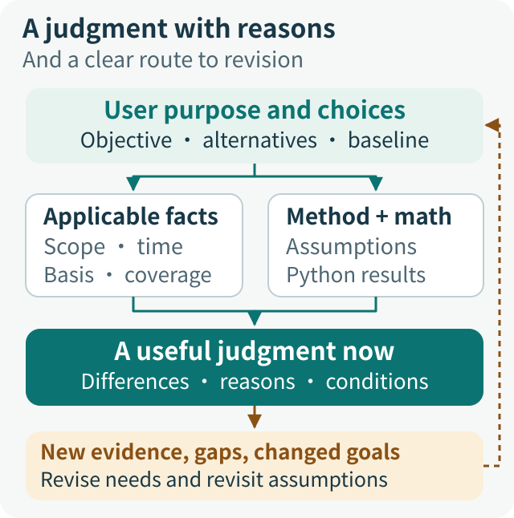
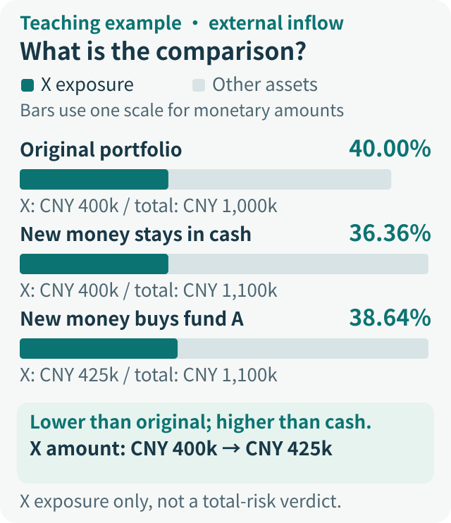

# How a Financial Agent Becomes a Professional Researcher: From User Goals to a Research System

## 1. What Is Professional Financial Research?

We can begin with a clear definition of the professional financial research discussed here:

**For a specific question and intended use, establish the relevant facts, choose suitable methods, compare possible explanations or courses of action, and form a judgment that is supported, verifiable, and explicit about when it needs revision.**

The central output in this definition is a judgment. It might explain where a company's growth comes from, compare the risks borne by two funds, or describe how an additional investment would change an existing portfolio.

Research needs documents, numbers, and reports. Their value, however, must be understood in relation to the judgments they support.

A report with comprehensive source material and precise calculations may still fail to answer the user's question. A short piece of research can be useful if it identifies a fact that changes the judgment and explains the reasoning and conditions under which it applies. Length, the number of metrics, and professional language are not sufficient measures of research quality.

### Research Connects Three Distinct Things

First come **facts**: what exists now, what happened in the past, and what the sources actually disclose.

Then comes **analysis**: how those facts relate to one another and what follows under a particular method or set of assumptions.

Finally comes **judgment**: what the results mean for the question at hand and how they help with the choices the user faces.

For example, “this fund holds a large allocation to technology companies” is a factual claim that needs verification. “How would buying it change the portfolio's exposure to those companies?” requires analysis. “Would that change serve the user's purpose?” is a matter of judgment.

These three things cannot substitute for one another. Obtaining the actual holdings does not automatically produce an appropriate allocation conclusion. Executing the right formula does not tell us whether the user cares more about long-term growth, short-term volatility, or an expense due in six months.

**Professional research is responsible for the reasoning that connects facts to judgment.**

This also explains why financial research is difficult to assess solely by asking whether a prediction turned out to be correct. Prediction can be part of research, but future outcomes are also affected by unknown events and random variation. We should examine the long-term performance of judgments as well as the methods and evidence available at the time: were important facts omitted, was the wrong comparison chosen, or was an assumption presented as something that had already happened?

Research cannot guarantee that the future will unfold as expected. It should help its users understand why the current judgment is reasonable, which evidence matters most, and what changes would require the judgment to be adjusted.

## 2. What Do Users Actually Need?

With that definition in place, we can discuss user needs more precisely.

A user asks: “I already own several technology funds. If I put another CNY 100,000 into Fund A, will my portfolio be more diversified?”

On the surface, the question is about a fund. The underlying task is to help with a choice in the user's own circumstances.

The user might worry that several different product names still represent the same underlying companies. They might want to reduce volatility without substantially reducing their equity allocation. Or they might simply want their allocation to feel more balanced. Different purposes lead to different research.

“More diversified” therefore cannot immediately be translated into “more funds,” nor should it automatically be reduced to one concentration metric. Reducing exposure to a single company, lowering sector concentration, adding geographic allocations, and retaining liquidity address different questions.

### Users Need to Understand Their Choices and the Consequences

Useful research should help the user understand at least four things:

| What the user needs to understand | What it means in this example |
| --- | --- |
| Their current position | Where the existing portfolio is concentrated and how much of it is covered by the available evidence |
| The alternatives that can be compared | What changes if the money buys Fund A, stays in cash, or goes into other assets |
| Why a particular change matters | How it relates to goals such as reducing concentration or retaining liquidity |
| The conditions that could still change the judgment | The source of the money, disclosure dates, holdings that have not been examined, or changes in the user's goals |

The most easily overlooked issue is the choice of comparison.

“Will the portfolio be more diversified after the purchase than it was before?” and “Will investing this new money in Fund A be more diversifying than leaving it in cash?” are different questions. The first compares a portfolio at two points in time. The second compares two ways of using the same additional money.

Without a clear comparison, an agent can calculate correct numbers and still reach a conclusion that is unhelpful or misleading.

Users may not be able to state all these conditions at the outset. Part of the researcher's job is to identify ambiguity and clarify the conditions that could materially affect the answer. The agent can state the scope of analysis and proceed with work that can be completed independently, without turning every question into a lengthy questionnaire.

In this example, it can first establish which risk concerns the user most and whether the CNY 100,000 comes from new money, existing cash, or the sale of other assets. Other research questions will have different critical conditions.

This gives us a broader relationship:

**Goals determine which changes matter, facts establish the current position, and methods determine how to compare. Professional judgment emerges from their combination.**

Without a clear goal, the agent may calculate many irrelevant metrics. Without established facts, it may apply general knowledge to the wrong object. Without a suitable method, it may use a true number to answer a different question.

## 3. What Does a General Answer Provide, and What Is Missing?

A general answer often advises the user to diversify, consider correlations, account for risk tolerance, and avoid excessive concentration.

These ideas have value. They provide general financial knowledge and help users understand which factors deserve attention. For a knowledge question such as “Why does diversification matter?”, a clear explanation of these principles can fully satisfy the request.

But when the question becomes “What happens if I invest my money this way?”, an additional step is required: **connect general principles to this user's facts, feasible alternatives, and goals.**

That connection does not arise automatically from a longer answer, more citations, or language that sounds more like an analyst's report.

### An Answer Can Be Complete in Language While the Research Remains Incomplete

Large language models are good at producing coherent explanations. Once a model recognizes topics such as funds, concentration, and risk, it can organize a structurally complete answer.

Whether the research is complete depends on other conditions: did the agent obtain the actual evidence for this portfolio, understand the period to which the data applies, choose the correct comparison baseline, calculate the relevant consequences, and explain how those consequences relate to the user's purpose?

An answer can therefore read as complete while its central judgment remains unsupported.

We have observed this gap in the private ETF Agent project. Scripts had been called repeatedly, yet some precise risk descriptions in the resulting reports still lacked the necessary inputs and calculations. Tool-call records show that the system took actions; they do not, by themselves, establish that those actions support the final sentence. [Practice: consuming Python results](https://hpoenixf.com/eff-agent-article/articles/financial-agent-python-result-consumption)

External research offers a similar observation. FinSearchComp, published in 2025, evaluated financial tasks through actual search and reasoning. Its reported failure modes include outdated evidence, temporal mismatches, errors when aggregating units or currencies, and misaligned reporting periods. These failures occur while obtaining and using facts; demonstrations of financial knowledge alone are unlikely to reveal them. [Original FinSearchComp paper](https://arxiv.org/html/2509.13160v1)

This describes a style of answering, not an inherent limit that confines language models to general advice. Models can participate in professional research. The product must, however, enable them to obtain facts about the specific case, perform analysis, observe the results, and revise their judgments.

From this perspective, the gap between a general answer and professional research is largely a question of whether the work has reached the user's actual problem. General knowledge provides the starting point; research completes the connection.

## 4. How Can an Agent Accomplish This Purpose?

This is where engineering practices such as research needs, time semantics, and Python belong.

They should serve a shared task: **form and maintain a judgment about the user's question.**

“Maintain” means that the judgment has explicit premises. When new facts arrive, alternatives change, or the user's goals shift, the system can identify the affected parts and investigate them again, rather than continuing to rely on the previous conclusion.

We will continue with the fund example to trace how such a judgment is formed. All portfolio amounts and weights below are teaching assumptions used to explain the method.

<figure id="research-judgment-figure" style="margin: 24px 0;">
  
  <figcaption>Figure 1. Organize the research around one judgment. This map shows responsibilities and revision relationships, not a mandatory execution sequence or a claim that ongoing research has passed end-to-end validation. <a class="diagram-original" href="../../visuals/en/financial-agent-from-talk-to-research/research-judgment.svg" target="_blank" rel="noopener noreferrer">Enlarge diagram</a></figcaption>
</figure>

### 1. Identify the Judgment That Actually Needs to Be Tested

“Research Fund A” is too broad. It could lead to a fund manager's biography or market news, without defining what would count as answering the user.

A more precise research question is:

> Given the current portfolio and the agreed source of funds, would buying Fund A reduce the concentration in Company X that concerns the user? How would it differ from other feasible arrangements?

Once that question is established, the engineering actions acquire a purpose.

The agent needs the original portfolio's total exposure to X because it establishes the baseline. It needs A's weight in X because that determines the additional exposure. It needs to confirm the source of the money because that determines the total portfolio value and which assets, if any, are being replaced. It needs the dates of the evidence because old weights may not be suitable for estimating the current structure.

This is where research needs can help: they record what is still missing for the judgment and which questions must change as research progresses.

Their value lies in preserving the dependencies behind a judgment, rather than merely listing “search, calculate, write report” as three tasks. Reading A's holdings, for example, may still leave the question of whole-portfolio concentration unresolved. Discovering that disclosures from different periods cannot be compared directly may require reopening a question previously considered resolved.

Our existing needs mechanism permits such revisions. When new knowledge results enter the model's input, it also reminds the model to distinguish direct support, partial support, topical relevance, and conflict. These records do not certify that a judgment is correct, do not require every need to be marked resolved before delivery, and do not replace the original user question. [Practice: research needs and research questions](https://hpoenixf.com/eff-agent-article/articles/agent-thinking-fast-slow-research-needs)

This design preserves the adaptability that research requires: the goal remains clear, while the route toward it can change in response to facts.

### 2. Organize the Evidence into Facts Applicable to the Same Question

Assume that the current portfolio is worth CNY 1 million, of which CNY 200,000 is invested in Fund A. The disclosure obtained shows that the market value of A's holding in Company X is 25% of A's net asset value.

Using a consistent net asset value basis, disregarding premiums or discounts, and carrying forward the disclosed weight, the exposure to X through A is CNY 50,000, or 5% of the total portfolio.

That describes only the exposure through A. Other funds may also hold X. Further research is needed to answer the question of concentration across the entire portfolio.

This distinction matters: **whether the available information is complete must be assessed relative to the judgment being made.**

A web page can be read in full while disclosing only some holdings. A table can be parsed completely while covering only part of the portfolio. In a controlled synthetic pipeline in the private project, we preserved precisely this kind of partial-coverage state. In a retrospective review of actual reports, we also used hypothetical completions consistent with the known disclosures to show that “largest among the disclosed holdings” does not establish “largest in the entire portfolio.” [Practice: boundaries of research claims](https://hpoenixf.com/eff-agent-article/articles/financial-agent-research-claim-boundaries)

Time has a related responsibility: determining whether a fact is admissible for the current judgment.

In one historical record from the private project, a risk metric described September 30, but the consumer borrowed the date of a separate net asset value observation. The metric consequently passed a September 29 cutoff incorrectly. Both a number and a date existed; the error was in the relationship between them.

Giving the model a prompt that states the current time is therefore insufficient. The task's reference date, the period specified by the user, the date each data item describes, and the publication date of a source must each be handled according to their meaning. Retrieving an old disclosure today does not turn old holdings into today's holdings. We have separated some of these temporal facts, while real end-to-end acceptance of the market calendar within ordinary research requests remains incomplete. [Practice: temporal semantics](https://hpoenixf.com/eff-agent-article/articles/agent-temporal-semantics-market-calendar)

These seemingly detailed requirements serve one purpose: ensuring that the data used in the analysis actually addresses the same question.

The meaning of a financial number depends on relationships among the object, date, measurement basis, and coverage. Retaining only the value discards part of the premises needed for subsequent reasoning.

### 3. Choose the Comparison Before Calculating Its Consequences

Continue the teaching example. After further research, assume we now have complete evidence sufficient for the calculation: the original portfolio's total exposure to X is CNY 400,000, or 40% of the portfolio.

The user also confirms that the additional CNY 100,000 is new money from outside the portfolio.

At least two alternatives can now be compared: leave the new money in cash for the time being, or invest all of it in Fund A. The following calculation assumes unchanged holding weights, a consistent net asset value and currency basis, no direct holding exposure to X from cash, and no fees or price changes.

| State or alternative | Total portfolio value | Total exposure to X | X as a share of the portfolio |
| --- | ---: | ---: | ---: |
| Original portfolio before the new money arrives | CNY 1,000,000 | CNY 400,000 | 40.00% |
| Keep the additional CNY 100,000 in cash | CNY 1,100,000 | CNY 400,000 | Approximately 36.36% |
| Invest the additional CNY 100,000 entirely in A | CNY 1,100,000 | CNY 425,000 | Approximately 38.64% |

<figure id="comparison-baseline-figure" style="margin: 24px 0;">
  
  <figcaption>Figure 2. Monetary amounts share one scale. Assume an external CNY 100,000 contribution, a 25% X weight in Fund A, unchanged holdings weights, a common NAV and currency basis, no fees or price changes, and no direct X equity exposure from cash. The percentages describe X exposure, not total portfolio risk. <a class="diagram-original" href="../../visuals/en/financial-agent-from-talk-to-research/comparison-baseline.svg" target="_blank" rel="noopener noreferrer">Enlarge diagram</a></figcaption>
</figure>

Two judgments in this table are simultaneously true.

Compared with the original portfolio, buying A reduces X's share from 40% to approximately 38.64%. Only 25% of the new money corresponds to X, below its 40% weight in the original portfolio, so the purchase dilutes that weight.

Compared with the alternative of having the same new money and leaving it temporarily in cash, buying A increases X's share from approximately 36.36% to 38.64%.

The goal itself also changes the assessment. If the user wants to reduce X's share of total assets, buying A improves that measure relative to the original portfolio. If the user wants to reduce the amount invested in X, this purchase does not achieve the goal: the corresponding amount increases from CNY 400,000 to CNY 425,000. Research must establish what the user actually wants to control.

**For the same purchase, a different reasonable comparison baseline can reverse the direction of the judgment.**

“Buying A helps diversify the portfolio” therefore cannot stand independently of its comparison. A more precise statement is that it lowers X's weight relative to the original portfolio, while leaving the new money in cash produces a lower X weight among these two uses of the new money. Whether the user is willing to retain more cash also depends on return objectives, investment horizon, and other risks.

This is where the choice of research method comes before numerical precision.

Python can execute a chosen comparison accurately. A number alone cannot tell it whether the appropriate baseline is the original portfolio, the cash alternative, or a portfolio after selling another fund. The model needs to understand the user's purpose, choose a suitable method, and interpret the calculation.

In the private project's research methods and result-consumption practices, we retain the object, window, units, methodological assumptions, and missing inputs alongside the result so that the model receives a meaningful research output. Stable methods can be reused, while temporary data preparation and exploration can run in an isolated Python workbench. Whether the result actually enters the main agent's analysis must also be checked at the handoff. [Practice: the Python workbench](https://hpoenixf.com/eff-agent-article/articles/agent-python-compute-workbench-evolution)

Skills are useful for capturing experience about when to use a method, which inputs it requires, and what artifacts it should produce. They guide the model through professional work. An expert-persona prompt alone does not perform that work. [The implementation and responsibilities of Skills](https://hpoenixf.com/eff-agent-article/articles/agent-skill-from-markdown-to-callable-research)

An external development provides a useful comparison. When Anthropic expanded its financial services capabilities in October 2025, it advanced data connectors, Excel integration, and financial Skills together. Discounted cash flow analysis, for example, was expressed through artifacts such as projections, scenario switching, and sensitivity tables. A product announcement does not establish research accuracy, but it illustrates a direction worth considering: turn knowledge into research procedures that can be carried out and inspected. [Anthropic's financial services announcement](https://www.anthropic.com/news/advancing-claude-for-financial-services)

At this point, sources, time, methods, Python, and model interpretation share an object: they work together to answer the same comparison, rather than each completing a separate feature demonstration.

### 4. Use the Judgment's Critical Dependencies to Decide What to Research Next

This brings us to a practical problem: there is always more financial information to find. Where should the research spend its time?

We can work backward from the calculation.

To determine whether buying A with external new money raises or lowers X's weight relative to the original portfolio, the crucial comparison is between two weights: A's weight in X and the original portfolio's total weight in X.

If the latter is still unknown, establishing the other funds' exposure to X could change the main judgment. Collecting more general information about the fund manager's career may have less value at that point.

If the source of the money is unclear, confirming it may also be useful. External new money increases the total-assets denominator; using existing cash does not. Selling another fund to finance the purchase also removes the exposure associated with the assets sold.

This gives research prioritization an explainable principle:

**Prioritize unknowns that could change the main judgment and can be investigated at a reasonable cost.**

Three kinds of uncertainty need to be distinguished. Uncertainty about facts, such as the source of the money or disclosed holdings, can be reduced through questions and evidence gathering. Outcomes under different future scenarios can be compared using explicit assumptions. What the market will actually do in the future will not become a certain fact through additional searches.

These require confirmation, analysis, and conditional statements, respectively. If they are mixed together, the agent may either keep searching indefinitely or dismiss every unresolved issue with a generic statement that “risks remain.”

Research needs provide a basis for recording and revising these questions. Time and provenance determine whether new material changes the established facts. Python calculates the consequences of new assumptions. Deciding which unknown deserves further investigation remains part of the model's research capability; the current engineering mechanisms cannot substitute for evaluating that capability in practice.

The same principle applies to whether multiple agents are necessary. A division of work has a clear purpose when independent disclosure checks, recalculation of key results, or challenges to major assumptions are needed. A small question that one main agent can handle does not need additional coordination merely to create the appearance of an expert team.

From this perspective, research depth comes from understanding the structure of the problem: becoming increasingly clear about what determines the conclusion, which evidence could change it, and which information merely adds length.

### 5. Deliver a Useful Current Judgment and Preserve a Way to Revisit It

After completing the work above, the agent could answer as follows:

> If your concern is Company X's share of the total portfolio, then under the disclosed holding weights and valuation assumptions used here, investing an additional CNY 100,000 in A reduces that share from 40% to approximately 38.64%. If the new money stays in cash, the share is approximately 36.36%.
>
> Buying A therefore dilutes X's weight in the original portfolio, while the cash alternative produces a lower weight on this particular measure. The two alternatives also change the allocation between cash and equities. Whether to choose A requires further consideration of your desired equity exposure, when you will need the money, and your assessment of other risks and returns.
>
> If the purchase is instead funded by selling other funds, or if new holdings disclosures change X's weight, the alternatives need to be compared again under those new conditions.

This answer still leaves some questions unresolved. It nevertheless provides help that general principles alone did not: a baseline for the specific case, a comparison of explicit alternatives, an explanation of their differences, and a connection between those differences and the user's purpose.

If the user only wants to understand the change in company concentration, the research can deliver within that scope. If the user goes on to ask where the money should ultimately be allocated, the comparison needs to expand to other alternatives, costs, liquidity, and return assumptions. The research scope should expand with the user's purpose; a limited calculation should not be presented as a complete investment conclusion.

This also gives us a basis for deciding when to stop. Research does not need to wait until every unknown disappears. It should deliver once the critical evidence is sufficient for the current use, or explain which critical evidence is currently unavailable and how that limits the result.

Our needs mechanism does not impose a hard gate on publication or completion, precisely to preserve this flexibility. The model can deliver the parts already established or continue investigating gaps that could change the main judgment. Progress can be communicated promptly while the final conclusion becomes more stable as the critical evidence is established.

Over a longer horizon, a research result worth retaining should include both its conclusion and the conditions under which it holds. When sources are updated, the system should know which premise changed, which calculation is affected, and which sentence needs revision. Remembering only “last time we recommended increasing the holding” loses the most valuable part of the judgment's rationale.

This is a design direction for ongoing research: new research should examine the premises of previous judgments, rather than merely generate another report on the same subject at regular intervals.

## Evaluate Progress Through the Judgment the User Receives

Under the definition developed above, professionalism must ultimately be assessed through what the user can do with the result.

Keep the question unchanged and alter one critical condition: replace external new money with existing cash, change the comparison baseline from the original portfolio to keeping the new money in cash, replace complete disclosures with partial disclosures, or change the user's goal from reducing company concentration to preserving liquidity for an expense in six months.

The system should adjust its method, calculation, research scope, or conclusion when relevant conditions change. Irrelevant promotional language, meanwhile, should not change the main judgment.

This comes closer to the intended purpose than counting tool calls or report citations alone. Execution and computation still need separate verification. Evaluating research quality also requires asking whether the comparison addresses the right question, whether the evidence supports the judgment, and whether the user now better understands their circumstances and choices.

A traceable report can still be shallow. A reproducible analysis can still miss the point. Professional capability continues to require financial methods, problem understanding, and training in judgment. The engineering system's responsibility is to let those capabilities operate in practice, preserve their supporting evidence, and make failures diagnosable.

For ETF Agent, research needs, time semantics, Python, Skills, and evidence consumption belong in the same overview because they jointly support this work: begin with the user's purpose, organize the relevant facts, apply suitable methods to form a judgment, and allow new facts to revise it.

Stronger models create an opportunity to perform this work in greater depth. The system may also shed temporary rules introduced to compensate for model weaknesses. But the user's goals, external facts, comparison baselines, and actual research artifacts still have to be established in each task.

**The most useful question for assessing whether a financial agent is becoming professional is: after this research, what more does the user know about their specific choices? Which finding is most likely to change their judgment?**

Working backward from that question gives tools and modules their proper roles. What the user ultimately receives is a research result with an explainable basis—one they can use and continue to revise.
