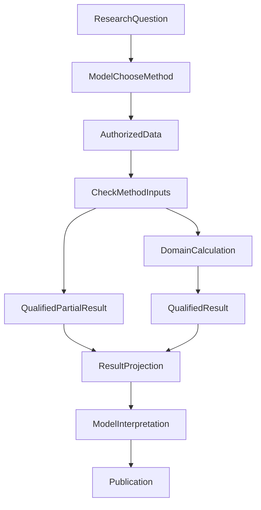

# The Agent Ran Python. Why Was the Investment Research Report Still Wrong?

> **Series:** Fintech and Compliance, with cross-links to architecture and module mechanics.
>
> The engineering source window ends on October 21, 2026. Numerical counterexamples are explicitly safe test or teaching inputs. Bounded regression success is not evidence that a natural model consistently completes autonomous investment research.

**Delegating arithmetic to Python does not delegate financial judgment along with it.** A defensible investment conclusion still requires an applicable method, eligible inputs, and an interpretation that preserves the result's original meaning. A successful script solves only one part of the problem.

We encountered research with market data and Python calls that nevertheless omitted portfolio-wide annualization, lacked covariance analysis, or reversed the meaning of an obtained number. More script calls or a universal Reviewer do not identify the right repair.

Instead, trace one pivotal conclusion: Was the method applicable? Were inputs sufficient? Did the model actually receive the result and its limitations? Did the final explanation preserve them?

## 1. A Script Running Is Not the Same as Answering the Question

Consider “What are the overall return and risk of a portfolio containing these funds?”

The system can fetch NAV series, prices, weights and date ranges. It may run several Python methods, each successfully. Yet the final requested comparison can still be absent.

One real autonomous research path invoked scripts multiple times without completing covariance analysis. Other reports omitted whole-portfolio annualization or misinterpreted quantitative results. Those are **observable gaps in the final artifact**. They do not prove the Planner intentionally skipped a method, nor do script counts identify the first defective handoff.

Some original tool parameters and model-visible request details were not fully retained. We therefore recorded the historical output defects separately from hypotheses about their causes, and used reproducible safe inputs to test current production seams. Newly constructed tests must not be misrepresented as the original incident trace.

A result travels through six stages:

| Stage | Fact to establish | Typical failure |
| --- | --- | --- |
| Research method selection | Did the model identify required return, covariance or risk-contribution methods? | It summarizes price quotes without requesting the needed calculation |
| Data preparation | Are instruments, shared sample period, currency, window and return basis eligible? | A price index is mistaken for a dividend-inclusive total-return series |
| Domain calculation | Did Python apply the method to suitable inputs? | A required field is missing, yielding only a partial metric |
| Result handoff | Did values, units, revision, denominator and limitations reach the next model request? | Tool success, but decisive fields are absent from projection |
| Model interpretation | Does prose preserve the sign, qualification and meaning of computed results? | The correct number is reported with the opposite implication |
| Final delivery | Do text, charts, files and history preserve one calculation basis? | Display recomputes numbers or promotes proxies into final metrics |

Bounded engineering tests can verify much of the first four stages. Natural-language interpretation in stage five requires its own review. File storage and download in stage six have independent delivery evidence and do not certify the investment conclusion.

## 2. Select the Method Before Using Python

Our fund-research methods already cover portfolio returns, tracking, covariance, risk contributions and attribution. The gap is not a missing formula catalog. It is turning **available methods** into **applicable results actually consumed for the current question**.



The two output branches carry different qualifications. When input contracts hold, calculation may produce a bounded formal metric. When critical data is absent, only an explicitly labeled proxy, an insufficient status or a reason is valid for the affected metric, while independently useful analysis remains possible.

The chart does **not** claim every research question must invoke Python or that every method is consistently selected in live natural-model runs.

A common architectural mistake is a Runtime keyword rule: “Every question containing return must call script X.” A conceptual question about all-weather investing might be answered directly. A numerical comparison of the user's specific portfolio needs appropriate method selection, input validation and computation.

We preserved the split: **the model dynamically chooses research methods; domain modules own formulas; Runtime owns objective execution facts**. The model cannot invent input eligibility, and Runtime should not design a financial research agenda from a few keywords.

## 3. A Python Number May Be Arithmetically Correct but Financially Ineligible

A number can be perfectly calculated while its reported interpretation is invalid.

**Price movement is not dividend-inclusive total return.** Fund NAV, a tracking price index, a total-return index and differently adjusted series support different claims. Without complete distribution events, we may describe observed price performance but must not promote it into a verified total-return ranking. We preserve the original Python method's proxy marker and reason rather than filling missing distributions with zeros or trusting a field name that happens to contain “total return.”

**Execution success is not proof that risk contribution can be computed precisely.** Covariance and contribution calculations need appropriate shared samples and assumptions. Missing eligible synchronized observations or correlation inputs may still allow discussion of weights and known exposures; it does not authorize exact risk-contribution percentages.

At least three facts cannot be compressed into one Boolean:

- Did the tool actually execute, and is the result readable?
- Are method preconditions met, and is the result formal, proxy or insufficient?
- Are the underlying sources identified, accessible and adequate for the asserted claim?

A zero Python exit code directly supports, at most, an execution fact in the first category. It does not supply missing dividend records or certify the source. Archived result-consumption tests established that incomplete-dividend qualifications survive the script output and the next model request. **Handoff fidelity is not a guarantee of faithful natural-language interpretation.**

## 4. Sometimes the Most Dangerous Error Is a Sentence, Not a Formula

Two safe numerical counterexamples in our engineering regression show why **derived comparisons should remain with the domain calculation that understands their denominator**.

### Example One: Contribution to Net Portfolio Gain

Suppose the portfolio gains a net **10** during a period. One position contributes **+15**, another **−5**. Using each contribution divided by net gain yields **150%** and **−50%**, which still sum to 100%. With negative offsetting contributions, a contribution share over 100% is not inherently wrong; the denominator must be explicitly stated.

Similarly, when the domain method returns **0.602**, that means **60.2%** under this particular denominator. The narrative must not say it exceeds the entire net gain.

If net gain is zero or negative, a method defined specifically relative to **positive net gain** is undefined. Report insufficiency. Do not divide anyway or secretly switch the denominator to the sum of positive contributions—that would be a different financial method.

### Example Two: Percentage Points Are Not Relative Growth

For the same time window, **+7.43%** and **−5.88%** differ by **13.31 percentage points (pp)**. That is not a “13.31% relative improvement.” Signs, units and benchmark identity must accompany the original result rather than being improvised by the final writer.

We did not make Publication search sentences for “outperform,” “exceed” or “return rate.” We generated derived results with defined denominators and units in the original attribution/comparison methods, then carried those results through existing identity and model-input paths.

The model still interprets the financial meaning. It should not need to redo arithmetic detached from its method contract.

## 5. Delivering a Result to the Model Is More Than Copying Python stdout

A research result needs more than value. It needs instrument, window, currency, return basis, unit/scale, method version, input provenance and qualifications such as proxy or insufficient.

The production path is broadly:

1. The original Python research method produces structured results.
2. A packaged Skill delivers them within the Run's existing authorization.
3. Existing Result/reference handling stores identity and projects necessary fields.
4. The next Main model request consumes that projection.
5. Publication determines delivery of independently eligible answer text.

In controlled handoffs, domain methods can pass results with their denominators, qualification flags such as `proxy` or `insufficient`, and source identities through Skill and Result handling into the next Main request. One insufficient metric also need not erase unrelated valid text. This establishes the handoff for those result types, not that a real model will always select the right method, interpret each number faithfully, or finish the research task.

Adding one more universal reviewer might look safer, but it could turn a local metric's insufficiency into rejection of the entire report, while reinterpreting source ownership, formulas and Run status in a new place. We chose to repair the original methods and the actual consumption seam, leaving permission, arithmetic, method eligibility, result identity and publication with their respective owners.

### Observe one result handoff in the public code

The same handoff problem can be reduced to an example without Python. A [fixed public Open ETF Agent v0.10 snapshot](https://github.com/hpoenixf/open-etf-agent/tree/ff5b9273ef0d239e804f61792702cd2e94174be7) selects explicit rows from an immutable synthetic table, then uses the existing calculator to compare 100 with 250. Original row identities, the USD currency and the data cutoff travel with the calculation reference into the next request. The report and CSV read that same reference instead of computing again. After installing the selected snapshot as its README describes, run:

```sh
node src/cli.mjs --case result-consumption --output runs/result-consumption
```

The CLI prints the Run directory, where the report, CSV attachment and manifest can be compared. The [source-consumption counterexamples](https://github.com/hpoenixf/open-etf-agent/blob/ff5b9273ef0d239e804f61792702cd2e94174be7/test/result-consumption-delivery.test.mjs) also check a required tail row outside the selection, mismatched currencies or dates, and an unknown denominator: only the affected number or attachment becomes unavailable, without discarding independently valid prose. Actions are scripted synthetic fixtures; next-request checks use the production Gateway encoder with an injected offline transport, not a natural model conducting research. This extracts a result-handoff contract, not the Python workbench or A33, and does not turn these numbers into investment returns. The ongoing entry point remains the [current main README](https://github.com/hpoenixf/open-etf-agent/blob/main/README.md). This completed module is now v0.10, carrying the original roadmap 1.1 minimal result-consumption increment rather than scheduling it twice; the [compatibility note](https://github.com/hpoenixf/open-etf-agent/blob/ff5b9273ef0d239e804f61792702cd2e94174be7/openspec/changes/result-reference-consumption/design.md) describes its recovery-protocol upgrade boundary.

## 6. Where Does A33 Numeric Fit?

The newer architecture includes **A33 Numeric** for explicit decimal addition, subtraction and comparison, unit-bound multiplication, scaling, specified rounding and residuals. Its value is real, and its scope intentionally narrow.

It can solve arithmetic such as “When the exact value is **2.055**, does a declared rounding policy produce **2.06**?” It does **not** decide which broker-channel fee applies, whether enough common observations exist for covariance, or what denominator a portfolio contribution measure should use.

Those remain contracts of the fee, investment-research and attribution domains.

Likewise, isolated execution, result identity, research synthesis, and publication have different responsibilities. Calling all of them “Python correctness” and giving them to a new central manager would obscure the place that actually needs repair.

The companion article [Financial Data, Precision and Reproducibility](031-fintech-data-time-and-reproducible-numbers.md) focuses on **arithmetical correctness and domain metric semantics**. This article focuses on **why a correctly computed or explicitly qualified result can still be misconsumed**.

## 7. Acceptance Still Depends on the Financial Question

**The important capability is not using Python. It is connecting an applicable method, eligible inputs, checkable results, and faithful explanation.**

When reviewing a portfolio report, start with a claim that could change the decision. Trace its instrument, shared period, denominator, unit, and proxy qualifications to the original result. Without dividend data, retain the price-performance limitation. When contribution share exceeds 100%, check the net-gain denominator. When calculation is right but prose says the opposite, inspect interpretation and consumption instead of rewriting the calculator.

Divide engineering verification along the same chain: targeted checks for calculation and handoff, real tasks for method selection and interpretation quality. The earliest failure in the original historical autonomous task remains incompletely established. That does not establish a stable completion rate or improved investment returns.

**The next time you see “Python executed,” ask: Why does this particular result support that particular conclusion in the report?** That is how a tool capability becomes a research capability.

## Further Reading

- [Financial numbers, dates and reproducible calculations](031-fintech-data-time-and-reproducible-numbers.md)
- [A trustworthy evidence chain for financial agents (Chinese original)](/articles/financial-agent-trustworthy-evidence-chain)
- [Python as a computational research workbench](agent-python-compute-workbench-evolution.md)

Browse the [ETF Agent engineering library](https://hpoenixf.com/eff-agent-article/) and its [GitHub repository](https://github.com/hpoenixf/eff-agent-article). Counterexamples and stars are welcome.
