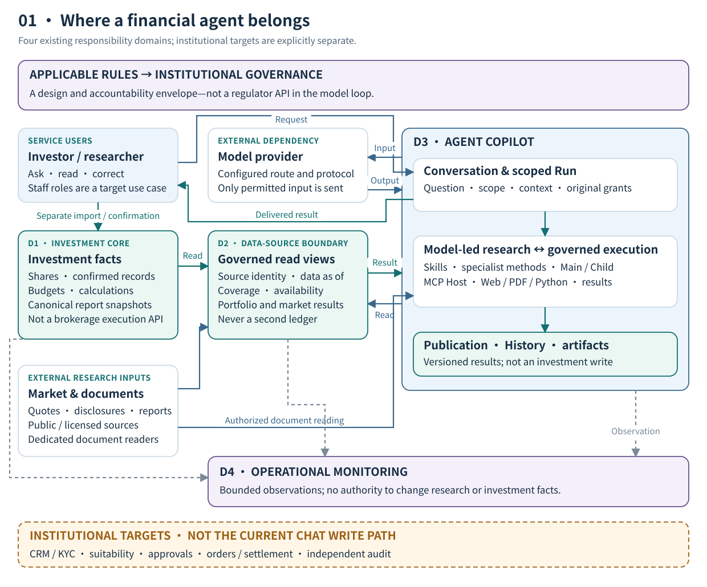
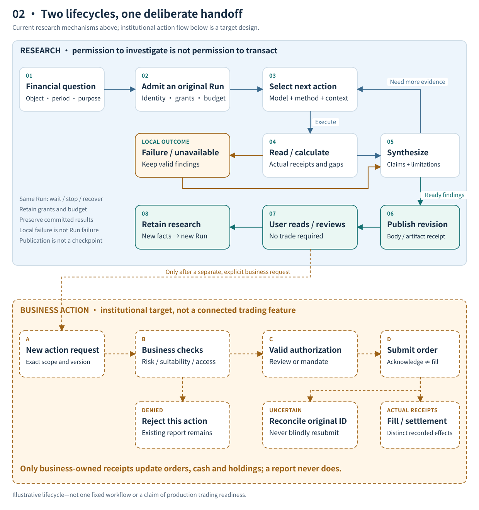
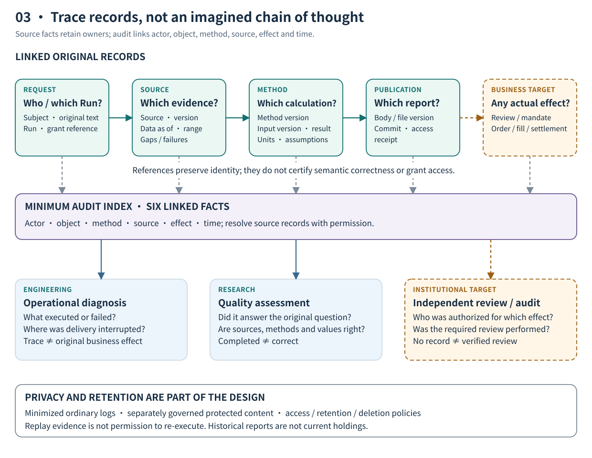

# Financial Agents in Context: Systems, Lifecycles, and Accountability

*From a user's question to reviewable research—and then, only when separately authorized, to a business effect.*

> Architecture observations as of October 27, 2026. ETF-Agent is an engineering project for personal fund research and investment tools. Solid domain boxes describe existing responsibilities; orange dashed boxes identify institutional targets, not already deployed advisory, trading, or compliance systems.

A user asks: “Do the two technology funds I hold own many of the same companies? Would investing more simply buy the same risk twice?”

A model can find information, read fund reports, perform calculations, and produce an illustrated analysis. A financial service must also answer different questions: whose portfolio and which disclosure period did it analyze? What definitions support the result? If the user then says “make that adjustment,” may the system execute it? Can someone recover the original basis three months later?

**The central architecture problem is not which layer should contain the model. It is how exploratory research can work alongside financial operations with explicit accountability.** Research may propose hypotheses; a ledger must not change with them. A model may propose an action; the proposal is not evidence of authorization, a fill, or settlement.

This article follows one portfolio review. We first define the service, map its systems, trace the separate research and business lifecycles, and then examine governance and institutional adoption. The three main diagrams answer three questions: **how systems connect, how work progresses, and how results can be traced.**

## 1. Define the service promise before choosing agent capabilities

For an investor, the product is a service, not a collection of tools. Product education, personal portfolio analysis, individualized advice, and investment operations may share a chat interface. They must not consequently share one vague authorization.

The following distinctions are product-design commitments, not a legal classification of activities. Whether a service constitutes regulated advice, distribution, or another activity depends on its provider, substance, delivery model, and applicable rules.

| User request | Appropriate deliverable | Authority it must not acquire by implication |
| --- | --- | --- |
| “How do these fund categories differ?” | A sourced explanation of public product information | Automatic access to a personal account |
| “Analyze overlap using my holdings” | Portfolio research within the permitted data scope | Treating historical disclosure as complete live holdings |
| “Compare holding, reducing, and continuing contributions” | Scenario analysis with assumptions, constraints, and limitations | Turning a research scenario into a confirmed operation |
| “Carry out this plan” | A separately defined business-admission and execution process | Replacing valid business authorization with conversational intent |

Our running example combines the first two services: **research duplicate exposure in specified funds, compare scenarios when appropriate, and do not operate the account.** It is a synthetic teaching example, not real customer data or a retelling of a fully qualified live run.

Once this scope is explicit, the user experience has a meaningful standard. Provide a readable conclusion, its basis, and its gaps. There is no need to invoke every tool to appear intelligent, and producing a report is no justification for expanding account access.

## 2. The system map: four responsibility domains, not four mandatory services

ETF-Agent began with deterministic investment tools for portfolio imports, contribution calculations, and confirmation records. Conversation, MCP, Skills, subagents, Python, knowledge retrieval, and report delivery came later. The important choice was not to let those new intelligent capabilities take over the original investment ledger.

The project separates four domains: the investment core, a governed data boundary, agent research and delivery, and operational observation. A domain assigns knowledge and decision authority; it does not specify a process, database, or microservice count.



[Open the full-size system map](../../visuals/en/financial-agent-system-panorama/system-map.svg)

**How to read the diagram:** blue and teal solid arrows represent principal request, data, or result handoffs. Gray dashed arrows represent bounded observations. Orange dashed boxes are institutional targets. The governance band shows how institutions implement applicable rules—not a “regulator API” called for each research request. External providers and research resources are not data or permissions the institution automatically owns.

| Responsibility domain | Core facts it holds | What it provides | What it must not take over |
| --- | --- | --- | --- |
| **Investment Core** | Accepted holdings, confirmation records, budgets, and deterministic investment rules | Inspectable investment outputs and report snapshots | Open-ended model research judgments |
| **Data-Source Boundary** | Bounded reads and projections, source identity, data time, coverage, and availability | Limited views of investment facts and external evidence | A second investment ledger |
| **Agent Copilot** | Conversations, Runs, tool receipts, research results, and publication versions | Explanations, research, scenarios, and readable reports | Root-ledger writes or actual trading authority |
| **Operational Monitoring** | Sanitized operational records, errors, and report-health observations | Diagnostic and operational-review material | Investment decisions, source-data repair, or statutory audit conclusions |

### Data can flow without transferring write authority

The investment core supplies the agent through read-only projections. The agent may explain holdings and deterministic outputs. Conversations, memory, research documents, and subagent conclusions do not automatically change actual shares, confirmed plans, or execution records.

The root tools' separate confirmation and execution-recording paths manage personal investment state. **They are not an already connected brokerage order-execution API.** This distinction prevents a diagram from making “record a confirmed operation” look like “complete an external trade.”

The data boundary is not a universal financial data platform either. Market feeds, websites, PDFs, and knowledge retrieval retain their respective readers. Grouping them as governed inputs explains access and factual handoffs; it does not claim that every resource uses one interface.

### In an institution, the agent is not a replacement core-business system

An institutional deployment also needs customer and account services, KYC and suitability, product master data, risk management, approvals, orders, and settlement. Names and organizational structures differ. The essential questions remain: who maintains customer state, admits business activity, submits orders, and updates cash and holdings from actual business reports?

These are the separately identified target capabilities, not features implied by the personal project's existence. The agent is better positioned as a governed research and collaboration interface than as a parallel authority for customers, risk, and trading.

Our existing [six-layer request overview](https://hpoenixf.com/eff-agent-article/en/articles/017-prompt-to-answer-six-layer-panorama-v3) explains how a request moves from input to a visible answer. The four domains answer another question: **however many technical stages a request crosses, who retains the original facts and decision rights?** The views complement one another; they need not become another hierarchy.

## 3. The research lifecycle: investigate a question, not fill in a fixed workflow

System boundaries explain who owns what. A lifecycle explains what happens. A financial agent first needs a research loop: admit the question, form a strategy, obtain evidence and calculations, synthesize, deliver, and review.

This is not a one-way pipeline. New evidence can change the model's decomposition and prompt another read. Independently useful findings may be delivered early. Outside that loop is a business-effect lifecycle that requires separate admission.



[Open the full-size lifecycle diagram](../../visuals/en/financial-agent-system-panorama/lifecycle.svg)

**The upper half is based on current research mechanisms; the lower half is an institutional target.** Reading the report may complete the service without any investment operation. Orange connections represent a separately requested business action, not automatic trading, and do not prescribe one approval sequence for every institution.

### 1. Admit a research task, not merely a message

A Conversation is a thread; a Run is a particular attempt to do research. A thread may contain several questions. A research attempt may span tool calls, subagent work, user input, disconnects, and recovery.

In the running example, the system needs to establish the target funds, the permitted account or portfolio source, the analysis period, and the restriction to analysis without execution. The system owns identity and source permissions. The model interprets what the user is trying to compare; a few keyword rules cannot replace that understanding.

The following is a **conceptual illustration, not an existing API contract**:

```json
{
  "question": "Compare duplicate exposure in funds A and B",
  "portfolio_snapshot": "P1",
  "permitted_service": "read_only_research",
  "comparison_basis": "Comparable portions of obtained disclosures",
  "requested_effect": "report_only"
}
```

Complete fields do not establish permission. Valid authorization must come from real admission, not a model-populated `permitted_service` value.

### 2. Put professional methods in Skills and research choices with the model

The model decides what to read, whether to compute, and when delegation is useful. A Skill describes how a class of research problem should be approached. Tools provide actual capabilities. The runtime manages execution identity, resources, receipts, and recovery.

Fund-overlap research must establish product and share-class identity, disclosure periods, weight denominators, and undisclosed holdings. Tracking-quality research must distinguish fund NAV returns, benchmark returns, and the corresponding calculation basis. Neither is adequately specified by “act as an experienced fund manager.”

ETF-Agent's fund method bundle, iARK deep research, and associated calculations provide a foundation for this method organization. Registration or successful script execution does not establish that the model selected the right method, or that reports consistently meet a financial quality standard.

The main agent need not assemble a full team of “experts” for every question. A subagent is useful when reading, computation, or an independent perspective adds value. It works within the original research authorization and resources and returns results and sources. A role name grants no new business authority.

### 3. Preserve financial meaning between data and conclusions

Suppose funds A and B represent 40% and 20% of total portfolio assets. In comparable disclosures, company X represents 8% and 12% of their respective fund assets. These are synthetic values.

The contribution to company X exposure from this observed portion is:

**0.40 × 0.08 + 0.20 × 0.12 = 0.056 = 5.6%**

The arithmetic is determinate, but its interpretation must preserve the inputs' scope. This is not “the entire portfolio's complete current exposure to X is 5.6%.” Other assets, undisclosed securities, and relevant look-through or derivative definitions may remain outside the analysis.

Likewise, download time is not the disclosure period. A share class's denomination is not automatically the currency of all underlying risk. A fresh quote cannot make an old holdings snapshot current.

A governed result therefore needs to retain the object, source identity, data time, unit, coverage, and method. The model then explains how that result relates to the user's objective. **Authentic sources, correct arithmetic, applicable methods, and faithful conclusions are four separate checks.** See [financial numbers and reproducibility](https://hpoenixf.com/eff-agent-article/en/articles/031-fintech-data-time-and-reproducible-numbers) and the [research evidence chain, in Chinese](https://hpoenixf.com/eff-agent-article/articles/financial-agent-trustworthy-evidence-chain) for the underlying mechanisms.

A corresponding output might be summarized as follows. It remains a teaching example, not proof of source qualification:

```json
{
  "observed_exposure_pct": 5.6,
  "basis": "Obtained disclosures for A and B on a comparable basis",
  "complete_portfolio_exposure": null,
  "limitation": "Other assets and undisclosed portions are not covered",
  "business_effect": "none"
}
```

### 4. Keep a local failure local to its conclusion or effect

If B's disclosure is temporarily unavailable, the system must not replace its weight with zero. A complete overlap estimate remains unavailable, but A's known product facts, an explanation of the method, and a list of required additional material can still be useful.

A formatting error in one public-source citation should not automatically remove an independently permitted answer. Conversely, deleting a private-source label cannot turn unauthorized content into public information.

This distinction preserves research value without sacrificing real permissions. The runtime enforces observable execution conditions and protected effects; it does not become a financial judge certifying that the research is “good enough.”

### 5. Deliver a versioned result, not just a terminated Run

ETF-Agent handles answer publication, historical delivery, and file artifacts separately. Generated text is not necessarily durably committed. A file in a workspace is not necessarily a saved, downloadable artifact. An emitted server event does not prove client rendering.

For the user, the report should present conclusions, evidence, calculation definitions, and material gaps. For the system, the published revision, file identity, and delivery receipts should be recoverable separately. Useful findings may be delivered while research continues; a later local failure should not erase independently valid earlier work.

“Complete” must therefore name its object. Execution ending, a result being saved, a user being able to see it, and research meeting a quality standard are not one state.

## 4. The business lifecycle: research may inform an action, but cannot impersonate one

After reading the report, suppose the user asks to reduce contributions to A and move part of the budget elsewhere. This is a new business request. It cannot simply reuse read-only research permission.

In the institutional target architecture, research may enter a business process as an input. Authorization and execution remain with the responsible business systems. Three distinctions matter particularly.

**First, intent is not valid authorization.** “Do it” must resolve to an exact account, product, amount, proposal version, and scope. Applicable checks, disclosures, and staff review follow actual business requirements and policy, not an unconstrained model judgment.

**Second, human interaction is not automatically financial approval.** Supplying an investment horizon adds research information. Approving report sharing permits a content-access effect. Authorizing an investment operation is a different business effect. These cannot all be collapsed into `approved=true`.

ETF-Agent's durable human-interaction mechanisms establish requests, responses, and handoff to original consumers. They are not institutional suitability, advisory approval, or trading-authorization systems. Agreement from a “risk officer agent” likewise does not discharge a real organizational role's responsibilities.

**Third, submission is not effect.** Order acknowledgment, partial fills, fills, settlement, cancellation, and rejection have different meanings. Cash and holdings must change according to the relevant rules and actual business reports, not through a generic “the model submitted successfully” update.

When an external outcome is unknown, inspect and reconcile using the original request or order identity before considering another action. A timeout does not establish non-execution. If the proposal changes, the applicability of an earlier approval must also be reconsidered; approval must not drift to a different amount or product.

These are requirements for a target institutional workflow, not trading capabilities claimed for ETF-Agent. Its research interface remains read-only, and the root tools' confirmation records are not equivalent to brokerage fill reports.

The cost of this separation is explicit business handoffs and state association. The benefit is that research can evolve rapidly without every model, Prompt, or Skill update implicitly changing the authority for moving money.

## 5. Continuity over time: old reports, original Runs, and new judgments are different

Financial research often remains useful after delivery. A month later, the user may ask: “Has overlapping exposure increased since the last review? Does the risk you identified still matter?”

Three distinct operations are possible.

| What the user wants | What the system should use | What it must not silently substitute |
| --- | --- | --- |
| Open an old report | The originally delivered revision and accessible content | Today's data silently rewriting the historical conclusion |
| Resume recoverable work | The original Run's grants, budget, checkpoint, and actual receipts | Reset allowances or replay uncertain external effects |
| Reassess using new facts | An independently admitted new Run, eligible history, and new evidence | Old holdings or source permissions automatically becoming current facts |

ETF-Agent's weekly reviews, research snapshots, and Investment Thesis work allow selected historical observations, original method outputs, hypotheses, and user corrections to be retained and read by identity. They support continued review; they are not yet a fully validated long-running autonomous research system.

The point is not to put more old prose into Memory. Memory can preserve preferences, and summaries can help thinking continue. Original holdings, calculations, user confirmations, and delivered reports still need to be interpreted through their original records.

Comparisons across time must also preserve financial definitions. If portfolio value rises from CNY 1 million to CNY 1.1 million while intervening cash flows are unknown, the system cannot simply report a 10% return. If fund disclosure periods differ, it cannot attribute every difference to actual portfolio trading.

The durable unit of research should therefore be **a judgment with its original premises and scope, capable of being tested against new evidence**, rather than a “latest summary” that continually overwrites the past. A model-inferred thesis and a user-confirmed investment objective also need different attribution.

## 6. Regulation and audit: governance spans the lifecycle; it is not a supreme model layer

A regulatory view starts with who provides which service to whom, which rules apply, and how accountability is implemented. Technical design then distributes those requirements across identity, data access, method management, business approval, execution, and retention.

The examples here concern mainland China's securities and fund-related context. No single rule is presented as a universal regime for all financial institutions or AI products.

Articles 43 and 44 of the CSRC's [Measures for the Administration of Information Technology of Securities and Fund Operating Institutions](https://www.csrc.gov.cn/csrc/c106256/c1653896/content.shtml) address outsourcing responsibility, knowledge and control of important systems, and arrangements for replacing providers. They support **retaining responsibility and substantive control despite procurement**, not a blanket requirement to write all software internally.

Articles 2 and 3 of the [Measures for the Administration of Securities and Futures Investor Suitability](https://www.csrc.gov.cn/csrc/c106256/c1653849/content.shtml) define the relevant product-sales and service scope and the associated matching obligations. Research explanations, service admission, and transactions must be assessed in their actual business context. A “financial education” label or disclaimer cannot by itself remove applicable responsibility.

Article 2 of the [Interim Measures for the Management of Generative Artificial Intelligence Services](https://www.cac.gov.cn/2023-07/13/c_1690898327029107.htm) distinguishes services offered to the public in China from development and use that do not provide such public services. Internal tools should not mechanically inherit every public-service requirement; other applicable sector, data, and personal-information obligations still require separate assessment.

These rules are not an exhaustive compliance checklist. The table below is this article's engineering interpretation, not a claim that legislation prescribes these module names.

| Governance question | Relevant fact or control | What to inspect instead of relying on appearances |
| --- | --- | --- |
| Who may use which customer information? | Identity, account ownership, source permission, and minimum disclosure | Actual admission and reads, not Prompt declarations |
| Who maintains a research method? | Method version, applicability, change control, and evaluation | Specific inputs and outputs, not a Skill name |
| Who authorizes a business action? | Original business checks, approval, or mandate | Exact object, version, and effect, not generic “user agreement” |
| What happens when an external service fails? | Replacement, exit, recovery, and reconciliation arrangements | Preservation of original facts, not provider count |
| How can the result be examined later? | Associations among source, execution, publication, and business receipts | Available original records, not a uniformly green Trace |

### Reviewability comes from factual handoffs, not a purported complete chain of thought



[Open the full-size evidence and accountability map](../../visuals/en/financial-agent-system-panorama/evidence-map.svg)

Horizontal connections denote identity-preserving relationships, not copying every record into an all-purpose log table. Downward connections denote authorized reads or projections, not one transaction that writes all records together. Orange elements remain institutional targets.

The initiating identity links to the original question and Run. Source records describe which material version was actually obtained. Calculations associate inputs, methods, and outputs. Publication records identify the committed text or file revision. If a business action follows, exact approvals and actual effects are linked separately.

These records can help locate the first distorted handoff. They do not reconstruct a model's unobservable internal reasoning or guarantee identical text when a probabilistic model is called again. If a source becomes unavailable, retained evidence must follow applicable retention arrangements and disclose gaps; a summary cannot manufacture an “original” document.

ETF-Agent uses Langfuse and durable invocation evidence for operational diagnosis. Publication and History retain delivery facts. Independent evaluation asks whether sources support conclusions, methods apply, and the task was actually addressed. **Record completeness, semantic correctness, and business compliance remain different judgments.**

Institutional audit additionally needs its own segregation of responsibilities, record-integrity controls, and retention regime. Ordinary logs should be minimized. Sensitive source content that genuinely needs retention requires separately governed access, retention, and deletion. Reviewability is neither indefinite collection of all customer material nor indiscriminate export of holdings and complete model inputs to external telemetry.

## 7. Three tradeoffs that determine whether the architecture can evolve

Finishing the system map is not a reason to implement every box in-house. It is a way to identify mechanisms that need stability and behaviors that should remain adaptable.

### Tradeoff one: autonomous research instead of an ever-growing fixed workflow

The model should adapt its route to the question and new evidence. The runtime owns real permissions, resources, execution identity, and durable effects. Encoding all judgments about evidence sufficiency or research completion as runtime gates can constrain exploration rather than improve research quality.

The cost is a variable research path that must be evaluated on real tasks. The benefit is avoiding a new fixed workflow for every financial question. High-impact business effects still have independent controls; research autonomy does not relax them.

### Tradeoff two: specialized financial ownership instead of a universal financial manager

Exact decimal arithmetic, portfolio scenarios, fund performance analysis, fee estimates, and contribution rules address different problems. Consistent input identity, units, and provenance are useful. Putting every metric and approval inside one Financial Manager can instead create another parallel authority.

The cost is clear contracts and maintainers across methods. The benefit is being able to return errors to the domain that actually owns them. Deterministic code can also contain algorithmic or definitional mistakes; “not calculated by an LLM” is not an exemption from recomputation and testing.

### Tradeoff three: transferable facts and responsibilities instead of owning every line of code

Model gateways, databases, workflow engines, parsers, and observability platforms may come from external products. Institutions should test whether they understand important system logic, enforce business permissions, use data lawfully, and can retain, export, and migrate historical results and execution records under the relevant arrangements.

Replaceability does not promise zero cost or identical prose after switching models. A meaningful exit exercise explains what an old report used, which operation version an approval covered, and how unresolved effects will be reconciled. Merely connecting another model API is not enough.

## 8. Adoption: prove research value before expanding business effects

ETF-Agent has engineering foundations across the four domains and numerous research-execution, result, and delivery mechanisms. Their integration does not collectively establish financial quality, long-term reliability, or institutional compliance.

For the move from a personal research tool to an institutional service, I prefer stages defined by **which business effects the system may produce**, not the number of connected models or named agent roles.

| Stage | First user value to deliver | Completion conditions to examine independently |
| --- | --- | --- |
| **Read-only research** | A readable analysis of specified funds or a portfolio question | Correct identity and sources, inspectable definitions and calculations, honest gaps, and results that can be read back |
| **Staff collaboration** | Review, correction, and historical comparison for researchers or advisers | Role permissions, version association, actual adoption of user responses, and a reasonable review burden |
| **Controlled business effects** | Admit and process operations within a defined business scope | Applicable admission, valid authorization, order and effect reconciliation, and handling of exceptions and unknowns |

The first two stages can create value without automatic trading. Conversely, generating a report or displaying a confirmation dialog is insufficient for the third. Each institution must set scope within its product and compliance boundaries.

Evaluation must also be separated. Engineering asks whether requests, data, and reports flow reliably. Research asks whether entities, dates, methods, numbers, and conclusions are correct. Business asks whether people actually use the results and whether review is affordable. Governance asks about unauthorized effects, traceability, and provider exit. A single `completed` state or aggregate success rate cannot substitute for these judgments.

Useful acceptance tasks should cover both normal work and consequential counterexamples. When holdings are missing, can personal conclusions be limited while public research remains available? When one disclosure fails, are valid findings retained? When a delivered report is followed by a rejected action, are both facts preserved? When an external effect is unknown, does the system avoid blind retries?

These are proposed acceptance criteria, not measured pass rates or investment returns reported by this article. The next worthwhile investment is making existing capabilities work together consistently on real financial problems, rather than continuing to expand the diagram.

## 9. Conclusion: research may be autonomous; business effects need explicit accountability

From the user view, a financial agent should deliver understandable, reviewable research with visible limitations. From the institution view, it should connect to—not replicate—the authority of customer, investment, risk, and trading systems. From the regulatory view, the institution must still implement its applicable responsibilities through actual permissions, effects, and records.

The three diagrams describe the same system. The system map assigns responsibility. The lifecycle map separates research from business effects. The evidence map makes handoffs traceable. They are not proposals to build three additional control platforms; they help test whether an existing design confuses different facts.

**Give research room to explore, give financial facts explicit ownership, and subject real business effects to independent authorization and verification.** That is a more durable architecture question than how many layers financial AI should have.

Models, protocols, and providers will change. The lasting assets are applicable financial methods, inspectable research, accurately recorded business effects, and the ability to remain accountable for them.

---

## Further reading and discussion

For the engineering foundations, continue with the [six-layer request overview](https://hpoenixf.com/eff-agent-article/en/articles/017-prompt-to-answer-six-layer-panorama-v3), [financial research evidence chain, in Chinese](https://hpoenixf.com/eff-agent-article/articles/financial-agent-trustworthy-evidence-chain), and [investment theses across research periods](https://hpoenixf.com/eff-agent-article/en/articles/agent-weekly-thesis-history-continuous-research). These develop request flow, evidence transfer, and continuity respectively; they do not expand the institutional capabilities claimed here.

The regulatory discussion links to original CSRC and CAC publications. The architecture mapping is an engineering interpretation, not legal advice or compliance certification. Diagrams and numeric examples are illustrative and are not investment advice.

[Explore financial technology topics](https://hpoenixf.com/eff-agent-article/en/fintech) · [Chinese edition](https://hpoenixf.com/eff-agent-article/articles/financial-agent-system-panorama) · [Star the article repository for future engineering notes](https://github.com/hpoenixf/eff-agent-article)
