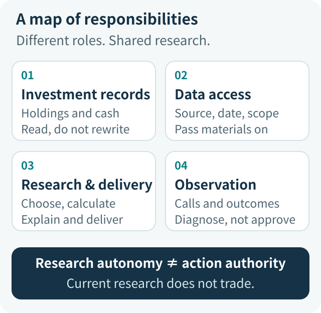
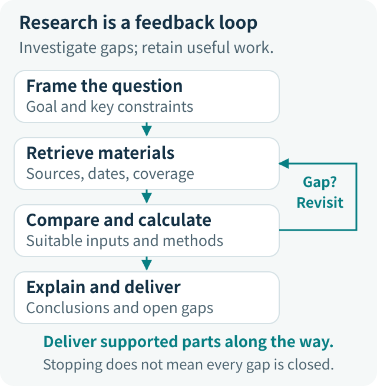
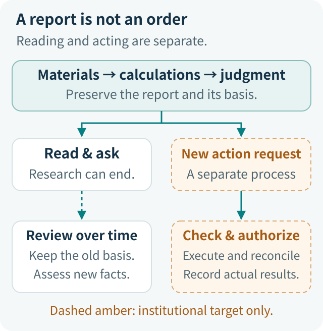

# Financial Agents in Context: Systems, Lifecycles, and Accountability

A user asks: “I already own two technology funds. Would adding another diversify my portfolio, or buy the same risk again?”

A conversational model can explain diversification. An Agent with tools can retrieve fund information, read holdings, and run calculations. But answering the actual question requires connecting several things: whose holdings these are, which disclosure period the documents cover, how overlap is calculated, what the results mean, what information remains missing, and which report the user receives.

If the user then says, “Make that adjustment,” a different set of questions appears. Is the research conclusion a sufficiently specific instruction? Who checks the account, product, and amount? If no transaction result arrives, should the system query the original request or submit another?

**The financial Agent panorama lies between research and business operations: let the model investigate flexibly, while giving data, calculations, permissions, and real actions clear owners.** Autonomy alone overlooks consequences. Restrictions alone can leave users with no useful result.

This article follows a synthetic fund-portfolio example through the system. ETF Agent's current conversational research layer does not trade directly. Orders, settlement, and institutional approvals in the text and diagrams describe responsibilities for a future business integration, not deployed trading capabilities.

## 1. Why financial applications need more than a different knowledge base

Agents in every domain need reliability. The distinction is not that other industries can tolerate arbitrary mistakes. Financial research frequently combines **precise facts, open-ended judgments, and actions that may affect real money** in the same question.

Start with facts. Similar fund names do not establish the same share class. A report downloaded today may still describe last quarter's holdings. A change in fund NAV does not necessarily equal an investor's realized return. A number can be authentic and still mislead when used in the wrong comparison.

Then consider judgment. “Both funds own company X” is a factual statement. “This portfolio is too concentrated” also depends on weights, other assets, and the investor's objectives. Software can calculate concentration without deciding an appropriate allocation for every user.

Finally, consider consequences. Explaining fees, reading private holdings, comparing scenarios, and submitting a real order may all begin in one chat window, but they require different permissions and responsibilities.

| User request | How far research should proceed | What must not happen implicitly |
| --- | --- | --- |
| “How do these funds differ?” | Compare public or otherwise authorized product information | Treat different dates, share classes, or measurement bases as the same fact |
| “Use my holdings to check for duplication.” | Analyze authorized holdings, known exposures, and gaps | Substitute conversational memory for current account data |
| “Compare keeping, reducing, and adding.” | Provide conditional analysis within the product's permitted service scope | Present a simulation as an executed allocation |
| “Implement this plan.” | Enter a separate business confirmation, authorization, and execution process | Grant action authority merely because the model researched the question |

The first design decision is therefore the service the product provides, not the model it uses. Whether personalized advice is within that scope cannot be decided merely by the presence or absence of a trading button. This article concerns technical responsibilities; relevant institutions must determine applicable business qualifications and review requirements.

For the distinction between research, advice, and trading, see [When AI Starts Discussing What to Buy](030-fintech-from-research-to-investment-advice.md).

## 2. The system map: who keeps the facts, and who does the research?

Think of a research team, but do not assume every responsibility requires another Agent. An account system maintains holdings, data tools retrieve materials, the model organizes analysis, calculation programs implement defined methods, and delivery infrastructure preserves reports. These roles cooperate without replacing one another.

[Open the system responsibility map](../../visuals/en/financial-agent-system-panorama/reader-system.svg)

**Investment records answer, “What does the user actually hold?”** Units, cash, and confirmed records come from the systems responsible for those facts. An Agent can explain them, but generating a new summary does not update the account. Personal investment records must not be presented as broker execution confirmations.

**Data access answers, “What did this research actually retrieve?”** Websites, PDFs, market interfaces, and internal knowledge stores serve different purposes. Their access layer should preserve the source, data date, retrieved scope, and failure details. Normalizing formats must not become an excuse for silently deciding that some material is insufficiently professional and the entire question must therefore go unanswered.

**Research and delivery answer, “How do materials become a useful result?”** The main Agent interprets the question, selects methods, invokes tools, and delegates when useful. Calculations, explanations, and delivered reports must connect; completing each in isolation is not enough.

**Operational observation answers, “What happened, and where?”** Why did a tool fail? Did the model receive its output? Was the answer saved? Could the user obtain the file? These questions need inspectable records. Observation supports diagnosis; it does not select investments or obtain unrestricted access to private material merely because it collects logs.

These are responsibilities, not a requirement to deploy four microservices. A small application may host them together. The important separation is that the model should not simultaneously act as researcher, account-record maintainer, and trading approver. A data adapter should not become a hidden judge of research quality either.

An Agent framework can handle model calls, tool orchestration, and state management. Existing financial systems retain their accounts, rules, and operations. They cooperate through interfaces; adopting an Agent does not require rebuilding a ledger.

For authorization design, see [The Model Understands; Code Authorizes](011-model-understands-code-authorizes.md). For data-access trade-offs, see [How a Financial Data MCP Grew into a Research Decision System](https://hpoenixf.com/eff-agent-article/articles/mcp-market-responsibility-retrospective) (Chinese).

## 3. How research progresses: a feedback loop, not a fixed assembly line

Return to the question of whether another technology fund improves diversification. The user supplies one sentence, but the work contains several connected judgments: what the existing assets are, what the new fund adds, which risks remain unchanged, and which conditions could alter the conclusion.

[Open the research loop](../../visuals/en/financial-agent-system-panorama/reader-loop.svg)

### Form a question that can move forward, rather than completing a form first

If the user only wants to compare investment mandates, public documents may be enough to begin. Authorized holdings become necessary when the question turns to the effect on their portfolio. If the proposed investment amount is missing, the Agent can still describe qualitative differences rather than stop all work at a clarification screen.

Distinguish **conditions whose absence changes the current judgment from details that can be filled in during research**. A near-term cash withdrawal directly affects scenario comparisons. An auxiliary metric that does not yet affect the main conclusion should not become a prerequisite for starting.

### After retrieving material, decide what it can answer

A result may contain a full holdings list or only the top ten. It may describe NAV or market price. The researcher should adapt the question to the material, not force every source into a predetermined template.

If disclosures cover different periods, search for comparable periods. If only partial holdings are available, analyze the disclosed portion and retain the uncovered scope. Follow-up retrieval should close a specific gap, not exercise every tool in the catalog.

### A completed calculation is not completed research

Tools can return common holdings, sector allocations, fees, or risk scenarios. The user, however, asked whether the portfolio becomes more diversified. The main Agent still needs to relate these outputs to that question: does the added product bring a different name, different companies, or different sources of risk? How far does the current evidence support that distinction?

New results may justify another retrieval. If further searching has little expected value, or resources are running short, deliver the existing work and identify unresolved items. Do not loop indefinitely, and do not turn “we stopped investigating” into “there are no remaining issues.”

Within this loop, the model chooses the research route. Software manages authorized tools, execution resources, and records of what actually occurred. **Flexibility belongs in deciding what to investigate next; determinism belongs in what is permitted and what actually happened.**

For a deeper explanation, see [How the Model, Harness, and Research Loop Work Together](https://hpoenixf.com/eff-agent-article/articles/etf-agent-model-harness-research-loop) (Chinese).

## 4. Data, calculations, and judgment must stay connected

Giving arithmetic to Python is useful, but “a calculation tool was called” is not a research-quality criterion. Ask instead what the inputs describe, whether the method applies, and how the output is interpreted.

### Data needs an object, a date, and a measurement basis

Suppose fund A represents 40% of a portfolio and fund B represents 20%. Company X represents 8% and 12% of the respective funds. Under the teaching assumption that disclosure periods, denominators, and coverage are comparable:

**40% × 8% + 20% × 12% = 5.6%**

Given these inputs, the observed holdings of company X within A and B contribute a combined 5.6% exposure to the portfolio. This is not the funds' overall overlap ratio, nor necessarily the portfolio's final total exposure to X: other assets or undisclosed holdings may contribute additional exposure.

If one holding weight uses fund net assets and the other uses equity assets, the values cannot simply be added. Different disclosure periods also require retaining the dates and either finding comparable material or explaining the comparison's limits. Reading a document today does not make it a statement of today's holdings.

### Define the method and preserve the meaning of its output

Fee estimates, historical returns, look-through exposure, and risk scenarios answer different questions. Fees may depend on terms and rounding. Returns need a stated treatment of distributions. Scenarios need explicit assumptions. Programs implement defined methods; researchers choose those methods and interpret their applicability.

Our calculation practice carries units, methods, inputs, and local limitations with results so that a correct number does not acquire a different meaning during explanation. One uncomputable metric should not erase other valid results. An approximation may be useful, but its assumptions must survive into the report.

### Use multiple sources to investigate differences, not to increase a count

When two providers disagree on a return, first check share class, dates, currency, and return basis. After establishing that they answer the same question, investigate errors or revisions. Conversely, identical values may come from the same republished source; twice as many links do not automatically provide independent confirmation.

There is no need to require two sources for every fact. Important data should be inspectable. Material conflicts and their effects on the conclusion should be explained. Spend research effort where it can change the judgment.

See [Financial AI's Most Dangerous Appearance of Expertise](031-fintech-data-time-and-reproducible-numbers.md) and [Why Investment Reports Can Still Be Wrong After Calling Python](financial-agent-python-result-consumption.md) for the calculation mechanisms.

## 5. Multiple Agents and human review: add different questions, not identical voices

One Agent can handle simple research. As tasks become more complex, collaboration has two main uses. One is material processing, such as reading two long reports separately. The other is hypothesis testing, such as examining both “this product adds diversification” and “this product repeats existing exposure.”

The first helps organize work; the second helps uncover omissions. Both require returning materials, methods, and unresolved issues to the main Agent—not merely a recommendation to buy. Otherwise, the main Agent receives a more confident conclusion rather than a stronger basis.

In our example, the supporting perspective can look for distinct sector or company exposure. The challenging perspective can examine overlapping holdings, funding constraints, and stress scenarios. The useful discussion concerns **which evidence holds up and which changed conditions would require revising the judgment**, not how many experts vote in favor.

Several roles using the same incomplete material cannot fill in the missing facts. Looking up a management fee or explaining a definition rarely needs a multi-party debate. Collaboration costs time and money; its justification is an additional, useful angle of inspection.

Human involvement also has different purposes. A user saying, “I need this money in six months,” changes the research assumptions. A professional checking a method or recommendation reviews the research. A business approver authorizing a specific operation grants permission for a controlled action. A single confirmation button should not collapse these into one event.

Real business actions that require approval must follow the relevant rules, regardless of model confidence. Ordinary research should not become unavailable merely because an optional Reviewer did not run.

For investment perspectives, see [How Multiple Agents Test an Investment Thesis](https://hpoenixf.com/eff-agent-article/articles/investment-perspectives-and-thesis-falsification) (Chinese).

## 6. Safety and usefulness: contain the affected risk, not the whole answer

Suppose the Agent retrieves fund A's documents but cannot obtain fund B's full holdings. Two responses are poor: inventing a complete overlap ratio, or returning nothing but “insufficient information.”

A better response explains A's concentration, compares the available investment mandates and fees, and states that full overlap remains uncomputed. This does not lower the standard. It matches the conclusion's scope to the material actually available.

We changed publication governance in this direction: handle a defective citation attachment locally, mark the affected metric when inputs are missing, and retain independently supported content if a later tool fails. **An error should affect what depends on it, rather than automatically spreading to the whole task.**

| Problem | What should be limited | What can continue |
| --- | --- | --- |
| Full holdings are missing | Full overlap and related definitive conclusions | Disclosed holdings, product differences, and the explanation of gaps |
| Citation details cannot currently be read | Disclose the missing inspection path; do not reconstruct fake original text | Independent body content whose permissions and identity remain established |
| Private material is not authorized | The corresponding access, use, and dependent disclosure | Public research that does not depend on the private material |
| A tool call fails | Record that failure rather than claim success | Other authorized routes or delivery of existing results |
| A real operation's result is unknown | Do not blindly repeat a potentially financial operation | Query and reconcile the original request, and report uncertainty |

Local handling does not weaken data security. Webpages and research reports are materials, not instructions. Text telling an Agent to ignore rules or send client information elsewhere must not acquire system authority. What the model reads, where material is sent, and which operations it invokes still need programmatic control.

Private holdings should not be copied indiscriminately into logs, external models, or every child Agent in the name of complete observability. Each recipient should receive only what the current task is authorized to disclose. Operational records retain what diagnosis needs; sensitive source material follows appropriate access and retention arrangements.

Safety and quality therefore call for different responses: deny unauthorized access, review disputed judgments, disclose incomplete coverage, and report tool failures accurately. Turning all four into “publication forbidden” solves none of them precisely and harms research usefulness.

**A real trade-off, not just a slogan.** An earlier financial-data MCP included some schema mismatches in a failure-avoidance key scoped to “provider + operation.” A failed lookup for one product could therefore cause the same operation on another product to be skipped. The code supports that possible propagation, but does not explain every historical failure. We narrowed failure tracking to the concrete request and kept a native-material research path, rather than letting the unified entry point judge whether the material deserves further research. This requires separate verification of native reading and structured consumption, but prevents local failures from spreading as readily. See [the financial-data MCP retrospective](https://hpoenixf.com/eff-agent-article/articles/mcp-market-responsibility-retrospective) (Chinese).

For local delivery, see [Why Generated Answers Need a Publication System](019-agent-answer-publication.md). For material versus instructions, see [Prompt Injection and Content Trust Boundaries](https://hpoenixf.com/eff-agent-article/articles/agent-content-trust-prompt-injection) (Chinese).

## 7. Beyond the report: evidence, history, and business operations

A report contains at least three kinds of content: cited facts, calculations based on those facts, and judgments formed from them. Inspection should lead users to the basis of the relevant statement, not require them to read an entire execution log.

[Open the research-to-business handoff](../../visuals/en/financial-agent-system-panorama/reader-handoff.svg)

### Evidence must support the conclusion; delivery must follow generation

For the 5.6% number, an inspection path should identify the two holdings disclosures, the user's portfolio weights, the formula, and the coverage limitations. For “adding more may not improve diversification,” it should also identify the supporting facts and added assumptions.

Preserving these relationships helps reconstruct the basis and actual behavior of the research. It does not claim to record every internal model thought, nor guarantee that rerunning the model produces an identical report. Citations provide an inspection path; whether a conclusion follows still requires judgment.

Generation, persistence, and receipt by the user are also distinct. The page may show an answer before saving fails. A file may exist on the server while remaining inaccessible to the user. Keep visible material where permitted and report storage or download failures honestly; do not equate “generated” with “received.”

### History supports comparison; it does not quietly become a current fact

When the user asks, “What about now?” a month later, the old report preserves the earlier reasoning basis and helps identify changed conditions. It cannot replace current holdings, new disclosures, or updated user constraints.

Continuing research should compare the original basis with subsequent changes. Overwriting the old report with new facts creates the false impression that later information was known earlier. Memory can help interpret user preferences, while current account facts still come from the original responsible system.

### Business operations follow a separate confirmation path

Read-only research can end when the report is delivered. A specific new user action request starts a separately defined business process: identify the exact plan and account, apply the relevant permission, risk, and approval checks, then let the business system execute and update records from actual results.

“I agree with the analysis,” “the order was submitted,” and “the order filled” are different states. When the result is unclear, querying and reconciling matter more than blind retries. Research software can explain progress; natural-language claims cannot create transaction facts.

### How a regulatory requirement becomes an inspectable engineering control

For institutions within the applicable mainland China securities and fund scope, Articles 43–44 of the [Measures for Information Technology Management of Securities and Fund Operators](https://www.csrc.gov.cn/csrc/c106256/c1653896/content.shtml) state that outsourcing technology services does not remove the institution's responsibility, and address control of important systems and arrangements for changing service providers. Articles 2–3 of the [Measures for Suitability Management of Securities and Futures Investors](https://www.shfe.cn/regulation/futureslaw/202501/t20250114_824326.html) define the scope of relevant sales or services and the suitability obligations of operators. Applicability depends on the provider, the actual activity, and jurisdiction.

This informs a specific architecture decision: a research Agent may produce an analysis saying “adjust fund B,” but **neither its conclusion nor a chat confirmation constitutes business approval**. If an institution offers an authorized subscription or adjustment service, its business systems should independently verify the exact account, product, proposal version, suitability, permissions, and required approvals, and update records from actual execution receipts. Replacing an external model or tool provider should not sever those facts or their traceable links.

**This is an engineering mapping of the cited rules, not a claim that the rules prescribe Agent, approval-module, or API names**, nor a claim that ETF Agent currently implements institutional trading flows.

For evidence transfer, see [The Trustworthy Evidence Chain of a Financial Agent](https://hpoenixf.com/eff-agent-article/articles/financial-agent-trustworthy-evidence-chain) (Chinese). For continued research, see [Investment Thesis and Research Across Time](https://hpoenixf.com/eff-agent-article/articles/agent-weekly-thesis-history-continuous-research) (Chinese).

## 8. How to tell whether the system improved

Once components work individually, an easy mistake is to conclude that research is complete because sources are inspectable, Python ran, and a report was saved. Acceptance still has to return to the user's question.

For “does the new fund improve diversification?”, listing three product descriptions is insufficient. The report must explain what was compared, which exposures changed, which risks remain unresolved, and what could change the judgment. Length and citation density cannot substitute for that answer.

I would evaluate four perspectives separately, rather than produce one aggregate score that decides whether the whole answer may appear.

| Perspective | What to inspect | What cannot substitute for it |
| --- | --- | --- |
| Execution and delivery | Connected tools, results, saving, downloading, and historical readback | A successful model API response |
| Financial research | Applicable objects, dates, methods, numbers, and explanations | Calling Python or adding citations |
| User value | Answering the original question and reducing work the user must complete | More text or more Agents |
| Safety and cost | Permission compliance and the value of extra retrieval or review | More refusals as proof of safety, or longer runs as proof of depth |

Tests need complete-data cases and important counterexamples: different disclosure periods, partial holdings, a failed calculation, or interrupted saving. The desired result is not universal refusal. It is useful work retained without invented missing facts.

When an error appears, trace its location: was the data unavailable, was the formula wrong, did the model fail to use the result, or was the final explanation incorrect? Repairing retrieval, an algorithm, and model guidance solves different problems. Another Reviewer is not always the answer, and an incorrect report does not automatically establish a broken tool.

Before changing a model, prompt, or method, compare results on these retained problems. Preserve unsuccessful and undelivered attempts too. This builds cases that guide the next improvement rather than a collection of successful demonstrations.

For the distinction between citations and research quality, see [Why Answers Can Still Be Unreliable Despite Many Citations](ai-citations-do-not-prove-reliability.md).

## 9. Roll out useful research before expanding business effects

A system panorama is not a procurement checklist. A team does not need memory, multiple Agents, an audit platform, and a trading system before testing product value. Begin with a research task whose materials are obtainable, methods explainable, and results inspectable.

A first stage can focus on read-only research: connect the required sources and calculations, deliver a report, and let users ask follow-up questions, inspect it, and reopen it. Employee collaboration can then address role permissions, review comments, revisions, and handoffs. When actual business execution is needed, add the relevant account, product, risk, approval, order, and response integrations.

This expands capability according to consequences, not model count. The first two stages can provide value independently. Connecting a trading interface does not establish the complete conditions for the third.

For ETF Agent, the more valuable next investment is making existing citations, calculations, collaboration, and delivery cooperate reliably on real research questions. Engineering mechanisms do not make every financial report correct. That gap needs real tasks, reproducible calculations, and user experience—not mandatory gates at every step.

Return to the opening question: the user did not come to inspect our components. They want to know whether they are duplicating exposure. The system should do as much of that research as possible, explain what is known and unknown, and respect the limits on data use and real operations.

**A panoramic architecture connects data to research, calculations to judgment, and judgment to useful results—without turning those results into business actions without authorization.** Clear handoffs preserve the Agent's ability to explore while giving the business an understandable allocation of responsibility.

## Further reading

The relevant specialist articles are linked alongside each discussion. For implementation-level relationships, retain the original [full system map](../../visuals/en/financial-agent-system-panorama/system-map.svg), [dual-lifecycle diagram](../../visuals/en/financial-agent-system-panorama/lifecycle.svg), and [evidence relationship diagram](../../visuals/en/financial-agent-system-panorama/evidence-map.svg). Institutional targets in those diagrams are not implemented capabilities. Interface and state details remain in the [original technical edition](https://github.com/hpoenixf/eff-agent-article/blob/9d46273da85bddaa6c5c432581c916496edd9cc1/en/articles/financial-agent-system-panorama.md).

[Financial technology topic](https://hpoenixf.com/eff-agent-article/en/fintech) · [中文原文](https://hpoenixf.com/eff-agent-article/articles/financial-agent-system-panorama) · [GitHub](https://github.com/hpoenixf/eff-agent-article)
